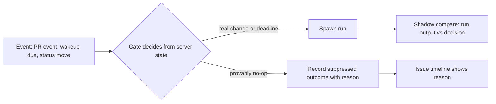

# CHE-2568: server-side gate for runs that need no LLM

Plan only. No code. Parent: CHE-2566 (stage 3, option C). Stage 1 (B, CHE-2567) is live and measured (CHE-2581).

## Problem

The parent premise says about 80% of x99-claude-sonnet and Tofu runs post no comment and no PR. Each run pays a boot write plus 0.2–1.3M cache-read tokens. One week of run history shows the premise holds for comments and PRs but the avoidable share is much smaller than 80%. The measured ceiling for deterministic server gates is about 3–5% of tokens. See "Finding" below.

## Measurement

Window: runs created 25 Oct 2026 to 1 Nov 2026 (ICT 07:00 start), x99-claude-sonnet and Tofu, status `completed` (7,807 runs, 7,981 Mtok, USD 3,832 at the CHE-2567 list-price model). Source: `multica agent tasks <id> --output json` (all pages) plus `multica issue timeline <id> --activity-only` for 908 issues. Scripts are in `.plans/CHE-2568-scripts/` (`fetch.py` rebuilds the 44 MB timeline cache and the run rows; `strict_ids.json` lists the strict no-op run ids).

Definitions, in widening order:

| Set | Rule | Runs | Share of runs | Mtok | USD |
| --- | --- | --- | --- | --- | --- |
| No output | no delivered comment and no `pr_url` | 5,714 | 73% | n/a | n/a |
| Inert | no output, and no status/assignee change by the run's agent during the run | 2,964 | 38% | n/a | 1,138 |
| Strict no-op | inert, and the final message states nothing was done (regex on the first 300 chars, no action verb) | 688 | 8.8% | 250.6 | 170 |

Caveats:

- "Inert" over-counts waste. Hand sampling shows many inert runs did real work with no comment: reran CI, merged `main` into a branch, fixed a PR title, set a wakeup, opened a decision request.
- "Strict no-op" is a text heuristic. A hand read of 18 random hits found about 15 true no-ops. Three also set a wakeup or posted a status comment. Treat USD figures as +/-20%.
- Chat (58) and autopilot (89) runs never show state change here. They are not gate targets.
- Cost uses list prices from `analyze.py` in CHE-2566; it ignores the 1 h cache-write premium already measured there.

### By trigger class

| Class | Runs | No output | Inert | Strict no-op | Strict USD |
| --- | --- | --- | --- | --- | --- |
| Workflow step / assignment hand-off | 3,052 | 3,050 | 979 | 206 | 44 |
| Time wakeup (`time.due`) | 734 | 578 | 442 | 38 | 13 |
| `pr.event` (needs-attention) | 480 | 480 | 455 | 194 | 35 |
| `pr.checks_failed` | 347 | 347 | 320 | 77 | 25 |
| `pr.merged` | 273 | 273 | 226 | 123 | 46 |
| Condition wakeup (`condition.met`) | 567 | 493 | 297 | 37 | 5 |
| Wakeup timeout | 133 | 118 | 79 | 4 | 1 |
| `pr.mergeability` | 96 | 96 | 85 | 2 | 1 |
| Comment mention | 1,810 | 0 | 0 | 0 | 0 |
| Autopilot, chat | 147 | 147 | 0 | 0 | 0 |

Comment-triggered runs always produce output. The waste sits in PR-event wakeups, polling wakeups and hand-off steps.

## Finding

1. Strict no-op runs are 8.8% of runs and 3.1% of tokens. They are cheaper than average (0.36 Mtok against 1.02 Mtok for all runs).
2. The largest cost is not wasted runs. It is run size: the average run reads about 1 Mtok of cache. That is a separate lever (resume size, boot prefix) and is out of scope here. Raise it as a follow-up.
3. Deterministic gates can remove about USD 100–180 of USD 3,832 (2.6–4.7%) and about 8% of runs (660 gated runs at the high end). The parent success criterion "share of no-output runs falls from ~80%" is not reachable with gates alone. Restate it as "strict no-op runs fall by at least half, no missed hand-off".

## Approach

Decide before spawning, in the existing dispatch paths. Every suppression writes a wakeup activity or receipt outcome (reusing `wakeupOutcomeFiltered` style records), so it is visible on the issue timeline. Nothing is silently dropped.

Rollout per gate, one at a time:

1. Shadow: compute the decision, log `would_suppress` with reason, still run the agent.
2. Compare 48 h: every `would_suppress` run that delivered a comment, PR or state change is a false positive. Required: zero.
3. Enforce, then 48 h before/after on the same agents (Cheese premise 3).

## Gates, ranked by estimated saving

Estimates are per week. Low = strict no-op subset of the gated runs. High = all gated runs that the gate rule would catch, measured from the same data. Mtok is cache read + write + input + output.

| Rank | Gate | Class | Gated runs | Mtok (low–high) | USD (low–high) |
| --- | --- | --- | --- | --- | --- |
| 1 | G1: `pr_merged` when issue is already Done | `pr.merged` | 155 | 33–61 | 36–60 |
| 2 | G4: `pr_checks_failed` for a head that is stale or no longer failing | `pr.checks_failed` | 77 | 49–66 | 25–29 |
| 3 | G6: no handler run when the mover is the handler and a decision request is open | hand-off to `need_decision` | 116 | 23–61 | 11–31 |
| 4 | G5: skip a polling wakeup when watched state is unchanged | `time.due`, `condition.met`, timeout | 139 | 25–60 | 18–31 |
| 5 | G3: `head_changed` caused by the agent's own push | `pr.event` | 89 | 26–80 | 14–39 |
| 6 | G2: `merged`, `ready`, `draft` events as next-turn context | `pr.event` | 84 | 10–24 | 4–16 |

Total: about USD 108–206 (low end 2.8%, high end 5.4% of cost); the plan quotes USD 100–180 after removing overlap between G1 and G2 (26 `pr.event merged` runs fire within 30 min of a `pr_merged` run on the same issue).

### G1: `pr_merged` on an issue that is already Done

Evidence: 155 of 273 `pr_merged` runs started on an issue whose status was already `done`. `systemWakeupIssueActive` treats only the `closed` category as inactive for PR wakeups (`server/internal/service/issue_wakeup_system.go:957`), so Done issues still wake. 97 of the 155 say "no follow-up needed".

Change: in `dispatchSystem` (`issue_wakeup_system.go:971`), for rule `pr_merged`, record outcome `suppressed: issue_done` and spawn nothing when the issue status category is Done and the merge is not a stack layer (`layer_delivered` false in the receipt payload built at `:373`).

Negative controls (must still spawn):

- Issue Done, PR base is not the default branch (`layer_delivered` true): successor PR may need a new base.
- Issue Done and another linked PR is open: a later layer still needs the merge facts.
- Issue `merged` (Code Accepted): agent sets `done`; never suppress.
- Issue `in_review`, `blocked`, `in_progress`: never suppress.

### G4: `pr_checks_failed` for a stale head

Evidence: 65 of 347 runs say the failure was for an old head, already fixed, or a false alarm. Largest-token class (330 Mtok, 0.95 Mtok per run).

Change: at dispatch, read the PR snapshot (`github_snapshot.sql`, `GetGitHubPullRequestByID`). Suppress when the event `head_sha` differs from the snapshot head, or the check rollup on that head is no longer failing. Record the head and rollup in the outcome.

Negative controls:

- Failure on the current head with a failing rollup: must spawn.
- Snapshot older than the event, or missing: must spawn (fail open).
- Failure on a head, then a new head with a different failure: the second must spawn.
- Required check failed and an optional check passed: must spawn.

### G6: hand-off to `need_decision` when the mover is the handler

Evidence: 139 runs started on entry to `need_decision`; 116 were inert, 54 say "request still open, nothing to do". Workflow step 9 opens the decision request first, then moves the issue, so the entry run only restates it.

Change: in `IssueService.WillEnqueueRun` (`server/internal/service/issue_trigger.go:109`), when `EnteredHandoffStep` is set, the handler equals the acting agent, the target status is `need_decision`, and an open (unanswered) decision request exists on the issue, return no run and record `suppressed: own_decision_open`. The decision-answered event must wake the handler (verify it does; see open questions).

Negative controls:

- `need_decision` entered by a different agent: must spawn.
- Entered by the handler with no open decision request: must spawn (the run must open one).
- Entered by a human: must spawn.
- Decision answered: handler must wake.

### G5: polling wakeup with unchanged watched state

Evidence: 139 inert `time.due`, `condition.met` and timeout runs had no issue activity since the same agent's previous run on the issue. Upper bound if every inert poll were skippable is 818 runs and USD 326, not a credible target because external state (PR checks, deploys) is not in the timeline.

Change: opt-in field on the wakeup, `skip_if_unchanged`. Compute a fingerprint of issue revision, status, assignee, comment count, linked-PR head and check rollup, child statuses, and open decision state. At `dispatch` (`server/internal/service/issue_wakeup.go:1009`, before `CreateWakeupTask` at `:1561`), skip when the fingerprint equals the one stored at the previous fire. Never skip a wakeup with a deadline or an absolute `fire_at` instruction.

Negative controls:

- Deadline wakeup ("apply default at 20:35 ICT") with unchanged state: must spawn.
- PR checks turn green between fires, no issue activity: must spawn.
- New comment from anyone: must spawn.
- First fire of a wakeup: must spawn.
- Wakeup without `skip_if_unchanged`: unchanged behaviour.

### G3: `head_changed` caused by the agent's own push

Evidence: 188 runs; 33 say the wake was the agent's own push; 89 are strict no-ops.

Change: in `bridgePREvent` (`server/internal/service/wakeup_pr_event_queue.go:109`), queue the event as next-turn context instead of spawning when the new head SHA was pushed during an active or just-ended run of the target agent on this issue. Needs a record of pushed SHAs (see open questions).

Negative controls:

- Head changed by another actor (force-push, bot, another agent): must spawn.
- Head changed with no run of the target agent in the window: must spawn.
- Head changed and conflict or failing checks attached to the new head: must spawn.

### G2: `merged`, `ready` and `draft` events as next-turn context

Change: in `bridgePREvent`, kinds `merged` (covered by the `pr_merged` rule), `ready` and `draft` queue as next-turn context only. Keep `closed`, `conflict`, `checks_failed` and `head_changed` as wake triggers.

Negative controls:

- `merged` with no `pr_merged` rule enabled on the issue: must spawn.
- `ready` when the issue is waiting on that PR (a condition wakeup `--until-pr` is set): the condition wakeup, not this path, must still fire.
- `closed` without merge: must spawn.

## Not planned

| Item | Reason |
| --- | --- |
| Skip `blocked` entry runs (371 inert-ish, USD 124) | Most set a wakeup or open a request; all 6 sampled did real work. No safe deterministic rule. |
| Suppress leader runs on workflow-routed issues | 18 runs, USD 6 per week. Not worth a gate. |
| Server-native `pr_merged` completion for status `merged` | Deterministic, but 21 runs, USD 12. Revisit after G1. |
| Todo-pull meta-cap precheck (CHE-2816) | 133 runs, USD 40, rule ends 10 Nov 2026. Expires first. |
| Cut boot prefix, resume size | Separate lever (about 1 Mtok per run). Follow-up issue. |

## Steps

1. Review this plan cross-lab (agent_review). Done when a different-lab reviewer signs PASS on the exact head.
2. One implementation issue per gate, in rank order. Each starts with a failing test per control below, red then green recorded in its PR.
3. Each gate ships shadow first (log only), then enforce after 48 h with zero false positives.
4. Each enforced gate gets a 48 h before/after read on the same agents: strict no-op share, runs per merged PR, review PASS rate.
5. After G1, G4, G6 are enforced, re-run this plan's measurement and decide whether G5, G3, G2 are still worth building.

## Tests

Go, targeted: `internal/service` wakeup and trigger tests (`issue_wakeup_system_test.go`, `issue_wakeup_test.go`, `wakeup_pr_event_coalesce_test.go`, `issue_trigger` tests). Each gate has one positive test (suppressed) and one test per negative control (spawns). Shadow mode has a test that the run still starts and the outcome is recorded.

## Open questions

1. G6: confirm that a decision-answered event wakes the handler on the Default workflow. If not, G6 needs that wake first.
2. G3: does the server see which SHAs an agent pushed? If not, use the GitHub webhook `sender` plus the agent's run window, or drop G3.
3. G5: which wakeup creators set `skip_if_unchanged`? Default off is safe. A default-on rule for polling instructions needs a Cheese decision.
4. Restating the parent success criterion (see Finding 3) needs Cheese's agreement before any gate ships.
5. Multica `multica issue wakeup checkin` already ends a scheduled check silently for every/cron runs. It cuts output tokens, not boot cost. Not a substitute for gating.
