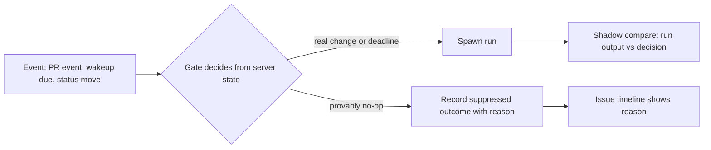

# CHE-2568: server-side gate for runs that need no LLM

Revision 3 (2 Nov 2026, 00:00 ICT). Changed since revision 2: G1 as designed matches only 6 runs (USD 2.1 per week), because 116 of 122 candidate runs had an unresolved agent-only thread; the earlier USD 41 is now an unverified upper bound that needs a new server-side behaviour (the server resolves those threads); every gate now uses one observable false-positive rule with a numeric shadow bar (`shadow.py`, tested); the measurement inputs are published in `.plans/CHE-2568-evidence/` (reproduction steps in its README) and the parts that cannot be reproduced are named; test-first status is stated in Tests.

Plan only. No gate code. Parent: CHE-2566 (stage 3, option C). Stage 1 (B, CHE-2567) is live and measured (CHE-2581).

## Problem

The parent premise says about 80% of x99-claude-sonnet and Tofu runs post no comment and no PR. Each run pays a boot write plus 0.2–1.3M cache-read tokens. The premise is wrong: 93% of runs author a comment. The better question is how many runs change nothing, and how many of those a server can decide without an LLM.

## Measurement

Window: runs with `created_at` in [25 Oct 2026 00:00Z, 1 Nov 2026 15:00Z) (25 Oct 07:00 ICT to 1 Nov 22:00 ICT), x99-claude-sonnet and Tofu, status `completed`: 7,767 runs, 7,964 Mtok, USD 3,822 at the CHE-2567 list-price model. Inputs: `multica agent tasks <id>` (all pages) and `multica issue timeline <issue>` (activity and comments) for 954 issues. `.plans/CHE-2568-scripts/fetch.py` fetches both for the fixed window and writes `manifest.json`. No timeline was truncated. Published in `.plans/CHE-2568-evidence/`: the manifest (sha256 `b7f17069b5a62c33…`), a per-run `rows.json.gz`, and `g1_evidence.json`. `est.py` and the G1, G2, G3 and G4 rows of `gates.py` reproduce from `rows.json.gz` alone (checked: 7,621 issue-bound runs, USD 417 no-change, G1 122/110/12). The raw `tasks.json` and timelines are not published and are mutable on the server, so a new fetch will differ from the manifest hashes. The G5 and G6 rows read timelines and are not reproducible from the published evidence; both gates are dropped, so no decision rests on them.

Run classes (`lib.run_class`, covered by unit tests):

| Class | Rule | Runs | Mtok | USD |
| --- | --- | --- | --- | --- |
| substantive | the run has a `pr_url`, or changed status, assignee, wakeup or description, or authored a comment that does not say "nothing changed" | 6,120 | 7,190 | 3,405 |
| ceremonial | changed nothing; every authored comment says nothing changed (regex on the first 400 chars, no action verb) | 1,125 | 524 | 303 |
| silent | changed nothing; authored no comment | 376 | 125 | 114 |
| not scored | chat (58) and autopilot (88) runs have no issue timeline | 146 | n/a | n/a |

No-change runs (ceremonial plus silent): 1,501 of 7,621 issue-bound runs (19.7%), USD 417 (10.9% of cost), 650 Mtok (8.2% of tokens).

Caveats:

- "Authored a comment" uses `source_task_id` on the timeline comment. `delivered_comment_ids` lists comments delivered TO the agent and is not output. Revision 1 used it, which made the 73% and 38% figures wrong.
- `result.pr_url` is empty on every run in the window, so PR output is not observable. A run that only pushed or opened a PR and posted no comment counts as `silent`. Treat `silent` as an upper bound.
- `ceremonial` is a text heuristic. A hand read of 16 random ceremonial runs found 10 that changed nothing and 6 that did work (a CI re-run, a code fix, a filed issue, an opened decision request). Precision is about 60% (n = 16, wide interval). Treat the no-change figure as USD 114 (silent only) to USD 417 (all).
- Cost uses list prices from `analyze.py` in CHE-2566.

### By trigger class

| Class | Runs | Substantive | Ceremonial | Silent | No-change USD | No-change Mtok |
| --- | --- | --- | --- | --- | --- | --- |
| Comment mention | 1,804 | 1,438 | 215 | 151 | 106 | 172 |
| Workflow step / assignment hand-off | 3,044 | 2,720 | 272 | 52 | 77 | 133 |
| `pr.merged` | 271 | 84 | 131 | 56 | 73 | 78 |
| Time wakeup (`time.due`) | 727 | 579 | 42 | 106 | 48 | 58 |
| `pr.event` (needs attention) | 470 | 235 | 233 | 2 | 46 | 78 |
| `pr.checks_failed` | 347 | 246 | 98 | 3 | 35 | 72 |
| Condition wakeup (`condition.met`) | 563 | 473 | 87 | 3 | 14 | 30 |
| `pr.mergeability` | 96 | 83 | 13 | 0 | 7 | 14 |
| Other wakeups, delegated failure | 249 | 242 | 34 | 3 | 11 | 15 |

## Finding

1. 19.7% of issue-bound runs change nothing (USD 417, 10.9% of cost). The parent's "about 80%" is not a measured quantity: 93% of runs author a comment, and 15% of runs author only a "nothing changed" comment.
2. A server can decide without an LLM only when it holds the deciding fact at dispatch. Measured against that rule, only G1 (`pr_merged` on a Done issue) is a candidate. As designed it matches 6 runs, USD 2.1 per week. Its USD 41 per week upper bound (1.1% of cost) holds only if the server also resolves agent-only threads, which is new behaviour and is not decided.
3. Four proposed gates do not survive the false-positive rule. The wakeups they would suppress mostly did real work (see the table below). G4 has no matching run in the week.
4. The larger part of the USD 417 is agent behaviour (a run that reads state and says "nothing to do") that a server cannot see without the agent's read. That is a design lever, not a gate: the plan lists it under "Not planned" with the opt-in `skip_if_unchanged` idea.
5. The parent success criterion cannot be met with gates. Restate it, with Cheese's agreement, as: "measure first: ship G1 in shadow, enforce only if the shadow bar below is met, and treat USD 41 per week as an upper bound until then; any wider cut needs the opt-in design in Open question 3".

## Approach

Decide before spawning, in the existing dispatch paths. Every suppression writes a wakeup activity or receipt outcome (reusing `wakeupOutcomeFiltered` style records), so it is visible on the issue timeline. Nothing is silently dropped.

Rollout per gate, one at a time:

1. Shadow: compute the decision, log `would_suppress` with reason, still run the agent.
2. Compare after 48 h with one rule for every gate (`shadow.py`, `shadow_verdict`). A `would_suppress` run is a false positive if it changed issue state (status, assignee, wakeup, description), authored a comment that does not say nothing changed, or has a PR url. A "nothing changed" comment alone is the saving, not a false positive. A run whose only work was resolving comment threads is `server_duty`: not a false positive only when the server performs that resolution. A run with no timeline is `unknown` and counts as not saved.
3. Enforcement bar: at least 30 `would_suppress` runs in the compare window (extend the window until reached), zero false positives, and a hand read of the final output of every `would_suppress` run for external work the timeline cannot show (a push, a CI re-run, a deploy). One external-work finding is a false positive.
4. Enforce, then 48 h before/after on the same agents (Cheese premise 3).

## Gates

Each predicate uses only facts the server holds at dispatch. `matched` = runs the predicate would suppress. `saved` = matched runs that changed nothing. `fp` = matched runs the false-positive rule flags (state change, or a comment that is not a "nothing changed" note): each would have been a dropped hand-off. These columns come from the run classes in Measurement and ignore thread resolution; G1 below applies the full rule. A gate may enforce only when the shadow bar in Approach is met.

| Gate | Predicate | Matched | Saved | fp | Saved USD | Saved Mtok | Verdict |
| --- | --- | --- | --- | --- | --- | --- | --- |
| G1 | `pr.merged`, issue status Done, `layer_delivered` false (no eligibility facts) | 122 | 110 | 12 | 41 | 43 | Upper bound only: see G1 |
| G6 | entered `need_decision`, mover = this agent | 79 | 36 | 43 | 4 | 11 | Drop: more fp than saved; open-request fact not in the data |
| G5 | polling wakeup, no issue activity since the agent's last run | 770 | 180 | 590 | 39 | 60 | Drop as a default: polls watch external state. Opt-in only |
| G2 | `pr.event` kind `merged`, `ready` or `draft` | 192 | 88 | 104 | 19 | 30 | Drop: more fp than saved |
| G4 | `pr.checks_failed` on a head a newer head had already replaced at dispatch | 0 | 0 | 0 | 0 | 0 | Drop: no match; 38 heads were replaced only after dispatch |
| G3 | `pr.event` `head_changed` caused by the agent's own push | 186 | 102 | 84 | 18 | 33 | Dropped: see below |

The `saved` column treats a no-change run as saved by the text heuristic, which misread 6 of 16 sampled runs (see Caveats), and the G1 row has no eligibility check. It is an upper bound, not a target. Only G1 is still a candidate; the other rows fail on false positives or have no match.

### G1: `pr_merged` on an issue that is already Done

Measured on the 122 runs the bare predicate matches (`g1_evidence.json`, state read after the window), with one rule (`shadow_verdict`):

| Verdict | Runs | USD | Meaning |
| --- | --- | --- | --- |
| false_positive | 12 | 6.0 | state change, real-work comment |
| saved | 65 | 23.9 | no work; at most a "nothing changed" comment |
| server_duty | 45 | 17.6 | only work was resolving agent-only threads |

Eligibility facts, read at each run's start: 116 of 122 runs had an unresolved agent-only comment thread. 1 had another linked PR open. Only 6 runs (USD 2.1) had neither. The "Linked PR Merge Wakeup" rule requires the agent to resolve agent-only threads, so the design "spawn when a thread is unresolved" keeps almost every run.

Two designs:

- **G1a (as first written):** suppress only when the issue is Done, `layer_delivered` is false, no other linked PR is open and no agent-only thread is unresolved. Saves at most USD 2.1 per week. Not worth a gate. Dropped.
- **G1b (needs a decision):** the server also resolves the agent-only threads when it suppresses. Upper bound USD 41.5 per week (110 runs, 65 saved plus 45 server_duty). The bound is unverified: the "nothing changed" text test misread 6 of 16 sampled runs, 66 of the 110 runs resolved no thread and may have left threads open on purpose, and external work is not visible in the data. Silent runs alone are USD 19.3 (51 runs) as the lower anchor. G1b changes server behaviour (the server resolves threads that an agent used to judge), so it needs Cheese's product decision (Open question 1) before any code.

Change for G1b, if approved: in `dispatchSystem` (`server/internal/service/issue_wakeup_system.go:971`), for rule `pr_merged`, resolve the issue's agent-only threads, record outcome `suppressed: issue_done` and spawn nothing when the issue status category is Done, the merge is not a stack layer (`layer_delivered` false in the receipt payload built at `:373`) and no other linked PR is open. Shadow mode first, with the bar in Approach.

Negative controls (must still spawn):

- Issue Done, PR base is not the default branch (`layer_delivered` true): a successor PR may need a new base.
- Issue Done and another linked PR is open: a later layer still needs the merge facts.
- Issue Done and a comment thread has a human participant or a human root: the server must not resolve it. The run still spawns.
- Issue `merged` (Code Accepted): the agent sets `done`; never suppress.
- Issue `in_review`, `blocked`, `in_progress`: never suppress.
- Issue status unknown or the receipt payload incomplete: fail open.

### G3: dropped

Revision 1 allowed the webhook `sender` plus the run window as proof of an own push. All agents share the same GitHub bot login, so another agent that pushes during the target agent's run would be suppressed, and a real hand-off would be lost. G3 needs task-attributed SHA evidence (a record of the SHAs a run pushed). The server holds none today. G3 is out of this plan until that record exists. If it is built, the negative controls must include the shared-login case: agent B pushes to agent A's PR while A's run is active; A must still wake.

### G5: opt-in only

A default rule is not viable (590 of 770 matched runs did real work: CI state, PR state, deploys are not in the issue timeline). An opt-in field `skip_if_unchanged` set by the wakeup creator, who declares that the instruction depends only on issue state, is safe by default. Nothing is planned until a creator needs it (Open question 3).

## Not planned

| Item | Reason |
| --- | --- |
| Skip `blocked` entry runs | Most set a wakeup or open a request; all 6 sampled did real work. No safe deterministic rule. |
| Suppress leader runs on workflow-routed issues | 18 runs, USD 6 per week. Not worth a gate. |
| Server-native `pr_merged` completion for status `merged` | Deterministic, but 21 runs, USD 12. Revisit after G1. |
| Todo-pull meta-cap precheck (CHE-2816) | 133 runs, USD 40, rule ends 10 Nov 2026. Expires first. |
| Cut boot prefix, resume size | Separate lever (about 1 Mtok per run). Follow-up issue. |

| G2, G4, G6 | Fail the false-positive rule (table above). Revisit only with a new predicate and a re-measurement. |
| Agents that post "nothing changed" comments (1,125 ceremonial runs, USD 303) | Agent behaviour, not a server decision. Follow-up: a skill rule to end a no-change run with `wakeup checkin` instead of a comment. |

## Steps

1. Review this plan cross-lab (agent_review). Done when a different-lab reviewer signs PASS on the exact head.
2. Cheese agrees the restated target (Finding 5) and decides Open question 1 before any gate ships.
3. If Cheese approves G1b: one implementation issue. It starts with a failing test per negative control, red then green recorded in its PR.
4. G1b ships shadow first (log only), then enforces only when the bar in Approach is met.
5. G1b gets a 48 h before/after read on the same agents: `pr_merged` runs, no-change share, review PASS rate.
6. Re-run this measurement (`fetch.py`, `classify.py`, `est.py`, `gates.py`) after G1 and decide on the opt-in and comment follow-ups.

## Tests

Test-first status, stated exactly:

- `shadow.py` (this revision) is test-first. Tests came first against a stub that always returns `saved`: 25 tests ran, 6 failed on assertions. After the implementation, 25 of 25 pass.
- `lib.py` (`is_output`, `run_class`): the code existed before its tests, as did `fetch.py`, `classify.py`, `est.py`, `gates.py` and `g1_elig.py`/`g1_report.py`. The recorded red for `lib.py` came from a stub, not from the original code, so it is not behavioral red for the original scripts. Test-first is NOT-MET for them. Only Cheese can waive it; this PR asks for that waiver and reconstructs nothing. The scripts are measurement helpers for a plan, not product code.
- Run the tests: `python3 -m unittest discover -s tests` in `.plans/CHE-2568-scripts/`.

Gate code tests (not run, no gate code in this PR): Go, targeted, `internal/service` wakeup and trigger tests (`issue_wakeup_system_test.go`, `issue_wakeup_test.go`). G1b has one positive test (suppressed and threads resolved), one test per negative control (spawns), a test that the server never resolves a thread with a human participant, and a shadow-mode test that the run still starts and the outcome is recorded.

## Open questions

1. Decision for Cheese: may the server resolve agent-only comment threads when a PR merges on a Done issue (G1b)? Without it G1 saves at most USD 2.1 per week and is not built. Also: are "other linked PR open" and "agent-only thread unresolved" readable at dispatch in `dispatchSystem`?
2. Does the server record which SHAs a run pushed? Without it G3 stays out.
3. Which wakeup creators would set `skip_if_unchanged`? Default off is safe. A default-on rule needs a Cheese decision.
4. Restating the parent success criterion (Finding 5) needs Cheese's agreement before any gate ships.
5. `multica issue wakeup checkin` already ends a scheduled check silently. It cuts output tokens, not boot cost. It is the lever for the ceremonial-comment follow-up, not a substitute for gating.
