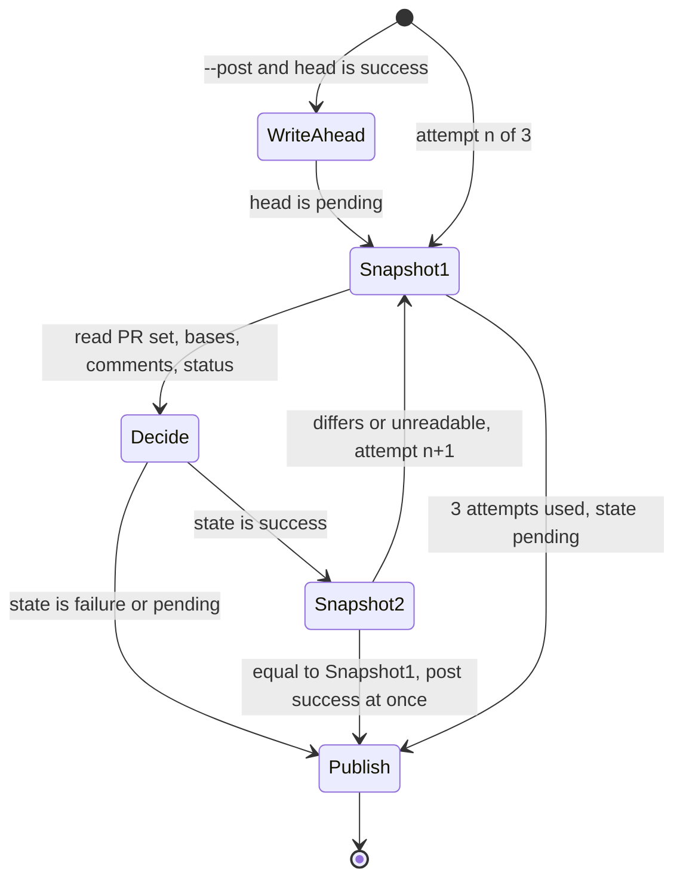

# CHE-4415: security-gate freshness design

Scope: `scripts/security-gate/security_gate.py`, `main()` and its helpers. Written before the code.

## Why patches failed

Three review rounds patched one read at a time (comments of the primary PR, then one sibling, then the base). Each patch left another input outside the re-check. The cause is that "what a success depends on" has no single definition. This note gives it one.

## Invariant

A `success` leaves the script (printed or posted) only if the **snapshot** taken immediately before the decision equals the snapshot taken immediately after it.

Snapshot (`_fingerprint`) = for the primary PR and for every open PR on the same head SHA:

- the PR number and its head SHA,
- its base ref and base SHA (binds the decision, and the diff and scans it used, to one base),
- every comment id with its edit time (a new, edited or deleted verdict moves it),

plus the set of PR numbers on that head (a new sibling moves it) and the live `security-gate` status of the head.

One snapshot covers the whole set. There is no per-PR cache and no partial refresh: when anything moves, every PR is read and evaluated again from scratch. A revoked PASS on sibling A therefore cannot survive a refresh of sibling B, and a PR retargeted after a skipped scan cannot reuse that skip.

## State machine

`Publish` for a non-success state:

1. Write the status, 3 attempts with the existing short backoff (`2 s`, `4 s`).
2. Revoke the queue heads that carry the PR, even when step 1 failed.
3. If step 1 or 2 failed, exit non-zero after both ran.

`Publish` for success writes once. A failed success write is not retried: a retry would send a decision whose snapshot is older than the failure. Any retry must go back to `Snapshot1` (Sol `e21567e3f9c4f0e79e6425bddfc522f5`). No rate-limit backoff is added here; that is the CHE-4242 follow-up and may come only on top of this loop.

## The five findings

| # | Finding | Closed by |
| --- | --- | --- |
| 1 | Final refresh before returning or posting success, primary and siblings | Snapshot2 covers the whole set; it runs for a printed success as well as a posted one (was: only `--post`, primary only) |
| 2 | Sibling A's revoked PASS survives a refresh of sibling B | One snapshot, full re-evaluation on any change |
| 3 | Base bound to the scan | Base ref and base SHA are in the snapshot |
| 4 | Failed downgrade write leaves `success`, skips queue revocation | Write-ahead `pending`; publish retries the write, revokes the queue regardless, then exits non-zero |
| 5 | Success write retried after backoff without a refresh | Success is written once; a retry re-enters Snapshot1 |

## Unstable or unreadable

- After 3 moving snapshots, the gate reads the PR's head once more and publishes `pending` ("changed while it was evaluated; re-run") on that **current** head, not on the head of the last snapshot. A head that moved on already has its own gate run (`synchronize`); the other head keeps whatever its own run wrote.
- A second snapshot that cannot be read counts as a moved snapshot (a retry).
- Any other unreadable GitHub read after the first snapshot (including the next attempt's initial snapshot) ends in `GateUnreadable`. `main()` then publishes `pending` on the last known head, revokes the queue and exits 1. If not even the first snapshot was readable there is no head to write; the queue is still revoked for the PR and the job is red.

Publish revokes the queue for **every PR seen on the head**, one at a time. A failing revocation does not skip the next PR. The first error is raised after all of them ran.

## Write-ahead `pending` (finding 4, round 2)

A commit status cannot be deleted or forced from the client. The only client-side hold against a downgrade write that never lands is to move the head off `success` **before** the long evaluation. With `--post`, when the first snapshot shows the head at `success`, the gate writes `pending` ("re-checking the verdicts") to that head first. Then:

- a decision of `success` writes `success` again (still once, after Snapshot2),
- a decision of `failure` or `pending` writes that state, 3 attempts; if all fail, the head stays `pending`, not the earlier `success`,
- a write-ahead that cannot be written is unreadable GitHub state: no evaluation, `pending` is attempted (3 attempts), the queue is revoked for every PR seen, exit 1.

No write-ahead happens when the head is not at `success` (nothing to hold), and none without `--post`.

Cost, accepted in scope item 4 ("the recorded state must not stay `success`"):

- **Churn.** Every sweep run (30 min) and every comment run of a green PR flips the required check to `pending` for the length of the evaluation (a few minutes with semgrep), then back. An enqueue in that window waits.
- **Stuck `pending`.** A run killed by the 20-minute timeout leaves `pending`. The sweep re-runs only PRs at `success`, so it does not heal this; the next comment, push or manual dispatch does. The state is safe (not green), only inconvenient.

A different cut of the same choice (not taken): no write-ahead, accept that three rejected writes leave `success` until the next sweep. Reverting is one `if` in `_decide`.

## Unreadable snapshot keeps what it read

`_fingerprint` raises `GateUnreadable` carrying the head and every PR it had read when a later read failed. `_decide` merges those into what it already knew, and `_evaluate` adds each sibling it lists to a shared `seen` set as soon as it lists it, so a sibling that appears after the snapshot and then fails is still revoked. The final head read after three moving snapshots has no fallback: if it fails the result is `GateUnreadable` (pending on the last known head, revoke, exit 1), never a silent old head with exit 0.

## Residual risk

The gap between Snapshot2 and the write is one API round trip. It cannot be closed from the client; the sweep and the per-comment gate run cover it. If every status write is rejected for the whole run (API down), no write-ahead can land either: the head stays as it was, the queue is revoked as far as the API allows, and the job goes red.
