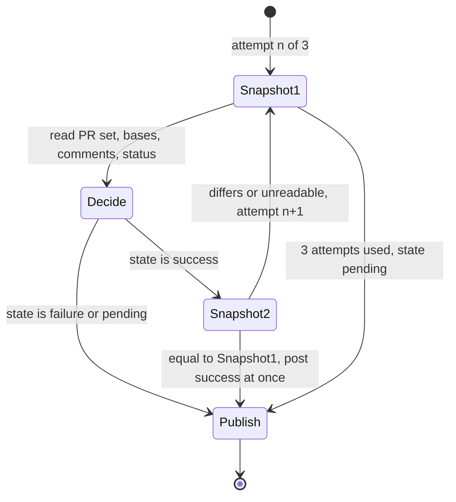

# CHE-4415: security-gate freshness design

Scope: `scripts/security-gate/security_gate.py`, `main()` and its helpers. Written before the code.

## Why patches failed

Three review rounds patched one read at a time (comments of the primary PR, then one sibling, then the base). Each patch left another input outside the re-check. The cause is that "what a success depends on" has no single definition. This note gives it one.

## Invariant

A `success` leaves the script (printed or posted) only if the **snapshot** taken immediately before the decision equals the snapshot taken immediately after it.

Snapshot (`_fingerprint`) = for the primary PR and for every open PR on the same head SHA:

- the PR number and its head SHA,
- its base ref and base SHA (binds the decision, and the diff and scans it used, to one base),
- every comment id with its edit time (a new, edited or deleted verdict moves it),

plus the set of PR numbers on that head (a new sibling moves it) and the live `security-gate` status of the head.

One snapshot covers the whole set. There is no per-PR cache and no partial refresh: when anything moves, every PR is read and evaluated again from scratch. A revoked PASS on sibling A therefore cannot survive a refresh of sibling B, and a PR retargeted after a skipped scan cannot reuse that skip.

## State machine

`Publish` for a non-success state:

1. Write the status, 3 attempts with the existing short backoff (`2 s`, `4 s`).
2. Revoke the queue heads that carry the PR, even when step 1 failed.
3. If step 1 or 2 failed, exit non-zero after both ran.

`Publish` for success writes once. A failed success write is not retried: a retry would send a decision whose snapshot is older than the failure. Any retry must go back to `Snapshot1` (Sol `e21567e3f9c4f0e79e6425bddfc522f5`). No rate-limit backoff is added here; that is the CHE-4242 follow-up and may come only on top of this loop.

## The five findings

| # | Finding | Closed by |
| --- | --- | --- |
| 1 | Final refresh before returning or posting success, primary and siblings | Snapshot2 covers the whole set; it runs for a printed success as well as a posted one (was: only `--post`, primary only) |
| 2 | Sibling A's revoked PASS survives a refresh of sibling B | One snapshot, full re-evaluation on any change |
| 3 | Base bound to the scan | Base ref and base SHA are in the snapshot |
| 4 | Failed downgrade write leaves `success`, skips queue revocation | Publish retries the write, revokes the queue regardless, then exits non-zero |
| 5 | Success write retried after backoff without a refresh | Success is written once; a retry re-enters Snapshot1 |

## Unstable or unreadable

After 3 moving snapshots, or when the second snapshot cannot be read, the gate publishes `pending` ("changed while it was evaluated; re-run"), not an exit that leaves an older `success` in place. Each change also starts its own gate run, so the next run decides.

## Residual risk

If the downgrade write fails on every attempt, the head status stays at its old value. The queue heads are still flipped, the job is red, and the 30-minute sweep re-runs the gate on every green PR. A write that fails on every bounded retry cannot be forced.

The gap between Snapshot2 and the write is one API round trip. It cannot be closed from the client; the sweep and the per-comment gate run cover it.
