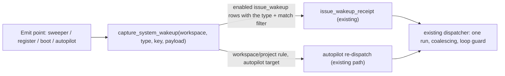

# CHE-5696 — System events for wakeup rules

Status: plan r1 (14 Nov 2026 ICT), author x99-claude-sonnet-200k. Code read at `c21875f6b7`.

## Goal

Let wakeup rules fire on server-side system events, so an agent waits for a fact instead of a timer. Extend the existing rule engine (CHE-1082, CHE-3395). Build no second rule system.

| Event | Payload | First user |
|---|---|---|
| `runtime.online` / `runtime.offline` | runtime id, host, version | issues waiting on a host (MBP browser, C00) |
| `server.deployed` | SHA, digest, health | live proofs (CHE-5523), post-deploy adoption (CHE-2794) |
| `daemon.restarted` | runtime id, version | resume orphaned runs (deferred, see Out of scope) |
| `autopilot.skipped` / `autopilot.failed` | autopilot id, reason | retry the brief after provider recovery |

## What the code showed (this changes the proposal)

1. The engine is issue-bound end to end. `wakeup_scoped_event.issue_id` is `NOT NULL` (`server/migrations/631_wakeup_scoped_event.up.sql`). Every custom-rule instance is an `issue_wakeup` row for one issue (`server/internal/service/wakeup_custom_exec.go`). `capture_issue_wakeup(p_issue, ...)` runs inside the issue-event transaction (`636_wakeup_scoped_event_capture.up.sql`). A system event has no issue, so none of this fires for it.
2. A workspace-scope rule therefore cannot "match" a system event on its own: there is no issue to materialise an instance on. Two target shapes exist in the plan:
   - **A. Issue-bound waiter.** An issue-scope event rule (`issue_wakeup`, `kind='event'`) lists system event types. This covers the three waiting cases (deploy, host online, host offline). It reuses receipts, coalescing, `once`/`continuous` and loop protection unchanged.
   - **B. Issue-less workspace rule.** Target is an autopilot, not an agent. This covers the brief retry. Precedent for issue-less runs: `autopilot_run` tasks (`agent_task_queue.autopilot_run_id`, migration 042) and `chat_wakeup` (701).
3. Event types are one list: `server/pkg/eventcontract/events.go` `WakeupTypes`, validated in `wakeup_definition_validate.go:252`. A new type needs the constant, the list entry, and a name in `multica issue wakeup events`. No new column: `event_types text[]` already carries any string.
4. Emit points exist but are not wakeup-aware:
   - `runtime.offline`: `sweepStaleRuntimes` loop over `staleRows` (`server/cmd/server/runtime_sweeper.go:259`) already records `analytics.RuntimeOffline`.
   - `runtime.online`: `server/internal/handler/daemon.go:~953` fires only when `inserted` (first register of a runtime row). A reconnect of an offline row is an upsert, not an insert, so it does NOT emit today. Slice 2 must find the offline→online transition (previous status is needed).
   - `server.deployed`: no server-side signal exists. The server must emit it at boot, with the build SHA and digest from build info.
   - `autopilot.skipped`: `shouldSkipDispatch` / `handleDispatchSkip` in `server/internal/service/autopilot.go:213,578,663`.
5. Provider recovery already has a path for issues (`provider_failure_recovery`, `provider_failure_guard.go`). Autopilot skips are not covered. A retry fired at skip time hits the cooldown again, so the brief retry must carry the cooldown end or a backoff.

## Design

### D1 Event contract
Add 6 types (`runtime.online`, `runtime.offline`, `server.deployed`, `autopilot.skipped`, `autopilot.failed`; `daemon.restarted` reserved, not emitted). They are marked `system` in `eventcontract`. Validation: a system type is allowed in an event trigger at issue scope and at workspace scope with an autopilot target; it is refused for an agent target at workspace/project scope (no issue to run on).

### D2 Fan-out function (one migration)
`capture_system_wakeup(p_workspace uuid, p_type text, p_key text, p_payload jsonb)`. Same shape as the legacy branch of `capture_issue_wakeup`: select enabled `issue_wakeup` rows of the workspace with `kind='event'` and `p_type = ANY(event_types)`, apply the match filter, insert into `issue_wakeup_receipt` with the existing `ON CONFLICT` coalescing and key idempotency. No outbox table: emit points are low volume and the function runs in the emitter's transaction. Skip closed issues, as the existing function does. Check with `EXPLAIN` that the lookup is indexed; add one `CREATE INDEX CONCURRENTLY` (own file) only if it is not.

### D3 Match filter (generic, settings-first)
Add `filters.match`: up to 4 `key: value` equality pairs checked against the payload (for example `host=MBP`, `runtime_id=...`, `sha=...`). No per-field column and no migration per feature (repo rule "Settings-first"). Unknown keys are refused at write time against a per-type key list.

### D4 Emit points
- `runtime.offline`: in the sweeper loop and any explicit deregister path.
- `runtime.online`: on first register and on offline→online transition.
- `server.deployed`: once at boot, after readiness. Event key = `digest:boot-unix`, so a redeploy of the same digest still fires. Assumes one server process (C00 today); replicas would each emit, and `once` mode makes that harmless.
- `autopilot.skipped` / `autopilot.failed`: at the skip/failure write.
Payloads: ids, host name, version, SHA, digest, reason code. No secrets, no tokens, no URLs with credentials, no free text from users.

### D5 Autopilot retry (target B)
A workspace rule with `target: {type: "autopilot", id}` and trigger `autopilot.skipped`. Required: `max_fires`, and a delay taken from the skip payload `retry_after` (cooldown end) when present, else the rule's `schedule` backoff. Loop guard: a retry that is itself skipped emits `autopilot.skipped` again; `max_fires` and `rate_limit` bound the chain, and the rule is refused at write time without `max_fires`.

### D6 Surfaces (F1, F5)
CLI: `multica issue wakeup create --event runtime.online --match host=MBP`. `multica issue wakeup events` lists system types with their payload keys. Workspace rule settings (GUI) show the event list and the match field. Docs in all five locales under `apps/docs/content/docs/` (repo rule).

## Fork checklist

| | Result |
|---|---|
| F1 settings | event list + match in workspace rule settings and CLI |
| F2 security | payloads carry ids/host/SHA only. `workspace_id` scopes the fan-out query. Rule write keeps the existing member check and target visibility redaction |
| F3 plugin | no, core server code |
| F4 System 1 | not applicable |
| F5 UI | per-rule match filter only |
| F6 fit | extends the rule engine. Upstream lacks it: propose upstream after the pilot (CHE-3676, CHE-5574) |
| F7 state | no new state machine. Reuses once/continuous, receipts, loop guard |

## Slices (each 2 h or less; Tofu creates them after plan PASS)

| # | Slice | Test-first check | Depends |
|---|---|---|---|
| S1 | Event contract + validation + `capture_system_wakeup` migration (D1, D2) | DB test: waiter row gets one receipt; second emit coalesces; closed issue gets none; other workspace gets none | none |
| S2 | Emit `runtime.online`/`offline`, find the offline→online transition (D4) | test per emit point; reconnect of an offline row emits `runtime.online` once | S1 |
| S3 | `filters.match` (D3) | match hit, miss, unknown key refused | S1 |
| S4 | `server.deployed` at boot (D4) | boot test with a fake build SHA | S1 |
| S5 | CLI + `wakeup events` + GUI + docs x5 (D6) | CLI golden output; typecheck/lint; docs link check | S1, S3 |
| S6 | Autopilot events + autopilot target + retry guard (D5) | skip emits; retry honours `retry_after`; chain stops at `max_fires` | S1, S3. Split in two if it passes 2 h |
| S7 | Consumers + measure: deploy-wait and brief-retry rules on the real workspace; counter for timer wakeups that wait on a deploy or runtime | before/after count over 7 days | S2, S4, S6 |

S2, S3 and S4 run in parallel after S1.

## Measure

Count timer wakeups whose purpose is a deploy or runtime wait, for 7 days before and 7 days after S7. Target: 0. Needs a classification: S7 adds a counter keyed by trigger kind and event type; the before-count comes from existing time wakeups whose instruction names a deploy or runtime (heuristic, stated as such).

## Out of scope / deferred

- `daemon.restarted`: the type is reserved. Emitting it needs a restart marker from the daemon register path, and "resume orphaned runs" overlaps `issue_urgent_orphans.go`. Decide after the pilot.
- Issue-less agent targets at workspace/project scope. Only autopilot targets are planned.
- A `provider.recovered` event. The brief retry uses `retry_after` instead.

## Risks and open points

1. R1: `runtime.online` has no transition signal today (see finding 4). S2 may need a query change. Estimate may grow.
2. R2: `server.deployed` fires on every boot, including crash restarts. Rules filter by `sha` so a restart of the same SHA also wakes a waiter. Accepted: a waiter wants "this SHA is serving", which a restart also proves.
3. R3: autopilot retry loop. Bounded by D5.
4. R4: receipt retention is 7 days, so a rule created after the event does not see it. Same as every event rule today. Waiters must create the rule before the action that causes the event.
5. Decision (reversible default, no human needed): D1 refuses system types for agent targets at workspace scope. Revisit only if a consumer needs it.
