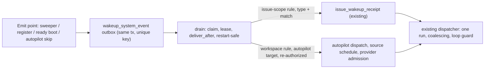

# CHE-5696 — System events for wakeup rules

Status: plan r2 (14 Nov 2026 ICT), author x99-claude-sonnet-200k. Code read at `c21875f6b7`.

## r2 changes (answer to Terra CHANGES r1, comment 01a1da1f)

| Terra finding | Where fixed |
|---|---|
| P1-1 brief retry has no durable delivery design | D2 (durable system-event outbox), D5 (capture, delay, restart, dedup, re-authorization, chain), slices S2, S7, S8 |
| P1-2 deploy proof lacks health/digest contract | D4 `server.deployed` (trusted sources, readiness gate, mandatory `sha`/`digest` match, workspace fan-out), slice S5 |

## Goal

Let wakeup rules fire on server-side system events, so an agent waits for a fact instead of a timer. Extend the existing rule engine (CHE-1082, CHE-3395). Build no second rule system.

| Event | Payload | First user |
|---|---|---|
| `runtime.online` / `runtime.offline` | runtime id, host, version | issues waiting on a host (MBP browser, C00) |
| `server.deployed` | SHA, digest, health | live proofs (CHE-5523), post-deploy adoption (CHE-2794) |
| `daemon.restarted` | runtime id, version | resume orphaned runs (deferred, see Out of scope) |
| `autopilot.skipped` / `autopilot.failed` | autopilot id, reason | retry the brief after provider recovery |

## What the code showed (this changes the proposal)

1. The engine is issue-bound end to end. `wakeup_scoped_event.issue_id` is `NOT NULL` (`server/migrations/631_wakeup_scoped_event.up.sql`). Every custom-rule instance is an `issue_wakeup` row for one issue (`server/internal/service/wakeup_custom_exec.go`). `capture_issue_wakeup(p_issue, ...)` runs inside the issue-event transaction (`636_wakeup_scoped_event_capture.up.sql`). A system event has no issue, so none of this fires for it.
2. A workspace-scope rule therefore cannot "match" a system event on its own: there is no issue to materialise an instance on. Two target shapes exist in the plan:
   - **A. Issue-bound waiter.** An issue-scope event rule (`issue_wakeup`, `kind='event'`) lists system event types. This covers the three waiting cases (deploy, host online, host offline). It reuses receipts, coalescing, `once`/`continuous` and loop protection unchanged.
   - **B. Issue-less workspace rule.** Target is an autopilot, not an agent. This covers the brief retry. Precedent for issue-less runs: `autopilot_run` tasks (`agent_task_queue.autopilot_run_id`, migration 042) and `chat_wakeup` (701).
3. Event types are one list: `server/pkg/eventcontract/events.go` `WakeupTypes`, validated in `wakeup_definition_validate.go:252`. A new type needs the constant, the list entry, and a name in `multica issue wakeup events`. No new column: `event_types text[]` already carries any string.
4. Emit points exist but are not wakeup-aware:
   - `runtime.offline`: `sweepStaleRuntimes` loop over `staleRows` (`server/cmd/server/runtime_sweeper.go:259`) already records `analytics.RuntimeOffline`.
   - `runtime.online`: `server/internal/handler/daemon.go:~953` fires only when `inserted` (first register of a runtime row). A reconnect of an offline row is an upsert, not an insert, so it does NOT emit today. Slice 2 must find the offline→online transition (previous status is needed).
   - `server.deployed`: no server-side signal exists. The server must emit it at boot, with the build SHA and digest from build info.
   - `autopilot.skipped`: `shouldSkipDispatch` / `handleDispatchSkip` in `server/internal/service/autopilot.go:213,578,663`.
5. Provider recovery already has a path for issues (`provider_failure_recovery`, `provider_failure_guard.go`). Autopilot skips are not covered. A retry fired at skip time hits the cooldown again, so the brief retry must carry the cooldown end or a backoff.

## Design

### D1 Event contract
Add 5 emitted types, plus one reserved (`runtime.online`, `runtime.offline`, `server.deployed`, `autopilot.skipped`, `autopilot.failed`; `daemon.restarted` reserved, not emitted). They are marked `system` in `eventcontract`. Validation: a system type is allowed in an event trigger at issue scope and at workspace scope with an autopilot target; it is refused for an agent target at workspace/project scope (no issue to run on).

### D2 Durable system-event outbox (one migration)
Table `wakeup_system_event` (workspace_id, event_type, event_key, payload jsonb, deliver_after, captured_at, claim lease columns, `delivered text[]`, outcome). `UNIQUE (workspace_id, event_type, event_key)` makes capture idempotent. It copies the pattern of `wakeup_scoped_event` (631/636) minus `issue_id`: capture in the emitter's transaction, drain by the scheduler with claim + lease, retry delay on a database error, 7-day retention, per-input `delivered` list. The column names of the lease are confirmed against 631 at S2.
- Capture: `capture_system_event(workspace, type, key, payload, deliver_after)` inserts one row only when an enabled definition in that workspace selects the type (so an unused type writes nothing).
- Drain (`wakeup_system_drain.go`, same service package): for each pending row past `deliver_after`, resolve matching definitions, then
  - issue-scope rule (target A): apply `filters.match`, skip closed issues, insert into `issue_wakeup_receipt` with the existing key coalescing. Existing dispatcher, `once`/`continuous` and loop guard run unchanged.
  - workspace rule with autopilot target (target B): D5.
- Each (row, rule) delivery is recorded in `delivered`, in the same transaction as the receipt or run. A crash replays the row and skips the delivered rules.
- Outcomes are recorded and visible, as in `scopedOutcome*`: `delivered`, `no_rule`, `no_match`, `rule_disabled`, `issue_closed`, `target_revoked`, `chain_exhausted`, `expired`.
Check with `EXPLAIN` that the definition lookup is indexed; add one `CREATE INDEX CONCURRENTLY` (own file) only if it is not.

### D3 Match filter (generic, settings-first)
Add `filters.match`: up to 4 `key: value` equality pairs checked against the payload (for example `host=MBP`, `runtime_id=...`, `sha=...`). No per-field column and no migration per feature (repo rule "Settings-first"). Unknown keys are refused at write time against a per-type key list. A rule on `server.deployed` is refused at write time unless `match` names `sha` or `digest` (see D4).

### D4 Emit points
- `runtime.offline`: in the sweeper loop and any explicit deregister path.
- `runtime.online`: on first register and on offline→online transition.
- `autopilot.skipped` / `autopilot.failed`: at the skip/failure write, in the same transaction as the `autopilot_run` row (D5).
- `server.deployed`: see below.
Payloads: ids, host name, version, SHA, digest, reason code. No secrets, no tokens, no URLs with credentials, no free text from users.

#### `server.deployed` health contract
Terra finding: a booting or rolled-back server must not wake a live-proof waiter. Contract:
1. **Trusted sources.** `sha` = the build-time `commit` ldflag (`-X main.commit`, set from the Docker `COMMIT` build arg), full length. Not the 7-character display value from `normalizeServerBuildInfo`, and never a request value. `digest` = env `MULTICA_IMAGE_DIGEST`, set by the deploy script from the digest-checked X99 artifact (a container cannot read its own image digest). If the env is empty, `digest` is empty and a digest-match rule never matches. The deploy script change (compose env) is part of S5; the server-side code does not guess a digest.
2. **Readiness gate.** The event is emitted only after the HTTP listener is serving AND an uncached `computeReadiness` returns `ok` (database ping and all migrations applied, `health.go`) on 3 consecutive checks 2 s apart. Retry for up to 5 min. If readiness never holds, no event is written and the server logs `server.deployed suppressed: not ready`. A booting, migrating or database-less server therefore never fires.
3. **Payload.** `sha`, `digest`, `version`, `started_at` (from `serverHealth.startedAt`), `pid`, `health: "ready"`, `ready_checks` (`db`, `migrations`), `ready_at`. `health` is always `ready`: an unhealthy boot emits nothing.
4. **Rollback.** A rollback boots the previous image, which reports its own older `sha`/`digest`. A waiter that matches the target `sha`/`digest` does not wake. This is why `server.deployed` rules must carry `match` on `sha` or `digest` (D3, refused otherwise). A pre-feature binary emits nothing; that is accepted.
5. **Key.** `digest-or-sha:started_at`, so each healthy boot is distinct and a redeploy of the same digest fires again. A same-SHA crash restart that turns healthy also fires; accepted (R2).
6. **Workspace fan-out.** The event is instance-wide, the outbox is workspace-scoped. At emit time the server writes one row per workspace that has an enabled definition selecting `server.deployed` (capture function in D2 does this check). Rows of other workspaces never exist, so a workspace cannot observe another workspace's deploy rows. Several replicas each emit; `once` mode makes that harmless.
7. **Residual.** The server cannot prove the digest it was given in env is the image it runs in; the deploy script owns that proof (digest-checked artifact, CHE-2365 deploy budget). S9 consumers keep the existing live smoke check as the acceptance proof; the event only replaces the timer.

### D5 Autopilot retry (target B): durable path
Terra finding: the existing scoped outbox needs an issue, and `wakeup_custom_exec.go` resolves an issue-bound agent. So target B does not use the issue path. It uses the D2 outbox and the existing autopilot dispatch.
1. **Rule.** Workspace rule with `target: {type: "autopilot", id}` and trigger `autopilot.skipped` (or `.failed`). Required at write time: `max_fires` (1 to 5) and the autopilot id. Write keeps the existing member check.
2. **Capture.** `recordSkippedRun` / `failRun` write the `autopilot_run` row and the outbox row in one transaction (key `run:<autopilot_run_id>`). Where the current code cannot take a transaction, S7 moves the run insert into one; if that proves too large, S7 adds a reconcile pass that scans skipped runs with a missing outbox row. Payload: `autopilot_id`, `run_id`, `trigger_id`, `reason_code`, `retry_after` (cooldown end when the provider-failure state exposes it; verified at S7), `chain_root`, `attempt`.
3. **Delay.** `deliver_after = retry_after` when present, else rule backoff (`schedule` backoff, floor 15 min). A skip at skip time never re-fires immediately into the same cooldown.
4. **Restart.** The row and its lease live in the database. After a server restart the drain reclaims pending rows past `deliver_after`. Test: write a row, restart the drain, assert one run.
5. **Duplicates.** Capture is unique on `(workspace, type, key)`. Dispatch passes idempotency key `sysevent:<rule_id>:<event_id>` to `createAutopilotRunWithQuota`, which already returns the existing run (`reused`). Test: emit the same event twice, replay the drain after a crash between run create and `delivered` write; assert one run.
6. **Re-authorization at drain time.** The drain re-checks before each dispatch: rule enabled and not expired; autopilot exists, in the rule's workspace, not archived, `IsProjectInactive` false; the rule creator is still a workspace member with access to the autopilot. Failure closes the row with `target_revoked` and starts nothing. Test: disable the rule, archive the autopilot, remove the creator, between capture and drain.
7. **Chain and `max_fires`.** A chain is `chain_root` (the id of the first skipped run) plus `attempt`. A retry run carries `{"system_event": {"rule_id", "event_id", "chain_root", "attempt"}}` in its trigger payload. A skip of a retry run emits `attempt+1` with the same `chain_root`. At `attempt > max_fires` the row closes `chain_exhausted`. A skip of a run that is NOT a retry starts a new chain (`attempt` 1). Test: a later independent skip after an earlier chain reached `max_fires` fires again. Rule `rate_limit` stays as a second bound.
8. **Provider-recovery admission preserved.** `dispatchAutopilot` applies `prepareProviderFailureRecovery` only when `source == "schedule"` (`autopilot.go:583`). The retry is dispatched with `source = "schedule"`, `planned_at` NULL, and the original skipped run's `trigger_id` and trigger payload (so `providerTriggerConditionKey` and `FindActiveScheduledAutopilotRunForTrigger` see the same scope). No new `source` value, so the `autopilot_run.source` CHECK (migration 042) is unchanged. Cost: retry runs count as `schedule` in reports; the `system_event` payload marker tells them apart. Rejected option: a new `system_event` source needs a CHECK migration and a change at line 583 and in `validAutopilotExecutionSource`. Test: a retry while the cooldown still holds is skipped again with `provider_failure_cooldown` and chains with `attempt+1`; an equivalent active scheduled run supersedes or dedups.
9. **Failure of the retry itself** (`autopilot.failed`) uses the same chain rule.

### D6 Surfaces (F1, F5)
CLI: `multica issue wakeup create --event runtime.online --match host=MBP`. `multica issue wakeup events` lists system types with their payload keys. Workspace rule settings (GUI) show the event list and the match field. Docs in all five locales under `apps/docs/content/docs/` (repo rule).

## Fork checklist

| | Result |
|---|---|
| F1 settings | event list + match in workspace rule settings and CLI |
| F2 security | payloads carry ids/host/SHA only. `workspace_id` scopes the fan-out query. Rule write keeps the existing member check and target visibility redaction |
| F3 plugin | no, core server code |
| F4 System 1 | not applicable |
| F5 UI | per-rule match filter only |
| F6 fit | extends the rule engine. Upstream lacks it: propose upstream after the pilot (CHE-3676, CHE-5574) |
| F7 state | no new state machine. Reuses once/continuous, receipts, loop guard |

## Slices (each 2 h or less; Tofu creates them after plan PASS)

| # | Slice | Test-first check | Depends |
|---|---|---|---|
| S1 | Event contract + validation (D1): types, `system` mark, scope/target rules, `server.deployed` needs `match` | validation table test: accepted and refused combinations | none |
| S2 | Outbox migration + capture function + drain for issue-bound waiters (D2, target A) | waiter row gets one receipt; second emit coalesces; closed issue none; other workspace none; crash mid-drain replays once | S1 |
| S3 | `filters.match` (D3) | match hit, miss, unknown key refused, `server.deployed` without `sha`/`digest` refused | S1 |
| S4 | Emit `runtime.online`/`offline`, find the offline→online transition (D4) | test per emit point; reconnect of an offline row emits `runtime.online` once | S2 |
| S5 | `server.deployed` with health contract + deploy-script `MULTICA_IMAGE_DIGEST` (D4) | unhealthy startup emits nothing; readiness that turns healthy emits once; rollback SHA does not wake a waiter on the new SHA; digest absent never matches; two workspaces fan out separately | S2, S3 |
| S6 | CLI + `wakeup events` + GUI + docs x5 (D6) | CLI golden output; typecheck/lint; docs link check | S2, S3 |
| S7 | Autopilot events: skip/failed capture in the run transaction, payload, `retry_after` source (D5 items 2-3) | skip emits exactly one row; crash between run and row cannot lose it; `retry_after` carried | S2 |
| S8 | Autopilot target delivery: drain dispatch, re-authorization, chain, provider admission (D5 items 1, 4-9) | restart; duplicate event; revoked target; independent skip after `max_fires`; cooldown still holds | S3, S7 |
| S9 | Consumers + measure: deploy-wait and brief-retry rules on the real workspace; counter for timer wakeups that wait on a deploy or runtime | before/after count over 7 days | S4, S5, S8 |

S3 and S4 run in parallel after S2. S5 waits for S3. If S8 passes 2 h, split drain dispatch from chain logic.

## Measure

Count timer wakeups whose purpose is a deploy or runtime wait, for 7 days before and 7 days after S9. Target: 0. Needs a classification: S9 adds a counter keyed by trigger kind and event type; the before-count comes from existing time wakeups whose instruction names a deploy or runtime (heuristic, stated as such).

## Out of scope / deferred

- `daemon.restarted`: the type is reserved. Emitting it needs a restart marker from the daemon register path, and "resume orphaned runs" overlaps `issue_urgent_orphans.go`. Decide after the pilot.
- Issue-less agent targets at workspace/project scope. Only autopilot targets are planned.
- A `provider.recovered` event. The brief retry uses `retry_after` instead.

## Risks and open points

1. R1: `runtime.online` has no transition signal today (see finding 4). S4 may need a query change. Estimate may grow.
2. R2: `server.deployed` fires on every healthy boot, including crash restarts that turn healthy. Rules filter by `sha`/`digest` so a restart of the same SHA also wakes a waiter. Accepted: a waiter wants "this SHA is serving", which a restart also proves.
3. R3: autopilot retry loop. Bounded by D5 item 7.
4. R4: receipt retention is 7 days, so a rule created after the event does not see it. Same as every event rule today. Waiters must create the rule before the action that causes the event.
5. R5: the outbox adds a table and a drain loop. Volume is low (runtime flaps, boots, skips) and the capture function writes nothing when no definition selects the type.
6. Decision (reversible default, no human needed): D1 refuses system types for agent targets at workspace scope. Revisit only if a consumer needs it.
