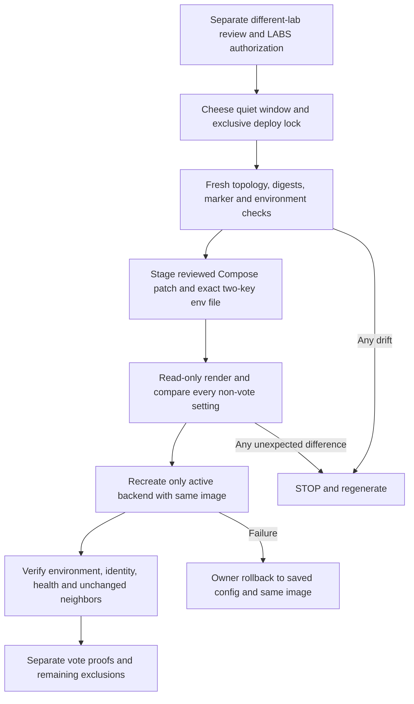

# C00 vote-gate enabling packet — DRAFT, NOT AUTHORIZED FOR EXECUTION

Author: c00-hermes-devops, OpenAI gpt-6.1-sol. This is authorship, not an independent signature.
Discovery: 22 October 2026, 11:17 ICT. Refs CHE-1950. This packet does not complete CHE-1950.

## Conditions

DO NOT RUN. Independent different-lab review is NOT-RUN. Cheese retains production execution. No instruction/C00 writes, ready transition, merge or deploy are authorized for agents. Do not treat the marker verdict as review of this packet. No LABS mapping has been provisioned. This document is a proposed owner procedure, not a deployment receipt.

The six-line Compose change and offline tests accompany this packet in a separate draft PR. PR #264 is not changed. A reviewed, hash-pinned final executable owner packet must replace this draft before Cheese is asked to execute anything. Stop rather than improvise when a gate below is unmet.

Correction source: Opus verdict `01a161f1-2e78-7ba4-b456-22a21169277a` and author-correction request `01a161f5-c1d7-747c-b234-2f1c3cc4167a`. This revision does not carry a new independent verdict. Keep CHE-1936 / PR #259 held. CHE-1950 stays in_progress and marker-scope PASS remains unchanged.

## Fresh read-only discovery

- Serving slot: `backend-blue`, container `multica-backend-blue-1`, Compose project `multica`, working directory `/home/congvc/.multica/server`.
- Actual Compose labels name `/home/congvc/.multica/server/docker-compose.selfhost.yml` and `/home/congvc/.multica/cd-state/cd-deploy-1792637682/cutover-controller/deploy/cd/docker-compose.ab.yml`. The second file no longer exists. This is a concrete execution prerequisite, not permission to substitute silently. The checked-in overlay at `/home/congvc/.multica/server/deploy/cd/docker-compose.ab.yml` is present and was rendered read-only for comparison. The final signer must approve that exact replacement after full runtime/config equivalence checks. Do not substitute the single-slot file alone.
- The missing overlay belongs to the 22 October 2026 deployment at 09:54:42 ICT, not an old historical deployment. `cd-deploy.yml` removes its temporary deployment directory after each deploy. Opus traced `build-cutover-bundle.sh` copying the tracked overlay verbatim and accepted replacement equivalence on X99. C00 rendering remains a separate gate.
- Active router state: `/home/congvc/.multica/ab/deploy/cd/router/state/active.json`, colour `blue`, backend port `18091`, frontend port `13001`. Router itself is not a backend target.
- Runtime commit: `6e3b42150711a2884a5b62bb568ffd81cf8e7462`.
- Running image and RepoDigest: `ghcr.io/cheese-work/multica-backend@sha256:503da080aef98300c95b876813782d11450d0e9dd4ffcb9902e5f66a42271a7d`.
- Backend `/health` and `/readyz` on `127.0.0.1:18091` return success. Public `/health` at `https://congvc-c00.taila6fa8a.ts.net:19444/health` returns 200.
- Both `MULTICA_VOTE_GATE_FIELDS` and `MULTICA_VOTE_GATE_LABS` are absent in the live backend. Existing base Compose does not forward either variable.
- In-memory comparison of rendered configuration against the running environment found one differing declared name: `MULTICA_SKIP_MIGRATIONS`. Runtime value is `1`. A recreation must preserve `1`, not use the empty Compose default. No credential values were emitted.
- Base Compose SHA-256: `69170f2d25f672203a5d858d6185f365dff42ef76ee94ab4d67d84146b2d31cb`.
- Checked-in A/B overlay SHA-256: `a8823b3c59f39b3967bee8c0e175d8b6b457ee4593d5b0bb4b4117323a9ee76b`.
- C00 Compose is `5.1.3`; X99 test Compose is `5.3.1`. `format: raw` requires Compose 2.30 or newer. A no-file stdin `docker compose config --format json` control with an optional raw env-file parsed successfully on C00. No container started. Exact final-file parsing remains a final-review prerequisite.

## Minimal proposed persistence

Add one optional raw `env_file` to `backend` in `docker-compose.selfhost.yml`. Both A/B services inherit the base service, so the same operator-owned file survives subsequent slot changes. Missing file keeps both vote settings absent. The file is `.env.vote-gate` beside the base Compose file and is already covered by `.env*` in `.gitignore`. No registry defaults or example production mappings are committed. Do not place settings in an ambient shell or plain `.env` and assume forwarding.

The pinned C00 base file differs from the git base used by the offline tests. Opus found no match among 82 git revisions. Do not replace C00's file with the repository file. The final packet must apply only the six-line hunk to the exact pinned C00 bytes, then prove full in-memory render equivalence except the approved vote settings. `cutover.sh` reads that local base file, so the scoped edit persists across later CD runs. No such hunk application or full C00 render has happened in this correction.

```yaml
env_file:
  - path: ./.env.vote-gate
    required: false
    format: raw
```

The file must contain only the two reviewed vote variables. A raw env file can override other variables not explicitly declared by Compose: validate its exact key set before installing it. Preserve existing field entries by union, never replace unrelated enabled fields. Observed absence means this candidate adds exactly `agent.instructions,workspace.context`, not `squad.instructions` or `project.description`.

## Exact proposed LABS registry — separate authorization required

Proposed minimal mappings, not installed or independently attested:

```json
{"claude/claude-sonnet-5-5[1m]":"anthropic","codex/gpt-6.1-sol":"openai"}
```

Evidence is runtime provider plus selected agent model: Sonnet agent `75eed3bd-33c6-42f5-b612-cf0f03b8879a`, provider `claude`, model `claude-sonnet-5-5[1m]`; Sol agent `5cd75ce5-d323-4004-9779-7e2ccf16bde4`, provider `codex`, model `gpt-6.1-sol`.

The unsupported Hermes entry is removed, not renamed. The live author row holds `custom:c00-openai:gpt-6.1-sol`. Native model display is not the server's stored claim. `daemon.go` records the agent row's model into `agent_task_queue.claimed_model` at claim time. The route's real upstream lab/model is not attested. Hermes stays unregistered unless a separate authorized change verifies both the exact C00 task record and real upstream routing. Do not add a guessed replacement key.

These two entries are proposed exact keys, not a claim that agent settings prove the persisted task model. The deployed server reads runtime provider and `agent_task_queue.claimed_model`, and records voters' provider/model at vote time. Agent rows alone are insufficient. Before installing the env file, the final packet must read the relevant task records on C00 and independently verify exact provider/model pairs and routing provenance. Task-record verification is NOT-VERIFIED in this draft. If evidence differs or is inaccessible, stop and leave that key unregistered. Do not infer a lab from the CLI family or invent aliases, fallback models or additional mappings. No shared credentials or credential changes are required.

Two registry entries do not mean two votes. Any positive proof must retain at least two distinct live non-writer agent PASS votes for the exact target and digest. One voter must be the owning squad leader and at least one voter must be from a different lab than the writer. A Sonnet writer and Sol leader alone provide only one non-writer vote. Another distinct eligible non-writer is required with an independently verified registered pair. Multiple agents may use one registered pair, but the writer never counts. An unknown-lab task does not count. Preserve BLOCK-vote denial and all remaining server checks.

## Owner procedure to finalize after independent review



1. Dev team obtains a different-lab signer for this packet, its separate PR head and its exact proposed LABS registry. Record reviewer identity/model/lab, signed verdict comment, head/base and packet digest. Author cannot sign. After draft approval, generate the final executable owner packet with those provenance fields and its own attachment digest. Independently review that exact final executable artifact before any request for Cheese execution. A draft verdict does not sign a later generated script. Keep both PRs draft meanwhile.
2. Cheese chooses an agreed quiet window outside active agent work. A backend restart can interrupt task connections. Coordinate the existing CD controller and acquire its same exclusive `/home/congvc/.multica/cd-state/deploy.lock` lock. Do not kill processes or daemons to get the lock. Hold it through verification or rollback. Do not use stale September `deployed-tuple.json` as current runtime truth.
3. In Cheese's owner terminal, re-read current runtime and markers. Require PR #264's 22 after-digests if markers have been applied. Resolve held packets serially. Confirm the six exclusions are still held and never claim full acceptance. Recheck exactly one running A/B backend, router colour, actual Compose labels, base/overlay digests and image identity. Any change from the pins above requires regeneration/review, not an automatic new target. Do not select by container-name substring.
4. Save mode-restricted owner-local rollback copies of only the exact base Compose file and any pre-existing `.env.vote-gate`. Do not upload `.env`, rendered configuration or Docker environment. Keep credentials within process memory when comparing. Record container IDs, image IDs, mounts, network attachments, ports, restart policies and router state for every running project container. Save no raw environment in the evidence attachment.
5. Apply only the reviewed six-line Compose diff to the pinned base file. Install the independently authorized `.env.vote-gate` atomically with mode 0600. Validate exactly two unique keys, exact approved field union and exact approved registry. No mapping decision may be delegated to a shell default. Do not edit the existing `.env`, A/B overlay or router state.
6. Create a task-private Compose override which pins **only the active backend service** to the running digest above. Set `MULTICA_SKIP_MIGRATIONS=1` explicitly in the operator environment. Use the pinned C00 base with only the reviewed hunk, independently approved exact replacement A/B overlay and image override, with explicit project name `multica`. The removed deploy-bundle path cannot be used. Check effective `MULTICA_JEV_FLAGS_FILE` and `MULTICA_JEV_GATEWAY_NETWORK` with the same environment/compose-directory lookup as `cutover.sh`, without printing secrets. Require both unset for the two-file recipe. If either is set, stop that recipe: the final packet must include and independently review the exact `docker-compose.jev.yml` overlay, mounts and networks used by CD, plus its existing validity checks. Do not clear JEV settings or omit that overlay. On C00 Compose 5.1.3, render in memory with `docker compose ... config --format json`; never print or attach the result. Compare every non-vote environment value with the live backend and compare mounts, ports, command, entrypoint, networks, restart policy and image identity. Report differing key names only. Stop unless the sole effective configuration changes are the two approved vote values and their input-file metadata. Check both slots inherit the file for future CD without starting the idle slot. Verify all non-backend services are unchanged. Full C00 hunk/render and JEV-state checks remain NOT-RUN until the final-packet preflight.
7. Final reviewed command shape for the confirmed-unset JEV case, not an instruction to run this draft: `docker compose -p multica -f <actual-base> -f <actual-ab-overlay> -f <active-image-pin> up -d --no-deps --no-build --pull never --force-recreate backend-blue`. The final packet must replace placeholders with reviewed exact paths and hashes, adding the reviewed JEV overlay if needed. Never run whole-project `up`, `down`, `pull`, a migration, `restart` alone, router cutover or a frontend recreation. Restart alone does not adopt environment changes. Do not build on C00.
8. Read back only the two vote values. Require exact approved values, not just nonempty JSON. Compare all non-vote environment values in memory with the pre-recreation snapshot. Require the same image ID/digest, volumes, networks and published ports. Every other container ID and router-state byte must be unchanged. Require private `/health` commit `6e3b42150711a2884a5b62bb568ffd81cf8e7462`, `/readyz`, public `/health` and runtime reconnection. Log no credential values.
9. If readiness or preservation fails, stop new work. Cheese restores saved base/env-file state and recreates only that same backend from the same pinned image, with `MULTICA_SKIP_MIGRATIONS=1`. Never roll back the database or router. Verify the same checks again. Preserve rollback evidence and report failure rather than retrying blindly. The final executable packet must implement this rollback and failure marker before use.
10. Successful environment readback is enabling only. Independent positive vote-write/readback and negative human-block 403 proofs remain separate acceptance work. Missing model attestation or six excluded values still prevents full CHE-1950 completion. No live proof was attempted in this authoring run.

## Test-first evidence

Base: `6e3b42150711a2884a5b62bb568ffd81cf8e7462`, separate `cheese-work/multica` branch. Before any Compose edit, X99 executed `python3 deploy/cd/test_vote_gate_env.py -v`: `Ran 3 tests`, `FAILED (failures=2)`. The absent-file default passed; operator-file forwarding and literal-value tests failed because no setting reached the backend. Those are behavior failures, not collection/compile failures.

After the six-line change, forwarding and preservation passed. The literal-dollar expectation initially used the unescaped form; Compose serializes a literal dollar as `$$` in reusable `config` output. The test expectation was corrected explicitly. This auxiliary expectation correction is not claimed as an additional production fix. Final tests check missing-file default, exact forwarding to base plus both slots, no other rendered setting changes, and raw-dollar serialization. Final X99 run: `Ran 3 tests`, `OK`.

No production recreation, live mapping installation, live vote write, independent review of this packet or full deployment-controller suite was run. This packet is intentionally not executable until a separately reviewed final owner artifact exists.

Correction regression: before changing this packet, X99 ran `test_packet_registry_excludes_unattested_hermes_route` against head `d2006c8118a4e093ee95950b5c7cb7cf0b717553` with the new test. Observed `Ran 4 tests`, `FAILED (failures=1)` because the registry contained the unsupported Hermes entry. The three existing Compose checks passed. The Compose implementation remains unchanged in this correction.

## CI gate retained, no waiver

Reuse CHE-1952 / `cheese-work/multica#351`, head `ff456935d12de9691efa1551e5746fa23cf6b802`, for the inherited trusted-checkout failure. Do not duplicate that repair. Rerun `close-target` on PR #353 after PR #351 merges, before PR #353 leaves draft. Require the rerun to pass. If the base or head changes, pin the actual pair and obtain fresh applicable review. This correction does not authorize a ready transition or waive any check.
