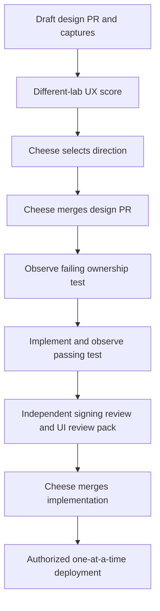

## Request

> "make the current user's comments stand out in the issue thread while they browse comments; for example fill the comment background."

Source: Cheese's 26 Oct 2026 DM, quoted in the issue description.

- Issue: [CHE-2133](mention://issue/01a177ba-fbeb-7a93-a11d-5920b30ebf6a)
- Pages in scope: issue detail discussion; member-authored roots and replies; web and desktop shared views. Native mobile is separate and is not implemented by this design PR.
- Status: selected — approved when PR #405 merges. Direction C of rev-1 (fill + "You" label), chosen by Cheese on CHE-2133.
- Current live before capture: NOT-CAPTURED. This X99 run has no authorized signed-in browser session. Authenticated resources remain with the browser owner; no session import or live mutation was attempted. The reconstructed baseline below is not a live capture.

## Existing implementation

`packages/views/issues/components/comment-card.tsx` already computes `isOwn` from `entry.actor_type === "member" && entry.actor_id === currentUserId` in both root and reply paths. Reuse that identity boundary and the viewer identity used by the merged self-mention work. Agent IDs must never qualify by ID alone. Keep each comment's fill outside its sibling replies. Preserve existing target, resolved, folded, deleted, editing and sticky-header semantics.

## Gates

The issue remains with Sonnet. No application implementation, merge or deployment is authorized by this design packet. Reflect was attempted before this flow; the memory service returned HTTP 503 (no available accounts), so reflect is unavailable.
