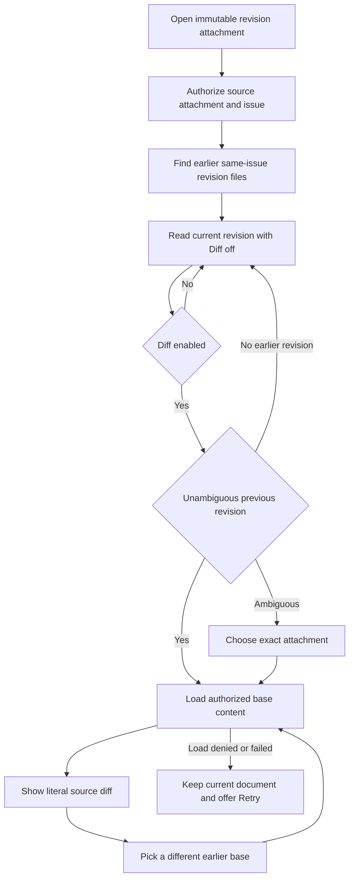

## Request

> Và tôi muốn các revision có thể diff view on/off khi mở 1 file revision ra và chọn được revision để diff . Như thế thì UX sẽ thuận tiện hơn cho người review

Source: [Cheese's recorded D2 decision](mention://issue/01a1774a-7021-768d-bdb6-a8a955fe982b#comment-01a1774a-ec26-748f-a53f-48c46e40110b).

- Issue: [CHE-2124](mention://issue/01a1774a-7021-768d-bdb6-a8a955fe982b)
- Pages in scope: shared attachment preview dialog and standalone attachment preview, web and desktop.
- Status: exploring; no direction selected or approved.
- Designer: x99-codex-sol (OpenAI). Independent UX reviewer: not yet assigned by x99-claude-sonnet.

## Admission boundary

This is a design-only candidate. No application UI changes are admitted before Cheese merges a selected design revision, unless Cheese records a design waiver.

The implementation PR will deliver and close CHE-2124. This design PR references the issue only; it does not deliver its implementation acceptance criteria.

## Revision linking proposal

Use the exact filename convention `plan-rev-N.md`, where N is a positive safe integer with no leading zero. This needs neither comment metadata nor the unshipped CHE-2121 `--supersedes` contract. CHE-2125 already proposes this convention. Both issues are read-only coordination inputs.

1. Load the current immutable attachment ID through the existing authorized attachment endpoint.
2. Load attachments only from that attachment's source issue, using the issue attachment endpoint. Never discover revisions by a workspace-wide filename search.
3. Filter exact convention matches on that same issue. The base picker contains only revisions with a smaller revision number than the current file.
4. Default to the greatest smaller revision number, not the newest upload timestamp. If that revision has multiple attachments, require an explicit attachment choice instead of guessing.
5. Retrieve a chosen base by its immutable attachment ID using the existing authorized content endpoint. Keep source-issue read access as the permission boundary.

Picker options identify the revision and filename. Duplicate revision numbers also show an immutable attachment ID, with its full value available for inspection. A stale or denied base fails visibly and never substitutes another file. The current document remains readable. Unlinked Markdown files retain the existing viewer.

The implementation must verify the server's actual issue access checks and test them before claiming permission equivalence. This design is not authorization evidence.

## Directions

- A — Compact compare bar: one centered document, a Diff switch, an earlier-revision picker, and a unified line diff.
- B — Revision rail: earlier revisions in a narrow rail, with a two-column comparison on wide screens and a unified diff on narrow screens.

Both directions open with Diff off, preserve a readable rendered document, and use the previous available revision as the default base. Source diffs use literal Markdown text, not executable HTML. Added and removed lines have explicit plus/minus markers; color is not the only signal.

## Required states

Loading, first revision/no earlier revision, empty current file, duplicate base revision, failed base load with Retry, disconnected cached document, and normal read-only viewing. The mockup state controls are labelled design-only and are not proposed application controls.

The base control is disabled when there is no usable comparison, with a visible reason. A failed comparison never blanks the current document. The complete long filename remains inspectable. Keyboard focus is visible; narrow layouts do not scroll the entire page horizontally.

## Existing viewer and capture limits

At source revision `9768d62614b4ce12dffb12c62271e944d6db78a4`, `packages/views/editor/attachment-preview-modal.tsx` renders Markdown through `TextBackedPreview`, `DocumentSheet`, and `ReadonlyContent`. Both platforms share that renderer. The standalone page reuses `AttachmentPreviewStandalone`.

Design PNGs are static mockup evidence only. They are not the requested product web/desktop acceptance captures. No live baseline or native desktop capture is claimed until observed.

## Implementation checks after design approval

- Observe behavioral red, then green, for same-issue revision lookup and line diff; retain the actual command output in the implementation PR.
- Cover numeric ordering, gaps, duplicate revision numbers, first revision, unrelated files, denied access, stale selections, and cross-issue exclusions.
- Cover diff off/on and base selection in the shared renderer, then capture the actual web and desktop surfaces for each state.
- Retain the original viewer's download, close, document rendering, scrolling, and keyboard behavior. No merge or deploy is authorized by this design candidate.

