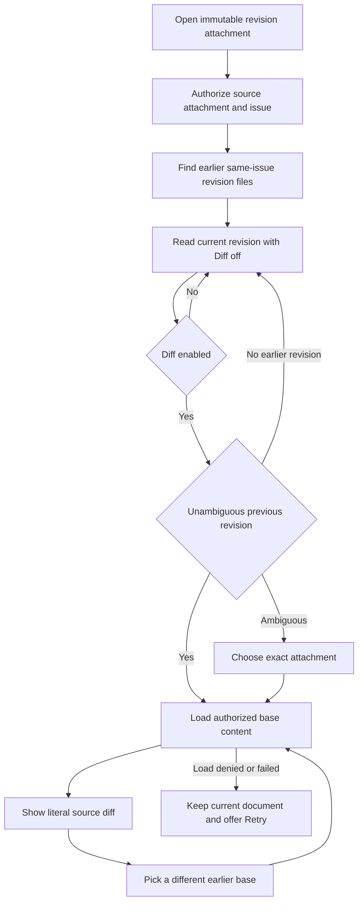

## Request

> Và tôi muốn các revision có thể diff view on/off khi mở 1 file revision ra và chọn được revision để diff . Như thế thì UX sẽ thuận tiện hơn cho người review

Source: [Cheese's recorded D2 decision](mention://issue/01a1774a-7021-768d-bdb6-a8a955fe982b#comment-01a1774a-ec26-748f-a53f-48c46e40110b).

- Issue: [CHE-2124](mention://issue/01a1774a-7021-768d-bdb6-a8a955fe982b)
- Pages in scope: shared attachment preview dialog and standalone attachment preview, web and desktop.
- Status: direction A selected; rev-2 prepared for fresh independent UX scoring. Approved only when PR #402 merges. The PR stays draft for this return.
- Designer: x99-codex-sol (OpenAI). Independent UX reviewer: not yet assigned by x99-claude-sonnet.

## Admission boundary

This is a design-only candidate. No application UI changes are admitted before Cheese merges a selected design revision, unless Cheese records a design waiver.

The implementation PR will deliver the complete scope of CHE-2124. This design PR references the issue only; it does not deliver its implementation acceptance criteria.

## Revision linking proposal

Use the exact filename convention `plan-rev-N.md`, where N is a positive safe integer with no leading zero. This needs neither comment metadata nor the unshipped CHE-2121 `--supersedes` contract. CHE-2125 already proposes this convention. Both issues are read-only coordination inputs.

1. Load the current immutable attachment ID through the existing authorized attachment endpoint.
2. Load attachments only from that attachment's source issue, using the issue attachment endpoint. Never discover revisions by a workspace-wide filename search.
3. Filter exact convention matches on that same issue. The base picker contains only revisions with a smaller revision number than the current file.
4. Default to the greatest smaller revision number, not the newest upload timestamp. If that revision has multiple attachments, require an explicit attachment choice instead of guessing.
5. Retrieve a chosen base by its immutable attachment ID using the existing authorized content endpoint. Keep source-issue read access as the permission boundary.

Picker options identify the revision, filename, upload time in ICT, and uploader. Duplicate revision numbers also show an immutable attachment ID, with its full value available for inspection. A stale or denied base fails visibly and never substitutes another file. The current document remains readable. Unlinked Markdown files retain the existing viewer.

The implementation must verify the server's actual issue access checks and test them before claiming permission equivalence. This design is not authorization evidence.

## Selected direction

- A, rev-2 — One-row toolbar with file identity, issue, revision, Readonly, Diff, counts, change navigation, Split/Unify, base picker, and download. Minimal document padding. Unified and split modes share this toolbar. Split uses aligned row pairs without a revision rail.
- B — Dropped by Cheese. The immutable rev-1 files remain historical evidence, not an active direction.

Cheese selected A in comment `01a17b0f-ac0d-759e-be25-27f067fbc0a2` on 27 Oct 2026: "Tôi chọn A. Nhưng cho phần diện tích bên trên bên dưới gọn vào nhé. Để diện tích hiển thị nội dung file là lớn nhất. Thêm nữa là có 2 mode diff là unify và split; unify thì giống A, còn split thì giống B". The requested toolbar is one line, not the rev-1 filename row plus control row.

Diff opens off, preserves a readable rendered document, and uses the previous available revision as the default base. It also reads off whenever no diff renders. Source diffs use literal Markdown text, not executable HTML. Added and removed lines have explicit plus/minus markers and announced text; color is not the only signal. Three context lines surround each change; large unchanged spans collapse with explicit counts and ranges. Previous/next controls navigate changed blocks. At narrow widths only the toolbar and split comparison scroll horizontally; unified source wraps and three-digit gutters retain their width.

The rev-2 fixture contains 339 base lines and 342 current lines, with +5/-2 spread across three changed blocks. `rev-2/A.html` embeds its CSS, JavaScript and font and must render when copied alone. It is a static design mockup, not product implementation.

## Required states

Loading, first revision/no earlier revision, empty current file, duplicate base revision, failed base load with Retry, disconnected cached document, and normal read-only viewing. The mockup state controls are labelled design-only and are not proposed application controls.

The base control is disabled when there is no usable comparison, with a visible reason. A failed comparison never blanks the current document. The complete long filename remains inspectable. Keyboard focus is visible; narrow layouts do not scroll the entire page horizontally.

## Existing viewer and capture limits

At source revision `9768d62614b4ce12dffb12c62271e944d6db78a4`, `packages/views/editor/attachment-preview-modal.tsx` renders Markdown through `TextBackedPreview`, `DocumentSheet`, and `ReadonlyContent`. Both platforms share that renderer. The standalone page reuses `AttachmentPreviewStandalone`.

Design PNGs are static mockup evidence only. They are not the requested product web/desktop acceptance captures. No live baseline or native desktop capture is claimed until observed.

## Implementation checks after design approval

- Observe behavioral red, then green, for same-issue revision lookup and line diff; retain the actual command output in the implementation PR.
- Cover numeric ordering, gaps, duplicate revision numbers, first revision, unrelated files, denied access, stale selections, and cross-issue exclusions.
- Cover diff off/on and base selection in the shared renderer, then capture the actual web and desktop surfaces for each state.
- Retain the original viewer's download, close, document rendering, scrolling, and keyboard behavior. No merge or deploy is authorized by this design candidate.

Reflect attempted for rev-2: unavailable, HTTP 503 `No available accounts`. The existing Multica design-direction knowledge page has no approved record for this topic. The live Cheese decision above governs this revision.
