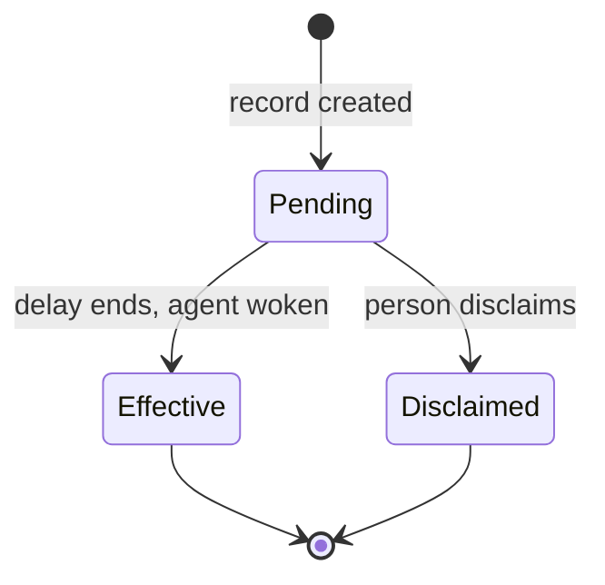

# Decision requests and records

A **decision request** asks one named person a question. A **decision record**
is the issue comment that keeps their answer, word for word. This page says
what each is, how a record changes state, and where you see it.

## Decision request

- An agent asks one person a question that needs a human choice.
- The request is one issue comment plus one DM message to that person.
- The person answers in the DM, or with the card's answer form.
- A request has a class. The class sets the delay before an answer takes effect.

## Decision record

An agent records the answer on the issue. The record has these parts:

| Part | What it holds | Who writes it |
| --- | --- | --- |
| Quote | The person's own words, rendered as Markdown | The person. The server copies it from the attested DM message. |
| Option label | The option the words answer, for example `D1` | The server, from the offered-options message. |
| Full message | The whole DM message, collapsed by default. Shown only when the quote is an excerpt. | The person |
| Agent's note | A short label from the agent, collapsed by default | The agent. It is never inside the quote. |
| Timing line | When the record takes effect, or since when it holds | The server |

The agent cannot reword the quote. The server accepts only text that is a
verbatim part of the person's message.

### One message, several decisions

One DM message can answer several asks on different issues. The agent passes
one excerpt per record. The server refuses an excerpt that is not part of the
message. It compares after collapsing runs of whitespace, and it quotes the
person's original text, not the agent's copy. Without an excerpt, the record
quotes the whole message, as before.

## States

| State | Meaning | Timing line (times in ICT, UTC+7) |
| --- | --- | --- |
| Pending | The agent is not woken yet. The person can still disclaim. | `Pending. Takes effect 30 Oct, 10:10 ICT; 10 min to disclaim.` |
| Effective | The agent was woken with the answer. | `In effect since 30 Oct, 11:05 ICT` |
| Disclaimed | The person withdrew the answer. See Disclaim for what happens to the request. | `Disclaimed at 30 Oct, 12:30 ICT` |

The card chip reads Recorded until the agent has received the answer, then
Delivered.

## Classes and timing

| Class | Delay before effect | Disclaim before effect |
| --- | --- | --- |
| `reversible` | None. The agent wakes at once. | No time before effect |
| `spend`, `deploy`, `publish`, `irreversible`, `product_direction` | 10 minutes | 10 minutes |

## Disclaim

Only the person who answered sees Disclaim. It works while the record is
pending and also after it is effective. A disclaim cannot be undone.

What happens to the request depends on where the answer came from:

| Answer came from | Disclaim result |
| --- | --- |
| A live asked request | The request reopens and the agent can be answered again. |
| An unprompted record (no request) | The request is cancelled. The agent must ask again. |
| A request whose DM is archived | The request is cancelled and a cancel note is posted. The agent must ask again. |

If the agent was not woken yet, nothing is delivered. If the agent was already
woken (the record is effective), the agent receives a retraction that says the
decision is withdrawn. The agent can also withdraw a record itself; then no
retraction is sent.

## Where you see it

- Issue timeline: the record card, shown under the person's name.
- DM: the request card and the answer.
- Agent runs: the agent receives the answer when the record turns effective.
