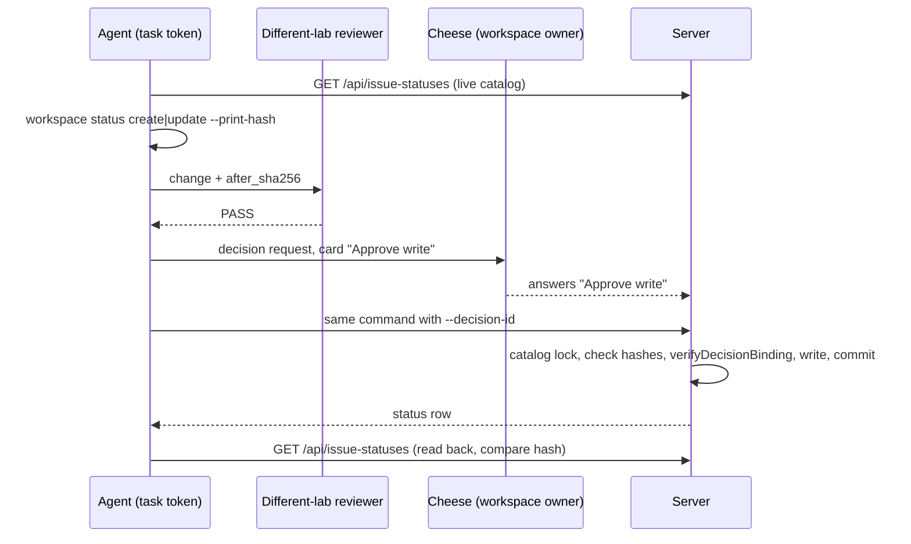

# Decision-bound issue status writes

An agent creates or edits a custom issue status only after a workspace owner
approves that exact change. The mechanism is the CHE-2455 decision-bound write
that `workflow update --decision-id` already uses. This page names the server
routes, the hash, the CLI commands, the tests and the implementation split.

Status: design, CHE-3070. No code changes in this PR.

## Today

- `POST /api/issue-statuses` and `PATCH /api/issue-statuses/{id}` need
  workspace owner or admin (`CreateIssueStatus`, `UpdateIssueStatus` in
  `server/internal/handler/issue_status.go`). The only client is Workspace
  Settings > Issue Statuses. The CLI has no command.
- The route block adds no per-route machine-credential middleware, unlike
  `/api/issue-workflows` (`RequireHumanOrTaskToken`, `RequireHumanActor`); a
  parent group may still add one.
  Child 2 starts with a red test that shows what a task token gets today. If it
  can write, the same change closes that gap.
- A workflow step may create a status, but a machine caller gets
  `errStatusCreateForbidden`. That stays: an agent creates the status first,
  with its own decision, then references it in a workflow.
- Built-in statuses are immutable. A key is immutable. Neither changes here.

## Scope

| In | Out (stay human-only) |
| --- | --- |
| Create a custom status | Archive, reorder |
| Update name, description, colour, icon of a custom status | Built-in statuses, key rename |
| Set the category when creating a status | Change the category of an existing status (see "Why no category change") |
| | Run-budget and any non-status setting |

## Flow



## Governed field

Add `workspace.issue_statuses` to `delegatedWriteFields` in
`workspace_delegated_writes.go`. The workspace setting (`allowed_agents`,
`allowed_fields`, `requires_human_decision`) already gates it. No migration: the
setting is JSON in `workspace.settings`. Default stays "delegates nothing".
The ask heading is `Apply this change to workspace.issue_statuses?`. The ask
text is built by a new `decisiontx.BoundStatusDecision`, which adds two lines
to `BoundWriteDecision` (see "What the card binds").

## Server routes

No new route. The two existing routes learn a bound mode:

| Route | Human | Task token | Other machine credential |
| --- | --- | --- | --- |
| `POST /api/issue-statuses` | owner/admin, unchanged | needs a bound body | 403 |
| `PATCH /api/issue-statuses/{id}` | owner/admin, unchanged | needs a bound body | 403 |
| `PATCH /reorder`, `DELETE /{id}` | owner/admin, unchanged | 403 (`RequireHumanActor`) | 403 |

Router: `RequireHumanOrTaskToken` on `POST /` and `PATCH /{id}`;
`RequireHumanActor` on reorder and delete.

Bound body: the normal create or update fields plus `decision_id`,
`before_sha256`, `after_sha256` (`DecisionBindingFields`). A bound body refuses
`position` and, on create, a missing `key` (400): the server derives a missing
key from the catalog, so the agent could not know `after_sha256`. A machine
caller without `decision_id` gets 403 from `refuseUnboundMachineWrite`.

Handler order, inside one transaction (same order as `UpdateIssueWorkflow`):

1. `refuseUnboundMachineWrite`, then the field checks the human path makes
   (name, description, category, colour, icon, key pattern). Extract these into
   one `validateStatusFields` both paths call.
2. `LockIssueStatusCatalog` (exclusive).
3. Load the whole custom catalog. `CatalogHash(live)` must equal
   `before_sha256`, else 409 (the catalog moved; ask again).
4. Update only: a body that carries `category` is refused with 400 (see "Why no
   category change").
5. Apply the change in memory. `CatalogHash(result)` must equal
   `after_sha256`, else 403 (the agent wrote something other than it hashed).
6. `verifyDecisionBinding(..., "workspace.issue_statuses", before, after)` with
   the optional ask check described under "What the card binds". It inserts the
   single-use `decision_bound_write` row in this transaction.
7. Write the row, commit. A refused or stale write commits nothing, so it
   consumes no decision.
8. Publish `EventIssueStatusChanged` with the agent as actor.
   `publishIssueStatusChanged` takes a `db.Member` today; give it an actor
   type and id.

The `decision_bound_write` row is the audit record. No second audit table.

## Hash definition

Why the whole catalog: a create has no row to hash, and one definition then
covers create and update. It also makes a key collision or a concurrent edit a
409. Cost: any other custom-status write between ask and apply invalidates the
approval. Catalog writes are rare admin actions, so that is acceptable.

Recipe (same style as `workflowStepsHash`), `CatalogHash(catalog)`:

1. Take every non-built-in status of the workspace, archived ones included
   (an archived status still owns its key).
2. Project each to
   `{"archived": bool, "category": <wire category>, "color": <lowercase #rrggbb>, "description": ..., "icon": ..., "key": ..., "name": ...}`.
   Leave out `id`, `position`, timestamps and `is_system`.
3. Wrap: `{"statuses": [<sorted by key, bytewise>], "workspace_id": "<uuid>"}`.
4. Canonical JSON: UTF-8, keys sorted, no whitespace, no HTML escaping, then
   sha256, lowercase hex.

`before_sha256` hashes the live catalog; `after_sha256` hashes the catalog as
the server will store it. The workspace id binds an
approval to one workspace.

### Why no category change

Changing the category of a status that issues use rewrites the machine behaviour
of every issue on it (terminal, started, closed). The number of such issues is
not in the catalog, so the catalog hash cannot bind it. Binding it would need a
count that stays true to commit, and the issue-status lock does not give that:
`assertIssueStatusStillActive` skips the shared lock for built-in targets, so an
issue moving off a custom status, or being deleted, changes the count without
the lock. Closing that gap means a new lock on every issue transition, which is
far more than this feature is worth.

So bound mode never changes the category of an existing status. A create sets
the category of a status that has no issues, so it has no impact to bind. A
category change stays on the owner/admin path with `confirm_category_change`
and its issue count. An agent that needs another category creates a new status.

### What the card binds

The hashes are opaque to a person, and the server cannot read a free-text
summary. So the owner is not shown a summary that the server trusts. The card's
decision text carries the change itself, and the server checks it against the
hashes:

```text
Apply this change to workspace.issue_statuses?
before_sha256: <hex>
after_sha256: <hex>
change: {"key":"needs_qa","op":"create","status":{"category":"started","color":"#ff8800","description":"","icon":"","name":"Needs QA"}}
```

- `change` is one line of canonical JSON. For create it holds the full status.
  For update it holds `key`, `op` and only the changed fields under `set`
  (never `category`).
- `verifyDecisionBinding` gets an optional ask check (nil for existing callers).
  For this field the check requires exactly one `change:` line in the decision text, parses `change`, applies
  `ApplyChange` to the live catalog and requires
  `CatalogHash(result)` to equal `after_sha256`. A card
  that shows one change while the hashes cover another is refused, and so is
  a repeated line. A line in any other card section is ignored, as the hash
  lines are today.
- The request body must produce the same `after_sha256` (step 5), so the body,
  the card text and the hashes all describe one change.
- `--print-hash` prints the ready-to-post `decision` text, so the agent never
  hand-types the lines.

Reviewer procedure, before the owner is asked: run the same `--print-hash`
command against the live catalog and compare the output byte for byte with the
`decision` text of the posted request; read the `change` line as the change.
Remaining trust: the other card sections (context, "Agent did") are free text
and the owner should read the `change` line, not those.

## CLI

```text
multica workspace status list [workspace] [--include-archived]
multica workspace status create --key K --name N --category C [--color #rrggbb] [--icon I] [--description D]
multica workspace status update <key|id> [--name N] [--color X] [--icon I] [--description D]
```

`create` and `update` share two flags:

- `--print-hash`: GET the live catalog, apply the change locally, print
  `before_sha256`, `after_sha256` and the ready-to-post `decision` text as
  JSON. Writes nothing.
- `--decision-id <uuid>`: same computation, then send the bound body. The CLI
  recomputes the hashes from the live catalog at that moment.

Without either flag the command makes the plain owner/admin request. A 403
without `--decision-id` explains that only an owner or admin can write statuses
and names the decision-bound path. Flags `--position` and archive/reorder do
not exist on the CLI.

## Tests (each child writes the red test first)

Server, `server/internal/handler/issue_status_bound_write_test.go`, modelled on
`issue_workflow_bound_write_test.go`:

| Test | Asserts |
| --- | --- |
| accepts approved create | 201, row stored, `decision_bound_write` row |
| accepts approved update | 200, fields changed |
| refuses without `decision_id` (task token) | 403, nothing written |
| refuses cloud PAT | 403 |
| refuses stale `before_sha256` | 409, decision unused |
| refuses wrong `after_sha256` | 403, decision unused |
| refuses reuse of a decision | 409 `decision already used` |
| approval does not carry to another workspace or field | 403 |
| refuses agent not on the allow list, or field not allowed | 403 |
| refuses non-owner answer, expired, non-approve answer | 403 |
| refuses `position`, missing `key` on create | 400 |
| card `change` line differs from the body's change (hashes match the body) | 403, decision unused |
| card with no, or a repeated, `change` line | 403 |
| `change` line only in another card section | 403 |
| update body or card `set` carries `category` | 400 / 403, decision unused |
| refuses built-in status, key rename, archived status | 403 / 400 / 409 |
| refuses reorder and delete for a task token | 403 |
| human owner path ignores decision fields | unchanged behaviour |

Pure, `server/internal/issuestatus/catalog_hash_test.go`: golden hash vector;
order independence; position, id and timestamps do not change the hash; archived
rows do; HTML characters stay literal; `ApplyChange` matches what the handler
stores (colour lowercased, name trimmed).

CLI, `cmd/multica/cmd_workspace_status_test.go`: `--print-hash` writes nothing
and matches the server vector; `--decision-id` sends the bound body; a flag
combination the server refuses fails before any HTTP call; the plain path is
unchanged.

## Implementation split

Stacked, each at most 4 hours, test-first, project Cheese Work Setup:

| # | Issue | Depends on | Estimate |
| --- | --- | --- | --- |
| 1 (CHE-3097) | `issuestatus.CatalogHash` and `ApplyChange` (pure, golden vector) | none | 2 h |
| 2 (CHE-3100) | Bound mode on create/update, router middleware, `validateStatusFields`, new delegated field, agent actor on the event | 1 | 4 h |
| 3 (CHE-3103) | `multica workspace status` commands, `--print-hash`, `--decision-id`, skill reference (`decisions.md`, `workspace.md`) | 2 | 4 h |

## Relationship to CHE-3070

CHE-3097, CHE-3100 and CHE-3103 are follow-up issues, not sub-issues of
CHE-3070. CHE-3070 is design only. A sub-issue would hold it open, and block a
PASS, until the implementation ships. The acceptance "child implementation
issues filed" is met by filing them with project, estimate and test-first
criteria; each names CHE-3070 and the design PR as origin. They stay in backlog
until the design review passes.

Cheese chose "Keep follow-ups" on 2 Nov 2026 (decision request
`a0cef9ea-da8f-45df-ada8-a1bea340a88f`), which waives the sub-issue wording of
the acceptance for this design issue.

## Risks and open questions

- A new status does nothing until a workflow lists it, and a machine caller
  cannot add it to a workflow without its own decision. Two approvals for one
  rollout is intended.
- Whether the web settings page for delegated writes lists fields from a
  constant or from the server is not checked. Child 2 greps for it.
