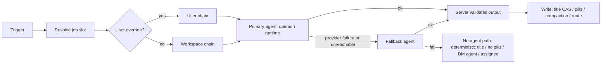
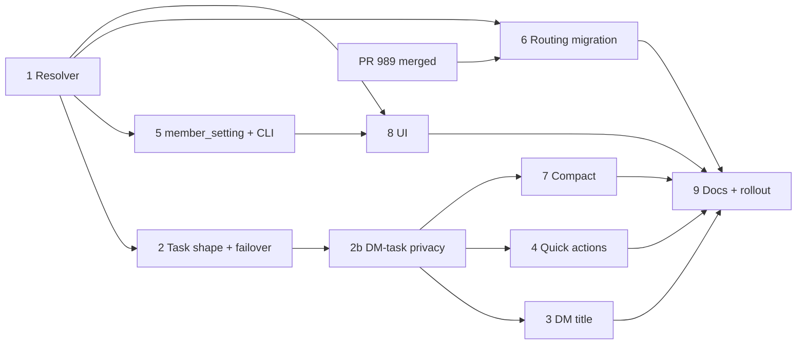

# Background agents: one agent-chain setting for background jobs

Issue: CHE-3703. Status: draft spec, awaiting cross-lab plan review (RGS-1). Facts checked at base `c21fb68da` (5 Nov 2026 ICT).

Supersedes in part: CHE-2908 and CHE-2917 (re-planned onto this framework). Does not block: PR #989 (CHE-3627, routing). Related: CHE-3683, CHE-3626.

## Decisions (Cheese, DM, 4 to 5 Nov 2026 ICT)

1. Initial DM title: 60 characters, client and server equal. Cheese may veto.
2. Re-title at milestones: first turn of a new DM, first turn after compact, first turn after fork. A manual rename is never overwritten.
3. The server re-titles, with a dedicated cheap agent. Background jobs get a settings entry, a per-user personalisation, a fallback and a settings UI.
4. Background jobs run as agents on daemon runtimes, not as direct server LLM calls.
5. One shared "Background agents" framework. `/compact` moves into it with the other jobs.

## Facts

| # | Job | Today (base `c21fb68da`) | Plan |
| --- | --- | --- | --- |
| 1 | DM auto-title | Server LLM call (`server/pkg/llm`, `MULTICA_LLM_*`). Fires on the first user message only: `maybeGenerateChatTitleAsync` (`handler/chat_title.go`), guard `shouldGenerateFirstMessageTitle` and `!session.ForkedFromSessionID.Valid` (`handler/chat.go:1057`). Write is a CAS: `UpdateChatSessionTitleIfCurrent` (`title = expected AND NOT title_manually_set`). Timeout 20 s. Client fallback title: `CHAT_TITLE_MAX = 30` (`packages/views/chat/components/use-chat-controller.ts:63`). Server cap 200 runes (`chatSessionTitleMaxLen`). | This spec |
| 2 | Quick actions (follow-up pills) | Server LLM call (`service/chat_quick_actions_generate.go`). Timeout 8 s, 16 concurrent, the client holds a skeleton until it resolves. | This spec |
| 3 | `/compact`, auto-compact | The DM's own agent runs the compact task. Workspace keys today: `compact_prompt`, `auto_compact`. No `compact_agent_id` and no `agent_task_queue.purpose` exist on `main`. | CHE-2894 plan v3, design PR #768 (merged 2 Nov 2026), CHE-2908 (blocked) |
| 4 | Routing-only workflow steps | Each step's own agent. | CHE-3627, PR #989 (draft, head `5128f1b45`): `settings.routing_agent` = `agent_id`, `fallback_agent_id`, `statuses`, `overrides`; `failOverRoutingTask` |

Other checked facts:

- `server/pkg/llm` is upstream code (multica-ai). It stays unchanged. Jobs 1 and 2 stop calling it in layers 3 and 4 (decision 4). Nothing else in this plan touches the package.
- No per-user settings store exists. `user` has no settings column; `member` has none. A per-user override therefore needs one new generic table (see Per-user store).
- Precedent for a task with no issue, chat or autopilot link: `EnqueueQuickCreateTask` (`service/task.go:2074`). Precedent for a nullable task discriminator: `regenerate_quick_actions_for` (`pkg/db/queries/chat.sql`).
- Task completion already carries `result` JSONB and an `output` string (`handler/daemon.go`).

## Goal

For each background job: an ordered agent chain, primary then fallback. Workspace default. Per-user override where the job belongs to a user. Settings UI and CLI at parity. Every job above uses it.



## Settings schema

Workspace scope: `workspace.settings.background_agents` (JSONB inside the existing settings object; no migration).

```json
{
  "background_agents": {
    "dm_title":      { "agent_id": "<uuid|null>", "fallback_agent_id": "<uuid|null>" },
    "quick_actions": { "agent_id": null, "fallback_agent_id": null },
    "compact":       { "agent_id": null, "fallback_agent_id": null },
    "routing":       { "agent_id": null, "fallback_agent_id": null, "statuses": ["todo","blocked","merged","need_decision"], "overrides": {} }
  }
}
```

- Job keys are a closed server-side catalog (`dm_title`, `quick_actions`, `compact`, `routing`). An unknown key is a 400. Adding a job is a code change plus one catalog row.
- A chain has two slots, no more. The shape matches PR #989, so `routing` maps one-to-one.
- `null` for `agent_id` means "no agent": the job runs on its no-agent path (table under Resolution). Defaults: every job unset. For `dm_title` and `quick_actions` that means the deterministic title and no pills, never a direct LLM call. An owner sets an agent to turn the generated title and pills on. `compact` and `routing` keep their agent-based behaviour today.
- Eligibility of a workspace-scope agent (ENG-8 from CHE-2894): workspace-visible (not private), not archived, on a workspace runtime. Checked at write time and again at resolve time. An agent that fails the resolve-time check is skipped as if unreachable.
- `routing` extras (`statuses`, `overrides`) stay as defined by PR #989. They apply to the `routing` job only.

Reason each job has a setting: Cheese's rule "every opinion is a setting" (repo `AGENTS.md`, Settings-first features). Review a job's setting if nobody changes it for 30 days.

### Per-user store

- One new generic table: `member_setting(workspace_id, user_id, key, value jsonb, updated_at)`, primary key `(workspace_id, user_id, key)`. Key here is `background_agents`; the value is the same object shape, restricted to user-scoped jobs.
- User-scoped jobs: `dm_title`, `quick_actions`, `compact`. `routing` is workspace-only (workflow steps belong to no single user). A `routing` key in a user value is a 400.
- This is the single migration the framework needs. It is generic, so later per-user settings reuse it.
- A user chain agent must pass `canInvokeAgent` for that user at resolve time (CEO-9(b) rule from CHE-2894). A private agent the user owns is allowed. Failing the check skips that slot.

## Resolution order

For a trigger on job `J` for user `U` (the DM creator, where `J` is user-scoped):

1. User chain for `J`, if the value exists and `agent_id` is set.
2. Else workspace chain for `J`, if `agent_id` is set.
3. Else the no-agent path.

Within a chain: primary, then fallback. A slot that is unset, ineligible, archived, or unreachable (below) is skipped. When both slots are skipped or fail, the no-agent path runs. A user chain that exists but fails entirely does not fall through to the workspace chain: the user's explicit choice is respected, and the no-agent path runs. Reversible default; Cheese may veto.

No-agent path per job:

| Job | No-agent path (no agent set, or no agent ran) |
| --- | --- |
| `dm_title` | Deterministic title from the first message (60 characters). No LLM call. |
| `quick_actions` | No pills. No LLM call. |
| `compact` | The DM's own agent runs compaction, as today. |
| `routing` | The step's own handler agent, as today. |

End state: no background job calls a model directly (decision 4). Layer 3 removes the direct call from `maybeGenerateChatTitleAsync`. Layer 4 removes it from the quick-actions generator. Each layer replaces the call site; it adds no shim, dual path or flag. `server/pkg/llm` and the `MULTICA_LLM_*` variables stay in the tree because they are upstream code. Removing the package is a separate decision.

Migration for a workspace that relies on the direct call today: an owner sets the `dm_title` and `quick_actions` agents before the layer 3 and 4 builds deploy. Each of those PRs states this step in its Conditions. Without it, titles fall back to the 60-character cut and pills stop. That is the intended no-agent behaviour, and it is a visible change for those workspaces.

## Execution model

One task shape for all jobs, so failover, audit and cancellation are written once.

- A background task is a row in `agent_task_queue` with a new nullable `purpose` text column (`bg:dm_title`, `bg:quick_actions`, `bg:compact`; `routing` keeps its existing workflow-step task and only reuses the chain resolver and failover). The same column is the one CHE-2894 plan v3 already specified for compaction (`purpose = 'compaction'`); this plan renames that value to `bg:compact` and the first layer to land adds the column.
- The task has no issue and no autopilot run. For `dm_title` and `quick_actions` it has no `chat_session_id` (so it never joins DM serialization), but it always carries `source_chat_session_id` (see Privacy of DM-derived tasks). The job input travels in the task `context` JSONB (precedent: quick-create). `compact` keeps `chat_session_id` as plan v3 ENG-1 requires and also sets `source_chat_session_id`.
- Input is bounded by the server: `dm_title` gets the user's message text (cap 2,000 characters, so a pasted log cannot become model input); `quick_actions` gets the last 6 messages with the existing budgets (`chatQuickActionsLatestBudget` and siblings, unchanged). The agent gets no tools beyond a read-only brief and no workspace access beyond the task's own context.
- Output is a short text in the existing task `output` field. The server, not the agent, validates and writes: `dm_title` runs `sanitizeChatTitle` and the CAS; `quick_actions` runs `sanitizeChatQuickActions`. An agent never calls a write API for these jobs. This keeps the write path server-owned and the CHE-2908 security rule intact (no agent-reachable route changes a title or a setting).
- Claim restriction: a `bg:*` task is claimed only by a runtime of the chain's agent. It never joins DM serialization (`chat_session_id IS NULL` for title and quick actions), so a title job never delays a user's turn.
- Run records: each background task is a normal task, so its row shows in the runs list and in usage. Its content is creator-private (next section). Cost per job is read from existing task usage grouped by `purpose`.

## Privacy of DM-derived tasks

A DM is creator-private, and so is everything its tasks produce (`handler/chat_task_privacy.go`). Today `redactForeignChatTaskContent` clears `result` and `error` for a task only when `chat_session_id` is set and the viewer is not the session creator. A `bg:*` task with no `chat_session_id` would skip that check, and its title text, pills or error text would be readable by any member who can list the shared agent's runs. The spec closes this as follows.

1. **Provenance column.** New nullable `agent_task_queue.source_chat_session_id` (UUID, no foreign key, per the repo rule). It is set at enqueue for every background task derived from a DM, in the same transaction as the enqueue. It is independent of scheduling: it does not change serialization, claim or `chat_session_id` semantics.
2. **One owner rule.** The privacy owner session of a task is `COALESCE(chat_session_id, source_chat_session_id)`. The redaction function uses it. A task whose owner session cannot be resolved stays "foreign" (the existing rule). A background task derived from a DM with neither column set is a bug: the enqueue helper rejects it and a test asserts it.
3. **Failover inherits.** A fallback attempt copies `source_chat_session_id` from the failed attempt inside the failover transaction. Every attempt in a chain has the same owner.
4. **Creator-only surfaces.** For a DM-derived task, a viewer who is not the session creator gets no `result`, no `error`, no `context` (it holds DM text), no transcript or task messages, and no event payload that echoes them. Layer 2b audits every route that returns task content: the two task lists that call the redactor today (`handler/agent.go`, agent task list and its second list path), the task messages and transcript routes, run events, and websocket payloads. It lists them in the PR body. Row metadata (id, status, purpose, timing, usage totals) stays visible, as workload views need it.
5. **Logs.** Background-task logs carry job, slot and reason only, never DM text or agent output.
6. **Regression test (two members).** Member A owns a DM and triggers `dm_title`, `quick_actions` and `compact` tasks, including a failed primary with a fallback attempt. Member B, in the same workspace, lists the agent's tasks and requests each task's messages and events. Expected: B sees row metadata only, never result, error, context, messages or events content. A sees everything. A negative control: a task with `source_chat_session_id` unset is rejected at enqueue.

Reason for a new column instead of reusing `chat_session_id`: setting `chat_session_id` would put title and pill jobs into DM serialization and the chat unread queries (`040_chat_unread_since`), so a title job could delay a user's turn.

## Failover rules

Same rules as PR #989 `failOverRoutingTask`, generalised:

1. Fail over only when the primary's run failed on a provider error and no retry was queued, or the primary was unreachable (below).
2. One failover per trigger. The fallback's failure ends the chain; the no-agent path runs.
3. A task that is not a provider failure (agent said nothing usable, output failed sanitising) does not fail over. The result is "nothing usable": the no-agent path for that trigger.
4. Unreachable means: the agent's runtime has no live daemon heartbeat at enqueue time, or the task is still unclaimed after the job's claim deadline (table below). The server cancels the unclaimed task and moves to the next slot. No task is left queued behind an offline daemon.
5. The failed run stays visible. A warning is logged with job, slot and reason. No transcript text in logs.
6. After a routing failover the fallback keeps the issue (PR #989 behaviour, unchanged). Other jobs hold no ownership, so nothing needs reassigning.

Per-job deadlines (targets for review; measurement is a layer-1 task, see Evidence plan):

| Job | Claim deadline | Run deadline | On deadline |
| --- | --- | --- | --- |
| `dm_title` | 10 s | 60 s | Next slot, then deterministic title |
| `quick_actions` | 5 s | 20 s | Next slot, then silent (no failed toast for the automatic pass; a refresh still reports failure, as today) |
| `compact` | 30 s | existing compaction limits | Existing plan v3 enqueue-fallback to the DM agent |
| `routing` | PR #989 rules | PR #989 rules | PR #989 rules |

## DM title

- Initial title: 60 characters, client (`CHAT_TITLE_MAX`) and server fallback equal. One shared constant in `packages/core` for the client; the server constant lives beside `chatSessionTitleMaxLen`. A test asserts both are 60. Title text stays a deterministic cut (markdown stripped, ellipsis at the cut).
- Milestone triggers (the server decides; every client behaves the same):
  1. First user message of a DM (exists today).
  2. First user message after a compaction completes.
  3. First user message in a fork child (removes the `!ForkedFromSessionID.Valid` guard for this case).
- Not in v1: agent switch, long idle, manual "re-title" button. Listed as candidates for the review.
- Input for milestones 2 and 3: the new first user message plus the previous title, so the agent can keep or sharpen the topic.
- A manual rename always wins: the write is the existing CAS `title = expected AND NOT title_manually_set`. A milestone run captures the title it saw. A rename that lands during or before the run makes the write a no-op. No new column.
- Idempotence: one milestone run per trigger event. The trigger key is `(session_id, milestone, source_message_id)`; a duplicate enqueue for the same key is dropped (unique partial index on the task context key or an in-transaction existence check; layer 2 picks the cheaper).
- Offline daemon or both slots failed: the deterministic 60-character title stays. No error surfaces to the user.

## Quick actions

- Runs as `bg:quick_actions` with the chain. The existing process-wide concurrency ceiling (16) and drop-not-queue rule stay.
- Risk: today's budget is 8 s end to end, and a daemon-claimed agent run adds claim and startup time that is not measured here. Planner default: while the job's chain is set, the client's pending window rises from 8 s to the job's run deadline (20 s). If measurement in layer 4 shows the agent path cannot meet an acceptable latency, the owner leaves the job unset and Cheese decides (see Open questions).

## Compact

- `compact.agent_id` replaces `settings.compact_agent_id` from CHE-2908. Plan v3 obligations carry over unchanged: SEC-1 (authority by purpose, agent equality gives no access), SEC-2 (resume isolation), SEC-3 (human owner/admin writes only, one transaction, cancel of non-terminal compaction tasks on any effective change), ENG-8 and the `workspace.compact_agent_changed` event (renamed `workspace.background_agent_changed`, with `job` in the payload).
- Per-user override for compact is allowed by this spec. It needs a security re-check because plan v3 assumed one workspace-wide agent. Until that review signs, layer 7 ships workspace scope only. The user override for `compact` is a separate gated layer.
- `fallback_agent_id` for compact maps to plan v3's enqueue fallback and extends it: on provider failure the fallback agent runs, then the DM agent.

## Routing

- `routing` is the same shape as PR #989's `settings.routing_agent`. Migration: a read shim, then a one-time copy.
  1. PR #989 merges first and is not blocked by this plan.
  2. Layer 6 moves the route `GET/PUT /api/workspaces/{id}/routing-agent` to read and write `background_agents.routing`, keeps the old route as an alias for one release, and copies existing `settings.routing_agent` into the new key in an idempotent startup step. The old key is cleared only after the copy is read back.
  3. The `routing_agent_changed` activity record keeps its name; the new generic event is added alongside.
- Routing stays workspace-only. No user override.

## Write path and security

- Every write to `background_agents` (workspace scope) is human-only: a task token or any `isGovernedFieldMachineActor` actor gets 403 with a stable code on every path (dedicated route, nested `settings` on PUT and PATCH, key-omitting replacement, reset). An unchanged-value machine write is accepted. This is the CHE-2908 SEC-3 rule applied to the whole key.
- Owner or admin only for workspace scope. A member edits only their own user scope.
- Every effective change writes an activity record in the same transaction: actor, job, scope, old and new agent ids. Never transcript text.
- A change to a job's agent cancels that job's non-terminal background tasks in the same transaction (generalised SEC-1 rule 4), so a task queued under A never runs under B's authority.
- Agent output for non-compact jobs is treated as untrusted text: sanitised, length-capped, written only through the server path above.
- `member_setting` reads and writes are scoped to the calling member. No route reads another member's row.
- DM-derived task content stays creator-private. See Privacy of DM-derived tasks.

## UI

- Settings > Workspace: a "Background agents" section with one row per job: "Agent" and "Fallback agent" selects (owner/admin; members see read-only), a one-line description, and the job's no-agent note ("No agent: uses the title cut" and so on). The existing compact picker (CHE-2917) and the routing selects (PR #989) become rows in this section.
- Settings > Preferences (personal): the same rows for user-scoped jobs, labelled "Use workspace default" when unset.
- A DM shows "Compacting with <agent>" as plan v3 requires. Title and quick-action runs show no UI beyond the runs list.
- Strings in all six locales; entries in the settings search index.
- Component tests first. Because this changes UI, the design record and cross-lab UX review of `multica-cheese-work-design-loop` apply before the UI layer is ready.

## CLI

Parity with the UI, human-only writes:

```
multica workspace background-agents list
multica workspace background-agents set <job> --agent <id-or-name|none> [--fallback <id-or-name|none>]
multica me background-agents list
multica me background-agents set <job> --agent <id-or-name|none> [--fallback <id-or-name|none>]
```

- `none` clears a field. `--output json` returns the resolved chain and its source (user, workspace, off).
- `multica workspace update --routing-agent ...` (PR #989) and `--compact-agent` (CHE-2908) become aliases for `set routing` and `set compact`.

## Latency and cost per job

No measurement exists yet for the agent path. The numbers below are budgets for review and the baseline we hold today, not results.

| Job | Calls per user action | Today | Agent path budget | Measure in |
| --- | --- | --- | --- | --- |
| `dm_title` | 1 per milestone (about 1 per DM, plus 1 per compact, plus 1 per fork child) | one short LLM call, timeout 20 s | claim 10 s, run 60 s; model: cheap tier (default proposal: Claude Haiku 5.5 once CHE-3626 passes; fallback Luna) | layer 3 |
| `quick_actions` | 1 per assistant reply | one JSON call, 8 s | claim 5 s, run 20 s | layer 4 |
| `compact` | 1 per compact | DM agent run | unchanged by default | existing plan |
| `routing` | per routing step | baseline 4 Nov 2026: routing steps USD 164/day; Tofu plus Sonnet routing incl. wakeups USD 367/day | PR #989 3-day measurement | CHE-3627 |

Cost risk: `quick_actions` fires after every assistant reply. An agent run costs more than a bare completion because of task setup. Layer 4 records USD per 100 replies for the agent path, with the old direct call as the baseline, before an owner sets the quick-actions agent. Spend stays inside the Standing Budgets of the workspace; a chain default is never turned on by a layer, only by an owner.

## Offline daemon

- `dm_title`: deterministic 60-character title; nothing else happens.
- `quick_actions`: no pills, no failed toast on the automatic pass.
- `compact`: plan v3 enqueue fallback (DM agent). If that agent's runtime is also offline, the existing "waiting" status row shows.
- `routing`: PR #989 behaviour.
- Reachability is read from the runtime heartbeat at enqueue time plus the claim deadline. A daemon that comes back later finds the task already cancelled.

## Layers

Each layer is at most 2 hours, test-first (observed red then green in the PR body), and a stacked PR on the previous layer's head. Layers 3 and 4 may run in parallel after layer 2b. Layer 7 and the compact user override need a fresh security review of this plan's changed assumptions (fallback agent, user scope, renamed event) before they are admitted. CHE-2905's PASS covers PR #768 head `17470060c06360519fcd4715a15fca58777de748` only.

| # | Layer | Content | Estimate |
| --- | --- | --- | --- |
| 1 | Core resolver | `background_agents` schema, catalog, validation, eligibility, resolution order, human-only write guard, activity record, `GET/PUT` route, tests. No job uses it yet. | 2 h |
| 2 | Task shape and failover | `agent_task_queue.purpose`, `bg:*` enqueue, claim restriction, reachability check, claim deadline, one-failover rule (generalises `failOverRoutingTask`), output path, cancel on change. Tests with a fake runtime. | 2 h |
| 2b | DM-task privacy | `source_chat_session_id` column and enqueue guard, owner rule in the redactor, failover inheritance, audit of every task-content route, two-member regression test. Lands before any job (layers 3, 4, 7) enqueues a DM-derived task. | 1.5 h |
| 3 | DM title | 60-character constant (client, server), milestone triggers, trigger-key idempotence, CAS write, tests for rename-wins, offline fallback and fork child. | 2 h |
| 4 | Quick actions | `bg:quick_actions` job, pending window, sanitising, concurrency ceiling, latency and cost measurement script. | 2 h |
| 5 | `member_setting` and CLI | Migration, user scope read/write, `canInvokeAgent` check, `multica workspace/me background-agents`, aliases. | 2 h |
| 6 | Routing migration | Re-point PR #989 setting to `background_agents.routing`, alias route, idempotent copy, read-back, tests. Starts after PR #989 merges. | 1.5 h |
| 7 | Compact onto framework | Re-plan CHE-2908 onto layers 1 and 2: `compact` job, SEC-1/2/3, event rename, cancel on change. Needs the fresh security review noted above. | 2 h |
| 8 | Settings UI | "Background agents" section and personal rows, strings in six locales, search index; picker for CHE-2917's disclosure and warnings. Needs approved design (design-loop). | 2 h |
| 9 | Docs and rollout | `apps/docs` pages in five locales, CLI docs, one 3-day measurement per enabled job. | 1.5 h |

Total about 18.5 h across 10 layers. Layers 1 to 4 deliver Cheese's title decisions; the rest finish the framework.



## Open questions (planner defaults, reversible)

1. Quick actions on the agent path may miss the 8 s feel. Default: pending window 20 s while the chain is set; the owner leaves the job unset (no pills) until layer 4 measures. Veto: drop job 2 from the framework and decide pills separately.
2. A user chain that fails entirely falls to the no-agent path, not to the workspace chain. Veto: fall through to the workspace chain.
3. Layers 3 and 4 remove the direct LLM call from jobs 1 and 2 at once, per decision 4. Veto: keep a transitional direct path for one release.
4. Per-user override for `compact` waits for a security re-check of plan v3's single-agent assumption.
5. Title milestones beyond the three listed (agent switch, idle) are not in v1.

## Evidence plan

- Every layer: failing test first, red output, green output, in the PR body (Test-First Practice, 20 Oct 2026).
- Layers 3, 4 and 9 attach measured claim time, run time and USD per job. Until then every latency and cost figure in this spec is a budget, not a measurement.
- This spec is docs-only: no code changed and no tests ran. Rendering of the two Mermaid blocks on GitHub is NOT-RUN until observed on the PR.
