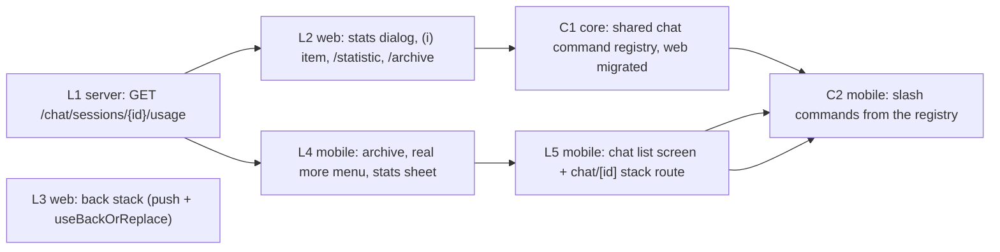
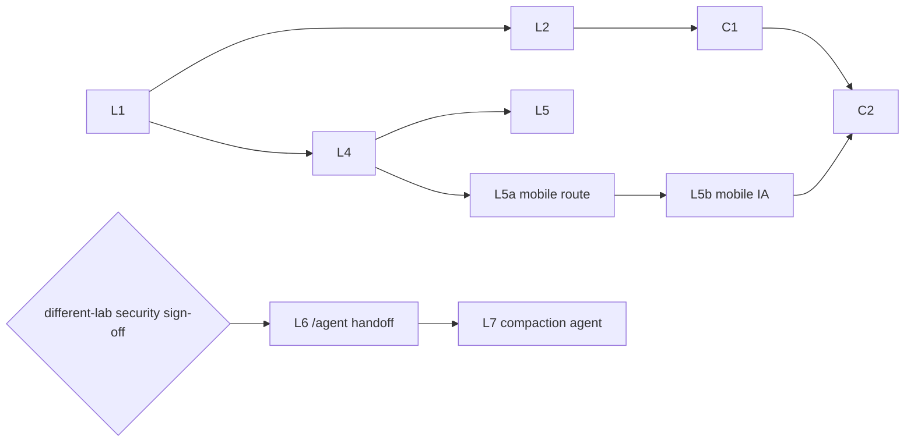

# Design: DM `/archive`, session statistics, and DM back stack

Generated by /office-hours on 2026-10-15
Branch: agent/x99-claude-opus/21497bbd6afd
Repo: cheese-work/multica
Status: APPROVED (Cheese, 2026-10-15, DM: "D2 A")
Autoplan gate (D5): APPROVED with every recommendation (Cheese, 2026-10-16, DM: "D5 accept recommendation"); see Gate decision (D5)
Mode: Intrapreneurship (plan supplied by Cheese; diagnostic skipped)

## Problem Statement

Three DM (chat session) gaps, requested by Cheese:

1. `feat(multica)`: a DM `/archive` command.
2. `feat(multica)`: DM session statistics as an (i) item in the DM more menu and a `/statistic` command.
3. `feat(multica)`: DM list > detail1 > detail2 keeps its back stack on mobile and web.

## What exists today (verified 2026-10-15 at `c1945db22`)

| Area | Exists | Gap |
|---|---|---|
| Archive | `PATCH /api/chat/sessions/{id}/archive` `{archived}` (`server/internal/handler/chat.go:570`); web header menu (`chat-session-header.tsx:219-258`) and row actions; `useSetChatSessionArchived` (`packages/core/chat/mutations.ts:332`) | No `/archive` command. Mobile has no archive mutation and lists active sessions only. |
| Slash commands | Web built-ins hardcoded `["compact","rename","fork"]` (`packages/views/editor/extensions/slash-command-suggestion.tsx:259`); `/rename` and `/fork` intercepted in `chat-input.tsx` | Mobile composer has no slash commands. No shared registry. |
| Statistics | `task_usage` (tokens, cost, model), `agent_task_queue.chat_session_id` and run timestamps, `chat_message` role and `elapsed_ms`, continuation links on `chat_session`; template query `GetIssueUsageSummary` (`server/pkg/db/queries/task_usage.sql`); format helpers in `packages/views/runtimes/utils.ts` | No per-session endpoint and no UI. Context-window size is not stored. |
| Web back stack | One route `/{ws}/chat?session=<id>`; `useBackOrReplace` (`packages/views/navigation/use-back-or-replace.ts`) | Store-to-URL sync always calls `replace()` (`packages/views/chat/chat-page.tsx:125-133`). The compact back button always clears to the list. |
| Mobile back stack | expo-router; chat is one tab screen; session in local `useState`; session list is a formSheet (`chat-sessions.tsx`) | No `chat/[id]` route, so nothing can be pushed or popped. |

## Premises (accepted by Cheese, not disputed)

1. `/archive` runs the same flow as the menu Archive item. It runs on the client and sends no message to the agent.
2. `/statistic` runs on the client and opens the same dialog as the (i) item.
3. Statistics v1 show: input, output, cache-read and cache-write tokens; cost; number of runs by status; total run time; message counts by role; models used; continuation chain. Context-window size is out of scope.
4. "detail2" is a linked DM (a continued or forked session opened from its divider link) or an issue opened from a DM.
5. Back follows real history: selecting pushes, and back calls `back()` with the list as a fallback.
6. Mobile is in scope.

## Approaches Considered

- **A) Web only.** Rejected: leaves the mobile back stack and mobile archive broken, which title 3 asks for.
- **B) Stacked web + mobile parity.** Chosen first.
- **C) Shared command registry.** Chosen second, after B, as a refactor with no new user-facing behavior on web.

## Recommended Approach: B, then C

Every layer is one PR in a stack. Each PR carries `Changelog: none` except the PR that lands the stack on `main`, which carries one user-facing line for the whole stack. The first commit of every layer holds only tests and fails against its parent (Test-First Gate). A reviewer from a different lab signs each layer (RGS-1).



L3 has no technical dependency and can start in parallel with L1; it does not touch `handleArchive` (L2 owns that).

### L1: server usage endpoint

- `GET /api/chat/sessions/{id}/usage`. Authorization: reuse `chatReadSession` (`chat_read_access.go:42`), the gate `GetChatSession` uses (`chat.go:352`), so the creator, workspace, private-agent, public-projection and interactive-credential rules of `docs/chat-read-access.md` apply unchanged. (Corrected by /autoplan CEO-1: `loadChatSessionForUser` checks only workspace and creator.)
- New sqlc query `GetChatSessionUsageSummary`, adapted from `GetIssueUsageSummary` (same two passes, `usage` and `terminal_runs`) with the filter on `atq.chat_session_id`. Keep the uncosted columns. Coverage for chat: "terminal" = `completed`, `failed`, `cancelled`; "metered" = terminal runs with at least one `task_usage` row. Queued and running runs appear only in the status counts.
- Response shape (field names are the contract for the web zod schema and the mobile schema):

```json
{
  "session_id": "uuid",
  "tokens": {"input": 0, "output": 0, "cache_read": 0, "cache_write": 0},
  "uncosted_tokens": {"input": 0, "output": 0, "cache_read": 0, "cache_write": 0},
  "cost_usd_ticks": 0,
  "runs": {"by_status": {"completed": 0, "failed": 0, "cancelled": 0, "queued": 0, "running": 0}, "terminal": 0, "metered": 0, "unreported": 0, "total_run_ms": 0},
  "messages": {"by_role": {"user": 0, "assistant": 0}},
  "by_model": [{"provider": "string", "model": "string", "tokens": {"input": 0, "output": 0, "cache_read": 0, "cache_write": 0}, "uncosted_tokens": {"input": 0, "output": 0, "cache_read": 0, "cache_write": 0}, "cost_usd_ticks": 0}],
  "continued_from_session_id": null,
  "continued_into_session_id": null,
  "forked_from_session_id": null
}
```

- Field sources:
  - run counts by `agent_task_queue.status`;
  - total run time `SUM(completed_at - started_at)` over finished runs;
  - message counts by `chat_message.role`;
  - per-(provider, model) buckets from `task_usage`, grouped by `LOWER(provider), model` (CEO-2), and `runs.unreported` = terminal runs with no `task_usage` row;
  - continuation chain: `continued_from_session_id` / `continued_into_session_id` / `forked_from_session_id` IDs (one hop each, no recursive walk in v1).
- Index: `idx_agent_task_queue_chat_session` on `(chat_session_id, created_at DESC) WHERE chat_session_id IS NOT NULL` (migration 472) covers every run status. Confirm with `EXPLAIN`; no new index is expected.
- Response compatibility: add the zod schema in `packages/core/api/schema.ts`, parse with `parseWithFallback`, and add a malformed-response test.
- Tests: DB-backed handler test (`testutil` fixtures) with a session that has 2 metered runs, 1 unmetered run and 1 failed run; a test that another user receives the same refusal as the session GET.

### L2: web stats dialog and the two commands

- `packages/core`: `api.getChatSessionUsage`, `chatSessionUsageOptions` query.
- `packages/views/chat/components/chat-session-stats-dialog.tsx`: reuse `formatTokens`, `formatUsd` and cost estimation from `runtimes/utils.ts`. Show cost as "partial" when uncosted tokens exist.
- More menu: add "Statistics" with an (i) icon to `chat-session-header.tsx` and to `SessionDropdown` in `chat-window.tsx`.
- Slash commands: add `archive` and `statistic` to the built-in list and `BuiltinCommandKey`, with i18n keys. Intercept them in `chat-input.tsx` like `/rename`, behind new optional `onArchive` and `onStatistic` props with `enableArchiveCommand` / `enableStatisticCommand` flags (same pattern as `onFork`). `/statistic` opens the dialog; `/archive` calls the page's `handleArchive` in `chat-page.tsx`. Neither is sent to the agent.
- Surfaces: the full Chat page on web and desktop (`ChatPage` is also mounted in `apps/desktop/src/renderer/src/routes.tsx`) and the floating chat window (`chat-window.tsx`), which passes the same two props.
- `/archive` failure (for example a decision-lane block from `decisionLaneArchiveAllowed`): today all three archive paths move the selection first and archive fire-and-forget: `chat-page.tsx` compact (`setActiveSession(null)`), `chat-page.tsx` desktop (`advanceSelectionAfterArchive`) and `handleArchive` in `chat-window.tsx` (~L1348). L2 changes all three to await the mutation (`mutateAsync`) before navigating, in line with AGENTS.md "await the server before navigation". On failure: show the server error in a toast and keep the session open. Tests cover the page and the floating window.
- L2 also owns the compact archive navigation: after a successful archive, call `useBackOrReplace()(wsPaths.chat())` instead of `setActiveSession(null)`, so L3 does not edit `handleArchive`.
- On an archived session the composer is not offered (sending already returns 409), so `/archive` cannot be typed. Unarchive stays a menu item only; no `/unarchive` in v1.
- Tests: suggestion list contains both commands; submit of `/archive` calls the archive mutation and sends no message; submit of `/statistic` opens the dialog and sends no message.

### L3: web back stack

- Mechanism: the store-to-URL effect in `chat-page.tsx` cannot tell a user selection from a new chat that just got its server ID. So move navigation to the call sites: thread-list selection, "new chat" and divider links call `push(...?session=)` directly. The effect keeps only the `replace` case (new chat receives its server ID after the first send) and the `?agent=` intent.
- Compact back button: `useBackOrReplace()(wsPaths.chat())` instead of `setActiveSession(null)`.
- Continuation and fork divider links already push through `AppLink`; with the two changes above, back from detail2 returns to detail1, then to the list.
- Desktop split view (web and the Electron app): also push on selection. Back then moves between sessions (open question 2). The Electron navigation adapter already implements `canGoBack` (`apps/desktop/src/renderer/src/platform/navigation.tsx:216`), so `useBackOrReplace` works in desktop tabs.
- Tests: list > A > linked B, back lands on A, back again lands on the list; cold open of `?session=B` and back lands on the list, not outside Multica.

### L4: mobile archive, more menu and stats sheet

- `apps/mobile/data/mutations/chat.ts`: archive and unarchive mutations.
- Session list: fetch `status=all` and show an "Archived · N" section, same as web. This is needed: without it a session archived on mobile cannot be found again to unarchive.
- Replace the ⋯ Delete-only alert (`(tabs)/chat.tsx:469-488`) with a real menu: Statistics (i), Archive or Unarchive, Delete.
- Stats sheet: calls the L1 endpoint through mobile's own request helpers, with its own schema.
- Read `apps/mobile/AGENTS.md` first; verify with the mobile commands listed there (root checks do not cover mobile).
- Mobile copy for the new items in every supported language.

### L5: mobile back stack

- Information architecture change: the chat tab root becomes the session list screen; a new stack route `[workspace]/chat/[id]` shows one DM. Selecting a session pushes `chat/[id]`. Depends on L4 because the L4 more menu moves into the `chat/[id]` header.
- State: the route param `id` replaces the local `activeSessionId` `useState` and the `chat-session-picker-store` hand-off. A new chat uses `chat/new?agent=<id>`; after the first send returns the session ID, `router.replace` to `chat/<id>`. Composer drafts stay keyed by session ID, as today.
- Render continuation and fork divider links on mobile; they push another `chat/[id]`. Issue links already push.
- Hardware back and the swipe gesture pop the stack: detail2 > detail1 > list.
- This layer changes UI layout, so it goes through `multica-cheese-work-design-loop` (mockup and UX review) before implementation.

### C1 and C2: shared command registry

- C1: `packages/core/chat/commands.ts` with one entry per command: `id`, i18n key, `isAvailable(ctx)` (for example rename and fork flags, archived state), and kind `client` or `prompt` (`/compact` stays a prompt that the server rewrites). Web suggestion list and menus read from it. No behavior change: the L2 tests must pass unchanged.
- C2: mobile composer shows a `/` suggestion list from the same registry and runs the same handlers. Mobile gains `/compact`, `/rename`, `/fork`, `/archive` and `/statistic`. This is wider than the three titles; Cheese chose C knowing it ("B then C").

## Addendum A1 (approved 2026-10-15): `/pin`, `/agent`, dedicated compaction agent

Request (Cheese, same DM): `feat(multica)`: DM `/pin` command; DM `/agent` command; DM `/compact` uses a dedicated agent instead of front-tier model agents. Decisions: D3 = B (`/agent <name>` hands the DM to another agent), D4 = A (workspace `compact_agent` setting).

### Facts (verified at `cb99a0d5a`)

- DM pin exists on web: `chat_session.pinned_at`, `PATCH /api/chat/sessions/{id}/pin` (`server/internal/handler/chat.go:493-538`), list-row menu (`chat-thread-list.tsx`). Continuation copies the pin (`chat_continue.go:139`). Mobile has no DM pin.
- A DM's agent is immutable by design (`chat.go:373-377`); continue and fork copy `session.AgentID` (`chat_continue.go:128`, `chat_fork.go:190`).
- `/compact` runs as the DM's own agent task (same model, resumed provider session). `ContinueChatSession` accepts a task token only from a running task of this session and this session's agent (`chat_continue.go:35-53`); `chatHistorySession` (`chat_history.go:245-298`) binds only to the task's own `chat_session_id` and workspace; it checks neither `status = running` nor the session's agent (corrected by /autoplan, see CEO-9).

### `/pin` (folded into existing layers)

- L2 (web): `/pin` toggles `pinned_at` through the existing mutation; client-only, not sent to the agent. Add a Pin/Unpin item to the session header more menu.
- L4 (mobile): pin/unpin mutation, pinned-first list order, Pin/Unpin in the more menu.
- C1/C2: `/pin` is a registry command.

### L6: `/agent <name>` hands the DM to another agent

- Server: `ContinueChatSession` takes the handoff target from the calling task (bound at enqueue, CEO-7); no request field carries it (DX-2). When a target is bound, the new DM gets that agent and its runtime; the old DM is archived with `continued_into_session_id` as today. Validate: same workspace, agent not archived, and the session creator can use the agent (private-agent rules, same check as creating a chat with it). Fork keeps the session's agent.
- CLI: no new flag; the agent runs the existing `multica chat continue --summary-file <path>` (DX-2).
- Prompt: `compactChatPrompt` also recognizes `/agent <name>`. The server resolves the name before the task is queued and rejects an unknown or unusable agent with a visible error. The rewritten prompt is the compact prompt with the target agent named; the continue command is unchanged (DX-2).
- Web: `/agent` suggestion with an agent-name argument picker (reuse the mention/agent picker data). The continuation divider in both DMs names the old and new agent.
- Tests: `/agent` with a bound target (happy path, private agent refused, cross-workspace refused, archived agent refused); prompt rewrite for `/agent`; unknown name error (see CEO-7, DX-2).

### L7: dedicated compaction agent

- Setting: `workspace.settings.compact_agent_id` (nullable). Edit paths: Settings > Workspace (next to the compact prompt) and `multica workspace update --compact-agent <id-or-name|none>`. Empty means today's behavior.
- Flow: when the setting is set and a DM message starts with `/compact` or `/agent <name>`, the server stores the user message as today but queues the task for the compaction agent instead of the DM's agent. The task keeps the DM's `chat_session_id` and carries `purpose = 'compaction'` (ENG-1, provisional per taste TE1). The DM shows a "Compacting with <agent>" status row.
- Client scope: routing is decided on the server from the message text, so it applies to every DM client that sends the message: web, desktop, mobile and the CLI. No client-side routing exists. Mobile can send `/compact` or `/agent <name>` as plain text before C2; C2 only adds the suggestion list. The L7 PR adds the "Compacting with <agent>" status row to the web, desktop and mobile chat views.
- Access (security-sensitive, needs a security review): `chatHistorySession` and `ContinueChatSession` also accept a running task of this session whose `purpose` is `compaction` and whose agent equals the workspace's current `compact_agent_id` (ENG-1, ENG-2). No other session is readable. Access ends when the task ends.
- The compaction agent summarizes from the transcript (`multica chat history`). It does not see the DM agent's provider session context.
- Tests: target-session read allowed; any other session refused; refused after the setting changes; refused after the task ends; empty setting keeps the DM-agent path; `/agent` through the compaction agent passes the target agent; a `/compact` message sent through the mobile request path is routed the same as one sent from web.



Gate D5 (UC1, T3, TE3): L6 and L7 are out of the main stack. Neither is admitted until a reviewer from a different lab than the author signs the security review (CEO-9(f), ENG-2, ENG-8). L7 builds on L6 (same prompt path). C1 does not wait for L6; L6 registers `/agent` in the registry when it lands. L5 is split into L5a (stack route) and L5b (list IA, decided by the L5 design loop).

## Open Questions

1. **Mobile IA (L5):** make the chat tab root a session list screen, or keep the formSheet list and push only detail routes from it? Decided by the L5 design loop, which compares a list-first tab screen with a route-backed sheet over pushed `chat/[id]` routes (`chat-sessions` is already a `Stack.Screen`; see CEO-6 and DES-9).
2. **Desktop split view (L3):** decided: push on every session selection (premise 5); selecting the already-open session adds no entry (DES-4).
3. **Chain totals (L1):** show only this session, or also a total across the continuation chain? Recommendation: this session only in v1; add chain totals when someone asks.

## Success Criteria

- Web and mobile: `/archive` archives the open DM with the same result as the menu item; no message reaches the agent.
- Web and mobile: (i) Statistics and `/statistic` show the same numbers. The L1 handler test asserts the totals equal a direct SQL sum over `task_usage` for that session; both clients compute the displayed cost with the same `packages/core` function over the same endpoint buckets (CEO-2).
- Web (desktop browser and phone-width browser): list > DM A > linked DM B, back, back: lands on A, then the list.
- Mobile app: the same path with hardware back or swipe lands on A, then the list.
- Web and mobile (A1): `/pin` and the Pin/Unpin menu item give the same `pinned_at` result; a pinned DM sorts first in the list on both clients; no message reaches the agent.
- `/agent <name>` (A1, L6), sent from web, mobile or the CLI: the old DM is archived with `continued_into_session_id`; the new DM runs as the named agent; both continuation dividers name the old and new agent. An unknown name, an archived agent, an agent in another workspace, or a private agent the session creator cannot use is refused with a visible error, and no DM is created.
- Dedicated compaction agent (A1, L7): with `compact_agent_id` set, `/compact` or `/agent <name>` sent from web, desktop, mobile or the CLI runs as the compaction agent and shows "Compacting with <agent>"; with it empty, the DM's own agent runs, as today. Access boundary: the compaction task (`purpose = 'compaction'`) reads and continues only its own `chat_session_id`; every other session is refused; access is refused after the task ends and after the setting changes to another agent. The security review signs before the L7 PR is marked ready.
- Every layer: tests-first commit with red output in the PR body, then green.

## Distribution Plan

Existing pipelines: the web and server deploy as today; the mobile app ships through its existing Expo build. No new artifact.

## Dependencies

- None blocking. L1 has no predecessor. L3 can start at once.
- Related: CHE-1538 (`/compact` prompt path) must keep working after C1.

## The Assignment

On your phone browser, open web chat, go list > a DM > its "continued from" link, press back twice, and write down where you land each time. This confirms premise 4 and gives L3 its red test.

## What I noticed about how you think

- You answered "B then C": ship the visible features first, then pay for the refactor. The stack order follows that.
- Your three titles name the surfaces ("mobile and web", "(i) icon in more menu"). That made the gap map exact on the first pass.

<!-- autoplan-accepted:ceo -->
- CEO-1 (changes dispatched L1): `GET /api/chat/sessions/{id}/usage` authorizes with `chatReadSession` (`server/internal/handler/chat_read_access.go:42`), the same gate as `GetChatSession` (`chat.go:352`), not `loadChatSessionForUser`. Tests: the refusal matrix equals the session GET for (a) another member, (b) another workspace, (c) a creator who lost private-agent access, (d) a CLI/legacy JWT (`interactive_login_required`), (e) a public-projection-hidden session; plus a running chat task reading its own session succeeds and reading another session is refused.
- CEO-2 (changes dispatched L1, and L2/L4): the usage response replaces `models: string[]` with `by_model: [{provider, model, tokens:{input,output,cache_read,cache_write}, uncosted_tokens:{...}, cost_usd_ticks}]` grouped by `LOWER(task_usage.provider), task_usage.model`, keeps the session totals, and adds `runs.unreported` (terminal runs with no `task_usage` row, as `unreported_task_count` in `GetIssueUsageSummary`). L2 moves the pricing table and arithmetic of `estimateCost`/`resolvePricing` from `packages/views/runtimes/utils.ts` to `packages/core` as a pure `estimateCost(usage, customPricing)` (today `resolvePricing` falls back to the persisted web/desktop custom-pricing store, `utils.ts:447`); views re-exports it and passes the store's value, mobile passes `{}`; web and mobile both compute displayed cost with that one function over `by_model`, and a bucket priced only by a web custom rate shows "Partial" on mobile. The dialog shows "Partial" when any bucket has uncosted tokens without a known price or `runs.unreported > 0`. Success criterion text becomes: both clients compute cost with the same core function over the same endpoint buckets; the L1 test asserts the buckets equal a direct SQL sum over `task_usage` for the session. Tests: zero-run session renders an empty state; malformed response falls back; one fixture yields the same cost string on web and mobile.
- CEO-3 (changes dispatched L3): L3's red test is Cheese's exact repro: Inbox > Chat list > DM A (selected from the list) > DM B (continued-from link) > back > back lands on A, then on the Chat list, then a third back lands on Inbox. Run it twice: with browser back, and with the compact in-app back button. Add: DM A > issue link > back lands on A; cold open of `?session=B` with the in-app back button lands on the list; with the Navigation API absent (`canGoBack` undefined or false) the in-app back button lands on the list, never outside Multica. One Playwright E2E covers the exact repro on a phone-width viewport.
- CEO-4 (changes dispatched L3): before moving navigation, L3 lists every writer of `activeSessionId` on the page path (`chat-page.tsx` URL→store effect, select, new chat, start new chat with agent, project-change fresh chat, compact back, archive advance; `use-chat-controller.ts` post-send server id, dangling-session clear, `advanceSelectionAfterArchive`; `chat-session-header.tsx` delete; `chat-thread-list.tsx` delete) and assigns each one push, replace, or URL-driven. Rule: user selection and divider links push; post-send server id, delete, dangling clear and archive advance replace (a dead or superseded URL must not stay on the stack). Exactly one writer changes the URL per transition, so the store→URL effect cannot follow a call-site `push` with a `replace`. Test: a list selection calls the navigation adapter's `push` exactly once and `replace` zero times.
- CEO-5 (L2): `/archive` is ignored while its mutation is pending (no double submit), and the stats dialog handles `interactive_login_required` with the existing Chat sign-in prompt and other errors with a message and retry. The (i) Statistics item has the accessible name "Statistics".
- CEO-6 (L4/L5): L4 builds the mobile more menu as one component that L5 moves into the `chat/[id]` header without rebuilding it. L5's design loop compares a list-first tab screen against a route-backed sheet over pushed `chat/[id]` routes; the "a sheet cannot be a back-stack entry" argument is dropped because `chat-sessions` is already a `Stack.Screen`. L5 maps a same-workspace relative `/{slug}/chat?session=<id>` link in `apps/mobile/lib/markdown/markdown.tsx` `onLinkPress` to `router.push('/{slug}/chat/<id>')`; unknown or foreign ids are a no-op. L5 makes a cold open of `chat/<id>` (deep link or notification) land with the list underneath (expo-router `unstable_settings.initialRouteName`). Tests for all three.
- CEO-7 (L6): `/agent <name>` is resolved in `SendChatMessage` at enqueue (same-workspace, not archived, `canInvokeAgent` judged for the session creator as the originator); an unknown or unusable name rejects the send with a visible error and keeps the draft. The resolved target id is stored on the task. The task-token continue path takes the target from the task and refuses a body `agent_id` that differs, so the agent runs the existing `multica chat continue --summary-file <path>` and older daemon CLIs keep working; the human `--agent` flag and the HTTP `agent_id` field are judged with `canInvokeAgent` for the creator. When a `/agent` task finishes without a continuation, the DM gets a visible "Handoff did not complete" note. Tests: happy path; prompt-injected different `agent_id` refused; target without invoke right refused; cross-workspace and archived refused; old-CLI continue (no flag) hands off to the bound target; no-continue completion posts the note.
- CEO-8 (L2, C1, L5, L6, L7): before writing code, the implementer searches upstream `multica-ai/multica` PRs and issues for an equivalent (command registry, session usage, agent handoff, compaction agent) and records the search and result in the PR body; if upstream ships an equivalent, stop and report to the coordinating leader. L2 also runs this check (it adds slash commands). L1 and L3 are exempt (already dispatched); L4 is exempt (it consumes the L1 endpoint and existing archive/pin APIs only).
- CEO-9 (L7, security gate): (a) only workspace owners/admins can set `compact_agent_id` (same route guard as `compact_prompt`), every change is audit-logged with actor and old/new value; (b) a compaction task is queued only if the session creator passes `canInvokeAgent` for the compaction agent, otherwise the DM agent path runs; (c) the compaction task keeps `chat_session_id` NULL and carries a new nullable `target_chat_session_id`, with its own claim prompt and result path, so it never writes the DM's resume pointer (`server/internal/service/task.go:4618`) and is never treated as a DM turn; (d) `chatHistorySession` and `ContinueChatSession` accept it only when the task status is `running` (or `dispatched` for continue, as today), `target_chat_session_id` equals the session, the task agent equals the workspace's current `compact_agent_id`, and the workspace matches, and `chatHistorySession` also gains an explicit `running` check on this branch; (e) the DM shows "Compacting with <agent>" from enqueue and a failure note if the task fails or finishes without a continuation; (f) before the L7 layer is admitted, a reviewer from a different lab than the L7 author runs `codex-security-review` or `/cso` on the L7 design and posts on the L7 issue a verdict that covers each of (a) to (e); L7 is not admitted without an approve verdict, and the PR still gets its normal cross-lab review. Tests: target read allowed; any other session refused; refused after the setting changes; refused after the task ends; refused for a non-admin setting change; creator without invoke right falls back to the DM agent; DM resume pointer unchanged after a compaction task; failure path clears the status row.
<!-- /autoplan-accepted:ceo -->

<!-- autoplan-accepted:design -->
- DES-1 (L2, L4, L6, L7): each UI-changing layer goes through `multica-cheese-work-design-loop` (mockup and cross-lab UX review) before admission, as L5 already does: one combined pass for L2+L4 (shared stats layout and menu), one for L6+L7 (agent picker, handoff divider, "Compacting with <agent>" row, failure notes, compaction-agent setting with a line stating that the chosen agent reads the DM transcript). L1 and L3 change no layout and are exempt.
- DES-2 (L2, L4): the stats surface uses one order on web (Dialog) and mobile (sheet): title "Statistics" with the label "This DM only"; cost with coverage ("Reported", "Estimated", or "Estimated · Partial" plus a one-line reason such as "Usage missing for 2 finished runs"; unavailable amounts show "—", never `$0`); total tokens; activity (non-zero run statuses, "Agent run time" for `total_run_ms`, messages "You" / "Agent"); a by-model table sorted by cost descending with input/output/cache-read/cache-write columns; related links ("Continued from", "Continued into", "Forked from") titled from the existing sessions cache as the dividers do, falling back to "Previous DM". No metric cards. States: skeleton in the final layout; zero runs shows cost "—" and "No runs yet" while messages and links still show; error with Retry; malformed response shows the error state, never zeros; while any run is queued or running, a row "N runs in progress — totals update when they finish" and a refetch on open and on task completion. Statistics stays available on archived DMs. Tests: each state renders on web and mobile; partial reason text; "—" for unavailable cost.
- DES-3 (L2, L4): one per-session pending guard covers menu Archive and `/archive`; while pending, the session shows "Archiving…" and composer submit is disabled; after success navigate only if that session is still selected: compact web uses `useBackOrReplace()(wsPaths.chat())` (L2), split view advances with replace (CEO-4), mobile pops `chat/[id]`. Client-only commands (`/archive`, `/statistic`, `/pin`) bypass the `isRunning` / `noAgent` submit gate (`chat-input.tsx:503`) the way `/fork` does. A command runs only as a standalone trimmed, case-insensitive message: extra text or attachments show an inline hint and keep the draft; selecting a suggestion inserts the command and Enter executes it; after success only the command text is cleared. Tests: `/statistic` and `/archive` work while the agent is running; `/archive extra` keeps the draft and shows the hint; slow archive does not navigate away from a DM opened meanwhile.
- DES-4 (L3, L5): selecting the already-open session adds no history entry; list scroll position, transcript position and drafts survive back and forward; Statistics closes before a related-session link navigates; focus returns to the originating row or divider link after back. Tests for the no-op reselect and the closed dialog.
- DES-5 (L2, L4, then C1): one menu order on the web header menu, the floating `SessionDropdown` and the mobile ⋯ menu: Statistics (i) · Pin/Unpin · Rename · Archive/Unarchive · separator · Delete (destructive styling, existing confirmation). L2 defines the list; L4 copies it; C1 moves it into registry metadata. The C1 registry `kind` drives a "runs the agent" hint on `prompt` commands (`/compact`, `/agent`) in the suggestion list.
- DES-6 (L3, L5, L6): handoff landing keeps today's behavior: after `/compact` or `/agent` the client does not auto-follow; the source DM becomes read-only with its "Continued into" divider link; the link pushes; back from the new DM returns to the archived source. Backing onto a session deleted elsewhere replaces it with the list and shows "This chat was deleted"; backing onto an archived DM shows it read-only with the existing Archived/Unarchive affordance (mobile gains the same banner in L5). Tests on web and mobile.
- DES-7 (L2, L4, L5): accessibility and responsive rules: web stats Dialog keeps a reachable Close with max-height and internal scroll, one column at 320 CSS px, wrapping model names, table semantics for the by-model table, locale-aware number and duration formats; slash suggestions support Arrow keys, Enter, Escape and IME composition; slash-opened Statistics returns focus to the composer, menu-opened returns to the menu trigger; mobile menu rows and stats links meet 44 pt (iOS) / 48 dp (Android) targets and carry `accessibilityLabel`s. Tests: focus return in both entry paths; 320 px render.
- DES-8 (L2, L4, all languages): new copy keys: "Statistics", "This DM only", "Agent run time", "Cache read", "Cache write", "Reported", "Estimated", "Partial", the partial reason, "N runs in progress — totals update when they finish", "No runs yet", "Archiving…", the no-arguments hint, "This chat was deleted", "runs the agent"; follow the AGENTS.md UI copy rules and the conventions pages; mobile copy is added separately in every supported language.
- DES-9 (L5): the mobile list screen has an empty state "No chats yet" with a Start a chat action, the new-chat button in the list header, an "Archived · N" entry that opens the archived list (matching web's separate Archived view), and back from `chat/new` keeps the unsent draft under the existing new-session draft key. These are inputs to the L5 design loop brief.
<!-- /autoplan-accepted:design -->

<!-- autoplan-accepted:dx -->
- DX-1 (changes dispatched L1): the usage JSON block includes `"runs": {..., "unreported": 0}` and is the only definition of the contract. L1 documents a glossary used by API, tests and UI: terminal run (`completed`, `failed`, `cancelled` with start and end times), metered run (terminal with a `task_usage` row), unreported run (terminal without one), uncosted tokens (usage rows with no provider cost). `cost_usd_ticks` is the provider-reported cost, 1 tick = 10^-10 USD (`COST_USD_TICKS_PER_USD = 10_000_000_000`), labelled "Reported"; the core estimate over uncosted tokens is labelled "Estimated" (DES-2).
- DX-2 (L6, supersedes the CLI and HTTP parts of CEO-7): L6 adds no `--agent` flag to `multica chat continue` and no `agent_id` field to the continue endpoints. `multica chat continue` is task-context only (`server/cmd/multica/cmd_chat.go:81` posts to `/api/chat/continue`, `router.go:2562`), so no human CLI path exists, and a new CLI sending `agent_id` to an older server would be silently ignored by its JSON decoder (source archived, same agent). The handoff target comes only from the task (bound at enqueue by `SendChatMessage`, CEO-7); the rewritten prompt keeps the existing `multica chat continue --summary-file <path>` command. Tests: the CLI help is unchanged; a continue from a `/agent` task creates the DM with the bound agent; a plain `/compact` task keeps the DM agent.
- DX-3 (C1, C2, and L2 parsing): each registry entry has `args` (`none` for `/archive`, `/statistic`, `/pin`; optional text for `/compact [focus]` and `/fork [message]`; required text for `/rename <title>`; required agent for `/agent <name>`), `descriptionKey`, an argument hint, and search terms (`/statistic` also matches "stats", "statistics", "usage"). DES-3's standalone rule applies only to `args: none`; existing argument forms keep working. Client commands refuse attachments with the DES-3 hint. Agent-name resolution is one shared rule on client and server: exact id, else case-insensitive exact name among agents the session creator can invoke; ambiguous names list the matches; the name is the rest of the line. Typing `/` with an empty query lists every available command. Composer commands are unavailable on archived DMs; the menu keeps Statistics there. Shared parsing fixtures run in web and mobile tests.
- DX-4 (L2, L6, L7): every new error states problem, cause and fix. Archive blocked by a decision lane maps to "Can't archive: this DM has an open decision request. Resolve or move it first." (final copy through the design loop); unknown or unusable `/agent` target: "No agent named "X" that you can use" with up to 3 nearest invokable names, never revealing private agents; a failed handoff note includes the task's failure reason and says to re-send `/agent <name>`. Task-token refusals on continue and history for L6/L7 return stable `ServerErrorCode`s with CLI user messages via `WithUserMessage` (target mismatch: "This task's handoff target is fixed; run multica chat continue --summary-file <path> with no other flags"; access ended: "This compaction task no longer has access to the DM; stop and report"). Tests assert CLI stderr text and exit codes, not only handler status.
- DX-5 (L7): the compaction fallback is visible: when the compaction agent is archived, not invokable by the session creator, or its runtime is offline at enqueue, the DM agent runs and the status row says "Compacting with <DM agent> — <compaction agent> unavailable: <reason>". Settings > Workspace and `multica workspace update` warn when the chosen agent is archived or private. `/compact` has no per-message override; the docs say to clear the setting to use DM agents.
- DX-6 (L7 CLI): the flag is `multica workspace update <workspace> --compact-agent <id-or-name>`, reset with `--compact-agent null` (same convention as `--compact-prompt-file`); names resolve inside the targeted workspace; an agent literally named "null" must be passed by id; the flag joins the exclusive single-setting group (`cmd_workspace.go:645`); after the update the CLI reads the setting back and fails with an actionable message if the server did not store it (older server). Tests: set by name, set by id, reset with null, ambiguous name, read-back mismatch.
- DX-7 (docs per layer): L1 adds the usage endpoint, glossary and tick unit to the API docs in `apps/docs`; L6/L7 update the Chat section of `apps/docs/content/docs/cli.mdx` (handoff behavior, compaction setting, reset syntax, expected JSON) and `docs/chat-read-access.md` for the L7 read branch; C1 lists the built-in chat commands in the chat docs. The L6/L7 implementer reports the needed `multica-platform` skill update to its owner.
- DX-8 (all layers): each layer PR names its verify commands from AGENTS.md (Go `make test`; frontend `pnpm typecheck`, `pnpm lint`, `pnpm test`; E2E `pnpm exec playwright test`; mobile per `apps/mobile/AGENTS.md`) and records the red run of its tests-only first commit. Success criteria are tagged with the layer that satisfies them: web `/archive` and `/statistic` L2; mobile archive, pin and stats via menu L4; mobile slash commands C2; web back stack L3; mobile back stack L5.
- DX-9 (observability): structured log events `chat.usage.refused` (reason code), `chat.command.client` (command id, surface; debug), `chat.handoff` (source and target agent, outcome) and `chat.compaction` (agent, fallback reason, outcome).
<!-- /autoplan-accepted:dx -->

<!-- autoplan-accepted:eng -->
- ENG-1 (L7, replaces CEO-9(c); provisional per taste TE1, recommended option A): the compaction task keeps `chat_session_id` = the DM and carries a new nullable `purpose = 'compaction'` (precedent: `regenerate_quick_actions_for`, `server/pkg/db/queries/chat.sql:1501-1520`), so pending detection, cancel, delete and L1 statistics include it. Completion skips `UpdateChatSessionSession` and `ClearChatSessionSessionIfMatches` for it (`server/internal/service/task.go:4618`); claim neither resumes the DM's provider session nor applies the runtime guard, and builds the compaction prompt from the stored `/compact` or `/agent` message; it posts no assistant turn except the status and failure notes. Claim exclusion becomes session-wide across agents while a compaction task is dispatched or running (today it is same-agent only, `agent.sql:824-830`), and sends made during compaction queue behind it. `callingChatSession`, `chatHistorySession` and `ContinueChatSession` accept `task.AgentID != session.AgentID` only when `purpose = 'compaction'` and the task agent equals the workspace's current `compact_agent_id`. Tests: concurrent send queues behind compaction; no cross-agent parallel claim; DM delete cancels compaction; resume pointer unchanged; compaction usage appears in L1 statistics.
- ENG-2 (L7 and the existing history path): every task-token branch of `chatHistorySession` (existing DM-agent branch included) requires task status `dispatched` or `running` and either `session.AgentID == task.AgentID` or the ENG-1 compaction rule; `ContinueChatSession` repeats the task status, purpose/agent and `compact_agent_id` checks inside its transaction after `LockChatSessionForEnqueue` (today the check runs before the transaction, `chat_continue.go:41`). Regression tests: a running DM task still reads its own history; a completed task whose token survived a failed revocation is refused; a cancel or setting change that commits while continue waits on the lock makes continue refuse.
- ENG-3 (L6, L7): new task columns (`handoff_agent_id`, `purpose`) are added to `CreateRetryTask`'s explicit column list (`server/pkg/db/queries/agent.sql:538`) and every other task-copy query; test that a deferred retry keeps both.
- ENG-4 (changes dispatched L1): `runs.by_status` is an open map with every `agent_task_queue` status that occurs (including `dispatched`, `waiting_local_directory`, `deferred`); the UI's "in progress" count is every non-terminal status; `messages.by_role` counts only `message_kind = 'message'` rows (continuation summaries, `no_response` and onboarding kinds excluded) and is an open map; `total_run_ms` sums `GREATEST(0, completed_at - started_at)` over terminal runs with both timestamps, each retry attempt counted as its own run. The zod and mobile schemas accept unknown keys. Tests: a deferred run, a continuation summary, a skewed timestamp.
- ENG-5 (L6, L7): one pure `resolveContinueAuthority(task, session, workspaceSettings)` returns the source session and the new DM's agent, with a table test: plain `/compact` by the DM agent → DM agent; `/compact` by the compaction agent → DM agent (never the compaction agent); `/agent` by the DM agent or by the compaction agent → bound target; every mismatch row refused. A retried continue for `/agent` returns the existing continuation (`ContinuedIntoSessionID` replay) with the target agent.
- ENG-6 (changes dispatched L3): an unsent new chat has URL state (`?new=1`; the `?agent=` intent still resolves into it), `composingNew` is derived from the URL, and the first send replaces it with `?session=<id>`; the compact back button on a new chat returns to the list. The reselect no-op compares against the URL, not the store. Tests: list → new → back; cold open of `?new=1` → back lands on the list; forward after back.
- ENG-7 (L7): a compaction task not running within the existing queue staleness window (or whose runtime goes offline) fails; the DM's status row clears and the failure note appears (DX-4, DX-5). Test with a queued task past the window.
- ENG-8 (L7 security additions to CEO-9): eligible compaction agents are workspace-visible (not private) agents on workspace runtimes; the `/compact` suggestion shows "runs with <agent>" before send; setting changes emit a structured log event `workspace.compact_agent_changed` with actor, old and new value (no settings audit table exists); failure notes never include transcript text. The pre-admission security verdict (CEO-9(f)) also covers ENG-1, ENG-2 and this item.
- ENG-9 (L6): `/agent` takes the agent name from the rest of the first line; following lines are optional focus text appended to the compaction prompt; shared web/mobile fixtures cover names with spaces and focus lines.
- ENG-10 (C1, C2): C1 is a behavior PR (args policy, search terms, hints) with its own tests-only first commit; C2 also adds mobile rename and fork mutations and schemas.
- ENG-11 (tests): the L3 one-push/zero-replace test runs with real effects under StrictMode, not a mocked store; the web/mobile cost-string parity test pins the locale; L5 opens existing notification payloads and stored `[Previous DM](/{slug}/chat?session=…)` links; mobile unarchive of an open archived DM updates its banner without a remount; L1 runs EXPLAIN on a large-session fixture and confirms `idx_agent_task_queue_chat_session` and `idx_chat_message_session` are used.
- ENG-12 (L2, L4): the archive pending guard is keyed by session id in the shared chat store in `packages/core` (mobile: its own store), so the page, the floating window and `/archive` share it.
- ENG-13 (L2, L4): moving the pricing table into `packages/core` means mobile prices with the table from its own release; the docs state that web and mobile estimates can differ until the mobile app updates, and both label such amounts "Estimated".
<!-- /autoplan-accepted:eng -->
## Gate decision (D5)

Cheese approved every autoplan recommendation on 2026-10-16 (DM: "D5 accept recommendation").

User Challenges:
- UC1 accepted: L6 (`/agent`) and L7 (dedicated compaction agent) leave the main stack. Neither layer is admitted until a reviewer from a different lab than its author posts an approve security verdict on the layer issue. For L7 the verdict covers CEO-9 (a) to (e), ENG-1, ENG-2 and ENG-8.
- UC2: D4 = A stays (dedicated compaction agent). Revisit per-task model override or measure-first only after the UC1 security review.
- UC3 deferred: no `multica chat usage` CLI in this plan.

Taste decisions (all as recommended):
- T1: chain totals ship as an additive L1b; L1 stays session-only.
- T2: L2 keeps per-command props (B then C); no registry-first.
- T3: C1 does not wait for L6.
- T4: L6 stays an agent-run CLI continuation, consistent with `/compact`.
- DT2: 5 s undo toast on menu Archive and `/archive`.
- DT3: mobile Delete only in the Archived view, as on web.
- DT4: without the Navigation API, in-app back from B falls back to the list.
- DT5: mobile tab reselect pops to the list.
- TE1: the L7 task keeps `chat_session_id` and carries `purpose = 'compaction'` (ENG-1); no longer provisional.
- TE2: L3 uses a one-shot `navIntent` in the store.
- TE3: L5 splits into L5a (route) and L5b (IA).

## Review record

<!-- autoplan-baseline-edits:ceo {"sourceSha256":"c87e3c3748ddb118501b23a53293102e9c2e2f9e2977d4827a2098f4e4b0d8f5","replacements":[{"oldText":"Authorization: reuse `loadChatSessionForUser` (`chat.go:278`), so the creator, workspace, private-agent and interactive-credential rules of `docs/chat-read-access.md` apply unchanged.","newText":"Authorization: reuse `chatReadSession` (`chat_read_access.go:42`), the gate `GetChatSession` uses (`chat.go:352`), so the creator, workspace, private-agent, public-projection and interactive-credential rules of `docs/chat-read-access.md` apply unchanged. (Corrected by /autoplan CEO-1: `loadChatSessionForUser` checks only workspace and creator.)"},{"oldText":"`chatHistorySession` has the same limit (`chat_history.go:245-281`).","newText":"`chatHistorySession` (`chat_history.go:245-298`) binds only to the task's own `chat_session_id` and workspace; it checks neither `status = running` nor the session's agent (corrected by /autoplan, see CEO-9)."},{"oldText":"  \"models\": [\"string\"],\n","newText":"  \"by_model\": [{\"provider\": \"string\", \"model\": \"string\", \"tokens\": {\"input\": 0, \"output\": 0, \"cache_read\": 0, \"cache_write\": 0}, \"uncosted_tokens\": {\"input\": 0, \"output\": 0, \"cache_read\": 0, \"cache_write\": 0}, \"cost_usd_ticks\": 0}],\n"},{"oldText":"  - distinct models from `task_usage.model`;","newText":"  - per-(provider, model) buckets from `task_usage`, grouped by `LOWER(provider), model` (CEO-2), and `runs.unreported` = terminal runs with no `task_usage` row;"},{"oldText":"both clients render the endpoint values without recomputing them.","newText":"both clients compute the displayed cost with the same `packages/core` function over the same endpoint buckets (CEO-2)."}]} -->

### Phase 1: CEO review (via /autoplan, 2026-10-15, mode SELECTIVE EXPANSION)

Input: `## Implementation plan` snapshot sha256 `c87e3c37…b0d8f5`. Repository: `cheese-work/multica` at `6070b100b`. Reviewer: x99-claude-opus (primary), a native Claude subagent (independent), and Codex 0.155.1 (outside, read-only sandbox).

#### System audit and taste calibration

- Hot files: `server/internal/handler/chat.go` (14 commits in 30 days), `chat-window.tsx` (9), `chat-page.tsx` (8), `use-chat-controller.ts` (7). Stacked PRs on these files carry merge-conflict risk. Keep each layer's diff narrow.
- Prior learning applied: `multica-chat-nav-replace` (confidence 9/10, 2026-10-15). It matches the plan's L3 diagnosis.
- Style references to copy: `packages/views/navigation/use-back-or-replace.ts` (one hook, an explicit contract in its doc comment, and a fallback that never guesses); `apps/web/platform/in-app-history.ts` (refuses to count `push` calls as history); `server/internal/handler/chat_read_access.go` (one small read gate for every chat read).
- Anti-patterns not to repeat: the two-way URL/store sync effects in `chat-page.tsx:115-134`, where the store→URL effect cannot tell why the store changed; and fire-and-forget archive that navigates first (`chat-page.tsx:164-175`, `chat-window.tsx:1348-1361`).
- Landscape (WebSearch; Aside not installed): the Navigation API, including `navigation.canGoBack`, is Baseline 2026 (Chrome 102+, Safari and iOS Safari 26.2+, Firefox 147+). Layer 1: push on selection, pop on back, and fall back to a list route. Layer 3: the in-app back button can only be correct where the browser reports `canGoBack`; on older Safari the fallback lands on the list.

#### 0A. Premise challenge

| # | Premise | Assessment |
|---|---|---|
| P1 | `/archive` = menu Archive, client-only | Valid. Matches the existing `PATCH /archive` flow. |
| P2 | `/statistic` opens the same dialog as (i) | Valid. |
| P3 | Stats v1 fields; context window out of scope | Valid as scope. The cost field is under-specified (see 0A-x1). |
| P4 | detail2 = linked DM or an issue opened from a DM | Valid. Cheese's observed bug (Inbox > List > A > B, back, back lands on Inbox) shows the List entry was replaced when A was selected (`chat-page.tsx:131` `replace`). The issue case has no test yet. |
| P5 | Back follows real history: select pushes, back with list fallback | Valid. It settles Open Question 2 (desktop split view pushes). |
| P6 | Mobile in scope | Valid. |
| D3 | `/agent <name>` hands the DM to another agent via continue | Valid as a product choice. Implementation premise gaps: see 0A-x4 and 0A-x5. |
| D4 | Dedicated compaction agent (workspace setting) | Challenged by both outside voices: User Challenge 2 at the final gate. Cheese's original direction stands until the gate. |
| 0A-x1 | "Clients render endpoint values without recomputing" while L2 "reuses cost estimation" | Contradiction. `estimateCost` (`packages/views/runtimes/utils.ts:691`) needs provider + model per bucket; `models: string[]` cannot feed it. Fixed by accepted obligation CEO-2. |
| 0A-x2 | L1 "reuse `loadChatSessionForUser`, so the rules of `docs/chat-read-access.md` apply" | **False.** `loadChatSessionForUser` (`chat.go:278-300`) checks workspace + creator only. The session GET uses `chatReadSession` (`chat.go:352`, `chat_read_access.go:42-47`), which adds the interactive-credential refusal, the private-agent gate and the public-projection gate. Fixed by accepted obligation CEO-1 (changes dispatched L1). |
| 0A-x3 | Facts: "`chatHistorySession` has the same limit" (running task of this session and this session's agent) | **False.** `chat_history.go:245-298` binds to `task.ChatSessionID` and the workspace only. It checks neither `status = running` nor `session.AgentID == task.AgentID`. L7's "access ends when the task ends" is therefore not enforced by that function today. Fixed by accepted obligation CEO-9. |
| 0A-x4 | L6 "the server resolves the name before the task is queued" | Incomplete. `compactChatPrompt` runs at daemon claim (`daemon.go:3312`), not at enqueue. Name resolution must happen in `SendChatMessage`, and the resolved id must be stored on the task. Fixed by CEO-7. |
| 0A-x5 | L6 "same check as creating a chat with it" | Clarify. `CreateChatSession` uses `canInvokeAgent` with the originator chain (`chat.go:~84`), not the private-agent read gate. When the DM agent calls continue with a task token, the target must be judged for the session creator, not the calling agent. Fixed by CEO-7. |
| 0A-x6 | Open Question 1: "a sheet cannot be a back-stack entry" | Weak. `chat-sessions` is already a `Stack.Screen` with formSheet presentation (`apps/mobile/app/(app)/[workspace]/_layout.tsx:291`). The design loop must compare list-screen vs route-backed sheet on its merits. Fixed by CEO-6. |

#### 0B. Existing code leverage

| Sub-problem | Existing code | Reuse |
|---|---|---|
| Archive API | `PATCH /api/chat/sessions/{id}/archive` (`chat.go:570`), `useSetChatSessionArchived` (`packages/core/chat/mutations.ts:332`, optimistic with rollback) | Yes |
| Read gate for stats | `chatReadSession` (`chat_read_access.go:42`) | Yes (instead of `loadChatSessionForUser`) |
| Usage SQL | `GetIssueUsageSummary` (`task_usage.sql:72-110`) | Adapt to `chat_session_id`, add a per-model group |
| Run index | `idx_agent_task_queue_chat_session` (migration 472) | Yes |
| Cost display | `estimateCost`, `formatTokens`, `formatUsd` (`packages/views/runtimes/utils.ts`) | Move the pure pricing functions to core for mobile parity |
| Back with fallback | `useBackOrReplace`, web `canGoBackInApp`, desktop tab `canGoBack` (`apps/desktop/src/renderer/src/platform/navigation.tsx:216`) | Yes |
| Slash commands | built-in list (`slash-command-suggestion.tsx:259`), `/rename` and `/fork` intercepts in `chat-input.tsx` | Yes (L2), registry in C1 |
| Continue / summary | `ContinueChatSession` (`chat_continue.go`), `compactChatPrompt` (`chat_compact_prompt.go`) | Extend in L6 |
| Workspace compact settings | `compact_prompt` (CHE-1612, `workspace.go:331-521`, admin route) | Pattern for `compact_agent_id` |
| Mobile links | `onLinkPress` (`apps/mobile/lib/markdown/markdown.tsx:134`) | Extend for chat links |

Nothing is rebuilt in parallel. C1 is the only refactor, and Cheese chose it.

#### 0C. Dream state

```
CURRENT                          THIS PLAN                              12-MONTH IDEAL
Web: select = replace, back      Web+mobile: select pushes, back pops,  One "conversation" spans its
skips the list. Mobile: no       list fallback. Stats per DM with       continuation chain: stats, back,
chat route, no archive, no       per-model cost. /archive /statistic    handoff and search act on the chain;
stats, no slash commands. No     /pin on both clients; one command      compaction cost is attributed; cheap
per-DM stats. /compact on the    registry. /agent handoff and an        summarizer chosen by measured quality.
DM agent only.                   optional compaction agent (gated).
```
Delta: the plan moves toward the ideal. Chain totals (taste item at the gate) close most of the remaining gap for statistics.

#### 0C-bis. Implementation alternatives

```
APPROACH A: Minimal web nav fix
  Summary: Only L3 (push on select + useBackOrReplace). No stats, no archive command, no mobile.
  Effort: S   Risk: Low
  Pros: fixes Cheese's observed bug in one PR; no new API.
  Cons: ignores 2 of 3 titles and mobile; Cheese rejected "web only" already.
  Reuses: useBackOrReplace, canGoBackInApp.

APPROACH B: Plan as approved (B then C, plus A1 in the same stack)
  Summary: L1-L5 parity, C1/C2 registry, /pin folded in, L6 /agent and L7 compaction agent.
  Effort: XL  Risk: Med-High (L7 widens an access check)
  Pros: matches every approved title and decision; one coordinated stack.
  Cons: L7 security and economics unproven; C1 waits on L6.
  Reuses: everything in 0B.

APPROACH C: B with A1 split into a gated proposal
  Summary: L1-L5 + /pin + C1/C2 ship as planned; L6 and L7 move to their own plan with a
  security design and a measured compaction comparison before admission.
  Effort: L + separate M  Risk: Med
  Pros: no proven work waits on unproven work; L7 gets its own review gate.
  Cons: changes the structure Cheese approved; two root issues to track.
```
RECOMMENDATION: B, because Cheese approved it and the 6 principles do not override a settled user decision. C is surfaced as User Challenge 1 (both outside voices recommend it). Completeness: A 3/10, B 9/10, C 9/10.

#### 0F. Mode

SELECTIVE EXPANSION (autoplan override; feature enhancement on an existing system).

#### 0D. Selective expansion analysis

- Complexity check: the plan touches far more than 8 files across server, core, views, desktop and mobile, and adds 2 new endpoints-worth of server surface (usage endpoint, continue `agent_id`) plus 1 new task routing mode (L7). That is a smell for the A1 part only. L1-L5 are each small and independent.
- Minimum set for the three titles: L1, L2, L3, L4, L5. C1/C2 and A1 are extra scope Cheese chose knowingly.
- Expansion scan: 10x (conversation object across the chain) is recorded and not recommended now. Delight candidates: (1) chain totals, (2) per-model rows, (3) mobile cold-open back, (4) mobile summary link, (5) "This DM only" label, (6) copy-session-id in the stats dialog (skipped: no ask). Platform potential: the C1 registry is the platform piece.
- Cherry-pick decisions: see the CEO plan archive `~/.gstack/projects/cheese-work-multica/ceo-plans/2026-10-15-dm-archive-stats-backstack.md`. Accepted: per-model rows, mobile cold-open test, mobile summary link, upstream check. Taste at gate: chain totals. Deferred: context-window indicator.

#### 0E. Temporal interrogation

```
HOUR 1 (foundations): L1 worker must use chatReadSession, not loadChatSessionForUser.
                      L3 worker must list every activeSessionId writer before moving navigation.
HOUR 2-3 (core):      L1 by_model grouping and the "unreported runs" count.
                      L3: call-site push followed by the store->URL effect's replace on a stale
                      searchParams snapshot can supersede the push (the exact failure in-app-history.ts warns about).
HOUR 4-5 (integration): L2 archive must await before navigating on 3 surfaces. L5 relative chat links.
                      L6: name resolution happens at enqueue, prompt rewrite happens at claim.
                      L7: compaction task must not carry the DM's chat_session_id (resume pointer overwrite).
HOUR 6+ (tests):      Navigation API absent branch; Cheese's exact Inbox > List > A > B repro;
                      DM > issue > back; cost parity between web and mobile; L7 negative access matrix.
```
Human ~6h per layer compresses to ~30-60 min per layer with CC. All these are resolved below as accepted obligations, not left for implementation.

#### 0.5 Dual voices

Claude SUBAGENT (CEO, strategic independence): completed, 15 findings (1 critical, 6 high). Highlights: F7 critical L7 transcript exfiltration path through a workspace setting; F1 split A1; F8 model override instead of a dedicated agent; F3 cost contract contradiction; F12 fork divergence; F4 premise 4 untested for issue links; F9 mobile menu built twice; F10 registry retrofit cost; F11 desktop push; F14 changelog per layer; F15 message roles.

Codex SAYS (CEO, strategy challenge): completed, 5 findings (all high). (1) L1 authorization premise false (`loadChatSessionForUser` vs `chatReadSession`), L7 needs a delegation policy; (2) dedicated compaction agent is an unmeasured bet, transcript projection loses provider context, `/agent` depends on the outgoing agent; (3) stats contract cannot support cost estimation, missing-usage runs, session-only totals reset at continuations; (4) no-Navigation-API fallback skips A; sheet premise false; (5) release coupling, C1 waits on L6, L6 CLI flag rollout against older daemons. Recommendation: send findings 1 and 4 to Stage 1 implementers now and separate L6/L7 into a gated proposal.

```
CEO DUAL VOICES — CONSENSUS TABLE:
═══════════════════════════════════════════════════════════════
  Dimension                           Claude  Codex  Consensus
  ──────────────────────────────────── ─────── ─────── ─────────
  1. Premises valid?                   No(F4,F5) No(1,4) CONFIRMED: premise gaps (L1 auth, sheet, cost)
  2. Right problem to solve?           Yes core, A1 doubtful  Yes core, A1 doubtful  CONFIRMED
  3. Scope calibration correct?        No(F1)  No(5)  CONFIRMED: split A1 -> User Challenge 1
  4. Alternatives sufficiently explored? No(F8,F6) No(2) CONFIRMED: model override / measure -> User Challenge 2
  5. Competitive/market risks covered? No(F12) Partly(5) CONFIRMED: fork divergence -> upstream check
  6. 6-month trajectory sound?         No(F7,F10) No(1,3) CONFIRMED: L7 trust boundary, stats reset at chain
═══════════════════════════════════════════════════════════════
6/6 dimensions confirmed by completed subagent + completed outside voice.
```
Disagreements (taste): registry-first in L2 (subagent F10) vs follow demonstrated reuse (Codex 5) and Cheese's "B then C"; desktop push vs replace (subagent F11) vs premise 5. Single-voice criticals: F7 (subagent critical, Codex rates high). Primary agrees with both and verified the code.

#### Section 1: Architecture

```
                      +--------------------- server (Go) ----------------------+
 web/desktop          |  GET /chat/sessions/{id}/usage  --chatReadSession-->    |
 (packages/views)     |      GetChatSessionUsageSummary (by_model + runs + msgs) |
  chat-page  ---------+->POST /continue {summary, agent_id?} (L6)              |
  chat-window         |      task_token path: target bound on task (L6/L7)      |
  stats dialog        |  SendChatMessage: /compact|/agent -> resolve target,    |
  command registry(C1)|      route task to compact agent (L7, target col)       |
        |             |  daemon claim: compactChatPrompt (daemon.go:3312)       |
        v             |  chatHistorySession / ContinueChatSession + L7 branch   |
 packages/core <------+  (running + target + current compact_agent_id check)    |
  api, schema, cost   +---------------------------------------------------------+
  (estimateCost moved)
        ^
 apps/mobile: chat list screen -> chat/[id] stack (L5); menu/stats/pin/archive (L4); / commands (C2)
```
Findings (each auto-decided, logged in the audit trail):
- 1.1 L1 read gate wrong helper (0A-x2). Fix: CEO-1. **CRITICAL GAP for L1** (stats of a private-agent DM would leak to a creator who lost agent access; CLI JWTs would read stats that the session GET refuses).
- 1.2 L7 task routing undefined: if the compaction task carries the DM's `chat_session_id`, completion overwrites the DM's resume pointer with the compaction agent's provider session and runtime (`server/internal/service/task.go:4618-4627`), and the claim path treats it as a DM turn. Fix: CEO-9 (separate `target_chat_session_id`, `chat_session_id` NULL, dedicated claim and result path).
- 1.3 C1 waits on L6, coupling the registry to the riskiest layer. Taste decision T3 (recommend: decouple; L6 registers `/agent` in the registry when it lands).
- 1.4 Coupling: moving `estimateCost` to core couples mobile to the web pricing table, which is desired (one owner). No new cycles: core stays UI-free.
- Rollback posture: L1-L5, C1, C2 are code-only reverts. L6 adds a request field (additive). L7 adds a column and a setting: rollback = clear the setting (behavior returns to the DM agent), then revert. Scaling: the usage query is per-session and indexed; 10x load is fine.

#### Section 2: Error & Rescue Map (see the Error & Rescue Registry below)

Gaps found: L1 interactive-credential refusal path (fixed by CEO-1); L2 archive failure after navigation (plan already fixes with await); L6 "agent did not call continue" has no visible state (CEO-7); L6 unknown agent name at claim time cannot surface a visible error (CEO-7); L7 compaction task failure leaves the DM showing "Compacting" forever (CEO-9).

#### Section 3: Security & threat model

| Threat | Likelihood | Impact | Mitigated by plan? |
|---|---|---|---|
| T1 L1 stats readable with CLI JWT or after private-agent access loss | High | Med | No → CEO-1 |
| T2 L7 workspace setting routes every member's DM transcript to an agent/runtime chosen by whoever can edit settings | Med | High | No → CEO-9 (admin-only, audit log, creator invoke check, disclosure row before queue) |
| T3 L7 access outlives the task (no status check in `chatHistorySession`) | Med | High | No → CEO-9 |
| T4 L7 access check uses "current `compact_agent_id`" but the task was queued under an older value | Low | Med | Plan says refuse after change; keep, test it (CEO-9) |
| T5 L6 prompt injection: DM content steers the agent to `continue --agent <other>` | Med | Med | No → CEO-7 (target bound on the task at enqueue; task-token continue ignores a body `agent_id` that differs) |
| T6 L6 target judged for the calling agent instead of the human creator | Med | Med | No → CEO-7 |
| T7 `/archive` / `/pin` typed in a channel-bound DM | Low | Low | Existing server gates apply (`gateChatSessionForUser`) |
No new secrets or dependencies. Audit logging is needed for `compact_agent_id` changes (CEO-9).

#### Section 4: Data flow and interaction edge cases

```
 USAGE:  sessionId ─▶ chatReadSession ─▶ SQL (by_model, runs, msgs) ─▶ JSON ─▶ zod parseWithFallback ─▶ estimateCost(core) ─▶ dialog
           │ nil/invalid: 400        │ not yours/private/cli: 403/404   │ zero rows: zeros, by_model [] │ malformed: fallback + test
 NAV:    select ─▶ push(?session=A) ─▶ URL→store effect ─▶ setActiveSession(A)   (store→URL effect must not replace it)
         new chat send ─▶ server id ─▶ replace(?session=id)                        back ─▶ canGoBack ? back() : replace(list)
```
Async ordering (L3): schedule `push(url)` → render with stale `searchParams` → store→URL effect sees `live != current` → `replace(url)`. Next.js can drop the pending push in favor of the replace, so no history entry is created and the bug survives. Mechanism required: one writer per transition (CEO-4) and a test asserting exactly one `push` and zero `replace` for a selection.

| Interaction | Edge case | Handled? | How |
|---|---|---|---|
| `/archive` | decision-lane block (409) | Plan: yes | await `mutateAsync`, toast, stay |
| `/archive` | double submit | Partly | the mutation is idempotent server-side; disable the command while pending (CEO-5) |
| `/statistic` | session has 0 runs | Gap | empty state "No runs yet" with zeros (CEO-2) |
| `/statistic` | runs still running | Plan: yes | status counts only |
| stats dialog | fetch fails / interactive_login_required | Gap | reuse the Chat "Sign in again" prompt; generic error + retry otherwise (CEO-2) |
| back (web) | no Navigation API (iOS < 26.2) | Gap | fallback to list; test both branches (CEO-3) |
| back (web) | cold open `?session=B` | Plan: yes | fallback list |
| mobile link | relative `/slug/chat?session=` | Gap | CEO-6 |
| `/agent` | unknown name / no invoke access | Gap at enqueue | CEO-7 |
| L7 | compaction task fails | Gap | CEO-9 |

#### Section 5: Code quality

- DRY: cost estimation must have one implementation (CEO-2). Mobile must not copy the pricing table.
- L2 adds `enableArchiveCommand` / `enableStatisticCommand` / `enablePinCommand` flags; three more flags on `ChatInput` is the pattern C1 removes. Accepted as a deliberate B-then-C cost (Cheese's choice).
- L4 menu: build it as one component (`ChatSessionMenu`) so L5 relocates it rather than rebuilding it (subagent F9). CEO-6.
- No over-engineering found in L1-L3.

#### Section 6: Test review

```
NEW UX FLOWS: /archive, /statistic, /pin (web, mobile), (i) Statistics item, mobile more menu,
              mobile list -> chat/[id] -> chat/[id], /agent picker, compaction status row
NEW DATA FLOWS: usage endpoint -> both clients; continue with agent_id; compaction target read
NEW CODEPATHS: chatReadSession for usage; by_model grouping; push vs replace per writer;
               L7 access branch in two gates; SendChatMessage target resolution
NEW ASYNC WORK: L7 compaction task (claim + result path)
NEW ERROR PATHS: archive failure toast; usage 403/interactive refusal; /agent unknown; L7 failure
```
Required assertions added (accepted obligations): exact repro test for Cheese's bug (CEO-3); DM → issue → back (CEO-3); Navigation API absent (CEO-3); one `push`, zero `replace` per selection (CEO-4); stats parity: the same fixture renders the same cost on web and mobile via the shared core function (CEO-2); unreported runs make cost "partial" (CEO-2); L1 refusal matrix equals the session GET matrix (CEO-1); L6 target bound at enqueue and refused for a non-invokable agent (CEO-7); L7 full negative matrix (CEO-9). Flakiness risk: navigation tests that depend on real browser history; use the navigation adapter stubs, plus one Playwright E2E for the exact repro.

#### Section 7: Performance

Usage query: one session's runs via `idx_agent_task_queue_chat_session`; `task_usage` joins by `task_id` (indexed). Sessions have tens to low hundreds of runs. p99 well under 50 ms. Chain totals (if accepted) walk at most 100 hops. No N+1. No new connection pressure. No issues beyond the EXPLAIN the plan already requires.

#### Section 8: Observability

- L1: log `chat.usage` refusals with the reason code at warn (same pattern as chat reads).
- L6: log `chat.continue` with `agent_changed=true`, source and target agent ids.
- L7: log every compaction-target access grant and refusal with task id, target session id, and setting value; audit-log `compact_agent_id` changes (CEO-9).
- Debuggability 3 weeks later: the continuation divider names both agents (plan), and the task row carries the target (CEO-9).

#### Section 9: Deployment and rollout

- L6 CLI rollout: deployed daemons run an older `multica` CLI that lacks `--agent`. Accepted fix (CEO-7): the task-token continue path reads the bound target from the task, so the agent keeps running the existing `multica chat continue --summary-file <path>` command. `--agent` is only for human CLI use.
- L7 migration: one nullable column on `agent_task_queue` (`target_chat_session_id`), plus an index if the access check needs it; follow the CONCURRENTLY single-statement rule. Backward compatible.
- Old desktop clients against the new server: the usage endpoint is new and additive; `parseWithFallback` covers schema drift.
- Post-deploy check: open a DM, (i) Statistics shows non-zero tokens; list > A > B, back, back on phone-width web.

#### Section 10: Long-term trajectory

Reversibility 4/5 (L7 setting and column are the only durable state). Debt: three per-command props on `ChatInput` until C1 lands; the pricing table now shared via core (good). Path dependency: L6's "continue with another agent" makes agent identity per-session-immutable but per-conversation-mutable; statistics and chain views must account for that (chain totals semantics include handoff hops). Fork divergence: upstream check (accepted item 7).

#### Section 11: Design & UX (UI scope detected)

```
 WEB (compact)                       WEB (split)                    MOBILE (after L5)
 Inbox ─push─▶ List ─push─▶ A        List|A ─push─▶ List|B          Tab: List ─push─▶ chat/A ─push─▶ chat/B
            ◀──back──      ◀─back─ B        ◀──back──                         ◀──back/swipe──   ◀──back──
 (i) Statistics / /statistic ─▶ dialog (loading | empty | error | data | partial cost)
```
| Feature | Loading | Empty | Error | Success | Partial |
|---|---|---|---|---|---|
| Stats dialog | skeleton rows | "No runs yet", zeros | message + retry; sign-in prompt for interactive refusal | totals + per-model rows | "Partial" label when uncosted tokens without pricing or unreported runs exist |
| /archive | command disabled while pending | n/a | toast with server error, stay | navigate per surface | n/a |
| Mobile list | existing | existing | existing | "Archived · N" section | n/a |
Accessibility: (i) item needs an accessible name "Statistics", not just the icon. Mobile menu items need text labels. Recommend /plan-design-review (Phase 2 of this run covers it).

#### NOT in scope

- Context-window fill indicator: premise 3 (accepted by Cheese); context size is not stored.
- Full conversation object across the chain (10x vision): L effort, revisit after chain totals.
- `/unarchive`: composer is hidden on archived DMs.
- Changelog line on every layer (subagent F14): the repository rule (AGENTS.md "The PR that lands a stack on `main` carries the line for the whole stack") wins.
- Server-side continuation instead of the agent running the CLI (subagent F6): taste T4; the existing `/compact` path is agent-run, so L6 stays consistent with it.
- TODOS.md: the repository has none, and this run may not create repo files beyond the plan; deferred items live in this list.

#### What already exists

See 0B. Every sub-problem reuses existing code; the only moves are `estimateCost`/`resolvePricing` into core (DRY for mobile) and the C1 registry Cheese chose.

#### Dream state delta

After this plan: every DM surface has archive, pin, stats and a real back stack on web and mobile, plus handoff and optional cheap compaction. Remaining gap to the 12-month ideal: statistics and navigation still act on one DM row, not the continuation chain (taste T1 narrows it), and the compaction agent's quality is not measured (User Challenge 2).

#### Error & Rescue Registry

```
 METHOD/CODEPATH                     | WHAT CAN GO WRONG                         | ERROR
 ------------------------------------|-------------------------------------------|-----------------------------
 GET /chat/sessions/{id}/usage       | bad uuid                                  | 400
                                     | not creator / other workspace             | 404/403 (same as session GET)
                                     | private agent access lost                 | 403 "you do not have access to this agent"
                                     | CLI/legacy JWT                            | 403 interactive_login_required
                                     | DB error                                  | 500 + slog with session id
 web/mobile usage fetch              | malformed JSON                            | parseWithFallback default
 /archive (3 surfaces)               | decision-lane block / network             | mutation error
 /pin                                | network                                   | optimistic rollback (existing)
 SendChatMessage /agent <name>       | unknown name / archived / no invoke right | 400/403 at enqueue (CEO-7)
 ContinueChatSession agent_id        | cross-workspace / archived / no invoke    | 403/400
 L7 compaction task                  | runtime offline / task fails / no continue| task failed; DM status row
 chatHistorySession (L7 branch)      | task not running / setting changed        | 403

 ERROR                               | RESCUED? | RESCUE ACTION                         | USER SEES
 ------------------------------------|----------|---------------------------------------|---------------------------
 usage 403 interactive_login_required| Y (CEO-1/2) | Chat sign-in prompt                | "Sign in again to use Chat"
 usage 403/404 other                 | Y        | dialog error state                    | error + retry
 usage 500                           | Y        | dialog error state, slog              | error + retry
 malformed usage JSON                | Y        | fallback zeros + test                 | zeros, no crash
 archive failure                     | Y (plan) | toast, keep session open              | server error text
 /agent unknown at enqueue           | Y (CEO-7)| reject send, keep draft               | "No agent named X you can use"
 continue never called by agent      | N ← GAP → CEO-7 | task completes without continuation -> system note | "Handoff did not complete"
 L7 compaction failure               | N ← GAP → CEO-9 | clear status row, post failure note  | "Compaction failed: <reason>"
 L7 access after task end/setting change | Y (CEO-9) | 403 + warn log                  | agent sees refusal
```

#### Failure Modes Registry

```
 CODEPATH            | FAILURE MODE                          | RESCUED? | TEST? | USER SEES?            | LOGGED?
 --------------------|---------------------------------------|----------|-------|-----------------------|--------
 L1 usage gate       | wrong helper leaks private-agent stats| Y(CEO-1) | Y     | 403                   | Y
 L1 cost             | runs with no usage row ignored        | Y(CEO-2) | Y     | "Partial"             | n/a
 L2 /archive         | navigate before failure               | Y(plan)  | Y     | toast                 | Y
 L3 select           | push superseded by effect replace     | Y(CEO-4) | Y     | correct back          | n/a
 L3 back button      | no Navigation API                     | Y(CEO-3) | Y     | lands on list         | n/a
 L5 summary link     | relative URL to Linking.openURL       | Y(CEO-6) | Y     | push chat/[id]        | n/a
 L6 continue         | agent never calls continue            | Y(CEO-7) | Y     | "Handoff did not complete" | Y
 L6 target           | injected/foreign agent id             | Y(CEO-7) | Y     | refusal               | Y
 L7 routing          | DM resume pointer overwritten         | Y(CEO-9) | Y     | n/a                   | n/a
 L7 access           | outlives task / other session         | Y(CEO-9) | Y     | refusal               | Y
 L7 failure          | "Compacting" row stuck                | Y(CEO-9) | Y     | failure note          | Y
```
Before the accepted obligations, 4 rows were RESCUED=N, TEST=N, USER SEES=Silent: **CRITICAL GAPS** (L1 gate, L6 continue never called, L7 routing, L7 failure). After CEO-1, CEO-7 and CEO-9: 0 critical gaps remain in the plan text.

#### Stale diagram audit

The plan's two mermaid diagrams: the first is accurate; the second (A1) shows `L6 --> C1`, which taste T3 recommends removing. No ASCII diagrams exist in the files this plan touches that the plan would make stale (`use-back-or-replace.ts` and `in-app-history.ts` have prose contracts; L3 must keep `chat-page.tsx:105-134` comments in sync with the new single-writer rule).

#### CEO Completion Summary

```
  +====================================================================+
  |            MEGA PLAN REVIEW — COMPLETION SUMMARY                   |
  +====================================================================+
  | Mode selected        | SELECTIVE EXPANSION                         |
  | System Audit         | hot chat files; L1 auth premise false;      |
  |                      | chatHistorySession has no status check      |
  | Step 0               | approach B kept; 2 User Challenges queued   |
  | Section 1  (Arch)    | 4 issues found                              |
  | Section 2  (Errors)  | 14 error paths mapped, 5 GAPS               |
  | Section 3  (Security)| 7 issues found, 3 High severity             |
  | Section 4  (Data/UX) | 10 edge cases mapped, 6 unhandled           |
  | Section 5  (Quality) | 3 issues found                              |
  | Section 6  (Tests)   | Diagram produced, 9 gaps                    |
  | Section 7  (Perf)    | 0 issues found                              |
  | Section 8  (Observ)  | 3 gaps found                                |
  | Section 9  (Deploy)  | 3 risks flagged                             |
  | Section 10 (Future)  | Reversibility: 4/5, debt items: 2           |
  | Section 11 (Design)  | 4 issues                                    |
  +--------------------------------------------------------------------+
  | NOT in scope         | written (6 items)                           |
  | What already exists  | written                                     |
  | Dream state delta    | written                                     |
  | Error/rescue registry| 11 methods, 2 CRITICAL GAPS (now fixed)     |
  | Failure modes        | 11 total, 4 CRITICAL GAPS (now fixed)       |
  | TODOS.md updates     | 0 written (no TODOS.md; review-only)        |
  | Scope proposals      | 7 proposed, 4 accepted, 1 taste             |
  | CEO plan             | written                                     |
  | Outside voice        | codex completed; subagent completed         |
  | Lake Score           | 6/6 recommendations chose complete option   |
  | Diagrams produced    | arch, data flow, nav flow, user flow        |
  | Stale diagrams found | 1 (A1 mermaid L6->C1, pending T3)           |
  | Unresolved decisions | 2 user challenges + 4 taste (final gate)    |
  +====================================================================+
```

<!-- autoplan-accepted:ceo -->
- CEO-1 (changes dispatched L1): `GET /api/chat/sessions/{id}/usage` authorizes with `chatReadSession` (`server/internal/handler/chat_read_access.go:42`), the same gate as `GetChatSession` (`chat.go:352`), not `loadChatSessionForUser`. Tests: the refusal matrix equals the session GET for (a) another member, (b) another workspace, (c) a creator who lost private-agent access, (d) a CLI/legacy JWT (`interactive_login_required`), (e) a public-projection-hidden session; plus a running chat task reading its own session succeeds and reading another session is refused.
- CEO-2 (changes dispatched L1, and L2/L4): the usage response replaces `models: string[]` with `by_model: [{provider, model, tokens:{input,output,cache_read,cache_write}, uncosted_tokens:{...}, cost_usd_ticks}]` grouped by `LOWER(task_usage.provider), task_usage.model`, keeps the session totals, and adds `runs.unreported` (terminal runs with no `task_usage` row, as `unreported_task_count` in `GetIssueUsageSummary`). L2 moves the pricing table and arithmetic of `estimateCost`/`resolvePricing` from `packages/views/runtimes/utils.ts` to `packages/core` as a pure `estimateCost(usage, customPricing)` (today `resolvePricing` falls back to the persisted web/desktop custom-pricing store, `utils.ts:447`); views re-exports it and passes the store's value, mobile passes `{}`; web and mobile both compute displayed cost with that one function over `by_model`, and a bucket priced only by a web custom rate shows "Partial" on mobile. The dialog shows "Partial" when any bucket has uncosted tokens without a known price or `runs.unreported > 0`. Success criterion text becomes: both clients compute cost with the same core function over the same endpoint buckets; the L1 test asserts the buckets equal a direct SQL sum over `task_usage` for the session. Tests: zero-run session renders an empty state; malformed response falls back; one fixture yields the same cost string on web and mobile.
- CEO-3 (changes dispatched L3): L3's red test is Cheese's exact repro: Inbox > Chat list > DM A (selected from the list) > DM B (continued-from link) > back > back lands on A, then on the Chat list, then a third back lands on Inbox. Run it twice: with browser back, and with the compact in-app back button. Add: DM A > issue link > back lands on A; cold open of `?session=B` with the in-app back button lands on the list; with the Navigation API absent (`canGoBack` undefined or false) the in-app back button lands on the list, never outside Multica. One Playwright E2E covers the exact repro on a phone-width viewport.
- CEO-4 (changes dispatched L3): before moving navigation, L3 lists every writer of `activeSessionId` on the page path (`chat-page.tsx` URL→store effect, select, new chat, start new chat with agent, project-change fresh chat, compact back, archive advance; `use-chat-controller.ts` post-send server id, dangling-session clear, `advanceSelectionAfterArchive`; `chat-session-header.tsx` delete; `chat-thread-list.tsx` delete) and assigns each one push, replace, or URL-driven. Rule: user selection and divider links push; post-send server id, delete, dangling clear and archive advance replace (a dead or superseded URL must not stay on the stack). Exactly one writer changes the URL per transition, so the store→URL effect cannot follow a call-site `push` with a `replace`. Test: a list selection calls the navigation adapter's `push` exactly once and `replace` zero times.
- CEO-5 (L2): `/archive` is ignored while its mutation is pending (no double submit), and the stats dialog handles `interactive_login_required` with the existing Chat sign-in prompt and other errors with a message and retry. The (i) Statistics item has the accessible name "Statistics".
- CEO-6 (L4/L5): L4 builds the mobile more menu as one component that L5 moves into the `chat/[id]` header without rebuilding it. L5's design loop compares a list-first tab screen against a route-backed sheet over pushed `chat/[id]` routes; the "a sheet cannot be a back-stack entry" argument is dropped because `chat-sessions` is already a `Stack.Screen`. L5 maps a same-workspace relative `/{slug}/chat?session=<id>` link in `apps/mobile/lib/markdown/markdown.tsx` `onLinkPress` to `router.push('/{slug}/chat/<id>')`; unknown or foreign ids are a no-op. L5 makes a cold open of `chat/<id>` (deep link or notification) land with the list underneath (expo-router `unstable_settings.initialRouteName`). Tests for all three.
- CEO-7 (L6): `/agent <name>` is resolved in `SendChatMessage` at enqueue (same-workspace, not archived, `canInvokeAgent` judged for the session creator as the originator); an unknown or unusable name rejects the send with a visible error and keeps the draft. The resolved target id is stored on the task. The task-token continue path takes the target from the task and refuses a body `agent_id` that differs, so the agent runs the existing `multica chat continue --summary-file <path>` and older daemon CLIs keep working; the human `--agent` flag and the HTTP `agent_id` field are judged with `canInvokeAgent` for the creator. When a `/agent` task finishes without a continuation, the DM gets a visible "Handoff did not complete" note. Tests: happy path; prompt-injected different `agent_id` refused; target without invoke right refused; cross-workspace and archived refused; old-CLI continue (no flag) hands off to the bound target; no-continue completion posts the note.
- CEO-8 (L2, C1, L5, L6, L7): before writing code, the implementer searches upstream `multica-ai/multica` PRs and issues for an equivalent (command registry, session usage, agent handoff, compaction agent) and records the search and result in the PR body; if upstream ships an equivalent, stop and report to the coordinating leader. L2 also runs this check (it adds slash commands). L1 and L3 are exempt (already dispatched); L4 is exempt (it consumes the L1 endpoint and existing archive/pin APIs only).
- CEO-9 (L7, security gate): (a) only workspace owners/admins can set `compact_agent_id` (same route guard as `compact_prompt`), every change is audit-logged with actor and old/new value; (b) a compaction task is queued only if the session creator passes `canInvokeAgent` for the compaction agent, otherwise the DM agent path runs; (c) the compaction task keeps `chat_session_id` NULL and carries a new nullable `target_chat_session_id`, with its own claim prompt and result path, so it never writes the DM's resume pointer (`server/internal/service/task.go:4618`) and is never treated as a DM turn; (d) `chatHistorySession` and `ContinueChatSession` accept it only when the task status is `running` (or `dispatched` for continue, as today), `target_chat_session_id` equals the session, the task agent equals the workspace's current `compact_agent_id`, and the workspace matches, and `chatHistorySession` also gains an explicit `running` check on this branch; (e) the DM shows "Compacting with <agent>" from enqueue and a failure note if the task fails or finishes without a continuation; (f) before the L7 layer is admitted, a reviewer from a different lab than the L7 author runs `codex-security-review` or `/cso` on the L7 design and posts on the L7 issue a verdict that covers each of (a) to (e); L7 is not admitted without an approve verdict, and the PR still gets its normal cross-lab review. Tests: target read allowed; any other session refused; refused after the setting changes; refused after the task ends; refused for a non-admin setting change; creator without invoke right falls back to the DM agent; DM resume pointer unchanged after a compaction task; failure path clears the status row.
<!-- /autoplan-accepted:ceo -->

<!-- AUTONOMOUS DECISION LOG -->
## Decision Audit Trail

| # | Phase | Decision | Classification | Principle | Rationale | Rejected |
|---|-------|----------|----------------|-----------|-----------|----------|
| 1 | 0 | gstack upgrade prompt: Not now (snooze 24h) | Mechanical | P6 / review-only | Upgrading the shared skill install is outside the allowed writes | Upgrade now |
| 2 | 0 | Continuous checkpoint WIP commits: skipped | Mechanical | Hard constraint | The run must not commit | WIP commits |
| 3 | 1 | Mode: SELECTIVE EXPANSION | Mechanical | autoplan override | Feature enhancement on an existing system | Expansion, Hold, Reduction |
| 4 | 1 | Approach B kept (plan as approved) | Mechanical | User direction | Cheese approved B then C plus A1 | A (web only), C (split) → User Challenge 1 |
| 5 | 1 | L1 gate: `chatReadSession` (CEO-1) | Mechanical | P1, security | Verified `loadChatSessionForUser` lacks private-agent and interactive checks | Keep `loadChatSessionForUser` |
| 6 | 1 | L1 contract: `by_model` + `runs.unreported`; pure core `estimateCost(usage, customPricing)` (CEO-2) | Mechanical | P4 DRY, P1 | `estimateCost` needs provider+model; one cost owner across clients | `models: string[]`; server-side pricing |
| 7 | 1 | L3 red test = Cheese's exact repro, both back paths, no-Navigation-API branch (CEO-3) | Mechanical | P1 | Both voices; Baseline 2026 leaves older iOS on the fallback | Gate L3 on "The Assignment" |
| 8 | 1 | L3 single writer per transition, push/replace inventory (CEO-4) | Mechanical | P5 explicit | Effect `replace` after call-site `push` can supersede it | Call-site push alone |
| 9 | 1 | L2 pending guard, sign-in prompt, accessible name (CEO-5) | Mechanical | P1 | Unhandled edge cases in the stats dialog | none |
| 10 | 1 | L4 menu as one component; L5 design loop compares both IAs; relative chat links; cold open (CEO-6) | Mechanical | P4, P1 | Avoid building the menu twice; sheet premise false; summary link broken | Rebuild menu in L5 |
| 11 | 1 | L6 resolve at enqueue, bind target on task, creator-scoped invoke, failure note (CEO-7) | Mechanical | P1, security | Claim-time rewrite cannot error visibly; prompt injection; old CLIs | Agent passes `--agent` freely |
| 12 | 1 | Upstream check before L2, C1, L5, L6, L7 (CEO-8) | Mechanical | P6 | Fork merge tax on hot chat files | Skip |
| 13 | 1 | L7 security obligations (CEO-9) | Mechanical | security | Verified resume-pointer overwrite and missing status check | Ship L7 as written |
| 14 | 1 | Split L6/L7 into a gated proposal | User Challenge | — | Both voices recommend; Cheese approved A1 | — (gate) |
| 15 | 1 | Dedicated compaction agent vs model override / measure first | User Challenge | — | Both voices challenge D4 = A | — (gate) |
| 16 | 1 | Chain totals as additive L1b | Taste | P1, P2 | Outside voices; open question 3 said session-only | Session-only v1 |
| 17 | 1 | Keep L2 per-command props (B then C), no registry-first | Taste | User direction | Subagent F10 vs Codex 5 disagree; Cheese chose B then C | Registry in L2 |
| 18 | 1 | Decouple C1 from L6 | Taste | P3 | Both voices; registry should not wait on handoff | Keep C1 → L6 |
| 19 | 1 | L6 stays agent-run CLI continuation (not server-side) | Taste | P4, P5 | Consistent with existing `/compact`; CEO-7 adds failure note | Server-side continuation (F6) |
| 20 | 1 | Desktop split view pushes on selection | Mechanical | Premise 5 | Settled by Cheese's premise 5 | Replace on split view (F11) |
| 21 | 1 | Changelog per layer: rejected | Mechanical | Repo rule | AGENTS.md stack rule | Per-layer line (F14) |
| 22 | 1 | Message roles concern dropped | Mechanical | Evidence | `chat_message.role` CHECK is user/assistant only | — |
| 23 | 1 | Per-model rows, cold-open test, summary link: accepted expansions | Mechanical | P2 | In blast radius, < 1 day | — |
| 24 | 1 | Context-window indicator: deferred | Mechanical | Premise 3 | Out of scope by Cheese | — |
| 25 | 1 | Next-step menus (review chaining, docs promotion): auto-skipped | Mechanical | autoplan | Autoplan runs every phase; plan already in docs/designs | — |
| 26 | 2 | Mockups skipped; visual design routed to the repo design loop (DES-1) | Mechanical | spend + unreachable user | Image API spend and live board feedback unavailable | Generate variants |
| 27 | 2 | Design loop for L2+L4 and L6+L7 (DES-1) | Mechanical | Workspace rule | `multica-cheese-work-design-loop` applies to every UI-changing spec | L5 only |
| 28 | 2 | One stats order and states, no metric cards (DES-2) | Mechanical | P5, P1 | Both voices: inventory, not hierarchy | Implementer's choice |
| 29 | 2 | Per-session archive guard; local commands bypass busy gate; standalone parsing (DES-3) | Mechanical | P1 | Verified `chat-input.tsx:503` gate | Gate local commands |
| 30 | 2 | Reselect no-op, state preservation, focus return (DES-4) | Mechanical | P1 | Codex 2 | — |
| 31 | 2 | One menu order on three surfaces (DES-5) | Mechanical | P4 | Subagent D6 | Per-layer order |
| 32 | 2 | Handoff landing = today's behavior, deleted/archived back targets (DES-6) | Mechanical | P5 | Verified no auto-follow in client | Auto-follow with replace (D1) |
| 33 | 2 | A11y and responsive rules (DES-7), copy keys (DES-8), mobile list inputs (DES-9) | Mechanical | P1 | Both voices | — |
| 34 | 2 | Chain link titles from the sessions cache, no L1 change | Mechanical | P4 DRY | Dividers already do this | Add titles to L1 (D7) |
| 35 | 2 | Undo toast on archive (menu and `/archive`) | Taste DT2 | P1 | Subagent D4; premise 1 says same flow as menu | No undo |
| 36 | 2 | Mobile Delete only in Archived view | Taste DT3 | P5 safety | Codex 3; web semantics | Keep mobile Delete on active DMs |
| 37 | 2 | No-Navigation-API: accept list fallback | Taste DT4 | P5 | `in-app-history.ts` forbids guessing | App-owned provenance (Codex 2) |
| 38 | 2 | Mobile tab reselect pops to list | Taste DT5 | Convention | Subagent D13 vs Codex 2 | Keep current DM |
| 39 | 2 | Q1/Q2 rewritten via baseline edits | Mechanical | P5 | Subagent D14/D15 | Leave contradiction |
| 40 | 2.5 | Mode DX POLISH; persona = DM agent (primary), admin (secondary) | Mechanical | autoplan override, P6 | Agents run the CLI from tasks | — |
| 41 | 2.5 | Contract block + glossary + tick unit (DX-1) | Mechanical | P5 | Both voices; verified `utils.ts:640` | — |
| 42 | 2.5 | Drop CLI `--agent` and HTTP `agent_id`; target only from task (DX-2) | Mechanical | P5, P3 | Verified task-only CLI route; old server ignores unknown JSON | Add flag with version check (Codex 1-2) |
| 43 | 2.5 | Registry args policy, descriptions, search terms, shared name resolution (DX-3) | Mechanical | P5 | Both voices | Rename `/statistic` to `/stats` (H2) |
| 44 | 2.5 | Actionable errors with stable codes, CLI-level tests (DX-4) | Mechanical | P1 | Both voices; verified `cli/errors.go:511` | Raw server text |
| 45 | 2.5 | Visible compaction fallback (DX-5) | Mechanical | P1 | Subagent H8 | Silent fallback |
| 46 | 2.5 | `--compact-agent null` reset, read-back check (DX-6) | Mechanical | P5 consistency | `--compact-prompt-file` convention | `none` sentinel |
| 47 | 2.5 | Docs per layer (DX-7), verify recipes (DX-8), log events (DX-9) | Mechanical | P1 | Both voices | — |
| 48 | 2.5 | Add `multica chat usage` CLI | User Challenge 3 | — | Both voices; DX POLISH adds no scope | — (gate) |
| 49 | 2.5 | Unknown `/word` still reaches the agent | Mechanical | P4 | Skills share `/name` | Intercept (H6) |
| 50 | 2.5 | Keep `/agent` name; no literal escape; no `/compact` override | Mechanical | User direction, P5 | D3; standalone-only interception | Rename / escape / override |
| 51 | 3 | Scope accepted as-is (override: never reduce) | Mechanical | P2 | autoplan eng override | Reduce |
| 52 | 3 | L7 task keeps `chat_session_id` + `purpose` (ENG-1) | Taste TE1 | P4, P5 | `regenerate_quick_actions_for` precedent; queue/cancel/stats automatic | NULL + target column with explicit serialization (Codex) |
| 53 | 3 | Status + agent check on both history branches; continue re-check in tx (ENG-2) | Mechanical | security | Both voices; verified `chat_history.go:260`, `chat_continue.go:41` | New branch only |
| 54 | 3 | Retry clone carries new columns (ENG-3) | Mechanical | P1 | Verified `agent.sql:538` | — |
| 55 | 3 | Open maps, kind filter, clamp in L1 (ENG-4) | Mechanical | P1 | Verified statuses and `message_kind` | Fixed 5-status object |
| 56 | 3 | Pure continue-authority function + table (ENG-5) | Mechanical | P5 | Subagent E3 | Inline conditions |
| 57 | 3 | `?new=1` URL state for unsent chat (ENG-6) | Mechanical | P1 | Codex 4, verified `chat-page.tsx:177,382` | Local state only |
| 58 | 3 | One-shot navIntent in the store for L3 | Taste TE2 | P3, P5 | Subagent H2; fewer call sites | Call-site push (plan) |
| 59 | 3 | Split L5 into L5a route + L5b IA | Taste TE3 | P3 | Subagent H1; largest layer | Single L5 |
| 60 | 3 | Compaction timeout, residency, log-event audit, `/agent` focus lines, C1/C2 scope, tests, guard, pricing drift (ENG-7..13) | Mechanical | P1, P5 | Both voices / verified | — |
| 61 | 3 | No new audit table; no migration batching; no model hiding in stats | Mechanical | P5 | Verified no audit sink; metadata-only ADD COLUMN | — |

### Phase 2: Design review (via /autoplan, 2026-10-15)

Input: Implementation snapshot sha256 `eec02ef0…2284683` (includes the CEO-1..CEO-9 block).

#### Step 0: design scope

- 0A initial rating: **4/10**. The plan specifies endpoints, gates and tests precisely, but not what the user sees: no stats layout, no command feedback, no menu order, no handoff landing, no loading or stale states. A 10 for this plan pins the stats layout and copy, one menu order on three surfaces, command parsing and feedback, focus rules, and every navigation landing (including deleted and archived entries).
- 0B DESIGN.md: absent. The repo's design contracts are `packages/ui/docs/button.md`, `packages/ui/docs/dialog.md`, `packages/ui/styles/tokens.css` (role-named `--text-*` scale) and the UI copy rules in `AGENTS.md`. Calibrate against those. `/design-consultation` is not recommended: the product already has a design system in code.
- 0C existing leverage: web `DropdownMenu` header menu (`chat-session-header.tsx:219-258`), the floating `SessionDropdown`, `Dialog` primitive, the web Archived view (`chat-thread-list.tsx:480`, Delete only there), continuation dividers with titles from the sessions cache (`chat-message-list.tsx:239-258`); mobile `ChatSessionActions` ⋯ button (`apps/mobile/components/chat/chat-session-actions.tsx`, `a11y.session_actions` label), RNR `IconButton`, formSheet `SHEET_OPTIONS`.
- 0D focus areas: all 7 passes (autoplan override P1).
- Step 0.5 mockups: **skipped** (decision logged). The designer binary is ready, but generation spends on an image API and the comparison board needs Cheese's live feedback, which this run cannot get. Visual design moves to the repo's `multica-cheese-work-design-loop` per layer (DES-1).

#### Dual voices

Claude SUBAGENT (design, independent): completed, 16 findings (1 critical, 8 high, 7 medium): D1 handoff landing; D2 stats hierarchy; D3 missing states; D4 `/archive` undo and parsing; D5 design loop for L2/L4/L6/L7; D6 one menu order; D7 chain link titles; D8 back onto deleted/archived DM; D9 jargon copy; D10 (i) vs label; D11 client vs agent-run commands; D12 pin/pending feedback; D13 mobile list details; D14 Q1 contradiction; D15 Q2 still open; D16 responsive/a11y.

Codex SAYS (design, UX challenge): completed, 5 findings: (1) stats inventory not hierarchy, Reported/Estimated/Partial, "—" not $0, refresh states; (2) navigation decided and open at once, scroll/focus/tab reselection, provenance for no-Navigation-API; (3) archive recovery contract differs between web (separate Archived view, Delete only there) and the proposed mobile menu, per-session pending guard; (4) command interface: busy-agent gate at `chat-input.tsx:503` blocks local commands, selection vs execution, extra text, focus, 44pt/48dp targets, 320px; (5) L6/L7 lifecycle undesigned, split them, explain transcript access in settings.

```
DESIGN OUTSIDE VOICES — LITMUS SCORECARD (classifier: OPERATE / app UI):
═══════════════════════════════════════════════════════════════
  Check                                    Claude  Codex  Consensus
  ─────────────────────────────────────── ─────── ─────── ─────────
  1. Brand unmistakable in first screen?   N/A     N/A    N/A (in-app dialog/menu)
  2. One strong visual anchor?             NO      NO     CONFIRMED gap (stats headline)
  3. Scannable by headlines only?          NO      NO     CONFIRMED gap (no grouping)
  4. Each section has one job?             NO      NO     CONFIRMED gap (inventory)
  5. Cards actually necessary?             NOT SPEC'D NOT SPEC'D NOT SPEC'D
  6. Motion improves hierarchy?            NOT SPEC'D NOT SPEC'D NOT SPEC'D
  7. Premium without decorative shadows?   NOT SPEC'D NOT SPEC'D NOT SPEC'D
  ─────────────────────────────────────── ─────── ─────── ─────────
  Hard rejections triggered:               0       0      CONFIRMED none
═══════════════════════════════════════════════════════════════
```
DISAGREE items: mobile tab reselection (subagent: pop to list; Codex: keep the DM) → taste DT5; no-Navigation-API provenance (Codex: app-owned provenance; plan/`in-app-history.ts`: never guess) → taste DT4. Cross-phase: Codex again recommends splitting L6/L7 (User Challenge 1, now flagged in 2 phases).

#### Pass 1: Information architecture — 3/10 → 8/10

Gap: the stats surface is a field list; menus have no order; mobile list screen has no defined hierarchy. Fix (DES-2, DES-5): one stats order shared by web and mobile; one menu order on three surfaces.

```
 STATISTICS (web Dialog / mobile sheet)
 ┌──────────────────────────────────────────────┐
 │ Statistics · This DM only            [Close] │  title row + scope label
 │ $0.42  Estimated · Partial  ⓘ               │  1st: cost + coverage line
 │ 182.4K tokens                                │  1st: total tokens
 │ "Usage missing for 2 finished runs."         │  shown only when partial
 ├──────────────────────────────────────────────┤
 │ Runs  12 completed · 1 failed                │  2nd: activity (hide zeros)
 │ 1 run in progress — totals update after it   │  live row while queued/running
 │ Agent run time  18m 04s                      │
 │ Messages  You 14 · Agent 13                  │
 ├──────────────────────────────────────────────┤
 │ By model   (sorted by cost desc)             │  3rd: table, in/out/cache split
 │ claude-…   120.1K   $0.31                    │
 ├──────────────────────────────────────────────┤
 │ Continued from "Title"  ·  Continued into …  │  4th: related links (push)
 └──────────────────────────────────────────────┘
 MENU ORDER (web header, floating SessionDropdown, mobile ⋯):
   Statistics · Pin/Unpin · Rename · Archive/Unarchive · ── · Delete (destructive)
```

#### Pass 2: Interaction state coverage — 4/10 → 8/10

| Feature | Loading | Empty | Error | Success | Partial |
|---|---|---|---|---|---|
| Stats surface | skeleton rows in the final layout | 0 runs: cost "—", "No runs yet"; messages and related links still shown | message + Retry; `interactive_login_required` → Chat sign-in prompt; malformed → same error state, never zeros | layout above | "Estimated · Partial" + one-line reason; unavailable amounts "—", never `$0` |
| Stats while a run is queued/running | — | — | — | totals + "N runs in progress" row; refetch on open and on task completion | — |
| `/archive` | composer submit disabled, "Archiving…" label on the session; one per-session pending guard shared by menu and command | — | toast with server error, stay, draft kept | navigate per surface (DES-3), toast "Archived · Undo" if DT2 accepted | — |
| `/statistic` | opens dialog immediately with skeleton | — | as stats surface | — | — |
| `/pin` | optimistic | — | rollback (existing) | list reorders, menu label flips; no toast | — |
| Command with extra text / attachments | — | — | inline hint "/archive takes no arguments", draft kept | — | — |
| Mobile list (L5) | existing | "No chats yet" + Start a chat | existing | Archived entry opens archived list | — |

#### Pass 3: User journey and emotional arc — 4/10 → 8/10

| Step | User does | User feels | Plan specifies (after fixes) |
|---|---|---|---|
| 1 | Opens a DM from the list | oriented | push; list scroll kept (DES-4) |
| 2 | Taps "Continued from" | curious | push; Statistics closes first if open |
| 3 | Presses back twice | confident | A, then list (CEO-3) |
| 4 | Types `/statistic` | informed | dialog with cost first; focus returns to composer on close |
| 5 | Types `/archive` | tidy | pending label, then list/advance; undo if DT2 |
| 6 | Runs `/compact` or `/agent` | trusting the handoff | stays on the source DM (now archived, read-only) with the "Continued into" divider link; link pushes; back returns to the archived source (DES-6) |
| 7 | Backs onto a DM deleted elsewhere | not lost | replace with list + toast "This chat was deleted" (DES-6) |
5-second: cost and tokens visible at once. 5-minute: per-model table and links answer "where did the money go". 5-year: the same menu order and commands on every surface.

#### Pass 4: AI slop risk — 6/10 → 8/10

Classifier: OPERATE (app UI). Hard rejections: none. The plan reuses existing primitives (Dialog, DropdownMenu, RNR IconButton) rather than inventing cards. Risk: a "dashboard-card mosaic" for stats (one card per metric). Fix (DES-2): one dialog, rows and one table, no metric cards, no icon tiles, utility copy only.

#### Pass 5: Design system alignment — 5/10 → 8/10

No DESIGN.md; align with the contracts in code: `Dialog` per `packages/ui/docs/dialog.md` (title, concise description, primitive focus handling), `DropdownMenu` with destructive item styling for Delete, typography from the `--text-*` role scale in `packages/ui/styles/tokens.css`, numbers with tabular numerals, mobile `IconButton` and formSheet `SHEET_OPTIONS` for the stats sheet. New components: the stats dialog/sheet and the mobile menu only.

#### Pass 6: Responsive and accessibility — 3/10 → 8/10

Fix (DES-7): web stats Dialog stays a Dialog at phone width with max-height and internal scroll, Close reachable, single column at 320 CSS px, model names wrap; by-model table uses table semantics; locale-aware number and duration formatting. Keyboard: slash suggestion list supports Arrow keys, Enter, Escape and IME composition; selection inserts the command, Enter executes it. Focus: slash-opened Statistics returns focus to the composer, menu-opened returns to the menu trigger. Touch targets: 44 pt iOS / 48 dp Android for mobile menu rows and stats links. Mobile `accessibilityLabel` on every new menu item and the stats sheet. Contrast: existing tokens in both themes.

#### Pass 7: Unresolved design decisions

| Decision needed | If deferred | Resolution |
|---|---|---|
| Undo toast for `/archive` and menu Archive | users who slip on Enter hunt for the Archived view | Taste DT2 (recommend add to both, 5 s) |
| Mobile Delete placement | mobile allows delete of active DMs while web requires archive first | Taste DT3 (recommend match web) |
| No-Navigation-API in-app back from B | older iOS in-app back lands on list | Taste DT4 (recommend accept list fallback) |
| Mobile tab reselect while deep in the stack | inconsistent platform feel | Taste DT5 (recommend pop to list, platform default) |
| Stats layout, menu order, copy, states | two clients diverge | Decided (DES-2, DES-5, DES-8) |
| Handoff landing, deleted/archived back targets | user stranded | Decided (DES-6) |
| Q1, Q2 wording | design loop anchored on dropped reason; L3 tests on an open question | Decided (baseline edits) |

#### NOT in scope (design)

- Generated mockups in this run (DES-1 routes them to the design loop).
- `/stats` alias (subagent D10): the registry can add aliases later; one name for now.
- A DESIGN.md / `/design-consultation`: the design system already lives in `packages/ui`.

#### What already exists (design)

Web header menu, floating SessionDropdown, Dialog contract, Archived view with Delete-only-there semantics, divider titles from the sessions cache, mobile ⋯ IconButton with an a11y label, formSheet options. All reused.

#### Design completion summary

```
  +====================================================================+
  |         DESIGN PLAN REVIEW — COMPLETION SUMMARY                    |
  +====================================================================+
  | System Audit         | no DESIGN.md; packages/ui docs + tokens      |
  | Step 0               | 4/10 initial; all 7 passes; mockups skipped  |
  | Pass 1  (Info Arch)  | 3/10 → 8/10 after fixes                     |
  | Pass 2  (States)     | 4/10 → 8/10 after fixes                     |
  | Pass 3  (Journey)    | 4/10 → 8/10 after fixes                     |
  | Pass 4  (AI Slop)    | 6/10 → 8/10 after fixes                     |
  | Pass 5  (Design Sys) | 5/10 → 8/10 after fixes                     |
  | Pass 6  (Responsive) | 3/10 → 8/10 after fixes                     |
  | Pass 7  (Decisions)  | 7 resolved by auto-decision, 4 taste at gate |
  +--------------------------------------------------------------------+
  | NOT in scope         | written (3 items)                           |
  | What already exists  | written                                     |
  | TODOS.md updates     | 0 (no TODOS.md; review-only)                |
  | Approved Mockups     | 0 generated, 0 approved                     |
  | Decisions made       | 9 added to plan (DES-1..DES-9)              |
  | Decisions deferred   | 4 taste (DT2-DT5) at the final gate         |
  | Overall design score | 3/10 → 8/10                                 |
  +====================================================================+
```

<!-- autoplan-baseline-edits:design {"sourceSha256":"11d80b6c9d69a8af9c176f3f174383c30ef371ba4ef74a43e1e8557106e1336f","replacements":[{"oldText":"Recommendation: list screen, because a sheet cannot be a back-stack entry. Needs the design-loop mockup.","newText":"Decided by the L5 design loop, which compares a list-first tab screen with a route-backed sheet over pushed `chat/[id]` routes (`chat-sessions` is already a `Stack.Screen`; see CEO-6 and DES-9)."},{"oldText":"2. **Desktop split view (L3):** push on every session selection (browser back walks sessions) or replace (back leaves chat)? Recommendation: push.","newText":"2. **Desktop split view (L3):** decided: push on every session selection (premise 5); selecting the already-open session adds no entry (DES-4)."}]} -->

<!-- autoplan-accepted:design -->
- DES-1 (L2, L4, L6, L7): each UI-changing layer goes through `multica-cheese-work-design-loop` (mockup and cross-lab UX review) before admission, as L5 already does: one combined pass for L2+L4 (shared stats layout and menu), one for L6+L7 (agent picker, handoff divider, "Compacting with <agent>" row, failure notes, compaction-agent setting with a line stating that the chosen agent reads the DM transcript). L1 and L3 change no layout and are exempt.
- DES-2 (L2, L4): the stats surface uses one order on web (Dialog) and mobile (sheet): title "Statistics" with the label "This DM only"; cost with coverage ("Reported", "Estimated", or "Estimated · Partial" plus a one-line reason such as "Usage missing for 2 finished runs"; unavailable amounts show "—", never `$0`); total tokens; activity (non-zero run statuses, "Agent run time" for `total_run_ms`, messages "You" / "Agent"); a by-model table sorted by cost descending with input/output/cache-read/cache-write columns; related links ("Continued from", "Continued into", "Forked from") titled from the existing sessions cache as the dividers do, falling back to "Previous DM". No metric cards. States: skeleton in the final layout; zero runs shows cost "—" and "No runs yet" while messages and links still show; error with Retry; malformed response shows the error state, never zeros; while any run is queued or running, a row "N runs in progress — totals update when they finish" and a refetch on open and on task completion. Statistics stays available on archived DMs. Tests: each state renders on web and mobile; partial reason text; "—" for unavailable cost.
- DES-3 (L2, L4): one per-session pending guard covers menu Archive and `/archive`; while pending, the session shows "Archiving…" and composer submit is disabled; after success navigate only if that session is still selected: compact web uses `useBackOrReplace()(wsPaths.chat())` (L2), split view advances with replace (CEO-4), mobile pops `chat/[id]`. Client-only commands (`/archive`, `/statistic`, `/pin`) bypass the `isRunning` / `noAgent` submit gate (`chat-input.tsx:503`) the way `/fork` does. A command runs only as a standalone trimmed, case-insensitive message: extra text or attachments show an inline hint and keep the draft; selecting a suggestion inserts the command and Enter executes it; after success only the command text is cleared. Tests: `/statistic` and `/archive` work while the agent is running; `/archive extra` keeps the draft and shows the hint; slow archive does not navigate away from a DM opened meanwhile.
- DES-4 (L3, L5): selecting the already-open session adds no history entry; list scroll position, transcript position and drafts survive back and forward; Statistics closes before a related-session link navigates; focus returns to the originating row or divider link after back. Tests for the no-op reselect and the closed dialog.
- DES-5 (L2, L4, then C1): one menu order on the web header menu, the floating `SessionDropdown` and the mobile ⋯ menu: Statistics (i) · Pin/Unpin · Rename · Archive/Unarchive · separator · Delete (destructive styling, existing confirmation). L2 defines the list; L4 copies it; C1 moves it into registry metadata. The C1 registry `kind` drives a "runs the agent" hint on `prompt` commands (`/compact`, `/agent`) in the suggestion list.
- DES-6 (L3, L5, L6): handoff landing keeps today's behavior: after `/compact` or `/agent` the client does not auto-follow; the source DM becomes read-only with its "Continued into" divider link; the link pushes; back from the new DM returns to the archived source. Backing onto a session deleted elsewhere replaces it with the list and shows "This chat was deleted"; backing onto an archived DM shows it read-only with the existing Archived/Unarchive affordance (mobile gains the same banner in L5). Tests on web and mobile.
- DES-7 (L2, L4, L5): accessibility and responsive rules: web stats Dialog keeps a reachable Close with max-height and internal scroll, one column at 320 CSS px, wrapping model names, table semantics for the by-model table, locale-aware number and duration formats; slash suggestions support Arrow keys, Enter, Escape and IME composition; slash-opened Statistics returns focus to the composer, menu-opened returns to the menu trigger; mobile menu rows and stats links meet 44 pt (iOS) / 48 dp (Android) targets and carry `accessibilityLabel`s. Tests: focus return in both entry paths; 320 px render.
- DES-8 (L2, L4, all languages): new copy keys: "Statistics", "This DM only", "Agent run time", "Cache read", "Cache write", "Reported", "Estimated", "Partial", the partial reason, "N runs in progress — totals update when they finish", "No runs yet", "Archiving…", the no-arguments hint, "This chat was deleted", "runs the agent"; follow the AGENTS.md UI copy rules and the conventions pages; mobile copy is added separately in every supported language.
- DES-9 (L5): the mobile list screen has an empty state "No chats yet" with a Start a chat action, the new-chat button in the list header, an "Archived · N" entry that opens the archived list (matching web's separate Archived view), and back from `chat/new` keeps the unsent draft under the existing new-session draft key. These are inputs to the L5 design loop brief.
<!-- /autoplan-accepted:design -->

### Phase 2.5: DX review (via /autoplan, 2026-10-16, mode DX POLISH)

Input: Implementation snapshot sha256 `a3f39c95…aba96947` (includes CEO and DES blocks).

#### Step 0: DX scope

- Product type: CLI tool + API surface inside a platform, with AI agents as primary CLI users (DM agents run `multica chat continue` from inside a task) and the slash-command registry as an in-product command surface.
- Persona (P6, inferred from `CLI_AND_DAEMON.md`, `cmd_chat.go` help text and the workspace's agent-run model):

```
TARGET DEVELOPER PERSONA
========================
Who:       an AI coding agent running a DM task (primary); a workspace admin using the CLI (secondary)
Context:   mid-conversation, asked to /compact or /agent; admin configuring a cheap compaction agent
Tolerance: zero retries for impossible operations; one help screen; no curl (platform rule)
Expects:   --help with a working example, stable error codes, unchanged existing commands
```

- Empathy narrative (agent persona): "I am the DM agent. Cheese typed `/agent qa-bot`. My prompt says to write a summary and continue. I run `multica chat continue --help`; it tells me about `--summary-file` and `--fork`, and the plan says I would also pass `--agent <id>`. I add it. The daemon host still has last month's CLI, so the flag is unknown and the command fails; or the CLI is new and the server is old, the server ignores `agent_id`, archives the DM and continues with me again. Nobody is told. If the call is refused, the CLI prints 'check workspace or ask an administrator' (`server/internal/cli/errors.go:511`), so I retry the same thing. As the admin, I set `--compact-agent none` and wonder if an agent named none just got picked."
- Competitive benchmark (WebSearch):

```
COMPETITIVE DX BENCHMARK
=========================
Tool              | TTHW  | Notable DX choice                                       | Source
Claude Code /cost | ~5 s  | session tokens + estimated cost, labelled estimate       | support.claude.com, howdoiuseai.com
Claude Code /stats| ~5 s  | usage by model; "/stats" is the common name             | likeone.ai, agensi.io
Claude Code /model| ~5 s  | switch model mid-session (the model-override path)       | support.claude.com
Claude Code /compact [focus] | ~10 s | same session, optional focus text         | institute.sfeir.com
THIS PLAN         | ~5 s web stats; 0 new steps for agents after DX-2; ~30 s admin setting | current plan
```
- Magical moment: a user types `/statistic` (or picks (i) Statistics) and sees "$0.42 · Estimated · 182.4K tokens" at once. Vehicle: the in-product command (lowest effort, P5). For agents: the handoff works with the exact command they already know.
- TTHW: end user 5 s (after L2); agent 0 extra steps (after DX-2); admin 30 s. Target tier: Champion (< 2 min) for existing users. Multica onboarding from zero (provider install, runtime) is out of scope for this plan.

#### Dual voices

Claude SUBAGENT (DX, independent): completed, 19 findings (8 high, 11 medium): H1 no CLI for usage; H2 four names for one feature; H3 contract block missing `runs.unreported`; H4 cost truth and tick unit; H5 registry has no argument grammar; H6 unknown `/word` reaches the agent; H7 raw server error toast; H8 silent compaction fallback; H9 no docs deliverables; M1-M15 (layer-tagged criteria, verify recipes, glossary, `none` magic word, `/agent` meaning, roles, archived availability, `/agent` errors, handoff retry, descriptions, discovery, `/compact` override, literal escape, undo, split-view history).

Codex SAYS (DX challenge): completed, 5 findings: (1) CLI does not cover the workflows: no `chat usage`, and `cmd_chat.go:81` posts to task-scoped `/api/chat/continue` with no session selector, so a human `--agent` path does not exist; (2) new CLI → old server: the old continue handler ignores unknown JSON, so `agent_id` is silently dropped and the source DM is archived with the same agent; (3) refusals collapse to a generic 403 message in `server/internal/cli/errors.go:511`, use `ServerErrorCode` / `WithUserMessage`; (4) C1 lacks argument policy; `/statistic` vs Statistics vs `/usage`; agent-name resolution must match between slash and CLI; (5) no Chat CLI quickstart; document 1 tick = 10^-10 USD; measure onboarding.

```
DX DUAL VOICES — CONSENSUS TABLE:
═══════════════════════════════════════════════════════════════
  Dimension                           Claude  Codex  Consensus
  ──────────────────────────────────── ─────── ─────── ─────────
  1. Getting started < 5 min?          No(H1)  No(1,5) CONFIRMED gap (agent path, CLI coverage)
  2. API/CLI naming guessable?         No(H2,M4) No(4)  CONFIRMED gap
  3. Error messages actionable?        No(H7,H8) No(3)  CONFIRMED gap
  4. Docs findable & complete?         No(H9)  No(5)   CONFIRMED gap
  5. Upgrade path safe?                n/raised No(2)  DISAGREE → Codex-only, resolved by DX-2
  6. Dev environment friction-free?    No(M2)  n/raised DISAGREE → Claude-only, resolved by DX-8
═══════════════════════════════════════════════════════════════
4/6 confirmed. Both disagreements are single-voice findings with verified evidence; both were auto-fixed.
```

#### Pass 1: Getting started — 6/10 → 8/10
Evidence: the agent persona hits an unknown flag or a silent same-agent continuation (Codex 2, verified `cmd_chat.go:81`, `router.go:2562`). Fix DX-2: no new agent-facing flag at all. Web stats are 5 s. Remaining gap: no CLI for usage (User Challenge 3).

#### Pass 2: API/CLI design — 4/10 → 8/10
Evidence: four names (subagent H2), no argument grammar (H5, Codex 4), `none` sentinel vs `null` in `--compact-prompt-file` (`cmd_workspace.go:221`), contract block incomplete (H3). Fixes: DX-1, DX-3, DX-6. Kept `/statistic` (Cheese's name) with "stats", "statistics" and "usage" as search terms instead of a rename.

#### Pass 3: Error messages — 3/10 → 8/10
Three traced paths: (a) archive blocked by a decision lane → today a raw server string (plan line "show the server error in a toast"); (b) task-token refusal on continue → CLI prints a generic 403 hint; (c) compaction agent unusable → silent fallback (H8). Fixes: DX-4, DX-5 (problem + cause + fix, stable codes, CLI-level tests).

#### Pass 4: Documentation — 2/10 → 7/10
No docs deliverables in the plan; `apps/docs/content/docs/cli.mdx:222` describes chat commands as channel reads. Fix DX-7 (per-layer docs). Remaining gap: the workspace `multica-platform` skill lives outside the repo.

#### Pass 5: Upgrade and migration — 5/10 → 8/10
Old CLI → new server is safe after CEO-7. New CLI → old server was unsafe for an `--agent` flag (Codex 2). DX-2 removes the flag and the interactive `agent_id` field, so no client ever sends an agent change the server could ignore. `--compact-agent` is new and additive; an old server rejects an unknown setting key or ignores it, so DX-6 requires the CLI to read the setting back and fail if it did not stick.

#### Pass 6: Developer environment — 6/10 → 8/10
Verify recipes were missing per layer (M2). DX-8 names the exact commands from AGENTS.md and tags success criteria by layer.

#### Pass 7: Community and ecosystem — 6/10 → 6/10
Internal fork; the upstream check (CEO-8) is the ecosystem obligation. No further findings.

#### Pass 8: DX measurement — 3/10 → 6/10
No signal says whether commands are used or handoffs fail. DX-9 adds structured log events. A dashboard is not in scope.

#### Developer journey map (9 stages)

| Stage | Developer does | Friction | Status |
|---|---|---|---|
| 1 Discover | types `/` in a DM | no list of client commands | fixed (DX-3: empty query lists all) |
| 2 Evaluate | reads suggestion descriptions | no descriptions or arg hints | fixed (DX-3) |
| 3 Install | none (server + clients deploy) | n/a | ok |
| 4 Hello world | `/statistic` | name mismatch with "stats" | fixed (DX-3 search terms) |
| 5 Integrate | agent runs `multica chat continue --summary-file` for `/agent` | new flag, version skew | fixed (DX-2) |
| 6 Debug | refusal or failed handoff | generic 403, silent fallback | fixed (DX-4, DX-5) |
| 7 Upgrade | mixed CLI/server | silent ignored `agent_id` | fixed (DX-2, DX-6 read-back) |
| 8 Scale | many DMs, long chains | session-only totals | taste T1 (chain totals) |
| 9 Migrate | admin clears compaction agent | `none` vs `null` | fixed (DX-6) |

#### First-time developer confusion report

```
Persona: DM agent (task token)
T+0:00  Reads compact prompt: "continue with --agent <id>".           → removed (DX-2)
T+0:30  `multica chat continue --help` shows no --agent.               → consistent after DX-2
T+1:00  Continue refused (target mismatch) → "ask an administrator".   → stable code + exact next step (DX-4)
T+2:00  Admin: `--compact-agent none` → which agent?                   → `null` reset (DX-6)
T+3:00  User: /stats → nothing matches.                               → search terms (DX-3)
```

#### DX scorecard

```
+====================================================================+
|              DX PLAN REVIEW — SCORECARD                             |
+====================================================================+
| Getting Started      | 6 → 8/10 |
| API/CLI/SDK          | 4 → 8/10 |
| Error Messages       | 3 → 8/10 |
| Documentation        | 2 → 7/10 |
| Upgrade Path         | 5 → 8/10 |
| Dev Environment      | 6 → 8/10 |
| Community            | 6 → 6/10 |
| DX Measurement       | 3 → 6/10 |
+--------------------------------------------------------------------+
| TTHW                 | web 5 s; agent 0 new steps; admin 30 s       |
| Competitive Rank     | Champion (existing users)                    |
| Magical Moment       | designed via in-product /statistic           |
| Product Type         | CLI + API + in-product commands, agent-primary |
| Mode                 | POLISH                                       |
| Overall DX           | 4 → 7/10                                     |
+====================================================================+
| Zero Friction covered | Learn by Doing gap (no quickstart until DX-7) |
| Fight Uncertainty covered | Opinionated + Escape Hatches covered (null reset, clear setting) |
| Code in Context covered (DX-7 examples) | Magical Moments covered      |
+====================================================================+
```

#### DX implementation checklist

```
[ ] TTHW: /statistic shows data in < 2 s on web and mobile
[ ] No new agent-facing CLI flag; existing `multica chat continue --summary-file` drives /agent handoff
[ ] Every new error: problem + cause + fix; stable ServerErrorCode for task-token refusals
[ ] Registry entries carry args policy, descriptionKey, arg hint, search terms
[ ] --compact-agent null resets; read-back check; exclusive with --compact-prompt-file
[ ] Usage contract block complete; glossary and tick unit documented
[ ] Docs: usage API, Chat CLI section, chat-read-access L7 branch, command list
[ ] Each layer PR lists its verify commands and red-first run
[ ] Structured log events for commands, handoff, compaction, usage refusals
```

#### NOT in scope (DX)

- `multica chat usage` CLI command: both voices want it (User Challenge 3); DX POLISH adds no scope.
- Intercepting unknown `/word` (subagent H6): skills already use `/name`, so an unknown command must still reach the agent.
- Literal-command escape (M13): only standalone messages are intercepted; a sentence that mentions "/archive" is sent as text.
- Renaming `/agent` to `/handoff` (M5): Cheese chose `/agent <name>` (D3); the description text explains the effect.
- `/compact` per-message override of the compaction agent (M12): documented instead (clear the setting).
- Roles beyond user/assistant (M6): `chat_message.role` is constrained to those two (`server/migrations/033_chat.up.sql:24`).
- Updating the workspace `multica-platform` skill: lives outside this repo; report to its owner after L6/L7.

#### What already exists (DX)

`multica chat continue --summary-file` / `--fork` with help text (`cmd_chat.go`); `--compact-prompt-file` with `null` reset and an exclusive-setting group (`cmd_workspace.go:221,645`); `ServerErrorCode` / `WithUserMessage` in `server/internal/cli/errors.go`; `COST_USD_TICKS_PER_USD = 10_000_000_000` (`packages/views/runtimes/utils.ts:640`); CLI docs page `apps/docs/content/docs/cli.mdx`.

<!-- autoplan-baseline-edits:dx {"sourceSha256":"ff087ca1116c31282a0a2d88aa5be0699ccab7947f4f25adb9c113955c5b6a2b","replacements":[{"oldText":"\"terminal\": 0, \"metered\": 0, \"total_run_ms\": 0},","newText":"\"terminal\": 0, \"metered\": 0, \"unreported\": 0, \"total_run_ms\": 0},"},{"oldText":"- Server: `ContinueChatSession` and `POST /api/chat/sessions/{id}/continue` accept optional `agent_id`. When set, the new DM gets that agent and its runtime;","newText":"- Server: `ContinueChatSession` takes the handoff target from the calling task (bound at enqueue, CEO-7); no request field carries it (DX-2). When a target is bound, the new DM gets that agent and its runtime;"},{"oldText":"- CLI: `multica chat continue --agent <id-or-name>`.\n","newText":"- CLI: no new flag; the agent runs the existing `multica chat continue --summary-file <path>` (DX-2).\n"},{"oldText":"The rewritten prompt is the compact prompt plus \"continue with `--agent <id>`\".","newText":"The rewritten prompt is the compact prompt with the target agent named; the continue command is unchanged (DX-2)."},{"oldText":"- Tests: continue with `agent_id` (happy path, private agent refused, cross-workspace refused, archived agent refused); prompt rewrite for `/agent`; unknown name error.","newText":"- Tests: `/agent` with a bound target (happy path, private agent refused, cross-workspace refused, archived agent refused); prompt rewrite for `/agent`; unknown name error (see CEO-7, DX-2)."}]} -->

<!-- autoplan-accepted:dx -->
- DX-1 (changes dispatched L1): the usage JSON block includes `"runs": {..., "unreported": 0}` and is the only definition of the contract. L1 documents a glossary used by API, tests and UI: terminal run (`completed`, `failed`, `cancelled` with start and end times), metered run (terminal with a `task_usage` row), unreported run (terminal without one), uncosted tokens (usage rows with no provider cost). `cost_usd_ticks` is the provider-reported cost, 1 tick = 10^-10 USD (`COST_USD_TICKS_PER_USD = 10_000_000_000`), labelled "Reported"; the core estimate over uncosted tokens is labelled "Estimated" (DES-2).
- DX-2 (L6, supersedes the CLI and HTTP parts of CEO-7): L6 adds no `--agent` flag to `multica chat continue` and no `agent_id` field to the continue endpoints. `multica chat continue` is task-context only (`server/cmd/multica/cmd_chat.go:81` posts to `/api/chat/continue`, `router.go:2562`), so no human CLI path exists, and a new CLI sending `agent_id` to an older server would be silently ignored by its JSON decoder (source archived, same agent). The handoff target comes only from the task (bound at enqueue by `SendChatMessage`, CEO-7); the rewritten prompt keeps the existing `multica chat continue --summary-file <path>` command. Tests: the CLI help is unchanged; a continue from a `/agent` task creates the DM with the bound agent; a plain `/compact` task keeps the DM agent.
- DX-3 (C1, C2, and L2 parsing): each registry entry has `args` (`none` for `/archive`, `/statistic`, `/pin`; optional text for `/compact [focus]` and `/fork [message]`; required text for `/rename <title>`; required agent for `/agent <name>`), `descriptionKey`, an argument hint, and search terms (`/statistic` also matches "stats", "statistics", "usage"). DES-3's standalone rule applies only to `args: none`; existing argument forms keep working. Client commands refuse attachments with the DES-3 hint. Agent-name resolution is one shared rule on client and server: exact id, else case-insensitive exact name among agents the session creator can invoke; ambiguous names list the matches; the name is the rest of the line. Typing `/` with an empty query lists every available command. Composer commands are unavailable on archived DMs; the menu keeps Statistics there. Shared parsing fixtures run in web and mobile tests.
- DX-4 (L2, L6, L7): every new error states problem, cause and fix. Archive blocked by a decision lane maps to "Can't archive: this DM has an open decision request. Resolve or move it first." (final copy through the design loop); unknown or unusable `/agent` target: "No agent named "X" that you can use" with up to 3 nearest invokable names, never revealing private agents; a failed handoff note includes the task's failure reason and says to re-send `/agent <name>`. Task-token refusals on continue and history for L6/L7 return stable `ServerErrorCode`s with CLI user messages via `WithUserMessage` (target mismatch: "This task's handoff target is fixed; run multica chat continue --summary-file <path> with no other flags"; access ended: "This compaction task no longer has access to the DM; stop and report"). Tests assert CLI stderr text and exit codes, not only handler status.
- DX-5 (L7): the compaction fallback is visible: when the compaction agent is archived, not invokable by the session creator, or its runtime is offline at enqueue, the DM agent runs and the status row says "Compacting with <DM agent> — <compaction agent> unavailable: <reason>". Settings > Workspace and `multica workspace update` warn when the chosen agent is archived or private. `/compact` has no per-message override; the docs say to clear the setting to use DM agents.
- DX-6 (L7 CLI): the flag is `multica workspace update <workspace> --compact-agent <id-or-name>`, reset with `--compact-agent null` (same convention as `--compact-prompt-file`); names resolve inside the targeted workspace; an agent literally named "null" must be passed by id; the flag joins the exclusive single-setting group (`cmd_workspace.go:645`); after the update the CLI reads the setting back and fails with an actionable message if the server did not store it (older server). Tests: set by name, set by id, reset with null, ambiguous name, read-back mismatch.
- DX-7 (docs per layer): L1 adds the usage endpoint, glossary and tick unit to the API docs in `apps/docs`; L6/L7 update the Chat section of `apps/docs/content/docs/cli.mdx` (handoff behavior, compaction setting, reset syntax, expected JSON) and `docs/chat-read-access.md` for the L7 read branch; C1 lists the built-in chat commands in the chat docs. The L6/L7 implementer reports the needed `multica-platform` skill update to its owner.
- DX-8 (all layers): each layer PR names its verify commands from AGENTS.md (Go `make test`; frontend `pnpm typecheck`, `pnpm lint`, `pnpm test`; E2E `pnpm exec playwright test`; mobile per `apps/mobile/AGENTS.md`) and records the red run of its tests-only first commit. Success criteria are tagged with the layer that satisfies them: web `/archive` and `/statistic` L2; mobile archive, pin and stats via menu L4; mobile slash commands C2; web back stack L3; mobile back stack L5.
- DX-9 (observability): structured log events `chat.usage.refused` (reason code), `chat.command.client` (command id, surface; debug), `chat.handoff` (source and target agent, outcome) and `chat.compaction` (agent, fallback reason, outcome).
<!-- /autoplan-accepted:dx -->

<!-- autoplan-baseline-edits:eng {"sourceSha256":"50907a71dddbd0072bf3da740eb2a9c2fdd217ff9c65816dc3bbabf1d8d65f0f","replacements":[{"oldText":"The task carries `target_chat_session_id`. The DM shows a \"Compacting with <agent>\" status row.","newText":"The task keeps the DM's `chat_session_id` and carries `purpose = 'compaction'` (ENG-1, provisional per taste TE1). The DM shows a \"Compacting with <agent>\" status row."},{"oldText":"also accept a running task whose `target_chat_session_id` equals the session and whose agent equals the workspace's current `compact_agent_id`.","newText":"also accept a running task of this session whose `purpose` is `compaction` and whose agent equals the workspace's current `compact_agent_id` (ENG-1, ENG-2)."}]} -->

### Phase 3: Eng review (via /autoplan, 2026-10-16, FULL_REVIEW)

Input: Implementation snapshot sha256 `1e679324…6c6238c` (includes CEO, DES and DX blocks).

#### Step 0: scope challenge

- Existing code per sub-problem: see the CEO "Existing code leverage" table; added here: `regenerate_quick_actions_for` (`server/pkg/db/queries/chat.sql:1501-1520`) is an existing task that keeps `chat_session_id` but is excluded from visible-turn logic (the precedent for L7); `idx_chat_message_session (chat_session_id, created_at)` serves the message counts; `CreateRetryTask` clones an explicit column list (`server/pkg/db/queries/agent.sql:538`).
- Complexity check: the plan touches far more than 8 files and adds new task semantics. The autoplan override says never reduce scope (P2), so no reduction is proposed; the layers stay small and the reduction question goes to the gate as User Challenge 1 (split L6/L7).
- Search check: Navigation API `canGoBack` is Baseline 2026 (Safari 26.2, Firefox 147); no custom history counting [Layer 1]. Session cost display follows Claude Code `/cost` (estimated cost labelled) [Layer 1].
- Distribution: no new artifact. The CLI flag in L7 ships with the existing CLI release.

#### Dual voices

Claude SUBAGENT (eng, independent): completed, 25 findings. E1 (high) a NULL-`chat_session_id` compaction task escapes queue serialization, pending detection, cancel and stats; E2 data residency; E3 continue authority matrix incl. "plain /compact via compaction agent keeps the DM agent"; E4 C1 is a behavior change; E5 (high) `by_status` misses `dispatched`, `waiting_local_directory`, `deferred`; E6 summaries counted as agent messages; E7 run-time clamp; E8 stuck compaction; E9 `/agent` name vs focus; E10 guard in shared store; E11 reselect compares URL; T1-T7 test gaps; S2-S6 security notes (S4: history branch lacks a status check on the existing path; S5: no settings audit mechanism); H1 split L5; H2 one-shot `navIntent`; H3 pricing drift; H4 migrations; H5 C2 needs rename/fork mutations.

Codex SAYS (eng, architecture challenge): completed, 5 findings. (1 P1) NULL `chat_session_id` is right for the resume pointer, but the task then escapes pending detection, serialization (`agent.sql:824` exclusion is same-agent only) and delete cancellation; retries clone an explicit column list (`agent.sql:538`); (2 P1) access does not end with the task: history checks neither status nor agent on either branch, token lookup checks only expiry, revocation is best-effort (`daemon.go:4472`), and continue checks status before its transaction (`chat_continue.go:41`) → TOCTOU; (3 P2) L1 misses compaction usage and pending statuses; (4 P2) L3 has no URL state for an unsent new chat; the compact back loses `setComposingNew(false)`; (5 P2) a `chat usage` CLI needs a task-context design because `chatReadSession` rejects CLI JWTs.

```
ENG DUAL VOICES — CONSENSUS TABLE:
═══════════════════════════════════════════════════════════════
  Dimension                           Claude  Codex  Consensus
  ──────────────────────────────────── ─────── ─────── ─────────
  1. Architecture sound?               No(E1,E3) No(1)  CONFIRMED gap; mechanism DISAGREE → taste TE1
  2. Test coverage sufficient?         No(T1-T7) No(1-4) CONFIRMED gap
  3. Performance risks addressed?      Partly(T2) n/raised Claude-only; resolved (index exists)
  4. Security threats covered?         No(S4,E2,S5) No(2)  CONFIRMED gap (both history branches, TOCTOU)
  5. Error paths handled?              No(E8)  No(1)   CONFIRMED gap (stuck/cancel compaction)
  6. Deployment risk manageable?       Partly(H4) No(1 retries) CONFIRMED gap (retry clone)
═══════════════════════════════════════════════════════════════
5/6 confirmed. Single-voice: performance (resolved by evidence). DISAGREE on L7 task identity → TE1.
```

#### Section 1: Architecture

```
                         EXISTING                                   NEW / CHANGED
 web/desktop ─ chat-page.tsx ── useChatStore(core) ──────────── navIntent one-shot (TE2) / ?new=1 URL state (ENG-6)
            ─ chat-input.tsx ── slash list ─────────────────── C1 registry (args, kind, search terms)
            ─ stats dialog ─── core estimateCost(usage, customPricing) ◀── moved from views (CEO-2)
                                   │
 mobile ──── (tabs)/chat list ─── chat/[id] stack (L5) ── markdown onLinkPress chat links (CEO-6)
                                   │
 server ──── GET /chat/sessions/{id}/usage ─ chatReadSession ─ GetChatSessionUsageSummary (by_model, open maps)
            SendChatMessage ─ /agent resolve (canInvokeAgent for creator) ─ task: handoff_agent_id, purpose
                                   │
            claim (daemon.go:3312) ─ purpose=compaction: no resume, compaction prompt
            completion (task.go:4618) ─ purpose=compaction: skip resume-pointer write
            chatHistorySession / callingChatSession / ContinueChatSession
                 └─ resolveContinueAuthority(task, session, settings)  [pure, table-tested]
                 └─ status ∈ {dispatched, running} on every task-token branch; re-check inside tx
            CreateRetryTask (agent.sql:538) ─ clones handoff_agent_id, purpose
            claim exclusion (agent.sql:824) ─ session-level, cross-agent for purpose=compaction
```
Findings: E1/Codex 1 (TE1 + ENG-1), E3 (ENG-5), Codex 2 (ENG-2), Codex 1 retries (ENG-3), E2 (ENG-8). Production failure per new integration: usage query timeout → 500 + retry state; compaction runtime offline after enqueue → ENG-7 timeout; token survives failed revocation → ENG-2 status check.

#### Section 2: Code quality

- DRY: `regenerate_quick_actions_for` precedent for a special-purpose chat task (TE1 A); one `resolveContinueAuthority` instead of conditions spread across three gates (ENG-5); one archive guard in the shared store (ENG-12).
- Over-engineering avoided: no new audit table (ENG-8 uses a structured log event, since no settings audit sink exists, verified by grep); no history counting (ENG-6 uses URL state).
- Stale diagrams/comments: the URL/store sync comments in `chat-page.tsx:105-134` must be rewritten with the new single-writer rule.

#### Section 3: Test review

Framework: Go `testing` + `server/internal/testutil` (DB-backed); vitest for core/views; Playwright `e2e/`; mobile per `apps/mobile/AGENTS.md`.

```
CODE PATHS                                              USER FLOWS
[+] handler: GET usage (L1)                             [+] Web back stack (L3)
  ├── chatReadSession refusal matrix   [GAP→CEO-1]        ├── [GAP][→E2E] Inbox>List>A>B back×3 (CEO-3)
  ├── by_model grouping                [GAP→CEO-2]        ├── [GAP] one push/zero replace, real effects (ENG-11)
  ├── by_status open map incl deferred [GAP→ENG-4]        ├── [GAP] new chat ?new=1 back/forward (ENG-6)
  ├── messages kind filter             [GAP→ENG-4]        └── [GAP] no Navigation API fallback (CEO-3)
  └── run-time clamp                   [GAP→ENG-4]      [+] Commands (L2)
[+] handler: SendChatMessage /agent (L6)                  ├── [GAP] /statistic,/archive while running (DES-3)
  ├── resolve at enqueue, canInvoke    [GAP→CEO-7]        ├── [GAP] standalone parsing + arg commands (DX-3)
  └── focus lines after name           [GAP→ENG-9]        └── [GAP] archive guard + slow response (DES-3, ENG-12)
[+] resolveContinueAuthority (L6/L7)   [GAP→ENG-5 table]  [+] Stats surface (L2/L4)
[+] chatHistorySession both branches   [GAP→ENG-2, regression] ├── [GAP] 6 states (DES-2)
[+] continue re-check inside tx        [GAP→ENG-2]        └── [GAP] cost parity, locale pinned (ENG-11)
[+] CreateRetryTask new columns        [GAP→ENG-3]      [+] Mobile (L4/L5)
[+] claim/completion purpose=compaction [GAP→ENG-1]       ├── [GAP] list>A>B back/swipe; cold open (CEO-6)
[+] compaction queue timeout           [GAP→ENG-7]        ├── [GAP] old notification payloads (ENG-11)
[+] --compact-agent CLI                [GAP→DX-6]         └── [GAP] unarchive banner live (ENG-11)
LLM: compact prompt rewrite for /agent [GAP→EVAL-lite: golden prompt-text test; no model eval suite exists in repo]
COVERAGE before: 0/30 planned paths specified with assertions | after accepted obligations: 30/30 specified
```
REGRESSION (iron rule, already authorized): ENG-2 changes the existing DM-agent history branch; a regression test that a running DM task still reads its own history and a terminal task is refused is mandatory. CEO-4/ENG-6 change the existing compact back button; a regression test that back from a DM still reaches the list is mandatory.
Test plan artifact: `~/.gstack/projects/cheese-work-multica/congvc-agent-x99-claude-opus-21497bbd6afd-test-plan-20261016-001500.md`.

#### Section 4: Performance

Usage query: per-session index scans (`idx_agent_task_queue_chat_session`, `idx_chat_message_session`, `task_usage` by `task_id`). Chain totals (if T1 accepted) cap at 100 hops. Session-level claim exclusion for compaction adds one indexed EXISTS per claim. No N+1, no new caches. Pricing table moves into the mobile bundle (a few KB). No issues beyond the EXPLAIN already required.

#### Failure modes (eng)

| Codepath | Failure | Test | Handling | User sees | Critical? |
|---|---|---|---|---|---|
| L7 compaction task | concurrent DM turn runs, continue archives mid-turn | ENG-1 | session serialization | queued message waits | was critical, fixed |
| L7 history branch | terminal task token reads transcript | ENG-2 | status check both branches | refusal | was critical, fixed |
| L6/L7 continue | auth passes, cancel commits, continue archives | ENG-2 | re-check in tx | refusal | was critical, fixed |
| L6 retry | retry loses bound target, hands off to wrong agent | ENG-3 | clone columns | correct target | was critical, fixed |
| L1 stats | deferred run breaks zod → error state | ENG-4 | open map | correct counts | fixed |
| L3 new chat | back from unsent new chat stays on composer | ENG-6 | URL state | list | fixed |
| L7 compaction | runtime offline after enqueue, row stuck | ENG-7 | timeout + note | failure note | fixed |

#### Worktree parallelization

| Step | Modules touched | Depends on |
|---|---|---|
| L1 | server/internal/handler, server/pkg/db/queries, packages/core/api | — |
| L2 | packages/views/chat, packages/core/chat, packages/views/locales | L1 |
| L3 | packages/views/chat, packages/views/navigation | — |
| L4 | apps/mobile | L1 |
| L5 | apps/mobile | L4 |
| L6 | server/internal/handler, server/migrations, server/pkg/db/queries | — |
| L7 | server/internal/handler, server/internal/service, server/migrations, packages/views/settings, server/cmd/multica | L6 |
| C1 | packages/core/chat, packages/views/chat, packages/views/editor | L2 (and L6 only if T3 rejected) |
| C2 | apps/mobile | C1, L5 |

Lanes: A: L1 → L2 → C1 · B: L3 · C: L4 → L5 → C2 (after L1) · D: L6 → L7. Launch A, B, D in parallel; C after L1. Conflict flags: A and B both touch `packages/views/chat` (L2 `handleArchive` vs L3 navigation in `chat-page.tsx`); A and D both touch `server/internal/handler/chat*` and `server/pkg/db/queries`; keep L2 on top of L3 if both are open at once.

#### NOT in scope (eng)

- New audit table for workspace settings (ENG-8 uses a structured log event).
- Batching L6/L7 columns into one migration (nullable `ADD COLUMN` is metadata-only in Postgres).
- Hiding provider/model names in usage from the session reader (S3): the reader can already read the transcript the models produced.
- Model-quality eval suite for the compaction prompt: none exists in the repo; a golden prompt-text test covers the rewrite.

#### What already exists (eng)

`regenerate_quick_actions_for` special-purpose chat task; `HasActiveChatTaskForSession` / `HasPendingChatTurnForSession` / `GetPendingChatTask`; same-agent claim exclusion; `CreateRetryTask`; `DeleteTaskTokensByTask` on completion paths; `idx_chat_message_session`; `ContinuedIntoSessionID` idempotent replay; `useBackOrReplace`; `canGoBackInApp`.

#### TODOs collected from all phases (TODOS.md not written: the repo has none and this run is review-only)

- Context-window fill indicator (CEO, deferred by premise 3).
- Conversation object across the continuation chain (CEO 10x vision).
- `multica chat usage` CLI (User Challenge 3; needs a task-context design per Codex eng 5).
- `multica-platform` skill update for L6/L7 behavior (DX-7, outside the repo).
- Mobile pricing-table drift between releases (ENG-13, documented).

#### Eng completion summary

- Step 0: scope accepted as-is (override: never reduce); split question → User Challenge 1
- Architecture review: 6 issues found
- Code quality review: 3 issues found
- Test review: diagram produced, 30 gaps identified, 2 regression tests mandatory
- Performance review: 0 issues (index verified)
- NOT in scope: written · What already exists: written
- TODOS.md updates: 5 items listed (not written to repo)
- Failure modes: 4 critical gaps flagged, all covered by accepted obligations
- Outside voice: ran (codex completed; claude subagent completed)
- Parallelization: 4 lanes, 3 parallel / 1 after L1
- Lake Score: 12/12 recommendations chose the complete option
- Unresolved decisions: none; 3 taste (TE1-TE3) + 3 User Challenges resolved at gate D5 (Cheese, 2026-10-16)

<!-- autoplan-accepted:eng -->
- ENG-1 (L7, replaces CEO-9(c); provisional per taste TE1, recommended option A): the compaction task keeps `chat_session_id` = the DM and carries a new nullable `purpose = 'compaction'` (precedent: `regenerate_quick_actions_for`, `server/pkg/db/queries/chat.sql:1501-1520`), so pending detection, cancel, delete and L1 statistics include it. Completion skips `UpdateChatSessionSession` and `ClearChatSessionSessionIfMatches` for it (`server/internal/service/task.go:4618`); claim neither resumes the DM's provider session nor applies the runtime guard, and builds the compaction prompt from the stored `/compact` or `/agent` message; it posts no assistant turn except the status and failure notes. Claim exclusion becomes session-wide across agents while a compaction task is dispatched or running (today it is same-agent only, `agent.sql:824-830`), and sends made during compaction queue behind it. `callingChatSession`, `chatHistorySession` and `ContinueChatSession` accept `task.AgentID != session.AgentID` only when `purpose = 'compaction'` and the task agent equals the workspace's current `compact_agent_id`. Tests: concurrent send queues behind compaction; no cross-agent parallel claim; DM delete cancels compaction; resume pointer unchanged; compaction usage appears in L1 statistics.
- ENG-2 (L7 and the existing history path): every task-token branch of `chatHistorySession` (existing DM-agent branch included) requires task status `dispatched` or `running` and either `session.AgentID == task.AgentID` or the ENG-1 compaction rule; `ContinueChatSession` repeats the task status, purpose/agent and `compact_agent_id` checks inside its transaction after `LockChatSessionForEnqueue` (today the check runs before the transaction, `chat_continue.go:41`). Regression tests: a running DM task still reads its own history; a completed task whose token survived a failed revocation is refused; a cancel or setting change that commits while continue waits on the lock makes continue refuse.
- ENG-3 (L6, L7): new task columns (`handoff_agent_id`, `purpose`) are added to `CreateRetryTask`'s explicit column list (`server/pkg/db/queries/agent.sql:538`) and every other task-copy query; test that a deferred retry keeps both.
- ENG-4 (changes dispatched L1): `runs.by_status` is an open map with every `agent_task_queue` status that occurs (including `dispatched`, `waiting_local_directory`, `deferred`); the UI's "in progress" count is every non-terminal status; `messages.by_role` counts only `message_kind = 'message'` rows (continuation summaries, `no_response` and onboarding kinds excluded) and is an open map; `total_run_ms` sums `GREATEST(0, completed_at - started_at)` over terminal runs with both timestamps, each retry attempt counted as its own run. The zod and mobile schemas accept unknown keys. Tests: a deferred run, a continuation summary, a skewed timestamp.
- ENG-5 (L6, L7): one pure `resolveContinueAuthority(task, session, workspaceSettings)` returns the source session and the new DM's agent, with a table test: plain `/compact` by the DM agent → DM agent; `/compact` by the compaction agent → DM agent (never the compaction agent); `/agent` by the DM agent or by the compaction agent → bound target; every mismatch row refused. A retried continue for `/agent` returns the existing continuation (`ContinuedIntoSessionID` replay) with the target agent.
- ENG-6 (changes dispatched L3): an unsent new chat has URL state (`?new=1`; the `?agent=` intent still resolves into it), `composingNew` is derived from the URL, and the first send replaces it with `?session=<id>`; the compact back button on a new chat returns to the list. The reselect no-op compares against the URL, not the store. Tests: list → new → back; cold open of `?new=1` → back lands on the list; forward after back.
- ENG-7 (L7): a compaction task not running within the existing queue staleness window (or whose runtime goes offline) fails; the DM's status row clears and the failure note appears (DX-4, DX-5). Test with a queued task past the window.
- ENG-8 (L7 security additions to CEO-9): eligible compaction agents are workspace-visible (not private) agents on workspace runtimes; the `/compact` suggestion shows "runs with <agent>" before send; setting changes emit a structured log event `workspace.compact_agent_changed` with actor, old and new value (no settings audit table exists); failure notes never include transcript text. The pre-admission security verdict (CEO-9(f)) also covers ENG-1, ENG-2 and this item.
- ENG-9 (L6): `/agent` takes the agent name from the rest of the first line; following lines are optional focus text appended to the compaction prompt; shared web/mobile fixtures cover names with spaces and focus lines.
- ENG-10 (C1, C2): C1 is a behavior PR (args policy, search terms, hints) with its own tests-only first commit; C2 also adds mobile rename and fork mutations and schemas.
- ENG-11 (tests): the L3 one-push/zero-replace test runs with real effects under StrictMode, not a mocked store; the web/mobile cost-string parity test pins the locale; L5 opens existing notification payloads and stored `[Previous DM](/{slug}/chat?session=…)` links; mobile unarchive of an open archived DM updates its banner without a remount; L1 runs EXPLAIN on a large-session fixture and confirms `idx_agent_task_queue_chat_session` and `idx_chat_message_session` are used.
- ENG-12 (L2, L4): the archive pending guard is keyed by session id in the shared chat store in `packages/core` (mobile: its own store), so the page, the floating window and `/archive` share it.
- ENG-13 (L2, L4): moving the pricing table into `packages/core` means mobile prices with the table from its own release; the docs state that web and mobile estimates can differ until the mobile app updates, and both label such amounts "Estimated".
<!-- /autoplan-accepted:eng -->

### Cross-phase themes

- **Theme: split L6/L7 out of the stack** — flagged by both outside voices in CEO and Design, and by Codex in Eng (L7 admission blocked on queue isolation and revocation). High-confidence signal. Surfaces as User Challenge 1.
- **Theme: L7 trust boundary** — CEO (F7 critical, Codex 1), Design (consent and disclosure), DX (silent fallback), Eng (E1/E2, Codex 1-2). Every phase added obligations (CEO-9, DES-1, DX-5, ENG-1/2/8).
- **Theme: statistics contract** — CEO (cost owner, by_model), DX (contract block, tick unit), Eng (open status map, kind filter). Three phases changed the dispatched L1 contract.
- **Theme: back stack needs one URL writer** — CEO (CEO-4), Design (reselect, focus), Eng (navIntent, `?new=1`). The dispatched L3 scope changed in each.
- **Theme: undo / reversible archive** — Design (DT2) and DX (M14) independently.
