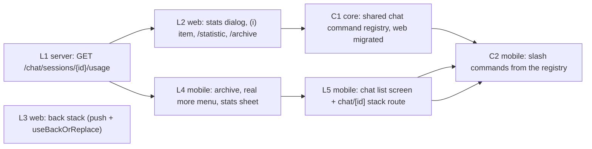

# Design: DM `/archive`, session statistics, and DM back stack

Generated by /office-hours on 2026-10-15
Branch: agent/x99-claude-opus/21497bbd6afd
Repo: cheese-work/multica
Status: APPROVED (Cheese, 2026-10-15, DM: "D2 A")
Mode: Intrapreneurship (plan supplied by Cheese; diagnostic skipped)

## Problem Statement

Three DM (chat session) gaps, requested by Cheese:

1. `feat(multica)`: a DM `/archive` command.
2. `feat(multica)`: DM session statistics as an (i) item in the DM more menu and a `/statistic` command.
3. `feat(multica)`: DM list > detail1 > detail2 keeps its back stack on mobile and web.

## What exists today (verified 2026-10-15 at `c1945db22`)

| Area | Exists | Gap |
|---|---|---|
| Archive | `PATCH /api/chat/sessions/{id}/archive` `{archived}` (`server/internal/handler/chat.go:570`); web header menu (`chat-session-header.tsx:219-258`) and row actions; `useSetChatSessionArchived` (`packages/core/chat/mutations.ts:332`) | No `/archive` command. Mobile has no archive mutation and lists active sessions only. |
| Slash commands | Web built-ins hardcoded `["compact","rename","fork"]` (`packages/views/editor/extensions/slash-command-suggestion.tsx:259`); `/rename` and `/fork` intercepted in `chat-input.tsx` | Mobile composer has no slash commands. No shared registry. |
| Statistics | `task_usage` (tokens, cost, model), `agent_task_queue.chat_session_id` and run timestamps, `chat_message` role and `elapsed_ms`, continuation links on `chat_session`; template query `GetIssueUsageSummary` (`server/pkg/db/queries/task_usage.sql`); format helpers in `packages/views/runtimes/utils.ts` | No per-session endpoint and no UI. Context-window size is not stored. |
| Web back stack | One route `/{ws}/chat?session=<id>`; `useBackOrReplace` (`packages/views/navigation/use-back-or-replace.ts`) | Store-to-URL sync always calls `replace()` (`packages/views/chat/chat-page.tsx:125-133`). The compact back button always clears to the list. |
| Mobile back stack | expo-router; chat is one tab screen; session in local `useState`; session list is a formSheet (`chat-sessions.tsx`) | No `chat/[id]` route, so nothing can be pushed or popped. |

## Premises (accepted by Cheese, not disputed)

1. `/archive` runs the same flow as the menu Archive item. It runs on the client and sends no message to the agent.
2. `/statistic` runs on the client and opens the same dialog as the (i) item.
3. Statistics v1 show: input, output, cache-read and cache-write tokens; cost; number of runs by status; total run time; message counts by role; models used; continuation chain. Context-window size is out of scope.
4. "detail2" is a linked DM (a continued or forked session opened from its divider link) or an issue opened from a DM.
5. Back follows real history: selecting pushes, and back calls `back()` with the list as a fallback.
6. Mobile is in scope.

## Approaches Considered

- **A) Web only.** Rejected: leaves the mobile back stack and mobile archive broken, which title 3 asks for.
- **B) Stacked web + mobile parity.** Chosen first.
- **C) Shared command registry.** Chosen second, after B, as a refactor with no new user-facing behavior on web.

## Recommended Approach: B, then C

Every layer is one PR in a stack. Each PR carries `Changelog: none` except the PR that lands the stack on `main`, which carries one user-facing line for the whole stack. The first commit of every layer holds only tests and fails against its parent (Test-First Gate). A reviewer from a different lab signs each layer (RGS-1).



L3 has no technical dependency and can start in parallel with L1; it does not touch `handleArchive` (L2 owns that).

### L1: server usage endpoint

- `GET /api/chat/sessions/{id}/usage`. Authorization: reuse `loadChatSessionForUser` (`chat.go:278`), so the creator, workspace, private-agent and interactive-credential rules of `docs/chat-read-access.md` apply unchanged.
- New sqlc query `GetChatSessionUsageSummary`, adapted from `GetIssueUsageSummary` (same two passes, `usage` and `terminal_runs`) with the filter on `atq.chat_session_id`. Keep the uncosted columns. Coverage for chat: "terminal" = `completed`, `failed`, `cancelled`; "metered" = terminal runs with at least one `task_usage` row. Queued and running runs appear only in the status counts.
- Response shape (field names are the contract for the web zod schema and the mobile schema):

```json
{
  "session_id": "uuid",
  "tokens": {"input": 0, "output": 0, "cache_read": 0, "cache_write": 0},
  "uncosted_tokens": {"input": 0, "output": 0, "cache_read": 0, "cache_write": 0},
  "cost_usd_ticks": 0,
  "runs": {"by_status": {"completed": 0, "failed": 0, "cancelled": 0, "queued": 0, "running": 0}, "terminal": 0, "metered": 0, "total_run_ms": 0},
  "messages": {"by_role": {"user": 0, "assistant": 0}},
  "models": ["string"],
  "continued_from_session_id": null,
  "continued_into_session_id": null,
  "forked_from_session_id": null
}
```

- Field sources:
  - run counts by `agent_task_queue.status`;
  - total run time `SUM(completed_at - started_at)` over finished runs;
  - message counts by `chat_message.role`;
  - distinct models from `task_usage.model`;
  - continuation chain: `continued_from_session_id` / `continued_into_session_id` / `forked_from_session_id` IDs (one hop each, no recursive walk in v1).
- Index: `idx_agent_task_queue_chat_session` on `(chat_session_id, created_at DESC) WHERE chat_session_id IS NOT NULL` (migration 472) covers every run status. Confirm with `EXPLAIN`; no new index is expected.
- Response compatibility: add the zod schema in `packages/core/api/schema.ts`, parse with `parseWithFallback`, and add a malformed-response test.
- Tests: DB-backed handler test (`testutil` fixtures) with a session that has 2 metered runs, 1 unmetered run and 1 failed run; a test that another user receives the same refusal as the session GET.

### L2: web stats dialog and the two commands

- `packages/core`: `api.getChatSessionUsage`, `chatSessionUsageOptions` query.
- `packages/views/chat/components/chat-session-stats-dialog.tsx`: reuse `formatTokens`, `formatUsd` and cost estimation from `runtimes/utils.ts`. Show cost as "partial" when uncosted tokens exist.
- More menu: add "Statistics" with an (i) icon to `chat-session-header.tsx` and to `SessionDropdown` in `chat-window.tsx`.
- Slash commands: add `archive` and `statistic` to the built-in list and `BuiltinCommandKey`, with i18n keys. Intercept them in `chat-input.tsx` like `/rename`, behind new optional `onArchive` and `onStatistic` props with `enableArchiveCommand` / `enableStatisticCommand` flags (same pattern as `onFork`). `/statistic` opens the dialog; `/archive` calls the page's `handleArchive` in `chat-page.tsx`. Neither is sent to the agent.
- Surfaces: the full Chat page on web and desktop (`ChatPage` is also mounted in `apps/desktop/src/renderer/src/routes.tsx`) and the floating chat window (`chat-window.tsx`), which passes the same two props.
- `/archive` failure (for example a decision-lane block from `decisionLaneArchiveAllowed`): today all three archive paths move the selection first and archive fire-and-forget: `chat-page.tsx` compact (`setActiveSession(null)`), `chat-page.tsx` desktop (`advanceSelectionAfterArchive`) and `handleArchive` in `chat-window.tsx` (~L1348). L2 changes all three to await the mutation (`mutateAsync`) before navigating, in line with AGENTS.md "await the server before navigation". On failure: show the server error in a toast and keep the session open. Tests cover the page and the floating window.
- L2 also owns the compact archive navigation: after a successful archive, call `useBackOrReplace()(wsPaths.chat())` instead of `setActiveSession(null)`, so L3 does not edit `handleArchive`.
- On an archived session the composer is not offered (sending already returns 409), so `/archive` cannot be typed. Unarchive stays a menu item only; no `/unarchive` in v1.
- Tests: suggestion list contains both commands; submit of `/archive` calls the archive mutation and sends no message; submit of `/statistic` opens the dialog and sends no message.

### L3: web back stack

- Mechanism: the store-to-URL effect in `chat-page.tsx` cannot tell a user selection from a new chat that just got its server ID. So move navigation to the call sites: thread-list selection, "new chat" and divider links call `push(...?session=)` directly. The effect keeps only the `replace` case (new chat receives its server ID after the first send) and the `?agent=` intent.
- Compact back button: `useBackOrReplace()(wsPaths.chat())` instead of `setActiveSession(null)`.
- Continuation and fork divider links already push through `AppLink`; with the two changes above, back from detail2 returns to detail1, then to the list.
- Desktop split view (web and the Electron app): also push on selection. Back then moves between sessions (open question 2). The Electron navigation adapter already implements `canGoBack` (`apps/desktop/src/renderer/src/platform/navigation.tsx:216`), so `useBackOrReplace` works in desktop tabs.
- Tests: list > A > linked B, back lands on A, back again lands on the list; cold open of `?session=B` and back lands on the list, not outside Multica.

### L4: mobile archive, more menu and stats sheet

- `apps/mobile/data/mutations/chat.ts`: archive and unarchive mutations.
- Session list: fetch `status=all` and show an "Archived · N" section, same as web. This is needed: without it a session archived on mobile cannot be found again to unarchive.
- Replace the ⋯ Delete-only alert (`(tabs)/chat.tsx:469-488`) with a real menu: Statistics (i), Archive or Unarchive, Delete.
- Stats sheet: calls the L1 endpoint through mobile's own request helpers, with its own schema.
- Read `apps/mobile/AGENTS.md` first; verify with the mobile commands listed there (root checks do not cover mobile).
- Mobile copy for the new items in every supported language.

### L5: mobile back stack

- Information architecture change: the chat tab root becomes the session list screen; a new stack route `[workspace]/chat/[id]` shows one DM. Selecting a session pushes `chat/[id]`. Depends on L4 because the L4 more menu moves into the `chat/[id]` header.
- State: the route param `id` replaces the local `activeSessionId` `useState` and the `chat-session-picker-store` hand-off. A new chat uses `chat/new?agent=<id>`; after the first send returns the session ID, `router.replace` to `chat/<id>`. Composer drafts stay keyed by session ID, as today.
- Render continuation and fork divider links on mobile; they push another `chat/[id]`. Issue links already push.
- Hardware back and the swipe gesture pop the stack: detail2 > detail1 > list.
- This layer changes UI layout, so it goes through `multica-cheese-work-design-loop` (mockup and UX review) before implementation.

### C1 and C2: shared command registry

- C1: `packages/core/chat/commands.ts` with one entry per command: `id`, i18n key, `isAvailable(ctx)` (for example rename and fork flags, archived state), and kind `client` or `prompt` (`/compact` stays a prompt that the server rewrites). Web suggestion list and menus read from it. No behavior change: the L2 tests must pass unchanged.
- C2: mobile composer shows a `/` suggestion list from the same registry and runs the same handlers. Mobile gains `/compact`, `/rename`, `/fork`, `/archive` and `/statistic`. This is wider than the three titles; Cheese chose C knowing it ("B then C").

## Open Questions

1. **Mobile IA (L5):** make the chat tab root a session list screen, or keep the formSheet list and push only detail routes from it? Recommendation: list screen, because a sheet cannot be a back-stack entry. Needs the design-loop mockup.
2. **Desktop split view (L3):** push on every session selection (browser back walks sessions) or replace (back leaves chat)? Recommendation: push.
3. **Chain totals (L1):** show only this session, or also a total across the continuation chain? Recommendation: this session only in v1; add chain totals when someone asks.

## Success Criteria

- Web and mobile: `/archive` archives the open DM with the same result as the menu item; no message reaches the agent.
- Web and mobile: (i) Statistics and `/statistic` show the same numbers. The L1 handler test asserts the totals equal a direct SQL sum over `task_usage` for that session; both clients render the endpoint values without recomputing them.
- Web (desktop browser and phone-width browser): list > DM A > linked DM B, back, back: lands on A, then the list.
- Mobile app: the same path with hardware back or swipe lands on A, then the list.
- Every layer: tests-first commit with red output in the PR body, then green.

## Distribution Plan

Existing pipelines: the web and server deploy as today; the mobile app ships through its existing Expo build. No new artifact.

## Dependencies

- None blocking. L1 has no predecessor. L3 can start at once.
- Related: CHE-1538 (`/compact` prompt path) must keep working after C1.

## The Assignment

On your phone browser, open web chat, go list > a DM > its "continued from" link, press back twice, and write down where you land each time. This confirms premise 4 and gives L3 its red test.

## What I noticed about how you think

- You answered "B then C": ship the visible features first, then pay for the refactor. The stack order follows that.
- Your three titles name the surfaces ("mobile and web", "(i) icon in more menu"). That made the gap map exact on the first pass.
