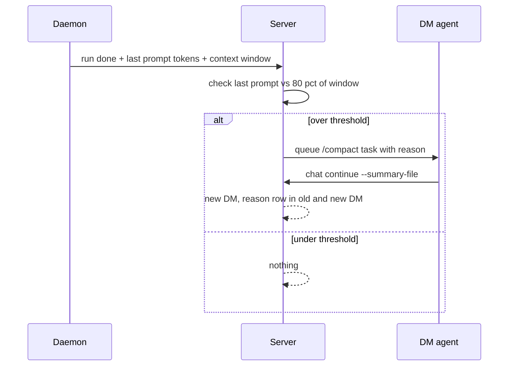
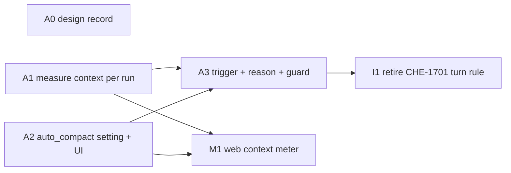

# Design: DM auto-compact at a context threshold

Generated by /office-hours on 2026-10-16
Branch: design/dm-auto-compact
Repo: cheese-work/multica
Status: APPROVED (Cheese, 2026-10-16, DM: "A"; spec review: 2 rounds, 8/10 PASS)
Mode: Intrapreneurship (plan supplied by Cheese; diagnostic skipped)

## Problem Statement

Cheese, 2026-10-16 DM: "Change to when a DM reached 80% context window. Compact with a reason why it compacted. A setting to change compact threshold."

Today a web DM rolls over to a new DM because of an agent instruction (CHE-1701): after about 8 agent turns, or after a turn that read large output, the agent writes a summary and runs `multica chat continue`. The agent cannot read its own context size, so the rule is a turn-count proxy. Cheese saw a rollover with no visible reason and asked why.

Three asks:

1. Trigger on measured context fill (80%), not on a turn count.
2. Show the reason for each compaction in the DM.
3. A setting that changes the threshold.

## What exists today (verified 2026-10-16 at `6d857ef38`)

| Area | Exists | Gap |
|---|---|---|
| `/compact` | Client sends `/compact` as plain text. At claim time the server swaps in the compact prompt for web DMs only (`server/internal/handler/daemon.go:3312`, `server/internal/handler/chat_compact_prompt.go:10`). The agent writes a summary and runs `multica chat continue --summary-file` | Only a person or an agent instruction can start it. |
| Continue | `POST /api/chat/continue` (`server/internal/handler/chat_continue.go:26`) creates the next `chat_session`, inserts a `continuation_summary` message with `[Previous DM](url)`, links both sessions. Idempotent per session. Callable only with a task token of that session | No reason field. |
| Usage | `task_usage` per `(task_id, provider, model)`: input, output, cache read, cache write, cost. `agent_task_queue.chat_session_id` links runs to a DM. Per-session endpoint `GET /api/chat/sessions/{id}/usage` (#266) | Values are summed across the run, so they overcount the final context. No per-call prompt size. No context-window size anywhere. |
| Claude stream | Daemon reads usage per assistant message (`server/pkg/agent/claude.go:478-507`). The result `modelUsage` carries `contextWindow` (Claude Code 2.1.299, local probe). The stream carries `compact_boundary` with `compactMetadata.preTokens` | Daemon keeps only sums. `contextWindow` and `compact_boundary` are ignored. |
| Codex stream | `thread/tokenUsage/updated` carries `tokenUsage.total`, `tokenUsage.last` and `tokenUsage.modelContextWindow` (`server/pkg/agent/codex.go:3983-3991`; fixtures `codex_test.go:3730`, `:4055`) | `last` is kept only from the first snapshot; `modelContextWindow` is ignored. |
| Messages | `chat_message.role` is `user` or `assistant` only (`server/migrations/033_chat.up.sql:24`). `message_kind = continuation_summary` has its own renderer (`packages/views/chat/components/chat-message-list.tsx:627`). Chat tasks get their prompt from linked user input messages at claim time (`daemon.go:3169`); a task with empty input is cancelled (`daemon.go:3321`) | No system role. No task-level prompt. |
| Settings | Workspace `settings.compact_prompt` with a UI ("Compact prompt", `packages/views/settings/components/workspace-tab.tsx:146-250`). Per-agent `runtime_config.compact_prompt` (API only) | No threshold setting. |
| Overflow | `context_overflow` failure starts a fresh provider session on the next turn (`server/pkg/db/queries/chat.sql:1454`) | Reacts after failure, with no summary and no new DM. |

## Premises (accepted by Cheese, 2026-10-16, DM: "A")

1. The platform measures context, not the agent. The daemon reports the prompt size of the last model call in a run and the model's context window. The server computes the fill.
2. The trigger runs only after a run finishes. The current answer always completes first.
3. The reason is visible in the old DM, in the new DM's summary message, and in `/statistic`.
4. The threshold is editable in Settings > Workspace, next to "Compact prompt", with an optional per-agent override and an Off state.
5. The rule is percent only: fill at or above the threshold (default 80%). A token cap was proposed and rejected by Cheese (2026-10-16, DM: "No" to "or at least 200k tokens"). On a 1M-context model the trigger is therefore 800k tokens.

## Approaches considered

- **A: Server auto-compact through the existing `/compact` (chosen).** See below.
- B: In-place provider compaction (`CLAUDE_AUTOCOMPACT_PCT_OVERRIDE`, same DM). Rejected: Claude only, provider-written summary that the user never sees, ignores the Compact prompt, conflicts with the CHE-1755 continuation and statistics model.
- C: A plus a live context meter. The meter is accepted as a later layer (M1), not part of the first delivery.

## Recommended approach (Cheese, 2026-10-16, DM: "A, with the meter from C as a later layer")

### Measurement (layer A1)

- Definition: `context_tokens` = input + cache read + cache write of the last model call of the run, for the model that made that call. Output tokens are excluded. Sub-model calls (for example a small model used by a tool) do not count.
- Claude: keep the usage of the last assistant message (already parsed at `claude.go:478-507`) and read `contextWindow` for that model from the result `modelUsage`.
- Codex: use `tokenUsage.last.inputTokens` of the latest `thread/tokenUsage/updated` notification of the run for `context_tokens` (OpenAI input already includes cached input; do not add `cachedInputTokens` again), and `tokenUsage.modelContextWindow` for `context_window`. The current parser keeps `last` only from the first snapshot (`codex.go:3994-4005`); A1 keeps the latest.
- Other providers: store NULL for both. Auto-compact never fires on NULL `context_tokens`.
- Storage: two nullable columns on `agent_task_queue`: `context_tokens BIGINT`, `context_window BIGINT`. The daemon sends them as an optional top-level `context: {tokens, window}` object on `POST /tasks/{taskId}/complete`, the authoritative call that A3 hooks (not the usage report, whose failure is only logged). Old daemons send nothing, which leaves NULL and disables auto-compact for that run.

### Setting (layer A2)

- Workspace `settings.auto_compact`: `{ "enabled": bool, "threshold_pct": int }`. Missing key means the defaults `{true, 80}`.
- Per-agent override (premise 4, accepted): `agent.runtime_config.auto_compact`, same shape, every field optional. A present field wins over the workspace value. `null` for the whole key means inherit.
- Validation (server, same style as `validateCompactPromptConfig`): `threshold_pct` 50 to 90 (above 90 the compaction run itself can overflow). Anything else returns 400 with the field name.
- Edit paths (per learning `spec-setting-needs-edit-path`):
  - Workspace: Settings > Workspace > "Auto-compact" section, directly below "Compact prompt", same `canManage` read-only rule, autosave like `saveCompactPrompt`. Fields: Enabled switch, Threshold (%) number. Help text states the rule in one sentence.
  - Per agent: CLI `multica agent update <agent> --runtime-config-file <file>` (existing path). An agent-page UI is out of scope for this feature.
- API: same `PATCH /api/workspaces/{id}` with a dedicated top-level `auto_compact` field, like `compact_prompt` (`server/internal/handler/workspace.go:331-334`).

### Trigger, reason, and guard (layer A3)

- Active compaction task: a task of the session with `task_kind = 'compact'` and `status IN ('queued', 'dispatched', 'running', 'waiting_local_directory', 'deferred')`. These are the same five active states as `HasActiveChatTaskForSession` (`server/pkg/db/queries/chat.sql:1485-1505`). Every guard below uses this one predicate (one sqlc query, `HasActiveCompactTaskForSession`), never a subset such as "queued or running".
- New nullable columns on `agent_task_queue`: `task_kind TEXT` (`'compact'` or NULL), `compact_reason TEXT`, `compact_trigger_tokens BIGINT`. One new `chat_message.message_kind`: `compact_notice`.
- Compaction tasks are recognised by `task_kind = 'compact'`. Auto-compaction sets it at enqueue. A manual `/compact` gets it at enqueue too: the send handler sets it when the first word of the message is `/compact`, using the same test as `compactChatPrompt` (`chat_compact_prompt.go:10`). The claim path only reads the column.
- When: in `CompleteTask`, when a task of a web DM (`chat_channel_type = ''`) completes successfully. All of these must hold:
  - the task is not a compaction task;
  - the session is active and `continued_into_session_id IS NULL` (the agent may still roll over by itself under CHE-1701 until I1);
  - the session has no active compaction task (all five active states).
- Rule: effective settings = agent override over workspace over defaults. Fire if `enabled` and `context_tokens` is not NULL and `context_window` is not NULL and `context_tokens >= threshold_pct% of context_window`. A run with an unknown window never triggers.
- Action, in one transaction:
  1. Enqueue a task on the same DM and agent with `task_kind = 'compact'`, `compact_reason` and `compact_trigger_tokens = context_tokens`. It has no linked input message. For an automatic compaction task (`task_kind = 'compact'` with no linked input) the claim path skips input loading entirely, including the legacy `trailingUserMessages` path (`daemon.go:3169-3173`) and the empty-input cancel (`daemon.go:3321`), and sets the prompt to `compactChatPrompt("/compact", ...)`, so the workspace and agent Compact prompt apply.
  2. Insert the old-DM notice (below).
- Reason text, built by the server only (the agent never writes it): `Auto-compacted: context 164k of 200k tokens (82%) reached the 80% threshold.`
- Where it shows:
  1. Old DM: an `assistant` message with `message_kind = 'compact_notice'` and content `<reason> Continuing in a new DM.` It is excluded from chat input selection and from the trailing-message selector (`daemon.go:4057`), so it never enters a prompt. Clients that do not know the kind render it as assistant Markdown (A3 verifies this on web and mobile); web renders it as a muted notice row.
  2. New DM: `ContinueChatSession` looks up the calling task's `compact_reason` and puts it as the first line of the `continuation_summary` message, above the agent's summary.
  3. `/statistic`: the continuation link row shows the reason (follow-up in the CHE-1755 L2/L4 views; the data is on the task).
- Sends during compaction (the DM has an active compaction task, manual or automatic, in any of the five active states): `POST` of a new user message returns 409 `chat_compacting`. Web disables the composer with "Compacting..." while `chat_session.compacting` (derived, sent in `chat:session_updated`) is true and keeps the draft; mobile shows the 409 error and keeps the draft under the existing send-failure rule. After `chat continue`, the client opens the new DM as it does today. This also closes the same race for manual `/compact`. The existing chat stop/cancel action cancels an active compaction task in any of the five active states (`CancelAgentTaskByUser` already covers all five), which unlocks the DM and goes through the guard's terminal path, so an offline runtime cannot lock a DM.
- Guard: when a compaction task reaches any terminal state (completed, failed, cancelled, swept as stale) and the session has no `continued_into_session_id`, post a `compact_notice` `Auto-compact failed (<status>). Type /compact to retry.` (automatic only) and do not auto-trigger again in that DM until a run's `context_tokens >= 1.1 x compact_trigger_tokens` of that failed task. The re-arm rule applies only when `compact_trigger_tokens` is set, so a failed manual compaction does not suppress auto-compact.
- Manual `/compact` keeps its current behavior apart from the 409 send guard. A manual compaction carries no reason line.

### Context meter (layer M1, later)

- Web/desktop DM header: `62% of 200k` from the latest completed run's `context_tokens` and `context_window`. Hidden when either is NULL.
- Warning state at 10 percentage points below the threshold: `Will compact after the next reply`.
- A "Compact now" item sends `/compact`.
- Mobile meter waits for the CHE-1755 mobile route (CHE-1761); out of scope here.

### Instruction change (layer I1)

After A3 is deployed and one auto-compaction is read back on production, replace the CHE-1701 turn-count rule in the agent instructions with "the platform auto-compacts; do not roll over on a turn count". Follow `multica-cheese-work-instruction-change`. Until then the CHE-1701 rule stays.

## Layers

| Stage | Layer | Scope | Depends on |
|---|---|---|---|
| 1 | A0 | This design record | none |
| 1 | A1 | Daemon + server: `context_tokens`, `context_window` per run (Claude, Codex) | none |
| 1 | A2 | Server setting, validation, API; web Settings > Workspace section | none |
| 2 | A3 | Trigger, queued compaction task, reason rows, guard | A1, A2 |
| 3 | M1 | Web/desktop header meter, warning, "Compact now" | A1, A2 |
| 4 | I1 | Retire the CHE-1701 turn-count instruction | A3 deployed |

## Success criteria

- A web DM on a 200k model compacts after the first completed run whose last prompt is at or above 160k, and never before.
- A web DM on a 1M model compacts at 800k (80%), and never before.
- A message sent while a compaction runs is refused with the draft kept, never answered in the old DM.
- The old DM shows the reason note; the new DM's first message starts with the same reason.
- Changing the threshold in Settings > Workspace changes the next trigger without a restart.
- Off means no automatic compaction; manual `/compact` still works.
- A DM never gets two compaction tasks from one trigger, and a failed compaction does not loop.

## Test plan (first commit of each layer is tests-only and red, per the Test-First Gate)

- A1: daemon parser tests with a recorded Claude stream (multi-call run with a sub-model call) and a Codex sequence of several `thread/tokenUsage/updated` notifications; assert last-call tokens of the latest call, not sums; handler test for the optional `context` object on `/complete`.
- A2: handler tests for validation bounds, inherit/override precedence, `canManage`; web test for the Settings section autosave and read-only state.
- A3: handler tests for: below/at/above percent; NULL window; NULL tokens; disabled; channel DM ignored; failed task ignored; already-continued DM ignored; compaction task never triggers (manual and automatic); one active compaction max (duplicate suppression tested with the existing compaction task in each of `queued`, `dispatched`, `running`, `waiting_local_directory`, `deferred`); claim of a `task_kind = 'compact'` task with no input; notice excluded from input selection; reason in old notice and new summary; 409 `chat_compacting` with draft kept on send while a compaction task is in each of the five active states, and no 409 once it is terminal; guard on each terminal path and the 1.1x re-arm; manual `/compact` marked at enqueue; cancel of an active compaction (each of the five states) unlocks sends.
- M1: component tests for hidden, normal, warning states.

## Open questions

1. Should the compaction run on the CHE-1771 (L7) compaction agent when one is configured? Recommendation: yes, automatically, once L7 ships; no change to A3's contract.

## Dependencies

- CHE-1755 L1 usage endpoint (#266, merged) for the `/statistic` reason row.
- CHE-1771 L7 compaction agent (optional, open question 1).
- Production deploy of A3 is Cheese's gate before I1.

## Distribution

Existing Multica server, daemon and web deploy pipeline. Daemon change (A1) needs a daemon release; an old daemon simply disables auto-compact for its runs.
