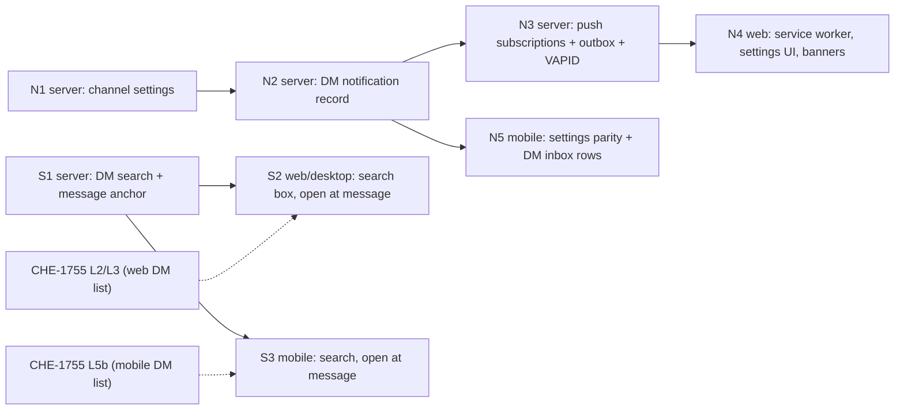

# Design: DM search, DM notifications, notification opt-in and Web Push

Generated by /office-hours on 2026-10-16
Branch: agent/x99-claude-opus/dm-search-notifications
Repo: cheese-work/multica
Status: DRAFT
Mode: Intrapreneurship (plan supplied by Cheese; diagnostic skipped)

## Problem Statement

Cheese's request (verbatim):

- Feat: DM search
- Feat: DM notifications
- Feat: opt in inbox noti and DM noti in setting
- Feat push noti on mobile web shortcuts (safari/chrome) and desktop browser

The underlying problem: a user delegates work to an agent in a DM, leaves, and has no reliable way to be pulled back when the agent replies or needs a decision. Once DMs pile up, the user also cannot find an old conversation.

## What exists today (verified 2026-10-16 at `87ba6ff24`)

| Area | Exists | Gap |
|---|---|---|
| DM search | Issue/project search with `LOWER(col) LIKE` plus ranking (`server/internal/handler/issue.go:809`), 8 s statement timeout (`server/internal/handler/search.go:17-30`); `pg_trgm` installed; client-side local index for issues, comments, projects (`packages/core/search-index`) | No endpoint, index or UI for DM titles or `chat_message.content`. Trigram indexes on comment content (140) and issue description (139) were later dropped (455, 464). |
| DM read gate | `chatReadSession` (`server/internal/handler/chat_read_access.go:42`) and message visibility filter (`server/pkg/db/queries/chat.sql:1257`) | Any search must reproduce both. |
| Inbox | `inbox_item` (`issue_id` nullable, `read`, `archived`), created by in-process listeners (`server/cmd/server/notification_listeners.go:670-1045`); `/api/inbox` incl. unread count; WS `inbox:*` | No `chat_session_id`. An agent reply in a DM never creates an item, so never raises a banner. Decision pings (`server/internal/decisiontx/ping.go:47-60`) create a `mentioned` item anchored to the issue, not the DM. |
| DM unread | assistant messages after `last_read_at` (`chat.sql:208-215`), `POST /api/chat/sessions/{id}/read`; badges on web sidebar and mobile tab | Badge only; no record, no banner. |
| Settings | `notification_preference` per (workspace, user), JSONB group map `all`/`muted` (`server/migrations/064`), applied in `isNotifMuted` (`notification_listeners.go:174-198`); web `notifications-tab.tsx`, `browser-notification-setting.tsx`; mobile `more/settings/notifications.tsx` | No DM group, no channel (in-app vs push) switches. `PUT` replaces the whole map (`server/internal/handler/notification_preference.go:129`), so an old client can erase new keys. |
| Banners | Browser Notification API while a tab is open (`packages/core/platform/system-notification.ts:54-111`), fired only on `inbox:new` (`packages/core/realtime/use-realtime-sync.ts:568-580`), copying `item.body`; Electron native banners (`apps/desktop/src/main/index.ts:782-835`) | Nothing when no tab is open. Banner text includes the item body. |
| Push | PWA manifest (`apps/web/app/manifest.ts:30-75`, `display: standalone`), `appleWebApp` (`apps/web/app/layout.tsx:95`) | No service worker, PushManager, VAPID keys, push library or subscription table. No Expo push. |

## Premises (agreed by Cheese, D1 = A, D2 = A)

1. **DM search:** one search box in the DM list on web, desktop and mobile. It matches DM titles and message text in DMs the user can read in this workspace. A result opens that DM at the matching message.
2. **DM notifications (revised at D2):** every agent reply in a DM and every decision request raised in a DM creates or updates one notification record per DM. The record is created whether or not the user is looking. Opening the DM marks it read. Push waits a short delay and is skipped when the record is already read. Inbox, the browser tab, the desktop app and push all read from that one record.
3. **Opt-in settings:** two switches, "Inbox notifications" and "DM notifications", each with channels: in-app and push on this device. Push stays off until the user turns it on per device. Existing group mutes stay.
4. **Push platforms:** standard Web Push (service worker + VAPID) for desktop Chrome, Edge, Firefox and Safari, and Android Chrome. iOS/iPadOS only from a Home Screen web app (16.4+), with permission asked from a button tap. Native Expo app push is out of scope.
5. **Privacy and self-host:** a banner shows the actor and the DM or issue title, never message text. Each deployment generates its own VAPID keys; push is off where they are not set.

## Cross-Model Perspective

Codex (completed, read-only cold read of a structured summary, 2026-10-16):

- Steelman: Multica lets people delegate to agents, leave the app, and reliably return when their attention matters. One durable notification connects an agent's reply or decision request to the exact conversation across devices.
- Key insight: "A new agent reply in a DM never creates an inbox item." Adding push alone would transport an incomplete notification model.
- Challenged premise 2 ("not looking at"): create the record regardless of presence; use read acknowledgement to suppress delivery. Cheese accepted this (D2 = A).
- Prototype: close the loop first (DM record, push subscription + outbox, service worker, channel settings, open-at-message), skip search.
- Risks: search must reuse the DM read gate and message visibility filter; the event bus is in-process (`server/internal/events/bus.go:73`), so push needs a durable outbox and dedupe; old clients' replace-all `PUT` and banner body copying break settings and privacy.

Claude agreed with all points and added: one coalesced record per DM, not per message.

## Approaches Considered

- **A) Minimal** (records in the existing inbox, two new mute groups, push sent from the in-memory bus, unindexed search). Rejected: no retry, old clients can erase the new switches, lost pushes on restart.
- **B) Durable stack.** Chosen (D3 = B).
- **C) Push only** (service worker + push per agent reply, no record, settings or search). Rejected: drops premises 2 and 3 and loses events on restart.

## Recommended Approach: B, durable stack

One PR per layer, stacked. Every code layer starts with a tests-only commit that fails against its parent (Test-First Gate); a reviewer from a different lab signs each layer (RGS-1). Only the PR that lands the stack on `main` carries a user-facing changelog line.

The notification track (N) and the search track (S) are independent. S2 and S3 wait for the CHE-1755 layers that rebuild the same DM list, to avoid rebuilding it twice.

### N1: channel settings (server)

- New table `notification_channel_preference` (workspace_id, user_id, source in {`inbox`, `dm`}, channel in {`in_app`, `push`}, enabled, updated_at). Separate from the legacy JSONB map, so the old replace-all `PUT` cannot erase it.
- API: `GET /api/notification-channels`, `PATCH` one (source, channel) at a time. zod schemas and malformed-response tests.
- Defaults: `push` = off for both sources (premise 3). `in_app` for `inbox` = on (today's behaviour). `in_app` for `dm` = see Open Question 1.
- Settings are per workspace. Push also needs a live subscription on the device (N3).
- Existing group mutes keep applying on top for inbox sources.
- N1 ships the table, API and defaults only; N2 and N3 read the switches.

### N2: DM notification record (server)

- Migrations: nullable `chat_session_id`, `chat_message_id`, `dedupe_key` and `updated_at` (default `created_at`) on `inbox_item`; a partial unique index on `(recipient_id, dedupe_key) WHERE dedupe_key IS NOT NULL AND read = false`; the inbox listing index from migration 200 is replaced by one that sorts on `updated_at`. Each index `CONCURRENTLY` in its own file; no foreign keys.
- New item type `dm_reply`. One unread record per (recipient, DM): `dedupe_key = 'dm:<session_id>'`. A later reply updates `chat_message_id`, `updated_at` and `details.reply_count` instead of inserting a row, and the row moves to the top of the inbox. Once read, the next reply starts a new record.
- One helper, `notifyDMReply(tx, session, message)`, is called inside the transaction of every write site that persists a final assistant reply of a run: the task completion and failure paths in `server/internal/service/task.go` (the assistant-message writes around lines 3231, 3379, 3537, 4876 and 5332), `chat_continue.go:134` and `mika_onboarding.go:184`. A failed run's error reply notifies; streaming partials do not. The recipient is the DM's creator; no record for messages the creator wrote.
- No record when the DM is channel-bound (the channel already delivers the reply) or archived. Archiving or deleting a DM marks its unread records read in the same transaction.
- Decision requests: the helper skips messages with `message_kind` `decision_request` or `decision_reference`. `NotifyPing` keeps its transactional dedupe and also sets `chat_session_id`. Resolving the decision marks its record read.
- Read sync: `POST /api/chat/sessions/{id}/read` marks that DM's unread `dm_reply` records read in the same transaction; marking a `dm_reply` item read advances the DM's `last_read_at` to `chat_message_id`.
- Channel switches (N1): when both `in_app` and `push` are off for `dm`, no record is created. When `in_app` is off and `push` is on, the record is created for push read-sync but is excluded from the inbox list and unread count.
- Access: the inbox list and unread count exclude records whose DM the user can no longer read (membership, session state, private-agent access), using the same checks as the DM read gate.
- Clients: the inbox schema already allows `issue_id: null` (`packages/core/types/inbox.ts:56`); add `chat_session_id`, `updated_at` and `details.reply_count` to the zod schema with `parseWithFallback`; a `dm_reply` row or a row with `chat_session_id` opens the DM. Older clients receive the row and must not crash (malformed and unknown-type tests).
- WS: `inbox:new` on insert, `inbox:updated` on coalesced update.

### N3: push subscriptions, outbox and VAPID (server)

- Config: `MULTICA_VAPID_PUBLIC_KEY`, `MULTICA_VAPID_PRIVATE_KEY`, `MULTICA_VAPID_SUBJECT`. `SELF_HOSTING.md` documents generating a key pair with an existing tool (no new command). `GET /api/push/config` returns `{enabled, public_key}`; push is disabled when keys are missing.
- Table `push_subscription` (id, user_id, endpoint unique, p256dh, auth, created_at, last_success_at, failure_count). A subscription belongs to (user, device) across all workspaces and stores the id of the login session or token that registered it. `POST /api/push/subscriptions` upserts by endpoint and reassigns the owner on a new login; `DELETE /api/push/subscriptions` takes the endpoint in the body. Logout reads the endpoint from `pushManager.getSubscription()`, sends the `DELETE`, then calls `unsubscribe()`, then clears the session. The worker skips a subscription whose registering session is revoked or expired, so a logout that cannot authenticate still stops pushes for the old account.
- Table `push_delivery` (outbox): one pending row per (record_id, subscription_id). Every inbox item insert or coalesced update goes through one service function, `createInboxItem(tx, item)`, which also upserts the outbox rows when the recipient's `push` switch is on for that source (`inbox` or `dm`) in that workspace. This covers the N2 DM records, `NotifyPing`, and the existing listeners in `notification_listeners.go`, which N3 changes to insert the item and its outbox rows in one transaction. A coalesced update moves `next_attempt_at` forward (= now + delay, Open Question 3) instead of adding a row.
- Worker: reuses the lease pattern of the leased decision consequence runner (CHE-1753): claim due rows with `claimed_until`, re-claim after lease expiry, stop cleanly on shutdown, keep sent rows for a short retention window. Before each send it re-checks: record still unread, push switch still on, user still a workspace member, DM still readable. It retries with backoff up to a cap and deletes the subscription on 404/410. The read check happens on the server because iOS requires every delivered push to show a notification.
- Payload (premise 5): `{record_id, workspace_slug, kind, actor_name, label, reply_count, url}`. `label` is fixed copy ("New reply", "Decision needed") for DM records, and the issue identifier and title for issue records. A DM title is never sent, because an untouched DM title is derived from the first user message (`chattitle.Derive`), so it counts as message text. No message text, no issue body, no decision ask. Encrypted per Web Push (RFC 8291).
- The push library needs a dependency health check before it is added (candidate: `SherClockHolmes/webpush-go`; maintenance not yet verified).

### N4: web client (service worker, settings, banners)

- `apps/web/public/sw.js`, served with `Cache-Control: no-cache` and registered with scope `/`; confirm the standalone image copies `public/` (the proxy matcher already skips paths with a dot). `push` shows a notification with `tag = record_id` (a coalesced update replaces the old banner). `notificationclick` focuses an open Multica tab on `url` or opens one; a push for another workspace switches to it. `pushsubscriptionchange` re-subscribes and re-registers.
- On app load, compare `pushManager.getSubscription()` with the server, and show "Notifications are blocked in this browser" when permission is `denied`.
- Settings: Inbox notifications and DM notifications sections, each with In-app and Push switches, plus one "Push on this device" switch that requests permission from the tap, subscribes with the deployment key and registers the device. In iOS Safari outside a Home Screen app, that switch is replaced by "Add Multica to your Home Screen to get notifications" with the steps; the user signs in again inside the Home Screen app, because it has separate storage.
- Platform gate: `notifications-tab.tsx` is shared with Electron, so service-worker registration and the Push switches render only on web, never in Electron.
- Banners in an open tab: fire on `inbox:new` and `inbox:updated` for DM records; route DM records to the DM; stop copying `item.body` into any banner; skip the banner when the user is already viewing that DM; coordinate with the service worker by `tag` so one event shows one banner.
- Desktop (Electron): no Web Push; the existing native banner path reads the same records and the In-app switches.

### N5: mobile settings parity and DM inbox rows

- Mobile settings gain the In-app switches for both sources (no push switch; native push is out of scope).
- Mobile inbox renders `dm_reply` rows and opens the DM. Badge counts keep coming from the server unread summary.

### S1: DM search and message anchor (server)

- `GET /api/chat/search?q=&limit=&cursor=`, interactive users only (no task-token path). It searches DMs the user can read in the workspace: the creator, public-session and private-agent rules of `chatReadSession` are written as SQL predicates, with a negative test for each, plus the message visibility filter of `chat.sql:1257`. Returns per hit: session id, title, agent, matched message id (if any), a short snippet around the match, `updated_at`, archived flag. Ranked: title matches first, then most recent message match.
- Query: `LOWER(...) LIKE` with the existing 8 s search timeout, scoped first to the user's sessions. A trigram GIN index on `chat_session.title` (small table). No index on `chat_message.content` until `EXPLAIN` on the largest workspace shows a need (Open Question 4).
- Archived DMs are included and marked archived.
- Message anchor: `GET /api/chat/sessions/{id}/messages?around=<message_id>` returns a page around the message with the same access and visibility rules.

### S2: web and desktop search box

- A search field at the top of the DM list (full page and floating window). Results replace the list while a query is active; each result shows title, agent, snippet with the match highlighted, and time. Escape or clear restores the list.
- Selecting a result opens the DM at the matching message (anchor API), scrolls to it and highlights it briefly. It pushes a history entry, consistent with CHE-1755 L3.
- Admitted after CHE-1755 L2 and L3 land.

### S3: mobile search

- A search entry in the mobile DM list (formSheet, as `apps/mobile/AGENTS.md` asks for search screens), same results and open-at-message. Admitted after CHE-1755 L5b.

## Open Questions

1. **DM in-app default:** should `in_app` for `dm` be on by default (DM rows appear in Inbox for everyone after deploy) or off (true opt-in)? Recommendation: on, because the DM badge already exists and a record nobody sees cannot pull anyone back; push stays off by default.
2. **Inbox placement:** show DM records in the main Inbox list, or under a "DMs" filter? Recommendation: main list with a DM icon and an inbox filter chip; decided in the N4 design loop.
3. **Push delay:** how long to wait before sending, so a reply read in an open tab is not also pushed? Recommendation: 10 s.
4. **Message content index:** add a trigram GIN index on `chat_message.content` only if `EXPLAIN` on the largest workspace exceeds the search timeout budget. Recommendation: measure in S1, no index by default.

## Success Criteria

- With every Multica tab closed and push on, an agent reply in a DM shows a banner within 30 s on desktop Chrome and on an iPhone Home Screen app; tapping it opens that DM.
- Ten replies in one DM while away produce one unread record and one visible banner ("10 new replies"), not ten.
- After logout on a device, that device receives no push for the old account.
- Reading the DM in any client marks the record read; a push not yet sent is dropped.
- A decision request in a DM produces exactly one record, linked to the DM.
- No banner, push payload or log line contains message text.
- With push off for DMs, or no VAPID keys configured, no push is sent; in-app behaviour is unchanged.
- An old client that `PUT`s the legacy preference map does not change the channel switches.
- DM search returns a hit for a word in a message of a readable DM, never returns a DM or message the user cannot read, and opens the DM at that message on web, desktop and mobile.

## Dependencies

- CHE-1755 L2 and L3 (web DM list and back stack) before S2; CHE-1755 L5b before S3.
- Deploy hosts need VAPID keys in config before push is enabled.
- Dependency health check for the Web Push library in N3.

## Out of Scope

- Native push for the Expo mobile app (APNs/FCM).
- Email notifications.
- Per-DM mute and quiet hours.
- A device-management list (only "Push on this device" in v1).
- Web Push inside the Electron app (native banners cover it).
- Searching issues and DMs in one combined Cmd+K result list.

## The Assignment

Before N3 starts, add Multica to the Home Screen on your iPhone from the deployed web app, sign in again inside it, and confirm it opens standalone (no Safari bar). That device is the first real push target for the success criteria.

## What I noticed about how you think

- You listed push targets as "mobile web shortcuts (safari/chrome) and desktop browser", which already scopes out native apps. That kept the push layer to one standard mechanism.
- You asked for "opt in" for both inbox and DM notifications, not only DMs, so settings were treated as one model rather than a DM special case.
- When Codex challenged "not looking at", you took the revision (D2 = A) on the first reply: reliability over fewer records.
