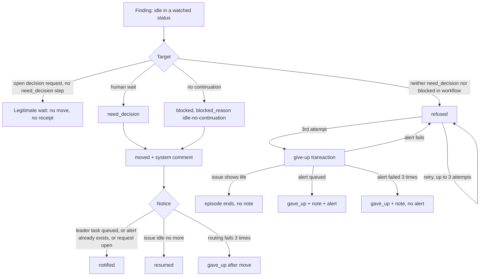

# Idle started-issue guard

A server job moves an issue that sits in `in_progress` or `agent_review` with
nothing left to continue it. The job runs every five minutes. It has three
modes: `off` (default), `shadow` and `act`. `shadow` only logs. `act` moves the
issue, explains the move in a system comment and tells the owning squad leader.

The guard never opens a decision request, never mentions an agent in a comment,
and grants no merge, deploy or decision authority.

## Settings

Workspace setting `idle_started_guard`:

```json
{"idle_started_guard":{"mode":"off","after_hours":4,"statuses":["in_progress","agent_review"]}}
```

| Key | Default | Rule |
| --- | --- | --- |
| `mode` | `off` | `off`, `shadow` or `act`. Any other value is treated as `off`. Changing it needs no deploy. |
| `after_hours` | `4` | A value below 1 or above 72 falls back to 4. |
| `statuses` | `in_progress`, `agent_review` | Statuses the guard watches. |

`mode: off` is the kill switch. It stops new moves at the next pass. It does not
undo a move that already happened.

## When an issue is idle

`idle_since` is the newest of: issue creation, the newest non-system comment,
the newest task creation or completion, and the newest member or agent
activity-log row. System comments, system activity and metadata writes never
count, so the guard's own writes cannot reset the clock.

An issue is a finding when `idle_since` is older than `after_hours`, its status
is watched, and none of these continue it:

- a task in `queued`, `dispatched`, `running` or `waiting_local_directory`;
- an enabled wakeup that will fire: `at`, `every`, `cron`, an agent-filtered or
  non-comment event, a `children_done`, `pull_request`, `github_run` or
  `other_issue` condition, or a `pr_*` system rule with an open or draft PR;
- an open child issue that is not in a done or closed category;
- an open or draft linked PR whose checks are `PENDING`.

An issue that already carries an `idle_guard` receipt is skipped by the main
scan. The episode pass handles it instead.

## Shadow mode

Each pass logs `idle_started_guard would_move` with the workspace, issue,
status, `idle_since` and threshold. It writes nothing to the database.

## Act mode



### Target

1. An open decision request: the wait is a person's to answer. The target is
   `need_decision` if the workflow lists it. If it does not, the guard moves
   nothing, writes nothing and ends an older refused receipt.
2. Human-wait evidence: an enabled member-filtered event wakeup, a newest
   comment from an agent that mentions a member, Readiness `gated-human`, or a
   workflow step handled by a person. The target is `need_decision`.
3. Otherwise nothing is left to continue the issue. The target is `blocked`
   and `blocked_reason` is `idle-no-continuation`.

A target that the issue's workflow (or, without a workflow, the status catalog)
does not list falls back to `blocked`, except for an open request (rule 1). If
neither exists, the move is refused.

### The move

The move uses the normal status-write path. Under the issue lock it:

1. compares the issue revision with the one the move was built from (a field
   edit or comment that landed first wins and the move does not commit);
2. re-runs the idle scan for that issue (a run, wakeup or child that landed
   first keeps the issue where it is);
3. writes the system comment, the `idle_guard` receipt and, for `blocked`,
   `blocked_reason`.

Comment, receipt and status change commit together. A stale move leaves no
trace and the next pass decides again from the issue as it is then.

### The notice

A separate transaction runs under the workspace and issue locks. In order:

1. An existing `decision_wait_alert_id` is reused (`need_decision` only).
2. An issue that is no longer idle in the target status gets no alert: `resumed`.
3. An open decision request is already a person's to answer: `notified`.
4. Otherwise the owning squad's leader gets one task, queued in a savepoint.
   Success writes `notified` and, for `need_decision`, seeds
   `decision_wait_alert_id` so the decision wait guard does not alert again.
   A routing failure counts an attempt and keeps the error. After 3 attempts the
   receipt is `gave_up` and a system comment says the alert failed.

The task goes through the usual run-budget, triage and stop gates.

### Refused moves and give-up

A refused move stores `refused`, the attempt count and the error, and the next
pass retries it while the issue stays idle. The third refusal starts the
give-up transaction.

Under the workspace and issue locks, the give-up first re-checks that the issue
is still in the same status, still idle, and has no open decision request.
Anything that shows life ends the episode: no note, no alert.

Then it queues the leader alert in a savepoint. `gave_up` commits only with a
delivered alert and its note, so a `gave_up` receipt means the leader was told.
If the alert fails, the receipt stays `refused` with `alert_error`,
`alert_attempts` and `alert_at`, and the next try waits 10 minutes. After 3
failed alert attempts the note commits with the failure in its text and the
receipt has no `alert_id`.

## Receipt

Issue metadata key `idle_guard`:

| Field | Meaning |
| --- | --- |
| `state` | See the table below. |
| `kind` | `human_wait`, `open_request` or `no_continuation`. |
| `from`, `to` | Status before the move, and the target. |
| `idle_since` | Idle time that started the episode (RFC 3339, nanoseconds). |
| `moved_at` | Empty until the move commits. |
| `attempts` | Move attempts, at most 3. |
| `alert_id`, `comment_id` | The queued leader task and the system comment. |
| `error` | The move or notice error. |
| `alert_attempts`, `alert_at`, `alert_error` | Give-up alert attempts, the last attempt time and the admission error. |

| State | Meaning | After a crash | New activity |
| --- | --- | --- | --- |
| `moved` | Moved, notice owed | The next pass resumes the notice | Notice checks idleness first and sets `resumed` |
| `refused`, `attempts` below 3 | Move refused | The next pass retries | Episode ends |
| `refused`, `attempts` 3, `alert_error` set | Give-up alert failed and rolled back | Retry after the cooldown | Episode ends, no note |
| `gave_up`, `moved_at` empty | Alert delivered, or alert failed 3 times | Final | Episode ends |
| `notified` | Leader task queued, alert reused, or request open | Final | Ends only when the issue leaves `to` |
| `resumed` | Issue went active before the notice | Final | Ends only when the issue leaves `to` |
| `gave_up`, `moved_at` set | Move done, notice failed 3 times | Final | Ends only when the issue leaves `to` |

The episode pass deletes the key when an issue leaves the status a settled
receipt describes, so a repaired issue can be caught again. It also deletes the
key of an unmoved episode when the idle clock moves past `idle_since`. The
guard's own alert task does not count as activity.

## Other guards

- **Decision wait guard:** the guard seeds `decision_wait_alert_id` for
  `need_decision`, so that guard does not queue a second leader task. If this
  guard cannot alert, the decision wait guard still alerts after its own delay.
- **Continuation watchdog and PULSE prompt (multica-dotfiles):** skip an issue
  only when `idle_guard.state` is `notified` and the issue is still in
  `idle_guard.to`. Every other state, or no key, is handled as before. The
  platform never reads watchdog state.

The plan called the skip state `done`. The code names it `notified`: it covers a
queued leader task, a reused alert and an open request, which are the three ways
someone has been told. Skip rules key on `notified`.

## Rollout

1. The guard ships with `mode: off`. No migration.
2. Set `mode: shadow` for the Cheese Work workspace. Run 7 days. Compare the
   `would_move` lines with the board: false positives and true catches.
3. Gates before `act`, all required:
   - the watchdog and PULSE skip rule is merged and deployed;
   - a verification run shows it skips a seeded `notified` issue in `blocked`
     and in `need_decision`, and does not skip a seeded `moved`, `refused`,
     `resumed` or `gave_up` issue;
   - the guard tests in `server/internal/handler/idle_started_guard*_test.go` are
     green on `main`;
   - shadow shows zero false positives on legitimate waits;
   - the scan cost is read back from the database statistics during shadow.
4. Switching to `act` changes issue statuses automatically. It needs Cheese's
   explicit approval with the shadow numbers and the gate evidence.

## Known limits

- A task enqueue that does not take the issue run-budget lock is not serialised
  with the move. All enqueue paths found take that lock.
- A `mention://member/` in the newest agent comment can misjudge `need_decision`
  against `blocked`. Both reach the same leader, so the cost is a wrong label.
- Long waits on an external system with no wakeup, PR snapshot or child look
  idle. An agent that waits registers an `at` or `github_run` wakeup, which
  counts as a continuation.
- The main scan and the episode pass run a few queries per workspace every five minutes. No index was added.
