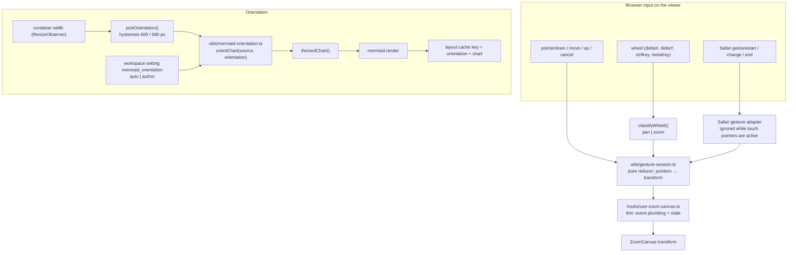
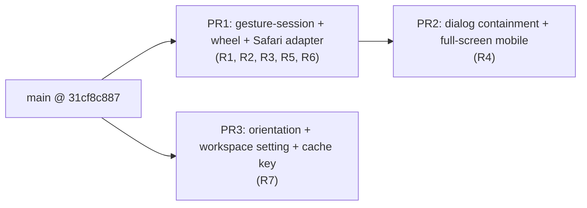

# Design: Mermaid diagram orientation by width, and viewer gestures (touch + trackpad)

Generated by /office-hours on 2026-10-29
Branch: agent/x99-claude-opus/661fdafcf10d
Repo: cheese-work/multica (base `main` @ `31cf8c887`)
Status: APPROVED (Cheese, 2026-10-29, DM: "D3 A"; decision record on CHE-2419). Spec review: 2 rounds, 6/10 → 8/10, round-2 issues fixed.
Mode: Intrapreneurship (plan supplied by Cheese; diagnostic skipped)

## Problem Statement

Cheese reported three problems in the Mermaid diagram surfaces (`packages/views/editor`):

1. **Orientation.** A diagram is drawn in the direction its author wrote (`flowchart LR`, `flowchart TD`), whatever the screen. A wide `LR` diagram on a phone is unreadable, and a tall `TD` diagram on a desktop wastes the width.
2. **Mobile gestures in the full-screen viewer.** Pinch-to-zoom and drag stop in the middle of the gesture. The gesture also reaches the layer under the dialog: the page behind it scrolls or zooms.
3. **MacBook trackpad.** Trackpad gestures in the viewer do not work as expected.

## Root causes (read from code, not yet reproduced on a device)

| # | Location | Cause |
|---|---|---|
| R1 | `hooks/use-zoom-canvas.ts` `onWheel` | Every wheel event zooms (`wheelZoomFactor(event.deltaY)`). `ctrlKey` and `deltaX` are ignored, so a two-finger trackpad swipe zooms instead of panning and a horizontal swipe does nothing. |
| R2 | same | A Chrome/Electron trackpad pinch arrives as `wheel` + `ctrlKey` with small `deltaY` and uses the mouse divisor `/400`, so pinch feels slow. |
| R3 | same | Safari (macOS and iOS) sends pinch as WebKit `gesturestart` / `gesturechange` / `gestureend`. Nothing listens to them. On iOS they also drive page zoom unless `preventDefault` is called. |
| R4 (hypothesis, not proven) | `styles/zoom-canvas.css:22`, `mermaid-viewer.tsx` `DialogContent` | Only `.zoom-canvas` has `touch-action: none`. The header and the 1rem backdrop strip around the dialog (`w-[calc(100vw-2rem)]`) keep default touch handling. A finger landing there lets the browser claim the gesture: it fires `pointercancel` (the pinch ends through `onPointerCancel` → `handlePointerUp`) and scrolls/zooms the page under the dialog. Caveat from spec review: Chromium decides `touch-action` from where each touch starts, so a second finger on the header may not cancel the canvas pointer. PR2 starts with a device reproduction; if R4 does not reproduce, PR2 shrinks to the iOS `gesturestart` guard and the full-screen layout. |
| R5 | `use-zoom-canvas.ts` `handlePointerMove` | Pinch only rescales about the current midpoint; it does not follow the midpoint when it moves. Worse, `zoomToAt` returns early when the clamped scale is unchanged (`utils/zoom-transform.ts:183`), so at the min/max scale a two-finger move does nothing at all. A two-finger drag during pinch feels stuck — likely the main "interrupted" symptom. |
| R6 | `use-zoom-canvas.ts` `handlePointerUp` | Going from 3 pointers to 2 keeps a stale `pinchOriginRef`, so the diagram jumps. |
| R7 | `mermaid-diagram.tsx:259,285` | Orientation does not exist yet. The layout cache key is `MERMAID_LAYOUT_CACHE_PREFIX + hashSource(chart)`; an orientation-dependent render must not reuse the other orientation's layout. `framedMermaidBodyHeightPx(chart)` (`:238`, used by `mermaid-block.tsx:36` and `rich-code-block.tsx:211`) reads it before any width is known. |

## Premises (agreed by Cheese, 2026-10-29, DM: "ok hết", D1 item 4 = "B")

1. "Mobile" means the web client in a mobile browser. `apps/mobile` (Expo/RN) has no Mermaid code.
2. Orientation follows the **width of the diagram's container**, not the device type (UA). This also covers narrow Electron panes and a rotated iPad.
3. Only `flowchart` / `graph` and the top-level `direction` of `stateDiagram` are re-oriented. Other diagram types are untouched. An author opts out with the comment `%% multica:fixed-direction`.
4. Trackpad convention (option B): two-finger swipe = pan; pinch, or ⌘/Ctrl + wheel = zoom. Plain mouse wheel pans too, so mouse users zoom with ⌘/Ctrl + wheel. This applies to every `useZoomCanvas` surface (the Mermaid viewer and the image attachment preview).
5. A gesture that starts inside the viewer dialog never reaches the layers below it.
6. Agents keep writing one direction. The client adapts. No agent instruction changes.

Spec-review additions (pending Cheese in D3):

7. Settings-first (repo `AGENTS.md`): auto-orientation is an opinion, so it becomes a **workspace** setting `mermaid_orientation: auto | author`, default `auto`. Allowed scopes are `workspace | project | issue`; there is no per-user scope.
8. The wheel convention (premise 4) stays fixed, not a setting: it is input-device behaviour that matches Figma/Miro/Excalidraw. This is a deliberate exception to "every opinion is a setting".
9. The manual Rotate button proposed in D2 is **dropped** (YAGNI): with the author marker and the workspace setting it would be a third override. Follow-up only if auto picks wrongly in practice.

## Approaches Considered

- **A. Patch in place.** Ruled out: the gesture logic stays inside a React hook, so the regressions above stay hard to pin with tests.
- **C. `@use-gesture/react`.** Evaluated at Cheese's request and ruled out (evidence below).
- **B. Pure gesture/orientation modules + thin hooks.** Chosen.

### Evaluation of C: `@use-gesture/react` (2026-10-29)

| Check | Result | Source |
|---|---|---|
| Security | No GitHub advisories for `@use-gesture/react` or `@use-gesture/core`. MIT. One runtime dependency (`@use-gesture/core`). | GitHub GraphQL `securityVulnerabilities` (empty), `npm view` |
| Adoption | 7,872,438 downloads in the week 2026-10-21 → 2026-10-27; 9,625 stars. | npm downloads API, GitHub API |
| Release freshness | Last release `10.3.1` on 2024-03-21 (about 31 months ago). Last commit on the default branch 2024-03-21. Not archived. | `npm view … time`, GitHub API |
| Maintainer activity | 57 open issues. Community PRs from 2026-09 (#709, #710, #712) are unreviewed. Issue #711 (2026-09-17) offers maintenance help and quotes the maintainer looking for maintainers; no reply. | GitHub API |
| Peer compatibility | Peer `react >= 16.8.0`; repo pins `react 19.2.3`. Installs, but no release was ever tested against React 19. | `npm view`, `pnpm-workspace.yaml:29` |
| Open bugs in the exact areas we need | #681 `usePinch` fires duplicate events on Safari; #683 `ctrlKey` always true during pinch; #685 iOS `preventDefault` flaky with touch pointers; #693, #694 iOS `preventScroll` drag bugs; #692 `transform` option breaks pinch and wheel (fix PR #712 not merged); #701 `setPointerCapture` throws in `pointerDown`. | GitHub issues |

**Verdict: not viable for this problem.** Not a security risk, and still widely used. But it is unmaintained, and its open bugs sit exactly on Safari pinch, iOS touch and trackpad `ctrlKey` — the three things this work fixes. We would need local workarounds on top of a frozen dependency, and replacing the engine would risk the keyboard, fit and resize behaviour `useZoomCanvas` already gets right. Developer complaints are about these unfixed bugs and the missing maintainer (#711), not a general "outdated" thread.

## Recommended Approach (B)

### 1. Gesture session (fixes R5, R6)

New pure module `packages/views/editor/utils/gesture-session.ts`, beside `zoom-transform.ts`, reusing its math (`zoomToAt`, `clampTransform`, `distanceBetween`, `midpointOf`).

- State: active pointers by id, and a baseline `{ transform, midpoint, distance }`.
- **Re-baseline on every pointer-set change** (add, up, cancel), from the current transform. This removes the stale origin (R6) and the jump on 3 → 2 and 2 → 1.
- Pinch uses the first two pointers in `Map` insertion order (pointerId order is not guaranteed). Each move: `scale = clampScale(s0 * distance / d0, computeMinScale(content, viewport))` **first**; then the content point under the baseline midpoint follows the current midpoint (`t = mid - (mid0 - t0) / s0 * scale`); then `clampTransform`. It never goes through `zoomToAt`, so there is no early return at the scale limits. Pinch and pan in one gesture (R5).
- One pointer: pan from the baseline, as today.
- `pointercancel` removes only that pointer and re-baselines; the remaining finger keeps panning.
- `use-zoom-canvas.ts` keeps ownership of state, focus, keyboard, fit and resize, and calls the reducer. Its size goes down (438 lines today).

### 2. Wheel and Safari gestures (fixes R1, R2, R3; premise 4)

`classifyWheel(event)` in `gesture-session.ts`:

| Input | Result |
|---|---|
| `ctrlKey` or `metaKey` (trackpad pinch in Chrome/Electron/Firefox, or ⌘/Ctrl + mouse wheel) | Zoom at the cursor. Normalise `deltaMode` (line × 16, page × 100), clamp each event to ±18 px, `factor = exp(-pixels / 100)`. One mouse notch (`deltaY 100`) then equals `ZOOM_STEP` 1.2; a trackpad pinch (small deltas) is unclamped and fast enough. Constants are pinned by tests and may be tuned on device. `classifyWheel` replaces `wheelZoomFactor`; update `zoom-transform.test.ts:209`. |
| Otherwise | Pan by `(-deltaX, -deltaY)` after the same `deltaMode` normalisation. If `shiftKey` and `deltaX == 0`, pan horizontally by `deltaY`. |

Safari adapter (native listeners on the viewport, `{ passive: false }`):

- Only attached when `"GestureEvent" in window` (WebKit). In that case a `ctrlKey` wheel is ignored only while a gesture is active, within 100 ms after `gestureend`, or when `deltaY` is fractional (trackpad); otherwise it zooms like any Ctrl + mouse wheel. `metaKey` + wheel always zooms. Gesture events own trackpad pinch zoom.
- `gesturestart`: `preventDefault`, record baseline transform and anchor (`clientX/Y` converted to viewport-local coordinates).
- `gesturechange`: `preventDefault`, zoom to `baseline.scale * event.scale` at the anchor.
- While touch pointers are active (iOS), ignore gesture-event scale — the pointer session owns touch pinch — but still `preventDefault` so the page does not zoom.

### 3. Containment in the dialog (fixes R4; premise 5)

- `DialogContent` of the Mermaid viewer gets `touch-action: none` and `overscroll-behavior: contain`. Taps on header buttons still produce clicks.
- Below the `md` breakpoint the viewer is full-screen, so there is no backdrop strip to touch. Overrides needed against the base classes in `packages/ui/components/ui/dialog.tsx:61`: `max-md:!inset-0 max-md:!translate-x-0 max-md:!translate-y-0 max-md:!w-screen max-md:!max-w-none max-md:!h-dvh max-md:!max-h-none max-md:!rounded-none max-md:!ring-0`, plus the existing `sm:max-w-sm` override. Close stays in the header.
- The source view (`mermaid-viewer.tsx:269`, `overflow-auto`) is its own scroll container and must still scroll by touch; verify on device.
- A `gesturestart` listener on the dialog root calls `preventDefault`, so an iOS pinch that starts on the header does not zoom the page.
- Acceptance is on devices (iOS scroll lock behaviour cannot be proven in jsdom).

### 4. Orientation (fixes R7; premises 2, 3)

New pure module `packages/views/editor/utils/mermaid-orientation.ts`:

- `orientChart(source, orientation: "horizontal" | "vertical"): string`.
  - Skips frontmatter (`---…---`) and `%%` comment lines to find the header line.
  - `flowchart` / `graph` header: horizontal → `TD`/`TB` become `LR`, `BT` becomes `RL`. Vertical → `LR` becomes `TD`, `RL` becomes `BT`. A header with no direction counts as `TB`.
  - `stateDiagram` / `stateDiagram-v2`: rewrites only a top-level `direction` line (outside every `state … { }` block); when none exists, inserts one after the header for the horizontal case.
  - Any other diagram type, or a source that contains `%% multica:fixed-direction`: returned unchanged.
  - Subgraph `direction` lines are left as authored (only the top-level header changes). Known limit: an LR diagram with TB subgraphs gets tall when flipped; the author can add the opt-out marker.
  - Header line may carry statements (`graph LR; A-->B`): only the direction token is replaced. `flowchart-elk` is treated like `flowchart`.
- `pickOrientation(width, previous?)`: vertical below 600 px, horizontal above 680 px, `previous` in between (hysteresis). With no `previous`, split at 640 px.
- `mermaid-diagram.tsx`: measure the container width in a layout effect **before** the first `mermaid.render` (rendering is client-only, `:450-489`), apply `orientChart` before `themedChart`, and re-render only when the picked orientation changes. With setting `author`, skip `orientChart`.
- Layout cache: keep the one chart-keyed entry (`PREFIX + hashSource(chart)`) and store `orientation` inside it. `framedMermaidBodyHeightPx(chart)` and the lazy initial state (`:433`) use it as-is to reserve height before width is known; a render whose picked orientation differs from the stored one is a cache miss and overwrites the entry. Only the inline render writes the cache. Update `rich-fence-block-ssr.test.tsx:50-56`, which mirrors the entry shape.
- The full-screen viewer reports its canvas width up through an `onViewportWidth` prop. `MermaidDiagram` (which owns rendering) picks the viewer's orientation from it; when that differs from the inline orientation it renders a second variant, keeps it in component state, and passes it to the viewer (`svg`, `viewerDocument`, `layout`). A narrow desktop column opened in a wide viewer therefore shows LR. `MermaidViewerStandalone` does the same through its own `MermaidDiagram` parent.
- The workspace setting `mermaid_orientation` is read through the existing generic settings store (located in PR3; no new column or migration). Where `MermaidDiagram` renders without workspace context (standalone media page, SSR tests) or the value is missing/unknown, it falls back to `auto`. If the value comes from the server, it passes through a zod schema with `parseWithFallback` (`auto`) per `AGENTS.md` API compatibility.
- **Copy source** and **Export `.mmd`** keep the author's original text. **Export SVG/PNG** export what is on screen.

### Out of scope

- The inline preview's gestures (`use-inline-zoom.ts`): there the page owns wheel and touch by design (MUL-7766). Only orientation applies to it.
- `apps/mobile` native code.
- A manual Rotate button (dropped, premise 9).

## Test plan (test-first: each must be observed red before its implementation)

Unit (vitest, pure modules). Create each module as a stub with the final signature first, so red is a behavioural assertion failure, not a missing-module error:

1. Pinch spread 2× from fit → scale 2×, and the content point under the start midpoint stays under the current midpoint.
2. Pinch while both fingers move 40 px right → transform x moves 40 px (pan inside pinch).
3. Three pointers down, lift one, keep moving → no transform jump on the lift frame.
4. `pointercancel` of one finger mid-pinch → the other finger keeps panning, no jump.
5. `classifyWheel`: `ctrlKey` + `deltaY -10` → zoom in; `metaKey` same; plain `deltaX 30` → pan x −30; `deltaMode 1` normalised; `shiftKey` + `deltaY` with `deltaX 0` → horizontal pan; ±18 px clamp.
6. Safari adapter: `gesturechange scale 1.5` → 1.5× at the anchor; a `ctrlKey` wheel during an active gesture is ignored; gesture scale is ignored while a touch pointer is active.
7. `orientChart` table: `flowchart LR`/`TD`/`TB`/`RL`/`BT`, `graph` without direction, frontmatter + comments before the header, `%% multica:fixed-direction`, `sequenceDiagram` unchanged, `stateDiagram-v2` with top-level `direction`, nested `direction` inside `state X { }` unchanged.
8. `pickOrientation`: 599 → vertical, 681 → horizontal, 640 keeps previous, no previous → 640 split.
8b. Pinch at max scale with both fingers moving → pans, anchor stable, no drift. Pinch at min scale same.
8c. WebKit mode: a fractional-`deltaY` `ctrlKey` wheel before `gesturestart` does not zoom; an integer `ctrlKey` mouse wheel (`deltaY 100`, no gesture) does zoom; `metaKey` wheel always zooms.
8d. `orientChart`: `graph LR; A-->B`, `flowchart-elk`, subgraph `direction` unchanged.

Component (existing test files):

9. `mermaid-viewer.test.tsx`: `DialogContent` carries the touch containment class; full-screen classes below `md`; the viewer re-renders in its own orientation when its width differs from the inline render.
10. `mermaid-diagram.test.tsx`: cache key includes orientation; reserved height uses the last rendered orientation; crossing the threshold re-renders once; staying inside the band does not; a first measure inside the band uses the 640 px split; setting `author` leaves the source unchanged.
11. Image attachment preview still zooms with ⌘/Ctrl + wheel and pans with plain wheel (shared hook).

Device acceptance (manual, evidence = short screen recordings):

| Device / browser | Checks |
|---|---|
| iPhone Safari | Pinch + drag without interruption; second finger on header does not zoom the page; page behind does not scroll; narrow width shows TD. |
| Android Chrome | Same as iPhone. |
| MacBook Safari | Two-finger swipe pans (both axes); pinch zooms at cursor; no duplicate zoom. |
| MacBook Chrome + Electron desktop app | Same as Safari; ⌘ + mouse wheel zooms; narrow Electron pane switches to TD at < 600 px. |

## Delivery plan (stacked PRs)

- PR1 → PR2 are stacked (PR2 touches the viewer chrome that PR1's hook feeds). PR3 is independent and runs in parallel off `main` once D3 settles premises 7–9; its viewer `orientation` prop is the only shared touch-point with PR2 (`mermaid-viewer.tsx`).
- Estimates for one agent: PR1 about 3 h, PR2 about 1 h, PR3 about 2–3 h, device acceptance about 1 h.
- Each PR: red/green evidence in the PR body; cross-lab review per RGS-1; Cheese merges.

## Open Questions

1. Zoom constants (±18 px clamp, `/100`) are starting values. Final values are tuned on the MacBook during PR1 device acceptance.
2. Does the current Base UI scroll lock fully stop iOS rubber-band scroll of the page behind? Answered during PR2 device acceptance; if not, PR2 adds `overscroll-behavior: none` on `html` while the viewer is open.
3. Where the generic workspace settings store lives and how views read it (PR3 locates it; no new column or migration per `AGENTS.md`).

## Success Criteria

- All automated tests above pass, each with recorded red then green output.
- The device acceptance table passes on every row, with recordings attached to the PRs.
- No regression in the existing `mermaid-viewer`, `mermaid-diagram`, `attachment-preview-modal` and `zoom-transform` tests.

## Distribution Plan

Existing web and desktop release pipelines. No new artifact.

## Next Steps

1. Create the implementation issue(s) for PR1, PR2, PR3 with this doc linked.
2. PR1 first (largest behaviour fix), PR3 in parallel after D3.
3. Device acceptance after PR2 and PR3.
