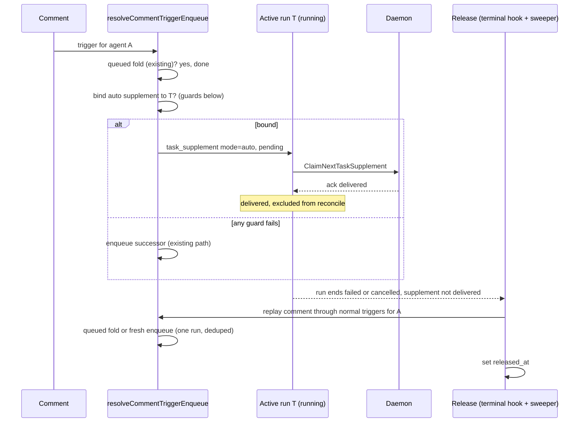

# Fold a comment into the agent's active run (CHE-1442)

Plan only. No code ships until a different-lab reviewer returns PASS (CHE-1442 acceptance 1).

## Problem

A comment for agent A queues a second run when A already has a run in flight.

| A's run state | Today |
| --- | --- |
| `queued` | Folded into that run (CHE-1418, #185). |
| `dispatched` | Registered as a planned input. Replayed as one follow-up run after `CompleteTask` only. |
| `running` | Not "pending" for the dedup index. A new `queued` successor run starts. |

Seed 6 (CHE-955, CHE-833): the assignment run was dispatched in under 1s. The dispatch comment, 1 to 10s later, queued a second run.

Two gaps follow:

1. A comment for a `running` agent always adds a run.
2. `reconcileCommentsOnCompletion` runs on `CompleteTask` only (`handler/daemon.go`). A comment deferred onto a run that then fails or is cancelled gets no follow-up.

## Options

| Option | Adds no new run | Survives run failure | Verdict |
| --- | --- | --- | --- |
| A. Reuse member steering (`steer_task_ids`) | yes | no | Rejected. Needs the author's explicit pick of a run. An agent-authored comment has no such pick. A failed delivery is excluded from reconcile on purpose (`ListReconcilableCommentsForIssueSince`), so it is lost. |
| B. Defer onto the active run, extend reconcile to fail and cancel | no | yes | Rejected. The comment reaches a successor run, not the active run. This is today's outcome with a later start. |
| C. Auto-supplement with release | yes | yes | **Chosen.** |

## Chosen path: auto-supplement with release

Reuse the shipped supplement delivery (`task_supplement`, daemon `task-supplement-v1`). Add an `auto` mode whose undelivered comments go back through the normal trigger pipeline.

### Bind guards

All must hold. Any miss falls through to the existing path, so the change can only remove a successor run.

- Trigger routing already chose agent A. Who is woken, and by which mention, does not change.
- A has a `running` task T on this issue with a `task_supplement_capability` row (old daemons and unsupported providers have none).
- T has the same head SHA and the same squad role (`is_leader_task`, `squad_id`) as the trigger, as in `MergeCommentIntoQueuedIssueTask`.
- T is not a wakeup task (`context->>'wakeup_id' IS NULL`).
- The bind locks T's row, so a terminal transition that wins the race binds nothing.

Order in `resolveCommentTriggerEnqueue`: queued fold, then auto bind, then enqueue.

### Changes

1. Migration: `task_supplement.mode TEXT NOT NULL DEFAULT 'explicit' CHECK (mode IN ('explicit','auto'))` and `released_at TIMESTAMPTZ`. Additive, no foreign keys, matches the existing table rules.
2. `BindAutoCommentTaskSupplement` query: `BindCommentTaskSupplement` plus the head and role guards, writes `mode='auto'`.
3. `foldCommentIntoRunningTurn` in `handler/comment.go`, wired as above. Notifies the daemon with `NotifyTaskSupplementAvailable`.
4. `ListReconcilableCommentsForIssueSince`: the exclusion becomes `mode='explicit' OR status='delivered'`. An undelivered auto supplement replays on `CompleteTask` through the existing reconcile.
5. Release for the other terminal paths: extract the per-comment replay body of `reconcileCommentsOnCompletion` into `replayCommentForAgent`. New `releaseUndeliveredAutoSupplements(task)` replays each auto supplement of the run with `status <> 'delivered' AND released_at IS NULL`, then sets `released_at`. Replay comes before the mark, so a crash repeats the replay. The repeat is absorbed by the pending-task fold.
6. Call sites: `FailTask` and `CancelTask` handlers. Plus a runtime-sweeper tick (`cmd/server`) that releases any terminal-run leftovers, which covers offline-runtime failure, bulk cancel and a crash between commit and release.
7. `ClaimNextTaskSupplement`: resolve the author name for agent authors (today it joins `"user"` only and prints "a user").
8. Trigger outcome: report `coalesced` with a new reason `coalesced_active_run`. Do not add a status.

### What does not change

- Mention routing and permissions. Replay re-runs them (`computeCommentAgentTriggers`, `canInvokeAgent`).
- Member steering. `mode='explicit'` keeps its semantics and its exclusion from reconcile.
- Daemon protocol. The server already gates on the capability row.

## Acceptance 3 check

| End of T | Supplement state | Result |
| --- | --- | --- |
| Completed, delivered | `delivered` | Nothing more. |
| Completed, not delivered | `failed turn_ended` | Reconcile replays: one follow-up run. |
| Failed or cancelled | `failed turn_ended` | Release hook replays: one follow-up run. |
| Any terminal, hook missed | `failed`, `released_at` null | Sweeper replays. |
| Provider rejects the input | `failed` (ack) | Release replays when T ends. |

A follow-up after a failed run is not a regression. Today the `queued` successor already exists in that case.

## Tests first (red, then green)

Each runs against the handler test database, like `comment_issue_fold_test.go`.

1. Comment for A while A's task is `running` with capability: no new `queued` row, one `task_supplement` with `mode='auto'`, outcome `coalesced_active_run`. Red today: a second `queued` row appears.
2. Dispatched assignment run starts within the same second, then the dispatch comment arrives: one run total after the start.
3. Guard misses each keep the old behavior: no capability row, different head, different squad role, wakeup task.
4. Run fails with the supplement `pending`: one follow-up run for the comment. Red today: none.
5. Run is cancelled (single task): one follow-up run.
6. Run completes with the supplement `delivered`: no follow-up.
7. Sweeper releases a failed run's leftover once. A second tick adds nothing.
8. Agent-authored comment shows the agent name at claim.
9. Explicit steering test suite stays green (`comment_steer_test.go`, `task_supplement_test.go`).

## Open questions for the reviewer

1. **Bulk cancel** (`CancelTasksForIssue`, `CancelTasksForAgent`, archived agent) also cancels queued successors today. Plan: replay anyway through the normal pipeline, which re-checks routing and agent state. Alternative: mark `released_at` without replay. Which one?
2. **Outcome status.** Plan keeps `coalesced` so the RHC-2 wrapper's `trigger_outcomes` admission check passes unchanged. Confirm the wrapper accepts `coalesced`, or require `steered`.
3. **Upstream.** `upstream/main` (fetched for this plan) has steering work only: more providers (Kiro `#9396`, Cursor `#9322`), Claude handshake budget (`#9252`), supplement root owners (`#9061`). No rule folds a comment into an active run without the author's pick. The plan reuses that provider gating through the capability row. The reviewer may re-check.

The `task_supplement` primary key is `(comment_id, task_id)` (migration 549), so one comment can fold into several agents' runs. No index change is needed.

## Size

About 4h: migration and queries 45min, bind and wiring 1h, release and sweeper 1h30, tests alongside.
