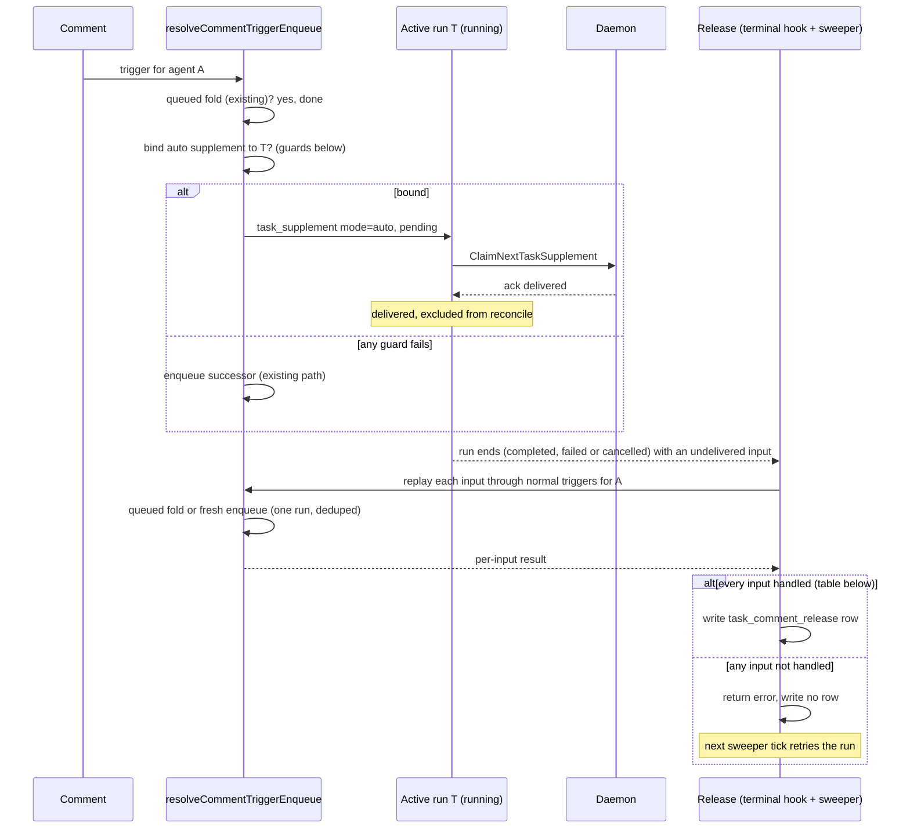

# Fold a comment into the agent's active run (CHE-1442)

Plan only. No code ships until a different-lab reviewer returns PASS (CHE-1442 acceptance 1).

Hindsight (`multica-org`, 2026-10-26 11:48 ICT): reflect: unavailable. Two `reflect` calls returned `503 No available accounts`. No memory is cited.

## Problem

A comment for agent A queues a second run when A already has a run in flight.

| A's run state | Today |
| --- | --- |
| `queued` | Folded into that run (CHE-1418, #185). |
| `dispatched` | Registered as a planned input. Replayed as one follow-up run after `CompleteTask` only. |
| `running` | Not "pending" for the dedup index. A new `queued` successor run starts. |

Seed 6 (CHE-955, CHE-833): the assignment run was dispatched in under 1s. The dispatch comment, 1 to 10s later, queued a second run.

Three gaps follow:

1. A comment for a `running` agent always adds a run.
2. `reconcileCommentsOnCompletion` runs on `CompleteTask` only (`handler/daemon.go`). A comment deferred onto a run that then fails or is cancelled gets no follow-up.
3. `reconcileCommentsOnCompletion` returns nothing. It logs a `ListReconcilableCommentsForIssueSince` or `GetIssue` error and returns, and `CompleteTask` continues (`handler/daemon.go:4999`, `5293-5296`). A replay that is blocked and whose obligation cannot be handed off is only logged (`slog.Error ... needs a durable obligation record`). Each of these paths loses the comment.

## Options

| Option | Adds no new run | Survives run failure | Verdict |
| --- | --- | --- | --- |
| A. Reuse member steering (`steer_task_ids`) | yes | no | Rejected. Needs the author's explicit pick of a run. An agent-authored comment has no such pick. A failed delivery is excluded from reconcile on purpose (`ListReconcilableCommentsForIssueSince`), so it is lost. |
| B. Defer onto the active run, extend reconcile to fail and cancel | no | yes | Rejected. The comment reaches a successor run, not the active run. This is today's outcome with a later start. |
| C. Auto-supplement with release | yes | yes | **Chosen.** |

## Chosen path: auto-supplement with release

Reuse the shipped supplement delivery (`task_supplement`, daemon `task-supplement-v1`). Add an `auto` mode whose undelivered comments go back through the normal trigger pipeline.

### Bind guards

All must hold. Any miss falls through to the existing path, so the change can only remove a successor run.

- Trigger routing already chose agent A. Who is woken, and by which mention, does not change.
- A has a `running` task T on this issue with a `task_supplement_capability` row (old daemons and unsupported providers have none).
- T has the same head SHA and the same squad role (`is_leader_task`, `squad_id`) as the trigger, as in `MergeCommentIntoQueuedIssueTask`.
- T is not a wakeup task (`context->>'wakeup_id' IS NULL`).
- The bind locks T's row, so a terminal transition that wins the race binds nothing.

Order in `resolveCommentTriggerEnqueue`: queued fold, then auto bind, then enqueue.

### Changes

1. Migration, additive, no foreign keys:
   - `task_supplement.mode TEXT NOT NULL DEFAULT 'explicit' CHECK (mode IN ('explicit','auto'))`.
   - New table `task_comment_release (task_id UUID NOT NULL, released_at TIMESTAMPTZ NOT NULL DEFAULT now())` with a unique index on `task_id`, built `CONCURRENTLY` in its own migration. It is a side table because `agent_task_queue` is a hot `SELECT *` table (migration 538 note). One row means "this run's undelivered inputs were handed back to routing".
2. `BindAutoCommentTaskSupplement` query: `BindCommentTaskSupplement` plus the head and role guards, writes `mode='auto'`.
3. `foldCommentIntoRunningTurn` in `handler/comment.go`, wired as above. Notifies the daemon with `NotifyTaskSupplementAvailable`.
4. `ListReconcilableCommentsForIssueSince`:
   - The supplement exclusion becomes `mode='explicit' OR status='delivered'`. An undelivered auto supplement is replayable.
   - The explicit-cancel acknowledgement also matches a comment bound to the cancelled run by a supplement, not only by `trigger_comment_id` or `coalesced_comment_ids`.
   - New argument `planned_only`. When true, only `c.id = ANY(planned_comment_ids)` qualifies. The thread and `created_at > since` window is off.
5. Termination release. Extract the per-comment replay body of `reconcileCommentsOnCompletion` into `replayCommentForAgent(...) error`. Change `reconcileCommentsOnCompletion(ctx, task)` to return `error`. New `releaseInputsOnTermination(ctx, task) error`:
   - Builds the run's **undelivered inputs**: `coalesced_comment_ids` plus the trigger comment, minus `delivered_comment_ids`, plus every auto supplement of the run that is not `delivered`.
   - Runs the reconcile with `planned_only=true` over that set on a failed or cancelled run, and the full reconcile (`planned_only=false`) on a completed run. A planned input (a comment registered on a `dispatched` run by `registerPlannedCommentForActiveTask`) and an auto supplement take the same path.
   - Replays every input first. Inserts the `task_comment_release` row (`ON CONFLICT DO NOTHING`) only when every input is handled (see *Release row* below). Otherwise it returns the error and writes no row. A crash between the replay and the row repeats the replay. The pending-task fold absorbs the repeat.
6. Call sites for `releaseInputsOnTermination`:
   - `CompleteTask`, in place of today's `reconcileCommentsOnCompletion` call. The terminal transaction is already committed, so an error does not change the HTTP status: the daemon retry of the callback returns early (`transitioned=false`) and would not retry the replay. `CompleteTask` logs the error at `Warn` with the task ID, writes no row, and continues with `NotifyTaskFinished`. The sweeper owns the retry.
   - `FailTask` and `CancelTask` handlers, with the same error handling.
   - A runtime-sweeper tick (`cmd/server`). It selects failed, cancelled and completed runs with `completed_at` in the last 24h, no release row, and at least one input to replay: an undelivered planned input or auto supplement, or for a completed run any comment in the run's reconcile window. It covers offline-runtime failure, the `CancelTasksForIssue`, `CancelTasksForAgent` and archived-agent cancels, a crash between commit and release, and every run whose release returned an error. It calls `releaseInputsOnTermination` per run, so each tick retries an unreleased run until a release succeeds.
   - The window stays `planned_only` on failed and cancelled runs. A failed run does not replay every member comment posted during it. Retry of the failed work itself belongs to CHE-1126.
7. `ClaimNextTaskSupplement`: resolve the author name for agent authors (today it joins `"user"` only and prints "a user").
8. Trigger outcome: report `coalesced` with a new reason `coalesced_active_run`. Do not add a status. The client allowlist (`packages/core/issues/comment-trigger-outcomes.ts:77`) and the RHC-2 admission check (`dotfiles-agents/scripts/check-handoff-links.sh`, status list `queued | coalesced | deferred`) both accept `coalesced`.

### Release row: only after every input is handled

The `task_comment_release` row is the only signal that tells the sweeper to skip a run. So the row is written only when the handler replayed every input or handed it off durably.

| Per-input result | Handled? | Why |
| --- | --- | --- |
| Enqueued (`queued`), folded (`coalesced`), `deferred` or `steered` | yes | A run now owns the comment. |
| Already delivered, a note comment, or routing keeps no trigger for this agent | yes | Routing decided that nothing is owed. |
| `blocked` with a policy reason (invocation not allowed, archived agent, self-trigger, attribution) | yes | Re-checked routing refused the run. This is the routing outcome, not a lost input. |
| `blocked`, obligation handed to the active task (`propagateUncoveredCommentObligation` returns true) | yes | The active task's plan now carries the comment. |
| Delegated failure recovery replay returns `nil` | yes | Same as today. |
| `GetIssue` returns not found | yes | The issue is deleted, nothing can replay (cancel table below). |
| `ListReconcilableCommentsForIssueSince` error, or any other `GetIssue` error | no | Nothing was replayed. The whole release returns the error. |
| `blocked` with `ReasonInternalError` | no | Transient. Retry on the next tick. |
| `blocked`, and the hand-off fails (slot held by a different-head queued task) | no | Today this is only logged. With no row, the sweeper retries, and the retry enqueues once that task ends and frees the slot. |
| Delegated failure recovery replay returns an error | no | Retry on the next tick. |

The handler replays every input even after one fails, and returns the first error. An input that is already handled is absorbed on the retry by the pending-task fold or the delivered set.

### Cancellation sources

The existing reconcile already splits cancels by `cancelled_by_type` (`ListReconcilableCommentsForIssueSince`, explicit-cancel clause). The release reuses that predicate without change in meaning.

| Cancel source | `cancelled_by_type` | Undelivered inputs |
| --- | --- | --- |
| A member or an agent cancels this run (`CancelAgentTaskByUser`) | `member` or `agent` | Acknowledged. No replay. |
| Server-initiated: stale plan, claim failure, offline runtime, archived agent (`CancelAgentTask`, `CancelAgentTaskWithReason`) | `system` | Replayed through normal triggers. Routing, permissions and agent state are re-checked, so an archived agent yields a blocked outcome, not a run. |
| Issue deletion (`CancelAgentTasksByIssue`) | `system` | Nothing replays: the issue is gone, so the replay finds no issue and the release row is written. |

There is no member-level "cancel all" path. A member stops runs one task at a time, which is the explicit row. So replay never recreates work right after an intentional stop.

### What does not change

- Mention routing and permissions. Replay re-runs them (`computeCommentAgentTriggers`, `canInvokeAgent`).
- Member steering. `mode='explicit'` keeps its semantics and its exclusion from reconcile.
- Daemon protocol. The server already gates on the capability row.

## Acceptance 3 check

| End of T | Input state | Result |
| --- | --- | --- |
| Completed, delivered | auto supplement `delivered` | Nothing more. |
| Completed, not delivered | supplement `failed turn_ended` | Full reconcile replays: one follow-up run. |
| Failed | auto supplement undelivered, or planned input from `dispatched` | Release replays: one follow-up run. |
| Cancelled by `system` | same | Release replays: one follow-up run. |
| Cancelled by a member or an agent | same | Acknowledged: no run. |
| Any terminal, hook missed | no release row | Sweeper replays once. |
| Any terminal, release returned an error | no release row | Sweeper retries each tick until a release succeeds. |
| Provider rejects the input | supplement `failed` (ack) | Release replays when T ends. |

A follow-up after a failed run is not a regression. Today the `queued` successor already exists for a `running` run. For a `dispatched` run the comment is lost on failure today.

## Tests first (red, then green)

Each runs against the handler test database, like `comment_issue_fold_test.go`.

1. Comment for A while A's task is `running` with capability: no new `queued` row, one `task_supplement` with `mode='auto'`, outcome `coalesced_active_run`. Red today: a second `queued` row appears.
2. Dispatched assignment run starts within the same second, then the dispatch comment arrives: one run total after the start.
3. Guard misses each keep the old behavior: no capability row, different head, different squad role, wakeup task.
4. Running run fails with the auto supplement `pending`: one follow-up run for the comment. Red today: none.
5. **Dispatched run fails** with a comment registered as a planned input: one follow-up run. Red today: none.
6. **System cancel** of a `running` run (auto supplement) and of a `dispatched` run (planned input): one follow-up run each.
7. **Explicit cancel** by a member and by an agent, for both input kinds: no follow-up run. Separate test from 6.
8. Run completes with the supplement `delivered`: no follow-up.
9. Sweeper releases a failed run's leftover once. A second tick adds nothing. A crash between replay and the release row leaves one pending run after the retry.
10. A failed run does not replay a member comment that was neither planned nor supplemented.
11. Agent-authored comment shows the agent name at claim.
12. Explicit steering test suite stays green (`comment_steer_test.go`, `task_supplement_test.go`).
13. **Completion query fails.** Force `ListReconcilableCommentsForIssueSince` to fail during `CompleteTask` for a run with an undelivered input (a failing query hook on the handler's reconcile queries in the test). Then check: `CompleteTask` returns 200, no `task_comment_release` row exists, and no follow-up run exists. Remove the fault and run one sweeper tick: one follow-up run, and the release row now exists. A second tick adds nothing. Red today: the error is logged, and no path ever replays the comment.
14. **Hand-off fails.** A failed run's planned input replays as `blocked` because a different-head queued task holds the slot. Check: no release row. Complete that queued task, then run one sweeper tick: one follow-up run for the comment, and the release row exists.

## Open questions for the reviewer

1. **Replay window.** A repeat after a crash between replay and release row can run one extra follow-up if the first follow-up already completed. The plan accepts that rare window. A claim-before-replay order would trade it for a lost comment.
2. **Upstream.** `upstream/main` (fetched for this plan) has steering work only: more providers (Kiro `#9396`, Cursor `#9322`), Claude handshake budget (`#9252`), supplement root owners (`#9061`). No rule folds a comment into an active run without the author's pick. The plan reuses that provider gating through the capability row.
3. **Retry window.** The sweeper retries an unreleased run only while `completed_at` is in the last 24h. A failure that lasts longer (for example a 24h database outage) leaves the input unreplayed. The handler logs every failed release at `Warn` with the task ID. The sweeper logs a failed release at `Error` when the run's `completed_at` is older than 23h, the last retries before the run leaves the window. The plan accepts that bound. A longer window costs a wider scan of `agent_task_queue`.

The `task_supplement` primary key is `(comment_id, task_id)` (migration 549), so one comment can fold into several agents' runs. No index change is needed.

## Size

About 5.5h: migrations and queries 1h, bind and wiring 1h, release, sweeper and cancel rules 2h, error-returning reconcile and handled-input rules 0.5h, tests alongside. Over the 4h guide because planned inputs and completed runs now share the release path.
