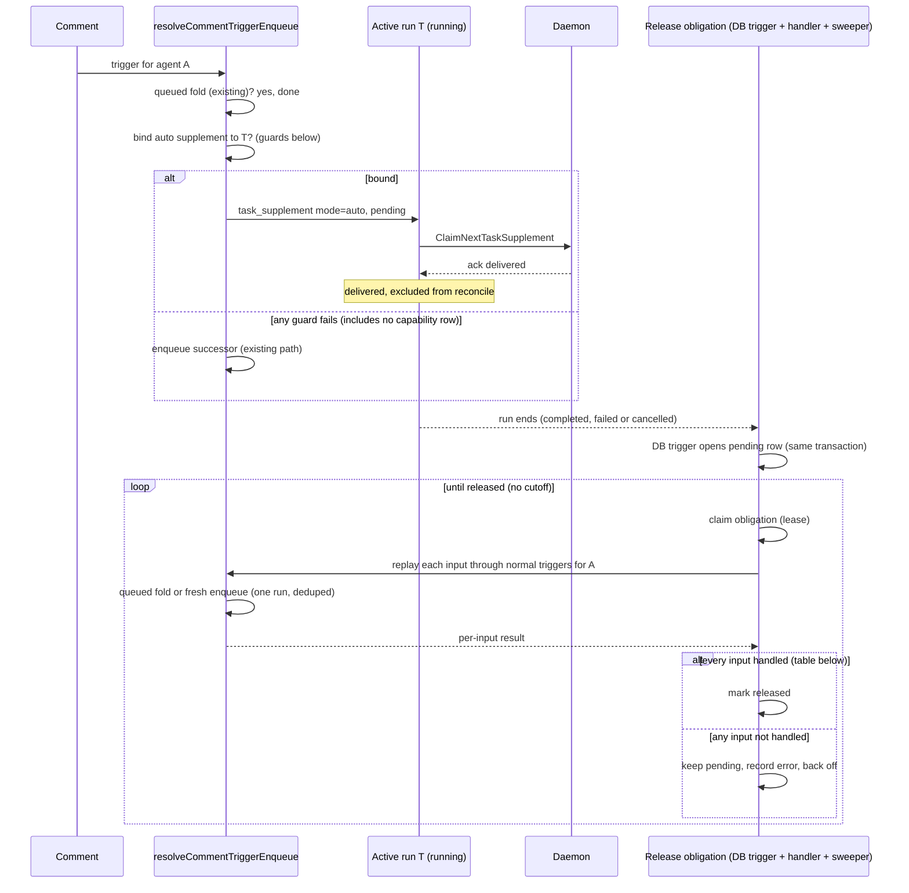

# Fold a comment into the agent's active run (CHE-1442)

Plan only. No code ships until a different-lab reviewer returns PASS (CHE-1442 acceptance 1).

Hindsight (`multica-org`): reflect: unavailable. Calls at 2026-10-26 11:48 ICT (two), 12:27 ICT (one) and 12:39 ICT (one) returned `503 No available accounts`. No memory is cited.

## Problem

A comment for agent A queues a second run when A already has a run in flight.

| A's run state | Today |
| --- | --- |
| `queued` | Folded into that run (CHE-1418, #185). |
| `dispatched` | Registered as a planned input. Replayed as one follow-up run after `CompleteTask` only. |
| `running` | Not "pending" for the dedup index. A new `queued` successor run starts. |

Seed 6 (CHE-955, CHE-833): the assignment run was dispatched in under 1s. The dispatch comment, 1 to 10s later, queued a second run.

Three gaps follow:

1. A comment for a `running` agent always adds a run.
2. `reconcileCommentsOnCompletion` runs on `CompleteTask` only (`handler/daemon.go`). A comment deferred onto a run that then fails or is cancelled gets no follow-up.
3. `reconcileCommentsOnCompletion` returns nothing. It logs a `ListReconcilableCommentsForIssueSince` or `GetIssue` error and returns, and `CompleteTask` continues (`handler/daemon.go:4999`, `5293-5296`). A replay that is blocked and whose obligation cannot be handed off is only logged (`slog.Error ... needs a durable obligation record`). The replay loop also turns lookup errors into "no route": a `GetCommentInWorkspace` error on the parent is ignored (`daemon.go:5350-5355`), and `computeCommentAgentTriggers` and `ResolveOriginatorFromTriggerComment` treat a failed agent, task, squad or comment read as "no trigger" or "unattributed". The loop then skips the comment (`daemon.go:5390-5392`). Each of these paths loses the comment.

## Options

| Option | Adds no new run | Survives run failure | Verdict |
| --- | --- | --- | --- |
| A. Reuse member steering (`steer_task_ids`) | yes | no | Rejected. Needs the author's explicit pick of a run. An agent-authored comment has no such pick. A failed delivery is excluded from reconcile on purpose (`ListReconcilableCommentsForIssueSince`), so it is lost. |
| B. Defer onto the active run, extend reconcile to fail and cancel | no | yes | Rejected. The comment reaches a successor run, not the active run. This is today's outcome with a later start. |
| C. Auto-supplement with release | yes | yes | **Chosen.** |

## Chosen path: auto-supplement with release

Reuse the shipped supplement delivery (`task_supplement`, daemon `task-supplement-v1`). Add an `auto` mode whose undelivered comments go back through the normal trigger pipeline.

### Bind guards

All must hold. Any miss falls through to the existing path, so the change can only remove a successor run.

- Trigger routing already chose agent A. Who is woken, and by which mention, does not change.
- A has a `running` task T on this issue with a `task_supplement_capability` row (old daemons and unsupported providers have none; measured in *Capability coverage* below).
- T has the same head SHA and the same squad role (`is_leader_task`, `squad_id`) as the trigger, as in `MergeCommentIntoQueuedIssueTask`.
- T is not a wakeup task (`context->>'wakeup_id' IS NULL`).
- The bind locks T's row, so a terminal transition that wins the race binds nothing.

Order in `resolveCommentTriggerEnqueue`: queued fold, then auto bind, then enqueue.

### Capability coverage (measured 2026-10-26 12:36 ICT)

**Code.** The capability row is written in one place: `StartAgentTaskWithSupplement` (`queries/supplement.sql:1-30`), when a task moves from `dispatched` to `running`. It writes `task-supplement-v1` only when all of these hold:

- The daemon advertised `task-supplement-v1` for this task (`daemon/daemon.go:8505-8510`). Daemon builds before `93ae552ba` (MUL-7565, 2026-09-23) never advertise it.
- `agent.SupportsTaskSupplement(provider, version)` (`pkg/agent/version.go:131-159`): `codex` >= 0.100.0, `claude` >= 2.1.110, `grok` >= 1.0.14, `kiro` >= 2.33.0, `cursor` >= 2026.10.14. Every other provider returns false.
- `cursor` only: not Windows, not a local directory or local worktree, hooks installable (`daemon/daemon.go:291-303`).
- The task has an issue, and the server's provider list matches (`provider IN ('codex','claude','grok','cursor','kiro')`).

**Live data.** Source: `multica runtime list` and `multica agent tasks <agent> --limit 200` (field `supplement_capability`) for all 24 active agents. Daemon builds in use: `46346f79` (MBP, C00, contains `93ae552ba`) and `0.7.0-20261025-2356` (X99, built 2026-10-25).

| Group | Runtimes | Issue runs started since 2026-10-19 without a capability row |
| --- | --- | --- |
| `claude` 2.1.295-2.1.308 and `codex` 0.155.1-0.162.1 on X99, C00, MBP (21 agents) | 6 | 0 |
| `hermes` (`c00-hermes-devops`) | Hermes (congvc-c00) | 178 of 178 |
| `antigravity` (`x99-agy-gemini`) | Antigravity (congvc-X99); Antigravity (congvc-c00) has no active agent | 83 of 83; 1 running at 12:36 ICT |
| `opencode` (`x99-opencode-gpt-6.1-sol`) | Opencode (congvc-X99) | 0 of 0 (3 older runs, all without) |
| `cursor` 2026.01.23, `grok` 0.2.118, `openclaw` (MBP) | 3 | No active agent. `cursor` and `grok` are below the minimum version, `openclaw` is unsupported. |

Older runs without a row on `claude` and `codex` agents (for example `mbp-codex-luna`, 141 of 151 since 2026-09-05) predate the daemon upgrade. None occurred since 2026-10-19.

**Gap.** It is real and named: `c00-hermes-devops`, `x99-agy-gemini` and `x99-opencode-gpt-6.1-sol`, plus any future agent on `cursor` < 2026.10.14, `grok` < 1.0.14, `openclaw`, or an older daemon. For these agents a comment during a `running` task still gets today's single successor run. No comment is lost on that path (the successor owns it), but the CHE-1442 outcome "adds no new run" is not met for them. Open question 4 asks Cheese to choose the scope.

### Changes

1. Migration, additive, no foreign keys:
   - `task_supplement.mode TEXT NOT NULL DEFAULT 'explicit' CHECK (mode IN ('explicit','auto'))`.
   - New table `task_comment_release (task_id UUID NOT NULL, opened_at TIMESTAMPTZ NOT NULL DEFAULT now(), released_at TIMESTAMPTZ NULL, attempts INT NOT NULL DEFAULT 0, next_attempt_at TIMESTAMPTZ NOT NULL DEFAULT now(), last_error TEXT NULL)`. It is a side table because `agent_task_queue` is a hot `SELECT *` table (migration 538 note). A row with `released_at IS NULL` is a **pending release obligation**: this run may still owe a replay. A row with `released_at` set means every input was handled.
   - Unique index on `task_id`, and a partial index on `next_attempt_at WHERE released_at IS NULL`. Each is built `CONCURRENTLY` in its own migration.
   - Trigger `open_task_comment_release`, `AFTER UPDATE OF status ON agent_task_queue`, with the same predicate as `settle_terminal_task_supplements` (migration 538): `OLD.status` non-terminal and `NEW.status IN ('completed','failed','cancelled')`. It inserts the pending row (`ON CONFLICT DO NOTHING`). The obligation is then durable in the same transaction as every terminal transition, including the bulk SQL cancels (`CancelAgentTasksByIssue`, `CancelTasksForAgent`, runtime-offline failure) that run no handler code. No terminal path needs its own hook.
2. `BindAutoCommentTaskSupplement` query: `BindCommentTaskSupplement` plus the head and role guards, writes `mode='auto'`.
3. `foldCommentIntoRunningTurn` in `handler/comment.go`, wired as above. Notifies the daemon with `NotifyTaskSupplementAvailable`.
4. `ListReconcilableCommentsForIssueSince`:
   - The supplement exclusion becomes `mode='explicit' OR status='delivered'`. An undelivered auto supplement is replayable.
   - The explicit-cancel acknowledgement also matches a comment bound to the cancelled run by a supplement, not only by `trigger_comment_id` or `coalesced_comment_ids`. New argument `ack_author_only`, true in the release path: the acknowledgement then also requires `c.author_id = cancelled.cancelled_by_id` (see *Cancellation sources*).
   - New argument `planned_only`. When true, only `c.id = ANY(planned_comment_ids)` qualifies. The thread and `created_at > since` window is off.
5. Release. Extract the per-comment replay body of `reconcileCommentsOnCompletion` into `replayCommentForAgent(...) error`. `reconcileCommentsOnCompletion` is replaced by `releaseTaskInputs(ctx, taskID) error`:
   - Loads the task. Builds the run's **undelivered inputs**: `coalesced_comment_ids` plus the trigger comment, minus `delivered_comment_ids`, plus every auto supplement of the run that is not `delivered`.
   - Runs the reconcile with `planned_only=true` over that set on a failed or cancelled run, and the full reconcile (`planned_only=false`) on a completed run. A planned input (a comment registered on a `dispatched` run by `registerPlannedCommentForActiveTask`) and an auto supplement take the same path.
   - Replays every input, even after one fails, and returns the first error. It returns `nil` only when every input is handled (see *Release obligation* below).
   - Replay uses error-returning lookups. `computeCommentAgentTriggers` gets an option `FailOnLookupError`. With the option on, each lookup that today folds an error into a route decision (`err != nil || ...` on agent, task, squad and root comment reads, and the `RequireActiveIssueProject` internal error) returns the error instead. A `pgx.ErrNoRows` keeps today's meaning: the entity is gone. `ResolveOriginatorFromTriggerComment` and `ResolveIssueReviewSHAParam` get error-returning variants with the same rule. The live comment-create path keeps the option off, so live routing does not change.
6. Obligation processing. `ClaimTaskCommentRelease` claims a pending row whose `next_attempt_at <= now()` (`FOR UPDATE SKIP LOCKED`), sets `next_attempt_at = now() + 5 minutes` as a lease and increments `attempts`. Then `releaseTaskInputs` runs:
   - `nil`: set `released_at = now()`.
   - error: keep `released_at` NULL, store `last_error`, set `next_attempt_at = now() + min(30s * 2^(attempts-1), 15 minutes)`.
   - A crash after the claim leaves the lease. The row is claimable again after 5 minutes.
   - There is **no cutoff**. A pending row stays claimable until a release succeeds. From `attempts >= 10`, every failed attempt logs at `Error` with the task ID and `last_error`, so a stuck obligation is visible. It is never dropped.
   - Callers:
     - `CompleteTask`, `FailTask` and `CancelTask` claim the row of their own task right after the terminal commit, in place of today's `reconcileCommentsOnCompletion` call. A claim or release error does not change the HTTP status: the terminal transaction is committed, and a daemon retry of the callback returns early (`transitioned=false`). The handler logs at `Warn` and continues with `NotifyTaskFinished`. If the claim finds no row ready, the sweeper owns the row.
     - A runtime-sweeper tick (`cmd/server`) claims up to N ready rows through the partial index and processes each. The tick has no time window. It covers every terminal path without handler code, every failed release and every expired lease.
   - The window stays `planned_only` on failed and cancelled runs. A failed run does not replay every member comment posted during it. Retry of the failed work itself belongs to CHE-1126.
   - Housekeeping: the sweeper deletes rows with `released_at` older than 7 days. It never deletes a pending row.
7. `ClaimNextTaskSupplement`: resolve the author name for agent authors (today it joins `"user"` only and prints "a user").
8. Trigger outcome: report `coalesced` with a new reason `coalesced_active_run`. Do not add a status. The client allowlist (`packages/core/issues/comment-trigger-outcomes.ts:77`) and the RHC-2 admission check (`dotfiles-agents/scripts/check-handoff-links.sh`, status list `queued | coalesced | deferred`) both accept `coalesced`.

### Release obligation: released only after every input is handled

`released_at` is the only signal that ends the obligation. It is set only when the handler replayed every input or handed it off durably.

Rule: only two outcomes count as handled without a run: an entity that is gone (`pgx.ErrNoRows`) and an explicit routing or policy decision. Any other error at any step is not handled.

| Step and result | Handled? | Why |
| --- | --- | --- |
| Claim, task load, input build, `ListReconcilableCommentsForIssueSince`: query error | no | Nothing was replayed. Release returns the error. |
| Task row not found (deleted) | yes | No run, no inputs. |
| `GetIssue` not found | yes | The issue is deleted, nothing can replay (cancel table below). |
| `GetIssue`, any other error | no | Retry. |
| Input already delivered, or a note comment | yes | Nothing is owed. |
| Input comment deleted (excluded by the reconcile query) | yes | The comment is gone. |
| Parent `GetCommentInWorkspace` not found | yes | The parent is deleted. Routing runs without a parent, as today. |
| Parent `GetCommentInWorkspace`, any other error | no | A missing parent can drop the route (`daemon.go:5350-5355`). Retry. |
| Originator or review head SHA lookup, error other than not found | no | An unattributed comment or a wrong head would turn a read error into a policy block. Retry. |
| `computeCommentAgentTriggers` lookup error (`FailOnLookupError`) | no | Retry. |
| Routing keeps no trigger for this agent, with no lookup error | yes | Routing decided that nothing is owed. |
| Enqueued (`queued`), folded (`coalesced`), `deferred` or `steered` | yes | A run now owns the comment. |
| `blocked` with a reason other than `ReasonInternalError` (invocation not allowed, archived agent, self-trigger, attribution, project inactive) | yes | Re-checked routing refused the run. This is the routing outcome, not a lost input. |
| `blocked` with `ReasonInternalError`, or no result for this agent | no | Transient. Retry. |
| `blocked`, obligation handed off (`propagateUncoveredCommentObligation` returns true: planned on the active task, merged into a pending task, or enqueued) | yes | A run's plan now carries the comment. When that run ends, its own obligation row covers the comment as a planned input. |
| `blocked`, hand-off fails (slot held by a different-head queued task) | no | Today this is only logged. The row stays pending. A later attempt enqueues once that task ends and frees the slot. |
| Delegated failure recovery replay: `nil` / error | yes / no | Same as today on success. Retry on error. |
| Mark released fails | no | The lease expires and the replay repeats. The pending-task fold or the delivered set absorbs the repeat (open question 1). |

### Failure-path walk against acceptance 3

Each path below ends either in a run that owns the comment, in an explicit decision that nothing is owed, or in a pending row that stays claimable.

| Path | Ends in |
| --- | --- |
| Run ends through any terminal SQL, with or without handler code | Pending row in the same transaction (trigger). |
| Handler or server crashes after the terminal commit | Pending row exists. Sweeper claims it. |
| Crash after the claim, before the mark | Lease expires after 5 minutes. Sweeper claims it again. |
| Query or lookup error at any step | Pending row, back-off, retry. No cutoff. |
| Policy block on replay | Decision recorded by routing, row released. |
| Hand-off fails | Pending row, retried until the slot frees. |
| Obligation handed to an active task | That task's own pending row covers the comment when it ends. |
| Database down for a long time | Pending rows wait. Processing resumes with the database. |
| Input delivered to the run (`delivered_comment_ids` or supplement `delivered`), then the run fails | The run received the comment, same as its own trigger comment today. Retry of the failed run belongs to CHE-1126. |
| Runs that end after the migration but on an old application build | Pending row from the trigger. The old build also runs today's completion reconcile. The new build's sweeper replays again: the pending-task fold or the delivered set absorbs it, or one extra follow-up runs (open question 1). |
| Run T hangs with no output | Daemon alive: the idle watchdog (`DefaultAgentIdleWatchdog`, `daemon/config.go`) force-stops it. Daemon dead: `FailStaleTasks` (`queries/agent.sql:1276`, `sweepStaleTasks` in `cmd/server/runtime_sweeper.go:593`) fails it after the reconnect grace. Either way the trigger opens the row. A run that keeps emitting events is alive and can still claim the supplement. |
| Bind succeeds, daemon notify (`NotifyTaskSupplementAvailable`) is lost | Supplement stays `pending` until the daemon claims it or T ends. If T ends first, migration 538 sets `failed turn_ended` and the release replays it. |
| Daemon claimed the supplement (`delivering`), then crashed | T ends through the offline-runtime path. Migration 538 sets `failed turn_ended`. The release replays it. A duplicate delivery is possible, a loss is not. |
| Bind loses the race with a terminal transition | The bind locks T and binds nothing. The comment takes the existing enqueue path. |
| T has no capability row (*Capability coverage*) | Existing successor run owns the comment. No loss. Outcome gap: open question 4. |
| Explicit cancel by Y, input written by X | Replayed (*Cancellation sources*). |
| Explicit cancel by Y, input written by Y | Acknowledged: Y withdrew Y's own input. |
| Runs that ended before the migration | No row. They keep today's behavior (`CompleteTask` reconcile already ran, failed and cancelled runs had none). Not backfilled. |

### Cancellation sources

The existing reconcile already splits cancels by `cancelled_by_type` (`ListReconcilableCommentsForIssueSince`, explicit-cancel clause). The release reuses that predicate and narrows the explicit-cancel acknowledgement to inputs written by the canceller (`ack_author_only`).

Why narrow it: with an auto bind, a comment by author X sits on T as an input. If member Y cancels T and the release acknowledges X's comment, nothing ever acts on it. Today X's comment has its own successor run, which Y's cancel of T does not touch. Without the narrowing the plan would add a loss path.

| Cancel source | `cancelled_by_type` | Undelivered inputs |
| --- | --- | --- |
| A member or an agent cancels this run (`CancelAgentTaskByUser`) | `member` or `agent` | An input written by the canceller is acknowledged, no replay. An input written by anyone else is replayed through normal triggers, as today's successor run would have run it. |
| Server-initiated: stale plan, claim failure, offline runtime, archived agent (`CancelAgentTask`, `CancelAgentTaskWithReason`) | `system` | Replayed through normal triggers. Routing, permissions and agent state are re-checked, so an archived agent yields a blocked outcome, not a run. |
| Issue deletion (`CancelAgentTasksByIssue`) | `system` | Nothing replays: the issue is gone, so the replay finds no issue and the obligation is released. |

There is no member-level "cancel all" path. A member stops runs one task at a time, which is the explicit row. Replay after an explicit cancel recreates work only for another author's input, which today's successor run would also have run. The canceller's own inputs are never replayed.

### What does not change

- Mention routing and permissions. Replay re-runs them (`computeCommentAgentTriggers`, `canInvokeAgent`).
- Member steering. `mode='explicit'` keeps its semantics and its exclusion from reconcile.
- Daemon protocol. The server already gates on the capability row.
- Live comment routing. `FailOnLookupError` is on only in the replay path.

## Acceptance 3 check

| End of T | Input state | Result |
| --- | --- | --- |
| Completed, delivered | auto supplement `delivered` | Nothing more. |
| Completed, not delivered | supplement `failed turn_ended` | Full reconcile replays: one follow-up run. |
| Failed | auto supplement undelivered, or planned input from `dispatched` | Release replays: one follow-up run. |
| Cancelled by `system` | same | Release replays: one follow-up run. |
| Cancelled by a member or an agent | same, written by the canceller | Acknowledged: no run. |
| Cancelled by a member or an agent | same, written by someone else | Release replays: one follow-up run. |
| Any terminal path without handler code | pending obligation row (trigger) | Sweeper replays once and marks released. |
| Any terminal, release returned an error | row stays pending | Retried with back-off until a release succeeds. No cutoff. |
| Provider rejects the input | supplement `failed` (ack) | Release replays when T ends. |

A follow-up after a failed run is not a regression. Today the `queued` successor already exists for a `running` run. For a `dispatched` run the comment is lost on failure today.

## Tests first (red, then green)

Each runs against the handler test database, like `comment_issue_fold_test.go`.

1. Comment for A while A's task is `running` with capability: no new `queued` row, one `task_supplement` with `mode='auto'`, outcome `coalesced_active_run`. Red today: a second `queued` row appears.
2. Dispatched assignment run starts within the same second, then the dispatch comment arrives: one run total after the start.
3. Guard misses each keep the old behavior: no capability row, different head, different squad role, wakeup task. The no-capability case asserts the current scope. It changes if Cheese picks path (a) in open question 4.
4. Running run fails with the auto supplement `pending`: one follow-up run for the comment. Red today: none.
5. **Dispatched run fails** with a comment registered as a planned input: one follow-up run. Red today: none.
6. **System cancel** of a `running` run (auto supplement) and of a `dispatched` run (planned input): one follow-up run each.
7. **Explicit cancel** by a member and by an agent, for both input kinds. An input written by the canceller: no follow-up run. An input written by another member or agent: one follow-up run. Separate test from 6.
8. Run completes with the supplement `delivered`: no follow-up.
9. Sweeper releases a failed run's leftover once and marks the row released. A second tick adds nothing. An expired lease (crash between replay and mark) leaves one pending run after the retry.
10. A failed run does not replay a member comment that was neither planned nor supplemented.
11. Agent-authored comment shows the agent name at claim.
12. Explicit steering test suite stays green (`comment_steer_test.go`, `task_supplement_test.go`).
13. **Completion query fails.** Force `ListReconcilableCommentsForIssueSince` to fail during `CompleteTask` for a run with an undelivered input. Fault injection: a test `DBTX` wrapper that fails a query by its sqlc `-- name:` tag. Then check: `CompleteTask` returns 200, the obligation row is pending with `last_error` set, and no follow-up run exists. Remove the fault, move `next_attempt_at` to now, and run one sweeper tick: one follow-up run, and the row is released. A second tick adds nothing. Red today: the error is logged, and no path ever replays the comment.
14. **Hand-off fails.** A failed run's planned input replays as `blocked` because a different-head queued task holds the slot. Check: the row stays pending. Complete that queued task, then run one sweeper tick: one follow-up run for the comment, and the row is released.
15. **Parent lookup fails.** A reply comment is a planned input of a failed run. Fail `GetCommentInWorkspace` once through the same wrapper. Check: the row stays pending and no follow-up exists. Next tick without the fault: one follow-up run, row released. Also: a deleted parent (not found) releases on the first attempt and the comment is routed without a parent.
16. **Every replay lookup fails closed.** Table test over each sqlc query the replay path calls (task, supplements, reconcile list, issue, parent comment, originator comment, agent, squad, task, root comment, project, review head SHA, enqueue). For each, fail it once: the row stays pending and no input is acknowledged as handled. Then retry without the fault: one follow-up run, row released. The test lists the queries explicitly. A new query in the replay path fails the test until it is added.
17. **Obligation opens on every terminal transition and has no cutoff.** Each terminal-transition query in `queries/agent.sql` and `queries/runtime.sql`, including `CancelAgentTasksByIssue` and runtime-offline failure, creates a pending row. A row with `attempts = 50` and `opened_at` 30 days old is still claimed and released when the fault clears.

## Open questions for the reviewer

1. **Replay window.** A repeat after a crash between replay and the released mark can run one extra follow-up if the first follow-up already completed. The plan accepts that rare window. A claim-before-replay order would trade it for a lost comment.
2. **Upstream.** `upstream/main` (fetched for this plan) has steering work only: more providers (Kiro `#9396`, Cursor `#9322`), Claude handshake budget (`#9252`), supplement root owners (`#9061`). No rule folds a comment into an active run without the author's pick. The plan reuses that provider gating through the capability row.
3. **Cutoff, for Cheese.** The plan has no cutoff: a pending obligation is retried until it succeeds, as acceptance 3 requires. Cost: a permanently failing row is retried every 15 minutes and logs at `Error` from attempt 10. If Cheese wants a cutoff (for example, stop after N days and post a blocker comment on the issue), that is an acceptance change and needs Cheese's decision. The plan does not rely on a cutoff.
4. **Capability scope, for Cheese.** Three active agents run without the supplement capability: `c00-hermes-devops` (hermes, 178 issue runs in 7 days), `x99-agy-gemini` (antigravity, 83) and `x99-opencode-gpt-6.1-sol` (opencode, 0). For them a comment during a running task still adds one successor run. This is an acceptance-scope choice. Only Cheese can decide it. The plan does not treat it as decided.
   - **(a) Supported in-run path for these providers.** Each provider needs its own verified mid-turn input hook and a `SupportsTaskSupplement` entry with a minimum version, as Codex (`turn/steer`), Claude (`PreToolUse` hook), Grok, Kiro and Cursor have today. `pkg/agent/hermes.go`, `antigravity.go` and `opencode*.go` contain no supplement, steer or interject handling today. OpenCode would need its session API checked for mid-turn input. Cost: about 1-2 days per provider for adapter, version probe and live verification, in separate issues. CHE-1442 stays open until all three land.
   - **(b) Explicit scope limit.** The three named agents, and any agent below the provider minimums above, keep today's successor run. Cost: one extra run per mid-run comment for those agents. No comment is lost, because the successor owns it. A follow-up issue per provider can add (a) later.
   - **Recommendation: (b)** for this plan, with one follow-up issue per provider. The fix covers 21 of 24 active agents now, and the remaining path loses no comment.

The `task_supplement` primary key is `(comment_id, task_id)` (migration 549), so one comment can fold into several agents' runs. No index change is needed.

## Size

About 7h: migrations, trigger and queries 1.5h, bind and wiring 1h, release, obligation claim, sweeper and cancel rules 2h, error-returning lookups in the replay path 1h, fault-injection wrapper and tests 1.5h. Over the 4h guide. Split for code: layer 1 obligation table, trigger, release and sweeper (tests 4-10, 13-17); layer 2 auto-supplement bind (tests 1-3, 11-12). Path (a) in open question 4 is not in this size.
