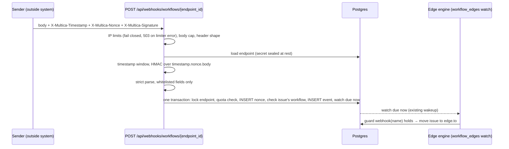

# Workflow inbound webhook guard — security spec

Status: DRAFT for cross-lab review (CHE-2031, parent design CHE-2029 Approach B).
No code starts until this spec has a cross-lab PASS.

A workflow edge can wait for a signed call from an outside system (a CI job, a
deploy tool). This is the one workflow guard whose input comes from outside the
platform, so it is the one that needs a threat model first. It adds a guard to
the CHE-2030/CHE-2152 edge engine; it does not add a second engine.

## Decisions

| Topic | Decision |
| --- | --- |
| Guard | `webhook(<name>)`, arity 1, name `[a-z0-9_-]{1,32}`. Needs `timeout` + `on_timeout` like `pr.*` guards: a sender that never calls must not park an issue. |
| Endpoint | One row per `(workflow, name)`. URL carries an opaque id, not the secret. |
| Auth | HMAC-SHA256 over timestamp, nonce and raw body. No bearer-only mode. |
| Replay | Timestamp window ±300 s **and** a single-use nonce kept 900 s. |
| Rate limit | Per IP before auth; per endpoint after auth. |
| Payload | Strict allowlist of typed fields. Raw body is never stored and never reaches a prompt. |
| Failure mode | Every check **fails closed**. A Redis or Postgres error answers 503 and stores nothing; it must not open the pre-auth, replay or rate gate. |

## Request

`POST /api/webhooks/workflows/{endpoint_id}`, `Content-Type: application/json`,
body at most 16 KiB (`http.MaxBytesReader`; larger → 413).

| Header | Rule |
| --- | --- |
| `X-Multica-Timestamp` | Unix seconds, decimal. Accepted when `abs(now - ts) <= 300`. Future and past use the same bound. |
| `X-Multica-Nonce` | 16–64 chars, `[A-Za-z0-9_-]`. Sender-generated, unique per call. |
| `X-Multica-Signature` | `v1=<hex>`, where hex = `HMAC-SHA256(secret, "v1." + timestamp + "." + nonce + "." + rawBody)`. Compared with `hmac.Equal` (constant time). |

Signing the timestamp and nonce together with the body means a captured request
cannot be re-dated or re-nonced. The `v1.` prefix leaves room for a new scheme
without ambiguity.

### Check order (matters)

1. Per-IP gates, fail closed. Reuse the two limiters of
   `HandleAutopilotWebhook` (`WebhookAbsoluteIPRateLimiter`,
   `WebhookIPRateLimiter`) but through their error-returning methods
   (`AllowWithError`, `CheckWithError`), never through `Allow` or
   `slidingWindowLimiterCheck`, which return true on a Redis error. A limiter
   that is nil, or that returns an error, rejects the request with
   `503 {"error":"unavailable"}` and `Retry-After`; no event is stored and no
   issue moves. Over limit → 429. The autopilot ingress keeps its fail-open
   contract; only this endpoint's admission path changes.
2. Body cap, header presence and shape. Reject → 400/413.
3. Load the endpoint by id. Unknown or disabled id: still run one dummy HMAC so
   timing does not reveal existence. Reject → 401.
4. Timestamp window. Reject → 401.
5. Signature, against the current secret, then the previous secret while a
   rotation overlap is open. Reject → 401, charge bad-credential debt.
6. Strict parse of the body (400 on failure). Nothing is stored yet.
7. **Only now** open the admission transaction (next section). An
   unauthenticated caller can never burn a nonce or fill a table. Any Postgres
   error rolls the transaction back and answers `503 {"error":"unavailable"}`.

All of steps 3–5 return the **same** 401 body (`{"error":"unauthorized"}`).
No response says which part failed. Details go to a structured log line
(endpoint id, IP, reason code, never the body, secret or signature).

## Admission transaction

Check-order step 7 runs in **one** Postgres transaction, so the quota, the nonce,
the event and the wake-up commit together or not at all:

1. `SELECT ... FROM workflow_webhook_endpoint WHERE id = $1 FOR UPDATE`. The row
   lock serialises concurrent calls for one endpoint; calls for other endpoints
   do not wait.
2. Quota: `count(*)` of `workflow_webhook_nonce` rows for the endpoint with
   `seen_at > now() - 60 s`. At or above `endpoint_rate_per_min` (default 60) →
   roll back, answer 429. **Nothing is inserted** on this path, so a signed
   flood cannot grow the table.
3. Nonce: `INSERT ... ON CONFLICT DO NOTHING`; zero rows inserted → replay →
   roll back, 409.
4. Resolve the issue (next section). Not eligible → commit (the nonce stays
   consumed), answer `200 {"status":"ignored"}`; no event row.
5. Insert the `workflow_webhook_event` row and set the issue's `workflow_edges`
   watch due now (`next_fire_at = now()`), then commit.

If any statement fails, the whole transaction rolls back: the nonce is not
consumed and the sender may retry the same request (same nonce) and get exactly
one accepted event. The watch update is only a prompt. The edge engine is
level-triggered, so it also finds a committed event on its next scheduled pass
if the prompt is lost.

## Replay protection

Table `workflow_webhook_nonce(endpoint_id uuid, nonce text, seen_at timestamptz,
PRIMARY KEY (endpoint_id, nonce))`. Postgres, not Redis: the repo's Redis
limiter fails open on error, which is wrong for replay protection.

A nonce must outlive the timestamp window, or a request could be replayed after
its nonce expired while its timestamp is still valid. Window 300 s each side
means a request is acceptable for up to 600 s; nonces are kept **900 s** (window
plus margin). The maintenance job deletes older rows. Bound on table size:
`endpoint_rate_per_min × 15` rows per endpoint, because an insert happens only
after the quota check passed under the endpoint row lock (admission step 2),
so at most `endpoint_rate_per_min` rows land in any 60 s span.

## Payload

The body is a JSON object. Decode with `DisallowUnknownFields`; any unknown
field → 400. Whitelisted fields:

| Field | Type | Rule |
| --- | --- | --- |
| `issue` | string | Identifier like `CHE-123`. Must resolve inside the endpoint's workspace, and the issue's **effective workflow** must be the endpoint's workflow (below). |
| `result` | string | One of `success`, `failure`. |
| `ref` | string, optional | At most 128 chars, `[A-Za-z0-9._:/#-]`. An external id (build number, run URL id). |

Stored columns of `workflow_webhook_event`: `endpoint_id`, `issue_id`, `name`,
`result`, `ref`, `received_at`, `body_sha256`, `body_bytes`. The raw body is not
stored. `body_sha256` and size exist for audit and dedupe only.

Eligibility (admission step 4). Resolve the issue's effective workflow with
`issueworkflow.ForIssue` (issue override, else project workflow, else workspace
Default). The call is eligible only if all of these hold: the effective workflow
id equals the endpoint's `workflow_id`; the issue's current step has an edge
`webhook(name)` with `name` equal to the endpoint's name; the issue is not
closed. Two workflows that both define `webhook(ci)` therefore never accept
each other's calls, although they share a workspace and a guard name.

The guard `webhook(name)` holds when the issue sits on the step and a
`success` event for **that endpoint** and `name` has `received_at` at or after
the step-entry time. The engine looks events up by `(endpoint_id, issue_id)`,
never by name alone.
Events from before entry do not fire; a webhook says "something happened now".
A `failure` event is stored but fires no guard (open question 2).
An ineligible call answers `200 {"status":"ignored"}` and stores no event, so a
sender cannot move an issue that is somewhere else or follows another workflow.

Dedupe: a unique index on `(endpoint_id, issue_id, ref)` where `ref` is not
null makes a sender retry with a new nonce but the same `ref` a no-op.

### Prompt isolation

- No code path reads `workflow_webhook_event.ref` into an agent prompt, run
  instruction, task description, comment or wakeup text. The engine moves the
  issue by status; the next run is built from the issue as for any other move.
- The UI shows `ref` as escaped plain text in the activity row only.
- A test (below) sends an injection string in `ref`-shaped fields and asserts it
  appears in no `agent_task_queue`, `issue_wakeup.instruction` or comment row.

Why a strict allowlist: the sender is a script we configure, so it can send the
three fields. Anything richer (a free-text message, a PR body) is the exact
channel for prompt injection and is refused rather than sanitised.

## Secrets and endpoints

- Secret: 32 random bytes from `crypto/rand`, shown **once** at creation as
  `whs_` + URL-safe base64. Stored sealed with `util/secretbox` (AES-256-GCM),
  not plaintext (autopilot's `signing_secret` is plaintext; this is stricter).
  The HMAC needs the secret, so a one-way hash is not an option.
- Rotation: `rotate` creates a new secret and keeps the previous one valid for
  24 h (`previous_secret`, `previous_expires_at`). Disable = immediate stop.
- Manage via `multica workflow webhook create|rotate|disable|list <workflow>`
  and the CHE-2150 editor guard picker. Owner/admin only, same as workflow
  edit. Every create, rotate and disable writes an activity row. Never log or
  return the secret after creation.
- Endpoint belongs to one workspace and one workflow; a call can only name
  issues of that workspace.

## Validation at workflow save

- `webhook(name)` requires `timeout` and `on_timeout` (extends `needsTimeout`).
- An endpoint named `name` must exist and be enabled on that workflow, else
  save fails with a message naming the endpoint.
- Edge count limits are unchanged (`MaxEdgesPerStep`).

## Threat model

| Threat | Control |
| --- | --- |
| Forged call | HMAC with 256-bit secret, constant-time compare |
| Replayed call | Single-use nonce, kept longer than the timestamp window |
| Re-dated or re-nonced capture | Timestamp and nonce inside the signed string |
| Nonce burning by an unauthenticated caller | Nonce consumed only after the signature passes |
| Brute force or flood | Per-IP gates (fail closed), bad-credential debt, per-endpoint cap in Postgres checked before any insert |
| Endpoint probing | Same 401 for unknown, disabled, stale and bad-signature |
| Timing oracle | Dummy HMAC for unknown endpoint, `hmac.Equal` |
| Prompt injection via payload | Typed allowlist, no raw body stored, no path into prompts |
| Cross-workspace, cross-workflow or cross-issue steering | Issue resolved in the endpoint's workspace; its effective workflow must be the endpoint's; it must sit on the guarded step; events are keyed by endpoint |
| Secret leak at rest | `secretbox` sealed; shown once |
| Large or malformed body | 16 KiB cap, strict JSON, unknown field rejected |
| Redis, limiter or Postgres outage | Pre-auth limiters use error-returning calls and reject with 503; replay, quota, nonce and event live in one Postgres transaction. Nothing is stored on any error |

Out of scope: TLS termination (platform edge), sender-side secret hygiene, IP
allowlisting per endpoint (add if a sender has fixed egress).

## Test plan (test-first, red then green recorded in the code PR)

Handler tests with `httptest`, plus unit tests for the verifier.

1. Valid call moves an issue on a `webhook(ci)` edge. **Control case.**
2. **Bad signature** → 401, no nonce row, no event row. (CHE-2029 criterion B)
3. **Reused nonce** with a valid signature → first 200, second 409, one event
   row. (CHE-2029 criterion B)
4. Bad signature does not consume the nonce: send bad, then valid with the
   same nonce → valid succeeds.
5. Timestamp too old and too far in the future → 401.
6. Body tampered after signing → 401. Timestamp or nonce header changed → 401.
7. Missing header, bad nonce shape, missing `v1=` → 400.
8. Body over 16 KiB → 413. Unknown field → 400. `result` outside the enum →
   400. `ref` with a space or over 128 chars → 400.
9. Unknown, disabled endpoint and bad signature give an identical body.
10. Per-endpoint cap: call 61 in a minute → 429 on the 61st. Sustained
    over-quota traffic (for example 500 signed calls with fresh nonces) leaves
    the nonce row count unchanged after the 60th. 100 simultaneous signed calls
    at a limit of 60 admit exactly 60 and answer 429 to the rest.
11. Rotation: old secret accepted inside the 24 h overlap, rejected after;
    disable rejects at once.
12. Issue in another workspace → ignored/401, never moved. Issue not on the
    guarded step → `ignored`, status unchanged. **Same workspace, different
    workflow:** workflows A and B both define `webhook(ci)`; A's endpoint names
    an issue waiting on B's `webhook(ci)` edge → `ignored`, the issue does not
    move, no event row.
13. Event received before step entry does not fire the guard.
14. Injection string in `ref`-shaped input: rejected by charset; an allowed
    but hostile-looking `ref` appears in no task, wakeup or comment row.
15. Save-time validation: `webhook(x)` without timeout fails; without an
    endpoint fails.
16. Nonce cleanup deletes rows older than 900 s and keeps newer ones.
17. Limiter outage: a Redis error from `AllowWithError` or `CheckWithError`, and
    a nil required limiter, each answer 503; no nonce, no event, issue
    unmoved. A Postgres error in the admission transaction answers 503 with the
    same result. The autopilot ingress tests stay unchanged.
18. Atomicity: force the event insert to fail after the nonce insert → 503, no
    nonce row; the same request (same nonce) retried → 200 and exactly one
    event row. Event committed but watch update skipped → the next scheduled engine
    pass moves the issue.

## Slices after PASS

1. Migration + queries: endpoint, nonce, event tables.
2. Verifier (pure function) + handler + route, with tests 1–12, 14, 17, 18.
3. Guard in `issueworkflow` (parse, validate, `Facts`), engine hookup, test 13, 15.
4. CLI `workflow webhook` and cleanup job, test 11, 16.
5. Editor guard option, on the CHE-2150 editor.

## Open questions

1. Is 16 KiB right? Autopilot allows 256 KiB; three short fields need far less.
2. Should a `failure` result fire a guard? Proposal: `webhook(name)` fires on
   `success`; a second guard `webhook_failed(name)` is added only when a
   workflow needs it. Until then `failure` is stored and the timeout path runs.
3. Per-endpoint IP allowlist: defer unless a sender has fixed egress.
