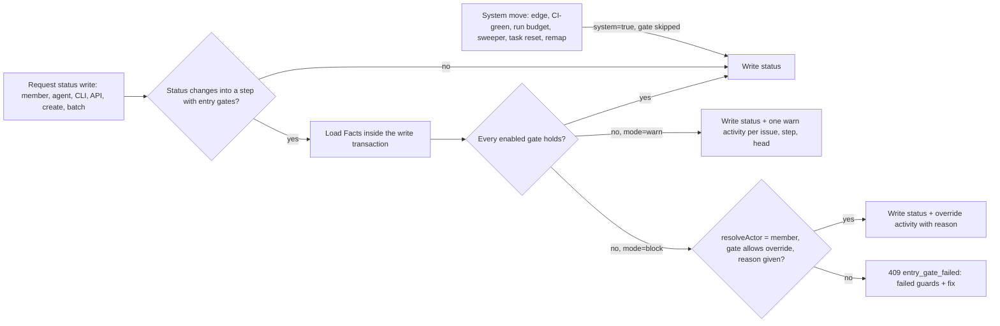

# Design: Workflow step entry gates (`entry: [{guard, mode}]`)

Generated by /office-hours on 2026-10-30 (x99-claude-opus, DM with Cheese)
Repo: cheese-work/multica (base `origin/main` 7abad725a)
Status: APPROVED (Cheese, D4 = A, 30/10/2026, decision record on CHE-2295)
Mode: Startup (intrapreneurship, internal tool)
Program: CHE-2295 (freeze exception D2 = B, 28/10/2026)

## Problem Statement

Status rules such as "an issue enters `in_review` only with a non-draft PR whose CI is green" live in skill prose and a client-side script (`run-in-review-gate`, CHE-2336). The server does not enforce them. Agents and people can still write `in_review` directly, and every new rule adds more prose. `AGENTS.md` "Settings-first features" asks for the opposite: catalog-based status entry conditions attached to workflow columns, with modes `off | warn | block`.

## Decisions recorded (Cheese, 30/10/2026 ICT, decision records on CHE-2295)

- Settings-first direction (message `01a188f5-0765-73dd-9740-0497c948c031`): add new settings, not prose rules.
- Gate primitive first (message `01a188f8-27f3-7d3f-83dd-6affd501dbff`): before presets (CHE-2295 step 3) and before run-budget UI (waits on CHE-2297).
- Approach B (message `01a18902-3c2f-7a9a-b630-0e12f2f64bfe`): entry conditions on each workflow step, reusing the existing guard catalog.

Ruled out:
- A, hard-coded `in_review` check in the status handler: a one-off check, the pattern `AGENTS.md` forbids.
- C, workspace-level gates keyed by status: duplicates the workflow step concept; projects on different workflows could not differ.

## Premises (stated in DM; Cheese gave no objection)

1. Delivered as sub-issues of CHE-2295, the only program exempt from the meta-work freeze (CHE-2258, 27/10 to 10/11/2026).
2. Every setting has a named default, a reason and a scope; it lives in existing JSON (workflow steps), no new column or migration.
3. One slice at a time; each slice merges and deploys to C00 separately with Cheese's approval.

## Existing code this builds on

- Guard catalog: `server/internal/issueworkflow/edges.go:22-32` (`agent_done`, `agent_verdict(x)`, `pr.checks_green`, `pr.checks_red`, `pr.ready`, `pr.merged`, `pr.closed_unmerged`, `pr.review_changes_requested`, `pr.review_approved`, `children_done`, `issue_status(id, status)`), parsed by `ParseGuard`, evaluated by the unexported `Facts.holds`.
- Facts: `issueworkflow.Facts` (`edges.go:187`). Child PRs count only when the workflow sets `IncludeChildPRs` (`issueworkflow.go:194`).
- Step model: `issueworkflow.Step` (`issueworkflow.go:169`); persisted through `storedStep` + `DecodeSteps`/`EncodeSteps` (`issueworkflow.go:210-286`), which copy fields one by one.
- Write path: every API status write, single or batch, reaches `workflowWrite.verify` (`server/internal/handler/issue_workflow_write.go:130`), either through `lockIssueAndVerify` (`:171`) or directly from `updateIssueAtomically` (`issue.go:3863`). Workflow edge, CI-green and run-budget moves also pass here via `moveIssueOnEdge` (`issue_workflow_ci_advance.go:106`) with a zero-value caller.
- Agents change status through the CLI → `PUT /api/issues/{id}` → `UpdateIssue`; task tokens authenticate as members, so the actor comes from `resolveActor` (`issue.go:5056`).

## Design



### Data shape (inside existing step JSON)

```json
{
  "status_key": "in_review",
  "entry": [
    { "guard": "pr.ready",        "mode": "block", "member_override": true },
    { "guard": "pr.checks_green", "mode": "block", "member_override": true }
  ]
}
```

- `guard`: any guard from the catalog except `agent_done` and `agent_verdict(...)`, which describe an agent's own write, not a state. Rejected at validation.
- `mode`: `off | warn | block`. No `entry` means no gate (today's behavior).
- `member_override`: default `true`. A member passes a `block` gate only with a reason. Agents never override. The "Cheese strict" preset (CHE-2295 step 3) sets `false`.
- At most 8 entry gates per step (same as `MaxEdgesPerStep`).

No database migration: `entry` lives in the existing steps JSON. It still needs code in each place that copies step fields (see slice 1).

### PR semantics for entry gates

Exit guards use "any PR" (`anyPR`), and `pr.checks_green` counts drafts (`open()` includes `draft`, `edges.go:234`). Evaluated one guard at a time, a non-draft red PR plus a draft green PR would pass both `pr.ready` and `pr.checks_green`. Entry gates therefore evaluate all PR guards of the step **per PR**: every linked open or draft PR in scope must satisfy all PR guards together, and at least one such PR must exist. Scope follows the workflow's `IncludeChildPRs`. Exit-guard behavior does not change.

Self-hosted VCS PRs carry no checks (`workflow_edges.sql:26`), so `pr.checks_green` can never hold for them. The step editor shows a warning next to a `pr.checks_green` gate; the server does not try to detect self-hosted projects (no speculative validation).

### Enforcement

- One evaluation point: `workflowWrite.verify`. It runs the gate only when the write changes the status **into** a gated step. Title, description and other edits on an issue already in that step are never gated.
- `workflowWrite` gets an explicit `system bool`. `moveIssueOnEdge` (edge, CI-green, run-budget moves) sets it, so those moves skip entry gates. Other system writers that do not use `workflowWrite` are unchanged and listed in a regression test: failed-task reset (`service/task.go:7142`), runtime sweeper (`runtime_sweeper.go:725`), PR auto-complete (`pr_auto_complete.go`), GitHub merge handling (`github.go`), Qoder lifecycle, Jev routing.
- The workflow-edit remap (`issue_workflow.go:710`) moves issues because a member edited the workflow; it is a system move (`system=true`), not a gated write.
- `CreateIssue` with a `status` runs the same gate (an issue cannot be created straight into a gated step).
- Batch updates return a per-item result (`entry_gate_failed` with failed guards) instead of the current silent `continue` (`issue.go:5067`, `5111`).
- Facts are loaded with the transaction's queries (`qtx`), not `h.Queries`, so the decision and the write see the same snapshot.
- Override: `PUT /api/issues/{id}` gains optional `entry_gate_override_reason` (string, 1–500 chars). Ignored unless the gate fails in `block`, `member_override` is true and `resolveActor` returns a member.
- `warn`: the write succeeds. One activity row per (issue, step, PR head SHA); dedup by reading existing activity rows of type `entry_gate_warning` for that key (no new table). One issue comment on the first warning only.
- `block`: HTTP 409, code `entry_gate_failed`. Body lists each failed guard, the fact behind it (for example "PR #533 is draft", "checks FAILURE on head 1574ce1") and the action that fixes it. The CLI prints the same text and exits non-zero.

### Preservation and security

- `entry` is part of the bound-write hash: add it to `stepToPayload` so `workflowWriteField` (`issue_workflow_bound_write.go:57-90`) classifies a gate change as a steps change, not `workflow.instructions`. Otherwise an agent holding an instructions-only decision could remove gates.
- A step write that omits `entry` keeps the stored `entry` (merge-preserve, like `SetIssueWorkflowHandoff` keeps `Edges` at `issue_workflow.go:1294`). An explicit `"entry": []` clears it. This protects gates from the current web editor, which rebuilds steps field by field (`workflow-editor-page.tsx:404-413`), and from older desktop clients.

### UI and CLI

- Settings → Workflows step editor: "Entry gates" section per step, one row per gate: guard picker, mode control (`Off / Warn / Block`), member-override toggle.
- `multica workflow get` shows `entry`; `multica workflow update` accepts it with no new command; `multica issue status` accepts `--override-reason`.
- Issue status menu: a gated target shows a lock or warning badge with the failed guard text before the write.

## Slices (each one PR, one sub-issue under CHE-2295, strictly in order)

1. **Engine + API.** `Entry` on `Step`, `storedStep`, `DecodeSteps`/`EncodeSteps`; handler payload/input structs, `stepToPayload`, `payloadToStep`, `resolveStepInputs` (`issue_workflow.go:80-160`, `366-436`); `NormalizeHandoff`/`ValidateHandoff`; merge-preserve; bound-write hash; `system` flag; gate in `verify` for update, create and batch; 409 contract; override reason; warn activity; zod step schema in `packages/core/api/schemas.ts:567` with a malformed-response test; CLI flag. Test-first: red test "agent writes `in_review` with a draft PR on a `block` gate succeeds today", then green; plus regression tests for every system writer listed above.
2. **Settings UI + status menu badge.** Step editor section and pre-write badge. Design-loop rules apply (UI change).
3. **Default workflow gates + instruction cleanup.** Only after slices 1 and 2 are deployed: set `in_review` entry gates (`pr.ready=block`, `pr.checks_green=block`, `member_override=true`) on the Default workflow (`ca300465-4a0e-4b3c-994a-d5623dcaec2e`); then retire the client script lane in `multica-cheese-work-issue` (CHE-2336 text) through the instruction-change process.

## Spec review

Round 1 (independent Claude Opus subagent, same lab as the author): 5/10, 14 issues. All fixed above after the author re-checked the main claims in code (`verify` at `issue_workflow_write.go:130`, `storedStep` field copy, `pr.checks_green` counting drafts, batch `continue`). Round 2 not run. The CHE-2295 step 1 technical and risk review by a different lab is the real gate.

## Success Criteria

- An agent writing `in_review` on an issue whose linked PR is draft or red receives 409 `entry_gate_failed` with the failed guard text; read back shows the status unchanged.
- A member override writes the status and the activity row carries the reason.
- `warn` mode writes the status, one activity row per (issue, step, head) and one comment on the first warning.
- Editing the title of an `in_review` issue with red CI still succeeds.
- A workflow save from an older client that omits `entry` leaves stored gates unchanged.
- System moves listed above behave exactly as before (regression test).
- After slice 3, the `in_review` section of `multica-cheese-work-issue` shrinks to "the server enforces the Default workflow's entry gates".

## Open Questions

1. Should a system move that lands in a gated step and fails its gate raise a visible notice (v2)? v1 exempts system moves.
2. Per-PR semantics above require every in-scope PR to pass. CHE-2336 instead refuses more than one open PR. Keep "every PR passes", or also refuse multiple open PRs?

## Distribution Plan

Existing pipeline: PR to cheese-work/multica → CI → Cheese merges → C00 CD cutover with Cheese's deploy approval. Older clients do not send `entry`; the server's merge-preserve rule keeps stored gates. The zod schema defaults `entry` to `[]` for reading.

## Dependencies

- CHE-2523 (restore `project_workflows_v1` on C00): Settings → Workflows must be visible to configure gates.
- CHE-2524 (cutover flag guard): prevents the page vanishing again.
- CHE-2295 step 1 proposal gate: this doc is the plan; it needs a technical review and a risk review, then Cheese's approval, before slice 1 starts.

## Next Steps

1. Commit this doc as `docs/plans/CHE-2295-entry-gates.md` with the slice-1 sub-issue.
2. Technical + risk review by a different-lab reviewer.
3. Cheese approves; slice 1 starts test-first.

## What I noticed about how you think

- You opened with "Sửa thiếu và bổ sung thêm": fix first, then extend. The session kept that order (CHE-2523/2524 before the gate).
- You picked the primitive over the visible feature twice ("A", then "B"), choosing reuse over the quicker demo.
- "Từ x99 không bao giờ ssh đc đến c00 đâu": you expect agents to know host topology and route to the agent on the right host, not report "unverified".
