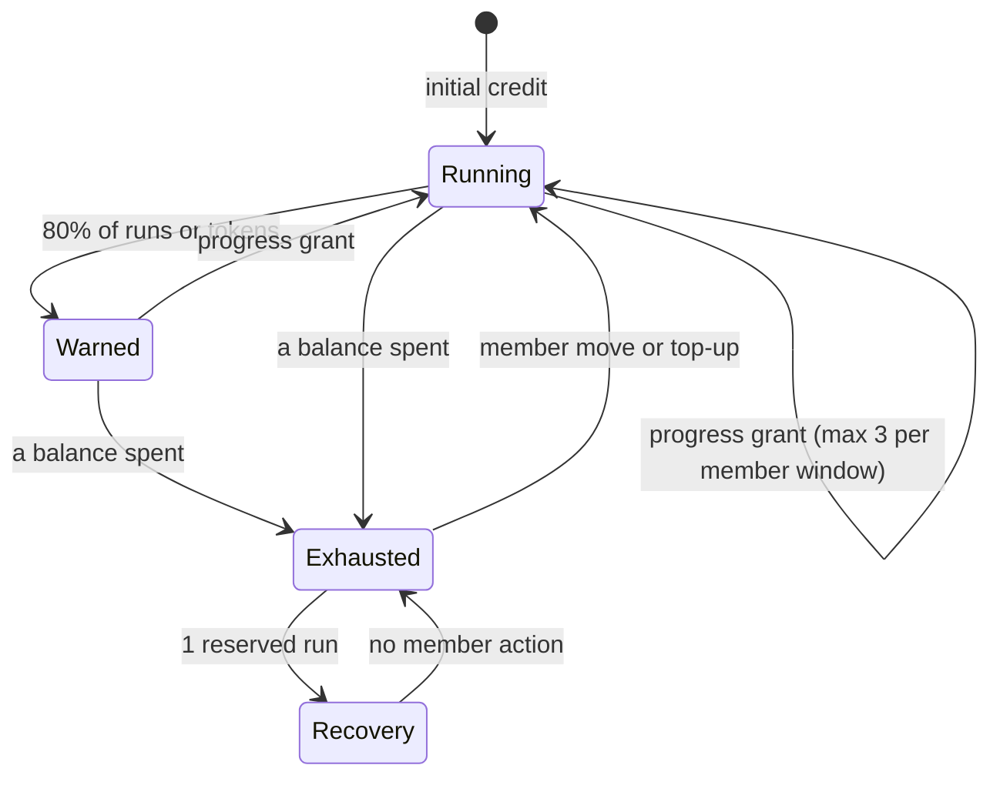

# CHE-2297 Run budget: progress-based grants and visible blocks

Status: plan, phase 1. No code yet. Inputs: Gemini and Sol discussion (CHE-2297 thread). Code read at `81d28c3`.

## What a person will notice

| Case | Today | After |
|---|---|---|
| Budget runs out | Silent: activity row + `blocked_reason` only; nothing at all when the workflow has no `blocked` status | Comment with reason, balances and how to reopen, plus a decision request to the requester |
| 80% used | Nothing | One comment and a notification to the requester |
| Blocked handler | Refused by the same budget: dead end | 1 recovery run per member window, own token cap |
| Any member status move | Resets usage to zero | Adds credit; usage history kept |
| Agent in a run | No idea of its budget | Prompt says "budget left: N runs, M tokens" |

## Approach

Count runs **and** tokens; admission stops when either is spent. Credit is added only on progress: a member status move that changes the status, a PR head never seen on this issue with a non-empty diff, first entry to a step (server-owned identity). At most 3 automatic grants per member window, +6 runs / 15M tokens each. No "off" value; 1000 stays the practical maximum.

## Steps

| # | Step | Owner | Estimate | Stage |
|---|---|---|---|---|
| L1 | Visibility: 80% and exhaustion comments, decision request, budget in prompt, signal without `blocked` status | write-eligible X99 agent | 2 h | 1 |
| L2 | Ledger: credit instead of reset, token balance, 3 grant events, dedup, per-window cap | write-eligible X99 agent | 2 h x 2 | 2 |
| L3 | Blocked recovery reserve and its limits | write-eligible X99 agent | 2 h | 3 |

Each step is a test-first server PR in the fork, stacked on the previous head. Review gates: none in the project line.

## Risks (1 low - 5 high)

| Axis | L1 | L2 | L3 |
|---|---|---|---|
| Technical | 2 | 4 | 3 |
| Security (budget bypass) | 1 | 3 | 3 |
| Rollback | 1 | 3 | 2 |
| Token cost | 1 | 2 | 2 |
| Conflict with open work | 1 | 2 | 2 |
| Operations | 2 | 3 | 2 |
| Single-agent dependency | 2 | 2 | 2 |

Conflict: CHE-2298 (PR events cost) and CHE-2295 step 4 option C.

## Open questions for Cheese

1. 3 automatic grants per member window (recommended) or a lifetime ceiling (Gemini: 50 runs / 100M)?
2. L2 token default waits for p90 tokens per issue from `task_usage`. Start L1 first?

