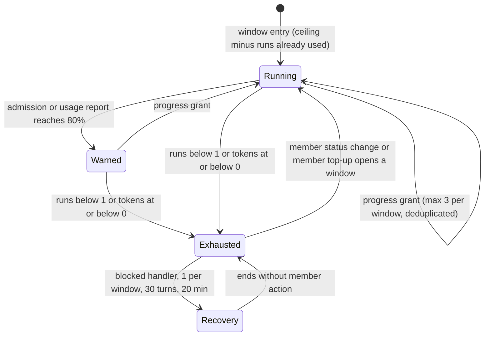

# CHE-2297 Run budget: progress-based grants and visible blocks

Status: plan, phase 1, revision 2. No code yet. Revision 2 answers the CHANGES REQUESTED review by x99-codex-sol on revision 1 (`2fb227f`). Code read at `81d28c3`.

## What a person will notice

| Case | Today | After |
|---|---|---|
| Budget runs out | Silent: activity row + `blocked_reason` only; nothing at all when the workflow has no `blocked` status | One system comment with reason, balances and how to reopen, plus one inbox item to the requester |
| 80% used | Nothing | One system comment and one inbox item to the requester |
| Blocked handler | Refused by the same budget: dead end | 1 recovery run per member window, with turn and time limits |
| Any member status move | Resets usage to zero | Adds credit; usage history kept |
| Agent @mentions another agent, or an agent's wakeup fires | Never refused by the budget | Refused at zero budget, like every other derived run |
| Agent in a run | No idea of its budget | Prompt says how many runs are left and how many tokens were used |

## Code facts this plan relies on

1. Every `agent_task_queue` row after the window start counts, whatever its status (`server/pkg/db/queries/workflow_edges.sql`, `CountIssueRunsSince`).
2. The window start is the later of `run_budget_since` and the last member `status_changed` activity (`server/internal/service/task_run_budget.go`, `RunBudgetStart`).
3. `OriginNamed` skips the budget (`server/internal/service/task_triage_guard.go:89`). The comment says "a person wrote this agent's name", but an agent-authored @mention also gets `mention_agent` and `OriginNamed` (`server/internal/handler/comment.go:3820`, `:2975`), and every wakeup fire is `OriginNamed` (`server/internal/service/issue_wakeup.go:1365`). So agent-to-agent loops and agent wakeups are never refused today.
4. Decision requests and decision intents require the issue's running task (`server/internal/handler/decision_request_api.go:17`, `server/internal/handler/decision_intent.go:43`). The server has no other way to open one.
5. System comments already exist: `author_type = 'system'`, zero author UUID, published as `comment:created`, made idempotent with a claim row (`server/internal/handler/issue_child_done.go:653`).
6. `inbox.CreateIfEligible` writes an inbox item for a member; decision-class items ignore notification preferences (`server/internal/inbox/create.go:17`).
7. Usage is reported once, when a run ends, even on cancel (`server/internal/daemon/daemon.go:5847`). The server cannot see tokens during a run.
8. `GetIssueUsageSummary` separates terminal runs without a `task_usage` row (`unreported_task_count`, `server/pkg/db/queries/task_usage.sql:72`). Missing usage is not zero usage.

## Approach

### L1: notices without a decision request (finding 1)

L1 does not open a decision request. Decision requests stay task-only (fact 4); no new authority is added to them. The server writes the notice itself, the same way as the stage-completion notice (fact 5):

- **One system comment** on the issue with: cause (runs spent), runs used and the ceiling, tokens used so far and the count of unreported runs, and the reopen action ("a member moves the status" in L1; "a member moves the status or runs `multica issue budget top-up`" from L2).
- **One inbox item** of a new kind `run_budget` to the requester (`requested_by_id`), else the member creator, else the workspace owners. Like decision items, it ignores notification preferences: it is the one signal that work stopped.
- **When:** the exhaustion notice fires on the first refused derived enqueue of a window. It fires whether or not the issue is already `blocked` and whether or not the workflow has a `blocked` status. The status move stays as today and stays skipped in those two cases.
- **Idempotency:** a claim row with the unique key `(issue_id, window_id, kind)`, where kind is `warn80` or `exhausted`. Concurrent refusals and retries insert at most one row; only the inserting transaction writes the comment and the inbox item. A failed comment write is retried by the next refusal, because the claim row and the comment are written in one transaction.
- **80% warning:** checked at admission of each run. The run whose admission makes the count reach `ceil(0.8 × ceiling)` writes the warning itself; no later enqueue is needed.
- **Interim token display (finding 4):** L1 has no token balance. The prompt and the notices show "runs left: N of M; tokens used: X (K runs unreported)". The token balance appears in L2.
- **Authority:** no endpoint is added. Agents and members cannot create or suppress these notices through the API; only the admission guard writes them.

### L2: ledger with defined accounting (finding 2)

**Ledger.** New table `issue_run_budget_entry` (`id`, `workspace_id`, `issue_id`, `window_id`, `kind`, `event_key`, `runs_delta`, `tokens_delta`, `created_at`), unique on `(issue_id, kind, event_key)`. No foreign keys. Balance = sum of deltas in the issue's entries. Usage history is never deleted.

**Member window identity.** `window_id` = the id of the activity row that opened it: the latest member `status_changed` row whose old and new status differ, or a member `run_budget_top_up` row. Before either exists: `workflow:<run_budget_since>`. Agent and system status moves never open a window.

**Credit events** (one entry each, `event_key` in brackets):

| Event | Credit | Key | Counts in the 3-grant cap |
|---|---|---|---|
| Window opened by a member | workflow `max_runs_per_issue` runs + workflow token allowance | `window:<activity_id>` | no |
| Member top-up (`POST /api/issues/{id}/run-budget/top-up`, CLI `multica issue budget top-up`) | same as a window | `window:<activity_id>` | no |
| First entry to a status in this window | +6 runs / 15M tokens | `step:<window_id>:<status_key>` | yes |
| PR head SHA never seen on this issue | +6 runs / 15M tokens | `head:<pr_id>:<sha>` | yes |
| CHE-2295 step 4 option C stale-PR return | +6 runs / 15M tokens | `stale_pr:<pr_id>:<sha>:<cause>` | yes |
| Refund of a review the server cancelled with reason `superseded_head` (CHE-2298 stop gate; D1 below) | +1 run, 0 tokens | `refund:<task_id>` | no |

The top-up endpoint accepts member sessions only; a `task_token` caller gets 403. Empty or cosmetic commits are not detected: the server has no diff data. They are bounded by the 3-grant cap, not prevented.

**Debit events.** At admission: `run:<task_id>` = −1 run, and `reserve:<task_id>` = −E tokens. At usage report: `tokens:<task_id>` = −(actual weighted tokens) and `release:<task_id>` = +E. A terminal run with no usage row keeps its reservation as the charge (fact 8). E is the p90 weighted tokens per metered run over the last 30 days, measured before L2b and stored as the workflow default.

**Weighted tokens.** `input + output + cache_write + 0.1 × cache_read`. Cache reads cost about a tenth of input and otherwise dominate the totals. The 15M grant is in weighted tokens.

**Atomic admission.** The enqueue transaction locks the issue row (`SELECT … FOR UPDATE`, as `LockDecisionIssue` does), reads the balance, refuses when runs < 1 or tokens ≤ 0, and inserts the debits. Grants take the same lock, count progress grants in the window, and insert only while the count is below 3. The unique key makes replays no-ops.

**Named-run bypass.** Kept only for runs a member caused: a member-authored @mention, a member reply, a wakeup created by a member. Those runs are admitted at zero and still debited. An agent-authored @mention and a wakeup created by an agent become derived and are refused at zero (fact 3).

**Overshoot is disclosed, not prevented.** Runs already admitted can spend more tokens than the balance (fact 7). Notices show the balance, which can be negative, and say so. The token ceiling is an admission rule, not a hard spend ceiling.

**Rollout and rollback.** The migration only adds the table and its indexes (each `CREATE INDEX CONCURRENTLY` in its own file). There is no backfill. The first admission after deploy writes the initial entry `window:<current window_id>` = ceiling − runs counted in today's window, so an issue at 38 of 40 runs has 2 left after deploy, not 40. Rollback = revert the PR: today's guard reads only `agent_task_queue` and activity rows, which the ledger never changes; the unused table stays.

### L3: recovery reserve with server-side limits (finding 3)

- **Who claims it:** only the agent that the workflow's `blocked` step hands off to, through the enqueue that the exhaustion move itself triggers. The task carries origin `budget_recovery`. Claim key `recovery:<window_id>`: one per window. A manual or agent request cannot claim it.
- **Limits, enforced by the server:** the run gets `--max-turns 30` where the runtime supports it, and a 20-minute wall-clock limit after which the server cancels it. Its tokens are charged after it ends like any run (fact 7); notices show any overshoot. The "own 2M token cap" of revision 1 is dropped: the server cannot measure tokens during a run, so a token cap would be a false promise.
- **Restrictions, enforced by the server for a `budget_recovery` caller:** creating a child of this issue, creating a wakeup, and calling top-up return 403. Its comments dispatch no runs, because an agent mention is derived and the balance is zero. Its status moves grant nothing, because only member moves open a window.
- **Failed recovery:** the issue stays `blocked`; the exhaustion comment and inbox item stay; a member move or top-up still works. The reserve does not return until a new window.

## Steps

All steps: test-first server PRs in `cheese-work/multica`, stacked in this order, each with an author and a different-lab verifier. Review gates: none in the project line.

| # | Step | Estimate | Stage |
|---|---|---|---|
| L1a | Exhaustion and 80% notices: claim rows, system comment, `run_budget` inbox kind and recipient rule | 2 h | 1 |
| L1b | Budget line in the run prompt (runs left, tokens used, unreported runs) | 1.5 h | 1 |
| L2a | Ledger table and migration, initial entry from today's window, locked admission and run debit, named-origin fix for agent mentions and agent wakeups | 2 h | 2 |
| L2b | Token reservation and usage debit, token notices at usage report; needs E | 2 h | 3 |
| L2c | Window credit, 3 progress grants with cap, `superseded_head` refund, step 4 C grant entry | 2 h | 3 |
| L2d | Member top-up endpoint and CLI | 1.5 h | 3 |
| L3 | Recovery reserve: claim, turn and time limits, 403 restrictions | 2 h | 4 |

Total 13 h of authoring, up from 8 h, plus one verification per step.

## Acceptance tests per step

- **L1a:** exhaustion with a `blocked` status gives one comment and one inbox item; an already-blocked issue and a workflow without `blocked` each give the notice without a status move; two concurrent refusals give one notice; a second refusal in the same window gives none; a new window re-arms; the inbox item arrives with notifications muted; the run whose admission reaches 80% writes the warning with no later enqueue.
- **L1b:** the prompt shows runs left, tokens used and unreported runs, matching `GetIssueUsageSummary`.
- **L2a:** an issue at 38 of 40 before deploy has 2 after; two concurrent admissions at a balance of 1 admit exactly one; a member mention at zero is admitted and debited; an agent mention and an agent-created wakeup at zero are refused; a member wakeup at zero is admitted; after a revert, today's guard still gives the same answer.
- **L2b:** a usage report replaces the reservation; a terminal run without usage keeps it; the usage report that crosses 80% of tokens writes the warning with no later enqueue; a negative balance is shown as overshoot.
- **L2c:** a replayed head SHA grants once; 4 distinct heads in one window grant 3 times; concurrent grants keep the cap; an agent status move grants nothing; a member move to the same status opens no window; a refund applies once per task and only for a head-changed cancellation.
- **L2d:** a member top-up opens a window; a `task_token` top-up gets 403.
- **L3:** the exhaustion move enqueues one recovery run for the `blocked` handler; a second claim in the window is refused; the recovery run gets 403 on child creation, wakeup creation and top-up; the server cancels it at 20 minutes; after a failed recovery a member move still admits runs.

## Shared ledger contract (CHE-2298 and CHE-2295 step 4 option C)

Both consumers write only through one service function, `service.RecordRunBudgetEntry(ctx, q, issueID, kind, eventKey, runsDelta, tokensDelta)`, which takes the issue lock and applies the unique key and, for progress kinds, the cap.

- CHE-2298 (plan revision 2 moved D1 here): every admitted run is debited at admission (`run:<task_id>`). When the CHE-2298 stop gate cancels a review with reason `superseded_head`, it calls this function with kind `refund`, key `refund:<task_id>`, +1 run, 0 tokens. Tokens are never refunded. CHE-2298 adds no grant of its own.
- CHE-2295 step 4 option C: its "run grant for the PR fix" is kind `progress`, key `stale_pr:<pr_id>:<sha>:<cause>`, inside the 3-grant cap, so a stale-PR loop cannot grant more than 3 times per window.

## Risks (1 low - 5 high)

| Axis | L1 | L2 | L3 |
|---|---|---|---|
| Technical | 2 | 4 | 3 |
| Security (budget bypass or authority) | 2 | 4 | 3 |
| Rollback | 1 | 2 | 2 |
| Token cost | 1 | 2 | 2 |
| Conflict with open work | 2 | 3 | 2 |
| Operations | 2 | 4 | 2 |
| Single-agent dependency | 2 | 2 | 2 |

- L1 security 2 (was 1): server-origin comment and inbox item with a preference override; no endpoint and no decision authority are added.
- L2 security 4 and operations 4: closing the agent-mention and agent-wakeup bypass changes how agent coordination behaves at zero budget, and a ledger bug either blocks work or lets runs through.
- L2 rollback 2 (was 3): additive table, no backfill, revert restores today's guard unchanged.
- Conflict: L1 and CHE-2298 both touch `onRunBudgetExhausted`; L2 is the shared contract above.
- L3 token cost 2: bounded by 30 turns and 20 minutes, charged afterwards.

## Open questions for Cheese

1. 3 automatic grants per member window (recommended) or a lifetime ceiling (Gemini: 50 runs / 100M)?
2. Close the bypass for agent @mentions and agent wakeups (recommended; needed for any budget to hold)?
3. Weighted tokens with cache reads at 0.1, and the 15M grant counted in weighted tokens?
4. Start L1 while L2b waits for the measured per-run reservation E?
5. D1 (moved from CHE-2298): **B** (recommended) debit every run at admission and refund 1 run, never tokens, only for a review cancelled with `superseded_head`; or **A** count only completed runs, which lets a crashing run loop for free.

