# CHE-2297 Run budget: progress-based grants and visible blocks

Status: plan, phase 1, revision 5. No code yet. Revision 5 answers the CHANGES REQUESTED review by x99-codex-sol on revision 4 (`4d9b75f`); earlier revisions answered the reviews on revision 3 (`0bd2fa5`), revision 2 (`7a3c228`) and revision 1 (`2fb227f`). Code read at `81d28c3`.

## What a person will notice

| Case | Today | After |
|---|---|---|
| Budget runs out | Silent: activity row + `blocked_reason` only; nothing at all when the workflow has no `blocked` status | One system comment with reason, balances and how to reopen, plus one inbox item to the requester. A decision request as well only if Cheese picks option B of open question 1 |
| 80% used | Nothing | One system comment and one inbox item to the requester |
| Blocked handler | Refused by the same budget: dead end | 1 recovery run per member window, with a 20-minute limit; it cannot start other runs or earn grants |
| Any member status move | Resets usage to zero | Adds credit; usage history kept |
| Agent @mentions another agent, or an agent's wakeup fires | Never refused by the budget | Refused at zero budget, like every other derived run |
| Agent in a run | No idea of its budget | Prompt says how many runs are left and how many tokens were used |

## Code facts this plan relies on

1. Every `agent_task_queue` row after the window start counts, whatever its status (`server/pkg/db/queries/workflow_edges.sql`, `CountIssueRunsSince`).
2. The window start is the later of `run_budget_since` and the last member `status_changed` activity (`server/internal/service/task_run_budget.go`, `RunBudgetStart`).
3. `OriginNamed` skips the budget (`server/internal/service/task_triage_guard.go:89`). The comment says "a person wrote this agent's name", but an agent-authored @mention also gets `mention_agent` and `OriginNamed` (`server/internal/handler/comment.go:3820`, `:2975`), and every wakeup fire is `OriginNamed` (`server/internal/service/issue_wakeup.go:1365`). So agent-to-agent loops and agent wakeups are never refused today.
4. Decision requests and decision intents require the issue's running task (`server/internal/handler/decision_request_api.go:17`, `server/internal/handler/decision_intent.go:43`). The server has no other way to open one.
5. System comments already exist: `author_type = 'system'`, zero author UUID, published as `comment:created`, made idempotent with a claim row (`server/internal/handler/issue_child_done.go:653`).
6. `inbox.CreateIfEligible` writes an inbox item for a member; decision-class items ignore notification preferences (`server/internal/inbox/create.go:17`).
7. Usage is reported once, when a run ends, even on cancel (`server/internal/daemon/daemon.go:5847`). The server cannot see tokens during a run.
8. `GetIssueUsageSummary` separates terminal runs without a `task_usage` row (`unreported_task_count`, `server/pkg/db/queries/task_usage.sql:72`). Missing usage is not zero usage.

## Approach

### L1: notices without a decision request (finding 1)

L1 does not open a decision request. Decision requests stay task-only (fact 4); no new authority is added to them. The server writes the notice itself, the same way as the stage-completion notice (fact 5):

- **One system comment** on the issue with: cause (runs spent), runs used and the ceiling, tokens used so far and the count of unreported runs, and the reopen action ("a member moves the status" in L1; "a member moves the status or runs `multica issue budget top-up`" from L2).
- **One inbox item** of a new kind `run_budget` to the requester (`requested_by_id`), else the member creator, else the workspace owners. Like decision items, it ignores notification preferences: it is the one signal that work stopped.
- **When:** the exhaustion notice fires on the first refused derived enqueue of a window. It fires whether or not the issue is already `blocked` and whether or not the workflow has a `blocked` status. The status move stays as today and stays skipped in those two cases.
- **Idempotency:** a claim row with the unique key `(issue_id, window_id, kind)`, where kind is `warn80` or `exhausted`. Concurrent refusals and retries insert at most one row; only the inserting transaction writes the comment and the inbox item. A failed comment write is retried by the next refusal, because the claim row and the comment are written in one transaction.
- **80% warning:** checked at admission of each run. The run whose admission makes the count reach `ceil(0.8 × ceiling)` writes the warning itself; no later enqueue is needed.
- **Interim token display (finding 4):** L1 has no token balance. The prompt and the notices show "runs left: N of M; tokens used: X (K runs unreported)". The token balance appears in L2.
- **Authority:** no endpoint is added. Agents and members cannot create or suppress these notices through the API; only the admission guard writes them.

### L2: ledger with defined accounting (finding 2)

**Ledger.** New table `issue_run_budget_entry` (`id`, `workspace_id`, `issue_id`, `window_id`, `kind`, `event_key`, `runs_delta`, `tokens_delta`, `created_at`), unique on `(issue_id, kind, event_key)`. No foreign keys. Balance = sum of deltas in the issue's entries. Usage history is never deleted.

**Member window identity.** `window_id` = the id of the activity row that opened it: the latest member `status_changed` row whose old and new status differ, or a member `run_budget_top_up` row. Before either exists: `workflow:<run_budget_since>`. Agent and system status moves never open a window.

**Credit events** (one entry each, `event_key` in brackets):

| Event | Credit | Key | Counts in the 3-grant cap |
|---|---|---|---|
| Window opened by a member | workflow `max_runs_per_issue` runs only | `window:<activity_id>` | no |
| Member top-up (`POST /api/issues/{id}/run-budget/top-up`, CLI `multica issue budget top-up`) | same as a window | `window:<activity_id>` | no |
| Token allowance of a window, only while the issue is activated (see Allowance invariant) | +A tokens | `allowance:<window_id>` | no |
| First entry to a status in this window by an agent or by a workflow edge (see Step-grant policy) | +6 runs / 15M tokens | `step:<window_id>:<status_key>` | yes |
| PR head SHA never seen on this issue | +6 runs / 15M tokens | `head:<pr_id>:<sha>` | yes |
| CHE-2295 step 4 option C stale-PR return | +6 runs / 15M tokens | `stale_pr:<pr_id>:<sha>:<cause>` | yes |
| Refund of a review the server cancelled with reason `superseded_head` (CHE-2298 stop gate; D1 below) | +1 run, 0 tokens | `refund:<task_id>` | no |

The top-up endpoint accepts member sessions only; a `task_token` caller gets 403. Empty or cosmetic commits are not detected: the server has no diff data. They are bounded by the 3-grant cap, not prevented.

**Step-grant policy.** A status counts as visited in a window from its first entry; the status the issue has when the window opens is visited from the start. For a status move:

| Move | Grant |
|---|---|
| Agent (ordinary task token) or workflow edge enters a status not yet visited in this window | +6 runs / 15M tokens, inside the 3-grant cap |
| Any move into a status already visited in this window, including a plain flip back (A → B → A: only B grants) | none |
| Member move that changes the status | none as a step grant; it opens a new window (window credit), and its target status is visited in that window |
| Member move to the same status | none, and no new window |
| Recovery-caused move (L3) | none, even into an unvisited status with a grant slot left |
| Any move after the window's exhaustion claim | none (sticky exhaustion) |

**Exhaustion is sticky.** Once a window's exhaustion claim row exists, no automatic grant (`step:`, `head:`, `stale_pr:`) applies in that window, whatever its cause. Only a member window or top-up gives credit again. A push or step move made during recovery, or by anything else, therefore cannot reopen an exhausted issue.

**Debit events.** At admission: `run:<task_id>` = −1 run. Once token accounting is active, admission also writes `reserve:<task_id>` = −E, where E is the value in force at that moment; the entry stores that amount.

**Token accounting epoch.** L2a is runs-only: it writes no token entries and admits on runs alone. Token accounting becomes active per workflow only when the workflow stores both values: allowance A (tokens credited per window) and reservation E (tokens held per admitted run). A is the p90 weighted tokens per issue window and E the p90 weighted tokens per metered run, both over the last 30 days, measured before L2b. Cheese confirms A (open question 6).

Each issue is activated once, by the first admission **or** the first usage report on it after the workflow stores A and E, whichever comes first. Both paths call the same step first, under the issue lock. Activation writes:

1. `token_activation` (unique per issue), which stores the epoch = the start of the window open at that moment;
2. `allowance:<current window_id>` = **+A** only, with nothing subtracted, through the shared allowance claim below;
3. for each task of the issue created at or after the epoch that already has `task_usage` rows: `tokens:<task_id>:1` = −(its weighted tokens).

Tasks created before the epoch are outside token accounting: they are never settled, now or later. Every counted token therefore sits in exactly one place, its task's `tokens:` entries; the allowance holds none.

**Allowance invariant.** Each window gets at most one token allowance: the entry with key `allowance:<window_id>`, unique per issue. Two writers can reach it, and both go through one function under the issue lock; the second insert is a no-op:

- **activation** writes `allowance:<window_id>` for the window open at activation;
- **opening a window** (a member status move or a top-up) writes `allowance:<new window_id>` only if the issue is already activated. Before activation it writes runs only (`window:<activity_id>`).

So a member move or top-up before activation gives runs now and its token allowance at activation, once. Every later member window still gets its own +A. Example: A = 10M, no usage, a member moves the status before the first admission: the move writes runs only; the first admission activates and writes `allowance:<that window>` = +10M; balance 10M, not 20M.

**Usage settlement.** `ReportTaskUsage` upserts one `task_usage` row per (task, provider, model), and a report can repeat or correct an earlier one (`server/internal/handler/daemon.go:5698`). In the same transaction as the upsert, under the issue lock, after the activation step, for a task created at or after the epoch, the server:

1. sums the weighted tokens over all of the task's `task_usage` rows, every provider and model;
2. sums the task's existing `tokens:<task_id>:<n>` entries, including any written by activation;
3. inserts `tokens:<task_id>:<n+1>` with the difference, only when the difference is not zero. A retried identical report writes nothing; a corrected report writes only the correction;
4. when a `reserve:<task_id>` entry exists and no `release:<task_id>` entry exists, inserts `release:<task_id>` = + the stored reservation amount, once.

Worked example (the review's counterexample): A = 10M; a legacy task (created after the epoch's window start, admitted before activation, no reservation) reports 6M, and that report is the first event after activation. Activation writes +10M and `tokens:<task>:1` = −6M; settlement finds a difference of 0 and writes nothing. Balance = +4M. A later admission writes no second allowance, because `allowance:<window_id>` and `token_activation` exist.

A task with no reservation gets no release, so no credit is created without a matching debit. A later change of E does not change a stored reservation. A terminal run with no usage row keeps its reservation as the charge (fact 8).

**Weighted tokens.** `input + output + cache_write + 0.1 × cache_read`. Cache reads cost about a tenth of input and otherwise dominate the totals. The 15M grant is in weighted tokens.

**Atomic admission.** The enqueue transaction locks the issue row (`SELECT … FOR UPDATE`, as `LockDecisionIssue` does), reads the balance, refuses when runs < 1 (or, once token accounting is active, when tokens ≤ 0), and inserts the debits. Grants take the same lock, count progress grants in the window, and insert only while the count is below 3. The unique key makes replays no-ops.

**Named-run bypass.** Kept only for runs a member caused: a member-authored @mention, a member reply, a wakeup created by a member. Those runs are admitted at zero and still debited. An agent-authored @mention and a wakeup created by an agent become derived and are refused at zero (fact 3).

**Overshoot is disclosed, not prevented.** Runs already admitted can spend more tokens than the balance (fact 7). Notices show the balance, which can be negative, and say so. The token ceiling is an admission rule, not a hard spend ceiling.

**Rollout and rollback.** The migration only adds the table and its indexes (each `CREATE INDEX CONCURRENTLY` in its own file). There is no backfill. The first admission after deploy writes the initial entry `window:<current window_id>` = ceiling − runs counted in today's window, so an issue at 38 of 40 runs has 2 left after deploy, not 40. Rollback = revert the PR. Today's guard reads only `agent_task_queue` and activity rows, which the ledger never changes, so admission returns to today's window count. What is lost: progress grants, top-ups and refunds exist only in the ledger. After a revert, an issue that was running on them can be refused at once. Before a revert, the operator lists the issues whose ledger balance depends on grants, top-ups or refunds and posts the reopen action on each; a member move then opens a new window under today's rule. The unused table stays.

### L3: recovery reserve with server-side limits (finding 3)

- **Who claims it:** only the agent that the workflow's `blocked` step hands off to, through the enqueue that the exhaustion move itself triggers. The task carries origin `budget_recovery`. Claim key `recovery:<window_id>`: one per window. A manual or agent request cannot claim it.
- **Limits, enforced by the server:** a 20-minute wall-clock limit, after which the server cancels the run. This is the only limit that applies to every runtime. `--max-turns 30` is added only where the runtime supports it, as an extra bound, not as the limit. The run's tokens are charged after it ends like any run (fact 7); notices show any overshoot. The "own 2M token cap" of revision 1 is dropped: the server cannot measure tokens during a run.
- **Caller identity, not balance, stops it from dispatching.** Every write made with a `budget_recovery` task token is tagged recovery-caused. For a recovery-caused write the server, whatever the balance and whatever grant slots are left:
  - writes no grant entry (`step:`, `head:`, `stale_pr:`);
  - starts no run on any path: status move (the handoff run is suppressed as with `--no-start`), assignment, rerun, comment mention or reply, and wakeup;
  - refuses child creation, wakeup creation and top-up with 403.
  The run can still comment and move the status, so it can record its diagnosis and leave the issue for a person. Sticky exhaustion (L2) also blocks a grant from a push the recovery run makes.
- **Failed recovery:** the issue stays `blocked`; the exhaustion comment and inbox item stay; a member move or top-up still works. The reserve does not return until a new window.

## Steps

All steps: test-first server PRs in `cheese-work/multica`, stacked in this order, each with an author and a different-lab verifier. Review gates: none in the project line.

| # | Step | Estimate | Stage |
|---|---|---|---|
| L1a | Exhaustion and 80% notices: claim rows, system comment, `run_budget` inbox kind and recipient rule | 2 h | 1 |
| L1b | Budget line in the run prompt (runs left, tokens used, unreported runs) | 1.5 h | 1 |
| L2a | Ledger table and migration, initial entry from today's window, locked admission and run debit, named-origin fix for agent mentions and agent wakeups | 2 h | 2 |
| L2b | Token reservation and usage settlement (all model rows, corrections, exact release once) | 2 h | 3 |
| L2e | Token activation per workflow (A and E stored), shared allowance claim, token notices at usage report | 1.5 h | 3 |
| L2c | Window credit, 3 progress grants with cap, `superseded_head` refund, step 4 C grant entry | 2 h | 3 |
| L2d | Member top-up endpoint and CLI | 1.5 h | 3 |
| L3 | Recovery reserve: claim, time limit, recovery-caused tagging with no grants, no runs and 403 restrictions | 2 h | 4 |
| L1c | Only if Cheese picks B in open question 1: server-origin exhaustion decision request | 2 h | 4 |

Total 14.5 h of authoring (16.5 h with L1c), up from 13 h in revision 2, plus one verification per step. L1 starts first: that is sequencing, not a separate approval.

## Acceptance tests per step

- **L1a:** exhaustion with a `blocked` status gives one comment and one inbox item; an already-blocked issue and a workflow without `blocked` each give the notice without a status move; two concurrent refusals give one notice; a second refusal in the same window gives none; a new window re-arms; the inbox item arrives with notifications muted; the run whose admission reaches 80% writes the warning with no later enqueue.
- **L1b:** the prompt shows runs left, tokens used and unreported runs, matching `GetIssueUsageSummary`.
- **L2a:** an issue at 38 of 40 before deploy has 2 after; two concurrent admissions at a balance of 1 admit exactly one; a member mention at zero is admitted and debited; an agent mention and an agent-created wakeup at zero are refused; a member wakeup at zero is admitted; admission on a workflow without stored A and E checks runs only and writes no token entry.
- **L2b:** a usage report releases the exact stored reservation once; a task admitted before activation (no reservation) gets a debit and no release; E changed between admission and report releases the stored amount, not the new E; a retried identical report adds no entry; a corrected report adds one entry equal to the difference; a report with two models settles in one transaction; a terminal run without usage keeps its reservation.
- **L2e:** activation by a first admission on an issue with earlier usage gives balance A minus that usage; activation by a usage report that arrives before any admission (the review's example: A = 10M, legacy 6M) gives +4M, and the next admission writes no second allowance; a member move, then the first admission, with A = 10M and no usage gives 10M; a top-up, then the first usage report, gives one allowance; a member move and a first admission at the same time give one allowance in either order; after activation, each new member window or top-up adds exactly +A; a member move before activation gives its runs at once and no token entry; a retried or corrected report for a task already settled by activation writes only the difference; a task created before the epoch is never settled; two concurrent first events activate once; the usage report that crosses 80% of tokens writes the warning with no later enqueue; a negative balance is shown as overshoot.
- **L2c:** a replayed head SHA grants once; 4 distinct heads in one window grant 3 times; concurrent grants keep the cap; one case per row of the Step-grant policy table, each with its expected grant: an agent's first entry to an unvisited status grants once, a workflow edge's first entry grants once, a plain flip back to a visited status grants nothing, a member move opens a window and gives no step grant, a member move to the same status opens no window, a recovery-caused move grants nothing (also in L3), a move after exhaustion grants nothing; a refund applies once per task and only for a `superseded_head` cancellation; a new head or step entry after the window's exhaustion claim gives no credit until a member acts.
- **L2d:** a member top-up opens a window; a `task_token` top-up gets 403.
- **L3:** the exhaustion move enqueues one recovery run for the `blocked` handler; a second claim in the window is refused; negative control: the recovery run moves the issue to a step not yet visited in the window, with a grant slot left, and gets no grant and no handoff run; its assignment, rerun, @mention and reply start no run; after a member top-up its writes still start no run; it gets 403 on child creation, wakeup creation and top-up; the server cancels it at 20 minutes; after a failed recovery a member move still admits runs.

## Shared ledger contract (CHE-2298 and CHE-2295 step 4 option C)

Both consumers write only through one service function, `service.RecordRunBudgetEntry(ctx, q, issueID, kind, eventKey, runsDelta, tokensDelta)`, which takes the issue lock and applies the unique key and, for progress kinds, the cap.

- CHE-2298 (plan revision 2 moved D1 here): every admitted run is debited at admission (`run:<task_id>`). When the CHE-2298 stop gate cancels a review with reason `superseded_head`, it calls this function with kind `refund`, key `refund:<task_id>`, +1 run, 0 tokens. Tokens are never refunded. CHE-2298 adds no grant of its own.
- CHE-2295 step 4 option C: its "run grant for the PR fix" is kind `progress`, key `stale_pr:<pr_id>:<sha>:<cause>`, inside the 3-grant cap, so a stale-PR loop cannot grant more than 3 times per window.

## Risks (1 low - 5 high)

| Axis | L1 | L2 | L3 |
|---|---|---|---|
| Technical | 2 | 4 | 3 |
| Security (budget bypass or authority) | 2 | 4 | 3 |
| Rollback | 1 | 3 | 2 |
| Token cost | 1 | 2 | 2 |
| Conflict with open work | 2 | 3 | 2 |
| Operations | 2 | 4 | 2 |
| Single-agent dependency | 2 | 2 | 2 |

- L1 security 2 (was 1): server-origin comment and inbox item with a preference override; no endpoint and no decision authority are added.
- L2 security 4 and operations 4: closing the agent-mention and agent-wakeup bypass changes how agent coordination behaves at zero budget, and a ledger bug either blocks work or lets runs through.
- L2 rollback 3: the table is additive and needs no backfill, but a revert loses ledger-only grants, top-ups and refunds; the operator step above handles the issues that ran on them.
- Conflict: L1 and CHE-2298 both touch `onRunBudgetExhausted`; L2 is the shared contract above.
- L3 security 3 and token cost 2: the recovery run cannot start runs or earn grants by caller identity, and its time is bounded by the 20-minute cancel on every runtime; its tokens are charged afterwards.

## Open questions for Cheese

1. **Exhaustion decision request (product direction).** Cheese's accepted direction (decision record D4 on CHE-2295, item 3) asks for a decision request when the budget runs out. Revision 3 does not claim that item is met.
   - **A (recommended):** system comment plus `run_budget` inbox item only. The inbox item reaches the requester even with notifications muted, and the only choice the server could offer is "reopen or not", which the reopen action already is. Cost: 0 h extra. Item 3 of D4 is replaced, not met.
   - **B:** add L1c, a server-origin decision request: a system asker, no running task, one per window, refused for every other caller. Cost: +2 h and a new authority path (security 3).
2. 3 automatic grants per member window (recommended) or a lifetime ceiling (Gemini: 50 runs / 100M)?
3. Close the bypass for agent @mentions and agent wakeups (recommended; needed for any budget to hold)?
4. Weighted tokens with cache reads at 0.1, and the 15M grant counted in weighted tokens?
5. D1 (moved from CHE-2298): **B** (recommended) debit every run at admission and refund 1 run, never tokens, only for a review cancelled with `superseded_head`; or **A** count only completed runs, which lets a crashing run loop for free.
6. Token allowance A per window: the measured p90 per issue window (recommended), shown to Cheese with the measurement before L2e.

```mermaid
stateDiagram-v2
  [*] --> Running: window entry (ceiling minus runs already used)
  Running --> Warned: admission or usage report reaches 80%
  Running --> Running: progress grant (max 3 per window, deduplicated)
  Warned --> Running: progress grant
  Warned --> Exhausted: runs below 1 or tokens at or below 0
  Running --> Exhausted: runs below 1 or tokens at or below 0
  Exhausted --> Exhausted: automatic grants ignored (sticky)
  Exhausted --> Recovery: blocked handler, 1 per window, 20 min
  Recovery --> Exhausted: ends; no grants, no runs from its writes
  Exhausted --> Running: member status change or member top-up opens a window
```

