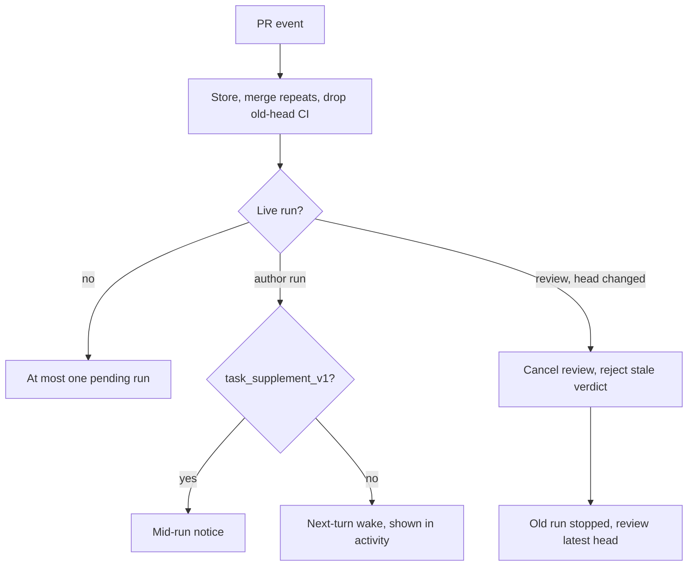

# CHE-2298 PR events during a live run

Status: plan, phase 1. No code yet. Inputs: Gemini then Sol (CHE-2298 thread). Code read at `81d28c3`.

## What a person will notice

| Case | Today | After |
|---|---|---|
| PR conflicts while the assignee runs | Wake dropped (`suppressed_active_run`); conflict missed or one more run | Live run gets a mid-run notice |
| Daemon cannot take mid-run notices, or run ends first | Dropped | One next-turn wake listing the pending causes, shown in activity |
| New head while a review runs | Review keeps going on the old head | Review cancelled, stale verdict rejected, new review on the latest head after the old run stops |
| Push / conflict / checks during an author run | May start another author run | Joins the live run or the one pending turn; repeats merged |
| PR merged or closed during a run | No special handling | Work that only serves that PR stops; cleanup still runs |

## Approach

Store each PR event before delivery. Send structured facts (no PR-body text) through the existing `task_supplement_v1` channel; mark delivered only when the run took it in. One author run at a time per issue; independent reviewer runs stay allowed. A review binds to one SHA. Track conflict changes, not only head changes (base moved). Ignore old-head CI and out-of-order webhooks.

## Steps

| # | Step | Owner | Estimate | Stage |
|---|---|---|---|---|
| a | Stored PR events, mid-run notice, next-turn fallback | write-eligible X99 agent | 2 h x 2 | 1 |
| b | Review SHA binding, cancel on new head, stale verdict rejection | write-eligible X99 agent | 2 h | 2 |
| c | Merged/closed and draft/ready handling | write-eligible X99 agent | 2 h | 2 |

Each step is a test-first server PR in the fork. One switch per event type; off = today's path. Review gates: none in the project line.

## Risks (1 low - 5 high)

| Technical | Security | Rollback | Token cost | Conflict | Operations | Single-agent |
|---|---|---|---|---|---|---|
| 4 (cancel/finish, delivery/turn-end races) | 2 | 2 | 2 | 3 (CHE-2297, CHE-2295 step 4 C) | 3 (`task_supplement_v1` per host not verified) | 2 |

## Open question for Cheese

D1, which runs count against the budget: **A** only completed new runs (a broken run loops for free), or **B** (recommended) reserve 1 slot on admission, refund only for a review the server cancelled because the head changed; tokens never refunded.

