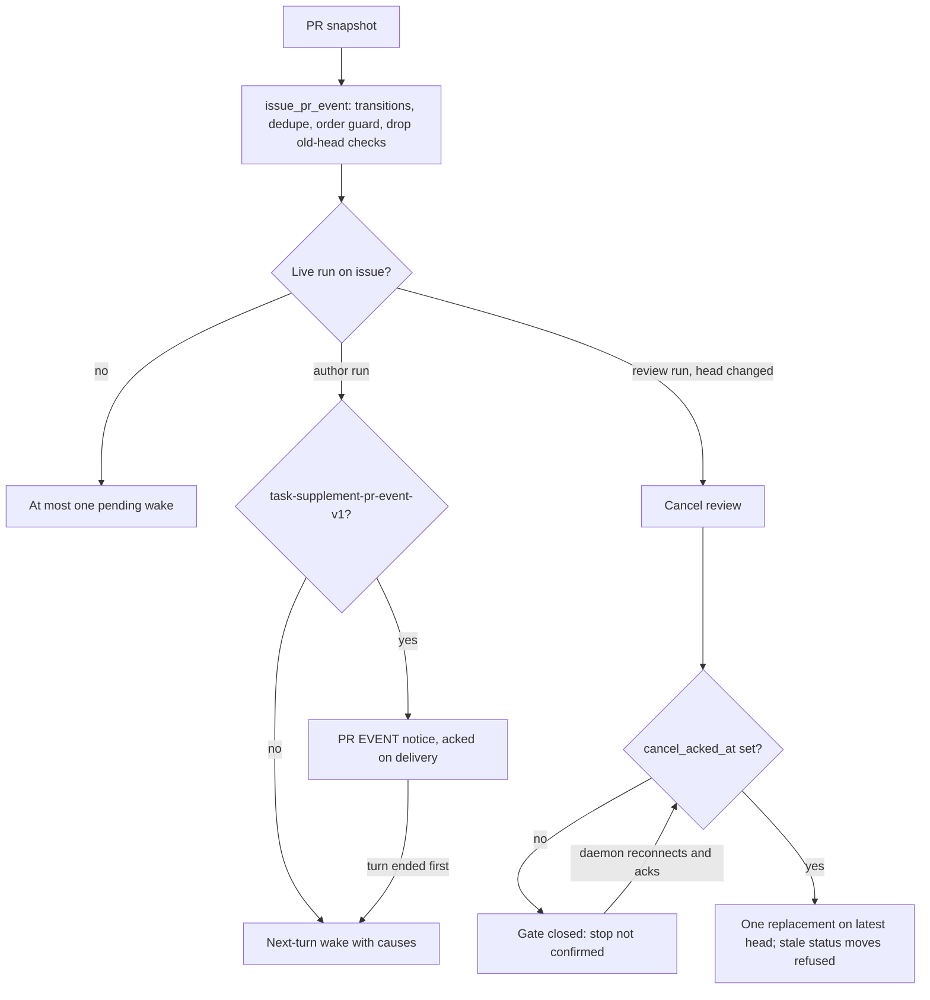

# CHE-2298 PR events during a live run

Status: plan, revision 4. No code yet. Inputs: Gemini then Sol (CHE-2298 thread); Sol's CHANGES REQUESTED on revision 1 (`2fb227f`), revision 2 (`e085739`) and revision 3 (`fa3f707`). Code read at `81d28c3`.

## What a person will notice

| Case | Today | After |
|---|---|---|
| PR conflicts while the assignee runs | Wake dropped (`suppressed_active_run`, `issue_wakeup_system.go:1386`); conflict missed or one more run | Live run gets a mid-run notice labelled as a system PR event |
| Daemon cannot take PR-event notices, or run ends first | Dropped | One next-turn wake listing the pending causes, shown in activity |
| New head while a review runs | Review keeps going on the old head | Review cancelled; new review on the latest head only after the old run is proven stopped; the old run's late status move is refused |
| Push / conflict / checks during an author run | May start another author run | Joins the live run or the one pending turn; repeats merged |
| PR merged or closed during a run | No special handling | Work that only serves that PR stops; cleanup still runs |
| Event switch turned off | n/a | No new events of that type are captured; already-accepted events still drain or stay visible |

## Approach

1. **PR event store.** New table `issue_pr_event` (no foreign keys, repo rule): issue, PR, kind (`conflict`, `head_changed`, `checks_failed`, `merged`, `closed`, `draft`, `ready`), head SHA, base SHA, observed-at, dedupe key, status (`accepted`, `delivering`, `delivered`, `next_turn`, `superseded`). Capture runs on the existing PR snapshot path. Conflict is tracked as a transition (`mergeable` false after true), so a moved base raises it with no new head. An event older than the stored latest for that PR (head order, then snapshot time) is stored as `superseded` and never delivered: force-pushes and out-of-order webhooks cannot restore an old candidate. Checks for a non-current head are dropped.
2. **Typed delivery, member path unchanged.** `task_supplement` keys on `comment_id` and its claim joins `comment` (`supplement.sql:200`); the daemon labels every supplement as human guidance (`task_supplement.go:90`). PR events do not reuse that row or that text. New delivery table `task_pr_event_delivery` (task, event, status, attempt count, same pending/delivering/delivered/failed states and ack rules). New capability `task-supplement-pr-event-v1`, recorded in its own table `task_pr_event_capability` (one row per task, unique on `task_id`). `task_supplement_capability` stays one row per task (`540_task_supplement_capability_index.up.sql`) and keeps `task-supplement-v1`; it is not migrated or overwritten, so member steering and PR-event delivery coexist on the same task. New claim and ack endpoints. The daemon formats it as `[PR EVENT] System:` with structured fields only (kind, PR number, old/new SHA, check name); no PR body, title or comment text; no member author. A daemon without the new capability never receives PR events through the mid-run channel; it gets the next-turn fallback. Member-comment steering keeps its table, claim query, text and tests unchanged.
3. **Next-turn fallback.** No new capability, a claim that loses the race with turn end (`failed` / `turn_ended`), or no live run: keep at most one pending wake per issue that lists every undelivered cause. It replaces the `suppressed_active_run` drop for PR events only. Activity shows "PR event queued for next turn: <causes>".
4. **Stop proof before a replacement.** Today cancel marks the task terminal and notifies at once (`task.go:3391`); that is not proof the runner exited. The daemon already sends a cancel-ack after its drain (`client.go:569`), used only for chat finalize. Persist it for every task as `cancel_acked_at`. The only automatic stop proof is `cancel_acked_at`. Offline expiry is not stop proof: the daemon ignores network errors while polling (`daemon.go:5648`), so a partitioned review can keep running. Without an ack the gate stays closed, also beyond the reconnect grace; activity shows "stop not confirmed". The task stays terminal on the server, so a daemon that reconnects sees the terminal status, interrupts the run and sends the ack, which opens the gate. There is no manual release: no member, no agent and no timer opens the gate without `cancel_acked_at`. The gate covers every new review run for the same (issue, PR, review step), including one a person triggers by moving the status; such a run is refused and activity shows "stop not confirmed for run <id>". Recovery is to bring the old run's daemon back online so it acks. A daemon host that never returns leaves the gate closed and visible; process-level fencing for that case is open question 2. The stop gate is one service function shared by steps b2 and c1.
5. **Review SHA binding.** A review task records PR id, head SHA and review step (the workflow step that handed it off). A new head cancels that review through the stop gate and creates one pending replacement keyed on (issue, PR, review step). Another push while the old run drains updates that pending replacement's head; it never adds a second one. When the old run finishes after supersede, its status moves on the issue are refused and activity shows "verdict for <old SHA> is stale". Author runs are not cancelled.
6. **Rollback.** One switch per event kind. Off stops new capture of that kind. Events already accepted keep draining through typed delivery or the next-turn wake; none are deleted; pending causes stay visible in activity and survive a server restart because they are stored. Today's drop path is not restored for accepted events.
7. **Budget.** The stop gate records cancel reason `superseded_head` on the cancelled review. Whether that refunds a run slot (D1) is decided in CHE-2297, which owns counting and grants. This plan adds no grant.

## Steps

| # | Step | Depends on | Owner | Estimate | Stage |
|---|---|---|---|---|---|
| a1 | `issue_pr_event` table, capture on snapshot, conflict transitions, dedupe, out-of-order and old-head-check guard, per-kind capture switch | - | write-eligible X99 agent | 2 h | 1 |
| b1 | Persist cancel-ack as `cancel_acked_at`; shared stop gate (ack only, no manual release); gate also refuses status-triggered review runs; "stop not confirmed" activity | - | write-eligible X99 agent | 2 h | 1 |
| a2 | `task_pr_event_capability`, `task_pr_event_delivery`, capability `task-supplement-pr-event-v1`, claim/ack endpoints, daemon `[PR EVENT]` formatter and capability report | a1 | write-eligible X99 agent | 2 h | 2 |
| b2 | Review SHA binding, cancel via stop gate, single coalesced replacement, stale status-move refusal, `superseded_head` reason | a1, b1 | write-eligible X99 agent | 2 h | 2 |
| a3 | Next-turn fallback replacing `suppressed_active_run` for PR events; turn-end race; switch-off drain | a2 | write-eligible X99 agent | 2 h | 3 |
| c1 | Merged/closed stops PR-only work via stop gate (cleanup still runs); draft/ready as notice only | a2, b1 | write-eligible X99 agent | 2 h | 3 |

Each step is a test-first server PR in the fork, built on X99. Daemon changes ship in a2; reaching each host's daemon is a separate rollout under existing deploy gates. Review gates: none in the project line.

## Required tests (red first)

| Step | Tests |
|---|---|
| a1 | Base moved → conflict event with same head; repeat snapshot → one event; older webhook after newer → `superseded`; checks on old head dropped; switch off → no capture |
| b1 | Ack sets `cancel_acked_at` → gate opens; no ack, runtime offline beyond grace → gate stays closed; partitioned daemon reconnects, interrupts, acks → gate opens; partitioned runner still active, no ack, member moves the issue to the review step → no review run starts, activity shows "stop not confirmed" with the member as actor; agent status move in the same state → refused the same way; replayed ack idempotent |
| a2 | New-capability daemon receives `[PR EVENT]` with no member author; legacy daemon receives none via mid-run channel; one task with both capabilities receives a member comment and a PR event in the same run; `task_supplement_capability` row unchanged; member-comment steering output unchanged byte for byte |
| b2 | New head → one replacement after ack; second push while draining → same replacement, new head; late finish of old review → status move refused, stale activity row; author run untouched |
| a3 | Legacy daemon → one next-turn wake with all causes; delivery loses race with turn end → cause moves to next turn; switch off with pending causes, then restart → causes still delivered or visible |
| c1 | Merge during author run → PR-only work stopped via gate, cleanup runs; draft/ready → notice only, no new run |

## Risks (1 low - 5 high)

| Axis | Score | Why / mitigation |
|---|---|---|
| Technical | 4 | Races: cancel vs finish, delivery vs turn end, webhook order. Mitigated by stop gate, stored events, ordered capture; still the main risk |
| Security | 2 | Typed envelope, system provenance, structured fields only, no member author fabricated; separate capability table, so the member path is not widened |
| Rollback | 2 | Switch stops capture only; accepted events drain and survive restart |
| Token cost | 2 | Conditional on CHE-2297 admission caps. One pending replacement per (issue, PR, review step) bounds the queue, not compute |
| Conflict | 3 | CHE-2297 (D1, counting), CHE-2295 step 4 option C (server stale-PR return uses the same snapshot path) |
| Operations | 3 | Typed delivery needs daemon rollout per host; until then hosts use the fallback. Per-host capability not verified |
| Single-agent | 2 | Any write-eligible X99 agent can build each step |

## Open questions

1. D1 (which runs count; refund for `superseded_head`) moves to CHE-2297. Not decided here.
2. Whether a daemon restart can report fenced tasks (process-level proof without the ack). Not in this plan; until then a lost ack needs the daemon to reconnect, and a host that never returns keeps the gate closed.

