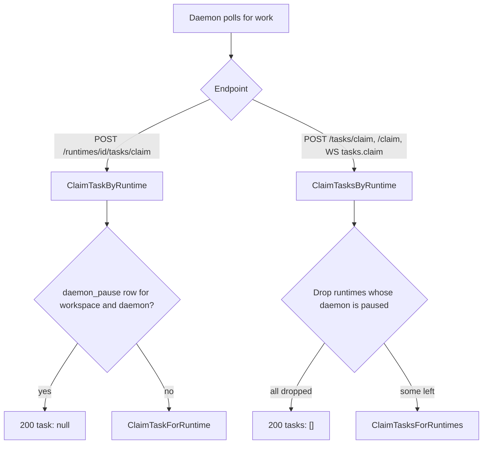

# CHE-2430 Machine pause, layer L1

Status: spec. Server part implemented in this PR. UI part waits for design approval (see "Open gates"). Code read at `f4960da0d`. Parent: CHE-2429.

reflect: unavailable. Hindsight `reflect` on `multica-org` via `POST http://127.0.0.1:8888/v1/default/banks/multica-org/reflect` returned `Authentication failed: Invalid API key`, and the Hindsight MCP tools are not exposed in this run. No prior memory was cited.

## What a person will notice

| Case | Today | After L1 |
|---|---|---|
| Stop a machine taking work | Shell on the host: `multica daemon maintenance acquire`, 1 h cap, in memory | Pause button on the Runtimes page. Stored on the server. No expiry |
| Is it safe to shut down? | Run `multica daemon status` on the host | Page shows "Draining: N tasks left", then "Safe to shut down" |
| Daemon restarts while paused | Gate is lost | Still paused until Resume |
| Old daemon version | Cannot honour a new flag | Covered. The gate is on the server claim endpoints |
| Tasks queued for a paused machine | Claimed at once | Wait in the queue. No re-routing |

## Decided premises (from CHE-2429)

- The unit is the machine: one `daemon_id`. All runtimes on that daemon pause together.
- Pause stops new claims only. Running tasks finish, so pausing the machine that runs the implementing agent does not strand its own task.
- Suspend and invalid are a pause with a reason: `maintenance`, `incident`, `suspended`.

## Defaults for the three open questions

| Question | Default | Why |
|---|---|---|
| Auto-expiry? | Yes (Cheese, 29/10/2026): `maintenance` 2 h, `incident` and `suspended` 30 min. An expired pause is treated as not paused | A forgotten pause cannot hold a machine for ever. Resume at any time; re-pausing restarts the clock |
| Who may pause? | Machine (runtime) owner and workspace owner (Cheese, 29/10/2026). A workspace admin who is neither gets 403 | Narrower than Update (`canEditRuntime`). A private runtime of another member stays hidden (404), as today |
| Auto-stop at 0 tasks? | L2, opt-in per pause | The daemon then needs a manual start on the host. Not in L1 |

None of these is unsafe, so none blocks.

## Data model

Migration `785_daemon_pause`:

```sql
CREATE TABLE daemon_pause (
    workspace_id UUID NOT NULL,
    daemon_id TEXT NOT NULL,
    reason TEXT NOT NULL CHECK (reason IN ('maintenance', 'incident', 'suspended')),
    paused_by UUID,
    paused_at TIMESTAMPTZ NOT NULL DEFAULT now(),
    PRIMARY KEY (workspace_id, daemon_id)
);
```

The repo allows no foreign keys, so `DeleteWorkspace` removes the rows in application SQL. There is no daemon table. A daemon exists as `agent_runtime.daemon_id`, so the row is keyed by `(workspace_id, daemon_id)`. A machine that serves two workspaces is paused per workspace. Runtimes with a NULL `daemon_id` (cloud) cannot be paused.

## Claim gate



- The WebSocket claim replays through the HTTP handlers (`daemon_rpc.go`), so one gate per handler covers all three entry points.
- Gate runs after authorization and before promote, reclaim and claim. A pause check failure returns 500. The daemon retries. It never falls through to a claim.
- The batch claim can span workspaces, so the lookup uses `<workspace_id>|<daemon_id>` keys in one query.
- Queued tasks stay `queued` and are claimed after Resume. Running and dispatched tasks are untouched.

## API

| Call | Auth | Result |
|---|---|---|
| `PUT /api/runtimes/{runtimeId}/pause` body `{"reason": "maintenance"}` | machine owner or workspace owner | 200 `{reason, paused_by, paused_at, expires_at}`. Reason defaults to `maintenance`. Bad reason 400. Runtime without `daemon_id` 400 |
| `DELETE /api/runtimes/{runtimeId}/pause` | same | 204. Idempotent |
| `GET /api/runtimes` | unchanged | Each runtime gains `pause` (object or null) and `daemon_running_tasks` (dispatched, running and waiting tasks across all runtimes on its daemon; null without a daemon) |

Pause and resume publish the existing `daemon:register` refresh event so open Runtimes pages refetch.

## UI states (Runtimes page, Machine section)

Proposal only. The design loop decides the final form.

| State | Shows | Actions |
|---|---|---|
| Running | "Taking work. N tasks running" | Pause (reason menu), Update, Remove |
| Pausing, N > 0 | "Paused: <reason>. Draining: N tasks left" | Resume, Update, Remove |
| Drained, N = 0 | "Paused: <reason>. Safe to shut down" | Resume, Update, Remove |
| Offline | Existing offline state. Pause still allowed | Pause, Resume |
| Loading, error | Existing list states. Pause and Resume disabled while pending (`aria-busy`) | none |
| Member without rights | Read-only, with the reason in text | none |

Banner: the daemon owner sees "<machine> is paused: <reason>. N tasks left" until Resume. Audience rules for workspace owner and project lead are L4.

## Test plan

Test first (observed red then green, see the PR body):

1. Single claim on a paused daemon returns no task; a sibling runtime on another daemon still claims; Resume claims the queued task.
2. Batch claim on a paused daemon returns no tasks; Resume claims.
3. Pause API: bad reason 400, success body, both runtimes on the machine show the pause, queued task not counted, running task counted, resume idempotent.
4. Authorization: another member's private runtime 404; runtime without `daemon_id` 400.
5. Deleting a workspace removes its pause rows.

## Open gates and remaining risk

- Design approval: the Machine section and banner have no approved design. The doop MCP tools are not exposed in this run, so the design loop has not started. No UI code ships before approval.
- A dispatched task whose claim response was lost is normally reclaimed inside the claim call. While the machine is paused that reclaim also waits for Resume.
- The CLI `daemon maintenance` stays separate and in memory. L2 ([CHE-2673](CHE-2673-machine-pause-l2.md)) makes the daemon mirror the server pause; the two stay separate, both can hold at once.
- `daemon_running_tasks` counts server-side task state. A task the daemon already finished but has not yet reported still counts until the report arrives. This errs toward "not yet safe".
