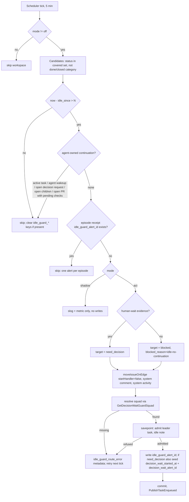

# CHE-2609 Idle started-issue guard (approach B, server-side)

Status: plan only, no code. Code read at `ec5533c56` (fork `cheese-work/multica`). Lines marked **unverified** were not read in this checkout.

## Problem

- CHE-2433 sat `in_progress` 17.5 h waiting on Cheese: no active run, no agent-owned continuation, nobody alerted.
- Approach A (CHE-2607, done) fixed the dotfiles continuation watchdog and the Tofu PULSE prompt. Both still need an agent/LLM sweep to run and to reason correctly.
- Approach B: the platform itself detects "started, idle, nothing agent-owned will wake it" and hands the issue to a person-visible state plus the accountable squad leader.

## Code facts this plan relies on

1. CHE-2591 L3 (CHE-2593) is already merged here: `server/internal/handler/decision_wait_guard.go`. It scans `need_decision` / Readiness `gated-human` (not `in_review`), and after 10 min with no open decision request admits ONE leader task. It stores the receipt in issue metadata (`decision_wait_started_at`, `decision_wait_alert_id`, `decision_wait_missing_request`, `decision_wait_route_error`; `:17`). An existing `decision_wait_alert_id` suppresses a second alert (`:132`). Settings live in `workspace.settings.decision_wait_guard` (`:21-26`). Design: `docs/designs/decision-wait-guard.md`.
2. L3 squad/leader routing: `GetDecisionWaitGuardSquad` (`server/pkg/db/queries/decision_wait_guard.sql`): squad assignee, then the latest leader task's squad, then the single active squad of an agent assignee. No arbitrary fallback.
3. Leader alert = an agent task, not a DM: `TaskService.EnqueueDecisionWaitLeaderTaskInTx` (`server/internal/service/task.go:1692`). It runs `guardIssueRunAllowed(... OriginDerived ...)`, so run budget, triage and stop gates apply. `TriggerSummary` is hard-coded to "Decision wait has no request" (`:1700`).
4. Decision requests need the issue's running task: `RequestDecision` returns 403 unless `X-Actor-Source == task_token` (`server/internal/handler/decision_request_api.go:17-20`). The server cannot open one itself. The DM decision card to Cheese is created when the leader's run opens the request.
5. `dmnotify` only coalesces agent DM replies into inbox items (`server/internal/dmnotify/dmnotify.go:35` `Reply`). It is not a push route for this guard.
6. System status moves already exist: `Handler.moveIssueOnEdge(ctx, issue, to, source, extra, startHandler)` (`server/internal/handler/issue_workflow_ci_advance.go:93`) uses `ExpectedRevision` (optimistic lock). The run-budget block uses it with `startHandler=false`, then sets `blocked_reason` metadata and writes a `system` activity (`server/internal/handler/issue_workflow_edges.go:290-317`).
7. System comments: `author_type='system'`, zero author UUID (`server/internal/handler/issue_child_done.go:646-653`).
8. Active run: `HasActiveTaskForIssue` = `queued|dispatched|running|waiting_local_directory` (`server/pkg/db/queries/agent.sql:1850`). `deferred` is not in that set.
9. Wakeups: `issue_wakeup.kind IN ('event','at','every','cron')` (`migrations/509_issue_wakeup.up.sql`); `condition jsonb`, `paused_reason` (`migrations/565_wakeup_conditions.up.sql`); `filter_actor_type/filter_actor_id` (`migrations/531_wakeup_actor_filter.up.sql`); `system_rule IN ('child_done','pr_merged','pr_checks_failed','pr_needs_attention','pr_checks_passed','workflow_edges')` (`migrations/693_workflow_edges_wakeup.up.sql:8`). Condition types: `issue_field`, `children_done`, `pull_request`, `other_issue`, `github_run` (`server/internal/service/issue_wakeup_condition.go:115-226`).
10. Linked PR state: `github_pull_request.state IN (open,closed,merged,draft)` and `checks_rollup_state` (`migrations/079_github_integration.up.sql:28`, `migrations/222_github_pr_api_snapshot.up.sql:24`). The value `PENDING` is the GitHub rollup enum; only `SUCCESS` is matched in code (`server/internal/handler/github.go:1427`). **Unverified** that `PENDING` is stored verbatim.
11. `SetIssueMetadataKey` bumps `issue.last_activity_at` and `updated_at` (`server/pkg/db/queries/issue.sql:747-751`). So neither column is a clean idle clock: guard writes would reset it.
12. Periodic jobs: DB-leased scheduler, e.g. `ChildEventSweepJob` (`server/internal/scheduler/jobs_child_done.go:19`, 30 s cadence, `ScopeGlobal`), registered in `server/cmd/server/main.go:859`. L3 instead runs in `DecisionWorker` every 5 s (`server/internal/handler/decision_worker.go:19`, `:258`).
13. Workflow step handlers: `none|agent|squad|member|project_lead|creator|human_by_role` (`server/internal/issueworkflow/issueworkflow.go:37-47`). `max_runs_per_issue` = `MaxRunsPerIssue` (`:203`).
14. CHE-2591 L1 merged (`da1309356`). L5 edges `decision.answered→in_progress`, `decision.expired→blocked`: no such event in `server/internal/issueworkflow` or handler code. **Not present** in this checkout.
15. `cheese-work/multica-dotfiles` `scripts/continuation_watchdog`: not checked out here. Its exact rules are **unverified**.

## Approach

One new pass, `checkIdleStartedIssues`, beside L3. It reuses L3's routing, leader-task admission and receipt pattern, and `moveIssueOnEdge`. No new table, no migration, no new notification channel.

Placement: a scheduler `JobSpec` `issue_idle_started_guard`, cadence 5 min, `ScopeGlobal`, `MaxAttempts: 1`, same shape as `ChildEventSweepJob`. The handler implements a one-method interface. Reason: N is hours; a 5 s worker pass is waste.

Idle clock (`idle_since`) = GREATEST of:
- latest non-system `comment.created_at` on the issue;
- latest `agent_task_queue` `created_at` / `completed_at` for the issue;
- latest `activity_log.created_at` with `actor_type IN ('member','agent')`.

System comments, system activity and metadata writes never count. So the guard's own writes cannot reset the clock.



Agent-owned continuation (any one skips the issue):
- Active task (fact 8).
- Enabled, unpaused `issue_wakeup` of kind `at|every|cron` with `next_fire_at` set.
- Enabled event wakeup filtered to an agent actor or to a non-comment event type.
- Enabled condition wakeup of type `children_done`, `pull_request`, `github_run` or `other_issue`.
- Enabled `system_rule` `pr_*` row while a linked PR is open.
- An open decision request (the decision flow wakes the asking agent on answer).
- Any child issue not in a done/closed category (the `child_done` rule wakes the parent; idle children are judged on their own).
- A linked PR in `open|draft` with `checks_rollup_state='PENDING'` (external CI).

Not a continuation:
- An event wakeup filtered to `filter_actor_type='member'` (CHE-2607 premise 2), and an unfiltered `comment.*` wakeup. Nothing agent-owned will post that comment.
- `issue_field` condition wakeups (status, assignee, label, property). They wait for someone to edit a field.
- A workflow step handler of type `agent`/`squad`. It names an owner, not pending work.

Human-wait evidence (target `need_decision`):
- Readiness `gated-human`; or
- an enabled member-filtered wakeup; or
- the latest non-system comment is by an agent and contains `mention://member/`; or
- the current workflow step handler is `member|project_lead|creator|human_by_role`.

Otherwise the agent side dropped the ball: target `blocked`. If the workspace has no `need_decision` status, or the workflow lacks the target (`def.Has`), use `blocked`. If neither status exists, alert only.

L3 interplay: on a `need_decision` move the guard seeds L3's own keys (`decision_wait_started_at` = now, `decision_wait_alert_id` = the idle leader task). L3 then treats the episode as already alerted (fact 1, `:132`). Result: one leader task, not two. When the leader opens a decision request, or the status leaves the wait, L3 clears its keys as today.

## Decisions

| # | Choice | Options | Recommended default | Reversible |
|---|---|---|---|---|
| D1 | N (idle threshold) | 2 h / 4 h / 8 h; setting `after_hours` 1-72 | **4 h**. Twice the 2 h scope rule; CHE-2433 would be caught at 4 h, not 17.5 h | yes, workspace setting |
| D2 | Covered statuses | all started / agent-owned subset | **`in_progress`, `agent_review`**. Out: `in_review` (human-owned, PR carries the ask), `need_decision` (L3 covers), `blocked` (already escalated, target), `merged` (waits on other PRs' human merge), `approved` (verdict status of review issues). Custom started statuses out unless listed in `statuses` | yes, setting list |
| D3 | Target status | always `need_decision` / always `blocked` / evidence rule | **evidence rule** above: human-wait evidence → `need_decision`, else `blocked` + `blocked_reason=idle-no-continuation` | yes, setting `target: auto|need_decision|blocked` |
| D4 | Decision request | guard creates one / leader creates one | **leader creates one.** The server cannot (fact 4). The leader run opens it; that sends the DM card to Cheese | yes |
| D5 | Who is notified | squad leader task / inbox item to requester / DM | **squad leader task** via L3 routing (facts 2-3). Plus one system comment on the issue. No member inbox or DM from the guard itself | yes |
| D6 | Mode / kill switch | featureflags key / workspace settings | **workspace settings** `idle_started_guard.mode: off|shadow|act`, code default `off`. Same store as L3; AGENTS.md "settings-first"; flip without deploy | yes |
| D7 | Cadence | 30 s / 5 min / 15 min | **5 min**. Error ≤ 5 min on a 4 h threshold | yes |
| D8 | Status move starts step handler | `startHandler` true / false | **false**, like the run-budget block (fact 6). The leader decides who runs next | yes |

Setting shape (`workspace.settings`):

```json
{"idle_started_guard": {"mode": "off", "after_hours": 4, "statuses": ["in_progress", "agent_review"], "target": "auto"}}
```

## Idempotency and flap safety

- Episode receipt in issue metadata, as L3 does: `idle_guard_alert_id`, `idle_guard_moved_at`, `idle_guard_route_error`.
- One transaction per issue. Lock order is copied from L3 (`LockWorkspaceForChatSessionCreate`, then `LockDecisionIssueNowait`). `NOWAIT` skips a contended issue until the next tick.
- Status move uses `ExpectedRevision`. A concurrent edit makes the move fail; the pass retries next tick against fresh state.
- Leader admission runs in a savepoint. A refusal leaves `idle_guard_route_error` and no alert id, so the next tick retries (L3 pattern, fact 1 `:155-173`).
- Reset: the episode keys are deleted when the issue leaves the covered set, or `idle_since` moves past `idle_guard_moved_at` (new member/agent activity). A new episode then starts from zero.
- Flap bound: after a move the issue is in `need_decision`/`blocked`, which are outside D2. It cannot be re-alerted until someone moves it back AND it idles N hours again.
- Shadow mode writes nothing. Each tick logs `idle_started_guard would_move` with issue, target, idle_since and continuation verdict, plus a counter metric. A metadata write would bump `last_activity_at` (fact 11) and change issue sort order.
- Run budget: the alert uses `OriginDerived` (fact 3). An issue with a spent budget is already `blocked` by the run-budget path, so it is outside D2.

## Interaction with other guards

- **L3 (merged):** seeded keys suppress a second leader task (see Approach). L3 still backs up the `need_decision` case if the guard's admission is refused: L3 retries with its own note after 10 min.
- **L5 (not present, fact 14):** when it lands, `decision.answered→in_progress` resets the idle clock through the member/agent activity it writes. No change is needed here. Re-check when L5 merges.
- **Continuation watchdog (multica-dotfiles, unverified):** while mode is `shadow`, the watchdog stays primary. When mode becomes `act`, the watchdog skips issues whose metadata has `idle_guard_alert_id` (one-line follow-up in multica-dotfiles), or drops its idle-started clause. The platform guard never reads watchdog state.
- **Tofu PULSE prompt (approach A):** same rule. The prompt skips an issue that already has `idle_guard_alert_id`.
- **Workflow engine:** `moveIssueOnEdge(..., startHandler=false)` writes a normal status change. Edges keyed on entering `blocked` / `need_decision` fire as for any system move.

## Test plan (red → green)

Location: `server/internal/handler/idle_started_guard_test.go`. Reuse `decisionWaitFixture`-style setup (`decision_wait_guard_test.go:13`) and `dbfx`. Age the clock with SQL on `comment.created_at` / `agent_task_queue.completed_at`, the same way `setWaitAge` does.

Run on X99 from the worktree: `make up`, then `cd server && go test ./internal/handler -run 'TestIdleStartedGuard' -count=1 -v`. Paste the red output (pass function missing or returning no move) and the green output into the PR body.

| Test | Setup | Expect |
|---|---|---|
| `TestIdleStartedGuardCHE2433Shape` | `in_progress`, squad assignee, last task `completed` 5 h ago, last comment by agent with `mention://member/`, one enabled event wakeup `comment.created` filtered to `member`, no active task, mode `act` | status `need_decision`; one leader task queued with idle note; `idle_guard_alert_id` = task id; `decision_wait_alert_id` seeded; one system comment |
| `TestIdleStartedGuardNoHumanEvidenceBlocks` | same, no member mention, no member wakeup | status `blocked`, `blocked_reason=idle-no-continuation`, leader task |
| `TestIdleStartedGuardSkipsActiveTask` | `running` task | no move, no task |
| `TestIdleStartedGuardSkipsAgentWakeup` | `at` wakeup with `next_fire_at` in 2 days | no move |
| `TestIdleStartedGuardSkipsOpenChildren` | one child `in_progress` | no move |
| `TestIdleStartedGuardSkipsPendingPRChecks` | linked open PR with `checks_rollup_state='PENDING'` | no move |
| `TestIdleStartedGuardSkipsOpenDecisionRequest` | open decision request | no move |
| `TestIdleStartedGuardRecentActivity` | member comment 1 h ago | no move |
| `TestIdleStartedGuardBoundaries` | idle 3h59m / 4h01m; `after_hours` 8 | move only past threshold |
| `TestIdleStartedGuardOncePerEpisode` | run the pass twice | one leader task; L3 pass afterwards adds none |
| `TestIdleStartedGuardShadowWritesNothing` | mode `shadow` | status, metadata, `revision`, `last_activity_at` unchanged |
| `TestIdleStartedGuardAdmissionFailureRetries` | leader `runtime_id` NULL, then restored | route error, then one task (mirror of L3 test `:47`) |
| `TestIdleStartedGuardStatusOutOfScope` | `in_review`, `need_decision`, `blocked`, `merged` | no move |
| `TestIdleStartedGuardRevisionRace` | bump `revision` between read and move | no move this tick, no task |

## Rollout

1. No migration. New sqlc file `server/pkg/db/queries/idle_started_guard.sql` (candidate scan + continuation probe); `make sqlc`.
2. Code default `mode: off`. Merged `main` auto-deploys to C00 under the fork's Standing Budget (multica fork listed). Read back health, digest and SHA within 15 min.
3. Set Cheese Work workspace `mode: shadow` (a reversible setting change). Run 7 days. Review the `would_move` log lines against the board: count of false positives and of true catches.
4. Switch to `act` only if shadow shows zero false positives on legitimate waits. This switch changes issue statuses automatically, so it is a product-direction call: ask Cheese with the shadow numbers.
5. Same week as `act`: the multica-dotfiles watchdog / PULSE skip rule (D-interaction above).
6. Kill switch: `mode: off` in workspace settings, no deploy.

## Estimate and PR split

Total about 9 h. Stack, each ≤ 4 h:

| PR | Content | Est |
|---|---|---|
| 1 | sqlc candidate + continuation query, idle clock, settings parse, eligibility fn, shadow-only pass, scheduler job wiring (`main.go`), tests for skips, boundaries, shadow | 4 h |
| 2 | act mode: target rule, `moveIssueOnEdge`, system comment and activity, leader admission (generalise `EnqueueDecisionWaitLeaderTaskInTx` to take the trigger summary), L3 key seeding, episode reset; CHE-2433-shape, once-per-episode, admission-retry and race tests | 4 h |
| 3 | `docs/designs/idle-started-guard.md` (settings, keys, interplay); multica-dotfiles watchdog skip rule (separate repo PR) | 1 h |

## Risks

- **Legit long waits.** External CI without a PR snapshot (snapshot client disabled, fact 10 note in `issue_wakeup_condition.go:283-286`), a build on another host, a vendor reply. Mitigation: the agent registers an `at`/`github_run` wakeup, which counts. Shadow week measures the rest.
- **Capacity queueing.** A task waiting for runtime capacity is `queued`, so it counts as active. `deferred` tasks do not count (fact 8). **Unverified** whether capacity waits ever use `deferred`; check in PR1.
- **Stage barriers.** A parent whose open children are all idle-waiting on a human: the parent is skipped and each child is judged alone. A child outside D2 (for example `in_review`) keeps the parent quiet. That is intended.
- **Ownership gaps.** No resolvable squad → status moves, alert does not, `idle_guard_route_error` stays visible. Same limit as L3.
- **Heuristic evidence.** `mention://member/` in the last agent comment can misjudge `need_decision` vs `blocked`. Both route to the same leader, so the cost is a wrong label, not a lost alert.
- **Scan cost.** Candidate query over covered-status issues every 5 min; no new index planned. Measure in shadow (`dbstats`) before `act`.
- **Watchdog double alert** until the multica-dotfiles skip rule lands (rollout step 5).

## Open questions for Cheese

1. **N:** 4 h (recommended), 2 h, or 8 h?
2. **Covered statuses:** `in_progress` + `agent_review` only (recommended), or also `approved` / `merged` / custom started statuses?
3. **Target status:** evidence rule `need_decision` vs `blocked` (recommended), or always `need_decision`?
4. **Who is notified:** squad leader task only (recommended; the leader opens the decision request that DMs you), or also a direct inbox item to the requester?
5. **Decision request:** confirm the guard does NOT open one itself (it cannot today; only a running task can). Adding a server-side decision request would widen L1 authority.
6. **Shadow → act:** approve the switch after the 7-day shadow review, or let it auto-apply under a 24 h veto window?
