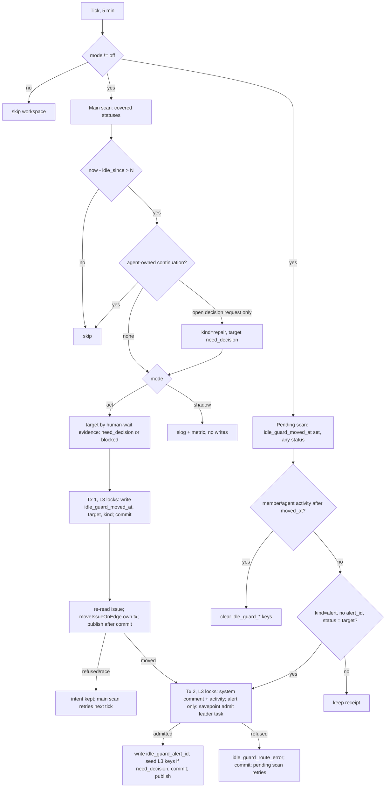

# CHE-2609 Idle started-issue guard (approach B, server-side)

Changes since first revision: review round 1 (x99-codex-sol-200k) — three-step write sequence replaces one transaction; separate pending scan and receipt lifecycle; open decision request on `in_progress` is repaired to `need_decision`; suppression and Standing Budget prerequisites gate `act`; red-test definition and closing-reference note fixed.

Status: plan only, no code. Code read at `ec5533c56` (fork `cheese-work/multica`). Lines marked **unverified** were not read in this checkout.

## Problem

- CHE-2433 sat `in_progress` 17.5 h waiting on Cheese: no active run, no agent-owned continuation, nobody alerted.
- Approach A (CHE-2607, done) fixed the dotfiles continuation watchdog and the Tofu PULSE prompt. Both still need an agent/LLM sweep to run and to reason correctly.
- Approach B: the platform itself detects "started, idle, nothing agent-owned will wake it" and hands the issue to a person-visible state plus the accountable squad leader.

## Code facts this plan relies on

1. CHE-2591 L3 (CHE-2593) is already merged here: `server/internal/handler/decision_wait_guard.go`. It scans `need_decision` / Readiness `gated-human` (not `in_review`), and after 10 min with no open decision request admits ONE leader task. It stores the receipt in issue metadata (`decision_wait_started_at`, `decision_wait_alert_id`, `decision_wait_missing_request`, `decision_wait_route_error`; `:17`). An existing `decision_wait_alert_id` suppresses a second alert (`:132`). An open request makes the issue ineligible and clears L3 keys (`:79-97`). Settings live in `workspace.settings.decision_wait_guard` (`:21-26`). Design: `docs/designs/decision-wait-guard.md`.
2. L3 squad/leader routing: `GetDecisionWaitGuardSquad` (`server/pkg/db/queries/decision_wait_guard.sql`): squad assignee, then the latest leader task's squad, then the single active squad of an agent assignee. No arbitrary fallback.
3. Leader alert = an agent task, not a DM: `TaskService.EnqueueDecisionWaitLeaderTaskInTx` (`server/internal/service/task.go:1692`). It runs `guardIssueRunAllowed(... OriginDerived ...)`, so run budget, triage and stop gates apply. `TriggerSummary` is hard-coded to "Decision wait has no request" (`:1700`).
4. Decision requests need the issue's running task: `RequestDecision` returns 403 unless `X-Actor-Source == task_token` (`server/internal/handler/decision_request_api.go:17-20`). The server cannot open one itself. The DM decision card to Cheese is created when the leader's run opens the request.
5. `dmnotify` only coalesces agent DM replies into inbox items (`server/internal/dmnotify/dmnotify.go:35` `Reply`). It is not a push route for this guard.
6. System status moves: `Handler.moveIssueOnEdge(ctx, issue, to, source, extra, startHandler)` (`server/internal/handler/issue_workflow_ci_advance.go:93`) uses `ExpectedRevision`. It writes through `updateIssueWithStatusGuard` (`:111`), which opens its OWN transaction (`server/internal/handler/issue.go:266-285`, `:289-313`) and takes `FOR UPDATE` on the issue row (`issue_workflow_write.go:175`, `issue.sql:128-135`). It publishes `issue:updated` after that commit (`:147`). `lockProject` must run "before any row lock" (`issue_workflow_write.go:85`). The run-budget block calls it with `startHandler=false`, then sets `blocked_reason` and a `system` activity (`issue_workflow_edges.go:290-317`).
7. System comments: `author_type='system'`, zero author UUID (`server/internal/handler/issue_child_done.go:646-653`).
8. Active run: `HasActiveTaskForIssue` = `queued|dispatched|running|waiting_local_directory` (`server/pkg/db/queries/agent.sql:1850`). `deferred` is not in that set.
9. Wakeups: `issue_wakeup.kind IN ('event','at','every','cron')` (`migrations/509_issue_wakeup.up.sql`); `condition jsonb`, `paused_reason` (`migrations/565_wakeup_conditions.up.sql`); `filter_actor_type/filter_actor_id` (`migrations/531_wakeup_actor_filter.up.sql`); `system_rule IN ('child_done','pr_merged','pr_checks_failed','pr_needs_attention','pr_checks_passed','workflow_edges')` (`migrations/693_workflow_edges_wakeup.up.sql:8`). Condition types: `issue_field`, `children_done`, `pull_request`, `other_issue`, `github_run` (`server/internal/service/issue_wakeup_condition.go:115-226`).
10. Linked PR state: `github_pull_request.state IN (open,closed,merged,draft)` and `checks_rollup_state` (`migrations/079_github_integration.up.sql:28`, `migrations/222_github_pr_api_snapshot.up.sql:24`). Only `SUCCESS` is matched in code (`server/internal/handler/github.go:1427`). **Unverified** that `PENDING` is stored verbatim.
11. `SetIssueMetadataKey` bumps `revision`, `last_activity_at` and `updated_at` (`server/pkg/db/queries/issue.sql:741-752`). So neither timestamp is a clean idle clock, and any metadata write invalidates a revision read before it.
12. L3 lock: `LockDecisionIssueNowait` = `FOR NO KEY UPDATE NOWAIT` (`server/pkg/db/queries/decision_action.sql:66-69`), taken after `LockWorkspaceForChatSessionCreate`.
13. Periodic jobs: DB-leased scheduler, e.g. `ChildEventSweepJob` (`server/internal/scheduler/jobs_child_done.go:19`, 30 s cadence, `ScopeGlobal`), registered in `server/cmd/server/main.go:859`. L3 instead runs in `DecisionWorker` every 5 s (`server/internal/handler/decision_worker.go:19`, `:258`).
14. Workflow step handlers: `none|agent|squad|member|project_lead|creator|human_by_role` (`server/internal/issueworkflow/issueworkflow.go:37-47`). `max_runs_per_issue` = `MaxRunsPerIssue` (`:203`).
15. CHE-2591 L1 merged (`da1309356`). L5 edges `decision.answered→in_progress`, `decision.expired→blocked`: **not present** in this checkout.
16. `cheese-work/multica-dotfiles` `scripts/continuation_watchdog`: not checked out here. Its exact rules are **unverified**.

## Approach

One new pass, `checkIdleStartedIssues`, beside L3. It reuses L3's routing, leader-task admission and receipt pattern, and `moveIssueOnEdge` unchanged. No new table, no migration, no new notification channel.

Placement: a scheduler `JobSpec` `issue_idle_started_guard`, cadence 5 min, `ScopeGlobal`, `MaxAttempts: 1`, same shape as `ChildEventSweepJob`. Reason: N is hours; a 5 s worker pass is waste.

Two scans per tick:
- **Main scan:** issues in the covered statuses (D2).
- **Pending scan:** issues in ANY status with `idle_guard_moved_at` set. It retries a missing alert and applies the receipt lifecycle below.

Idle clock (`idle_since`) = GREATEST of:
- latest non-system `comment.created_at` on the issue;
- latest `agent_task_queue` `created_at` / `completed_at` for the issue, except the guard's own alert task (`id = idle_guard_alert_id`);
- latest `activity_log.created_at` with `actor_type IN ('member','agent')`.

System comments, system activity and metadata writes never count. So the guard's own writes cannot reset the clock. The leader's own comments and activity do count.



Agent-owned continuation (any one skips the issue):
- Active task (fact 8).
- Enabled, unpaused `issue_wakeup` of kind `at|every|cron` with `next_fire_at` set.
- Enabled event wakeup filtered to an agent actor or to a non-comment event type.
- Enabled condition wakeup of type `children_done`, `pull_request`, `github_run` or `other_issue`.
- Enabled `system_rule` `pr_*` row while a linked PR is open.
- Any child issue not in a done/closed category (the `child_done` rule wakes the parent; idle children are judged on their own).
- A linked PR in `open|draft` with `checks_rollup_state='PENDING'` (external CI).

Not a continuation:
- An event wakeup filtered to `filter_actor_type='member'` (CHE-2607 premise 2), and an unfiltered `comment.*` wakeup. Nothing agent-owned will post that comment.
- `issue_field` condition wakeups (status, assignee, label, property). They wait for someone to edit a field.
- A workflow step handler of type `agent`/`squad`. It names an owner, not pending work.

Open decision request on an idle `in_progress` issue (CHE-2607 accepted premise: a human decision wait is `need_decision` + decision request, never `in_progress`):
- `kind=repair`. Move to `need_decision` and write one system comment. Keep the existing request; open no new ask.
- No leader task. The request already put the DM card in front of Cheese, and the answer wakes the asking agent. L3 stays silent because the open request makes the issue ineligible (fact 1, `:79-97`).
- If the workflow lacks `need_decision`, skip. The wait is legitimate; only the label is wrong.

Human-wait evidence (target `need_decision`, `kind=alert`):
- Readiness `gated-human`; or
- an enabled member-filtered wakeup; or
- the latest non-system comment is by an agent and contains `mention://member/`; or
- the current workflow step handler is `member|project_lead|creator|human_by_role`.

Otherwise the agent side dropped the ball: target `blocked`. If the workspace has no `need_decision` status, or the workflow lacks the target (`def.Has`), use `blocked`. If neither status exists, alert only.

L3 interplay: on a `need_decision` alert the guard seeds L3's own keys (`decision_wait_started_at` = now, `decision_wait_alert_id` = the idle leader task). L3 then treats the episode as already alerted (fact 1, `:132`). Result: one leader task, not two.

## Write sequence (transactions)

`moveIssueOnEdge` cannot run inside an L3-style transaction: its inner transaction would wait on the outer `FOR NO KEY UPDATE` row lock forever (facts 6, 12), and taking the issue lock before `lockProject` breaks its lock order. So the guard writes in three steps, each its own commit:

1. **Tx 1 (intent).** L3 locks (workspace `FOR KEY SHARE`, issue `NOWAIT`). Re-check eligibility under the lock. Write `idle_guard_moved_at` = now, `idle_guard_target`, `idle_guard_kind` (`alert|repair`). Commit. This bumps `revision` (fact 11).
2. **Move.** Re-read the issue (fresh revision). `moveIssueOnEdge(..., startHandler=false)` unchanged, with source `idle_started_guard`. It commits, then publishes. A revision race refuses the move; the intent stays and the main scan retries next tick, or the reset rule clears it after new activity.
3. **Tx 2 (notify).** L3 locks again. System comment and system activity. For `kind=alert`: leader admission in a savepoint; on success write `idle_guard_alert_id` and L3 seed keys and delete `idle_guard_route_error`; on refusal write `idle_guard_route_error`. Commit. Publish `comment:created` and `PublishTaskEnqueued` only after commit.

A crash between steps leaves a receipt the pending scan can find. No step holds a row lock while another step waits on it.

## Decisions

| # | Choice | Options | Recommended default | Reversible |
|---|---|---|---|---|
| D1 | N (idle threshold) | 2 h / 4 h / 8 h; setting `after_hours` 1-72 | **4 h**. Twice the 2 h scope rule; CHE-2433 would be caught at 4 h, not 17.5 h | yes, workspace setting |
| D2 | Covered statuses (main scan) | all started / agent-owned subset | **`in_progress`, `agent_review`**. Out: `in_review` (human-owned, PR carries the ask), `need_decision` (L3 covers), `blocked` (already escalated, target), `merged` (waits on other PRs' human merge), `approved` (verdict status of review issues). Custom started statuses out unless listed in `statuses` | yes, setting list |
| D3 | Target status | always `need_decision` / always `blocked` / evidence rule | **evidence rule** above; open request → repair to `need_decision` | yes, setting `target: auto|need_decision|blocked` |
| D4 | Decision request | guard creates one / leader creates one | **leader creates one.** The server cannot (fact 4) | yes |
| D5 | Who is notified | squad leader task / inbox item to requester / DM | **squad leader task** via L3 routing (facts 2-3), plus one system comment. Repair: system comment only | yes |
| D6 | Mode / kill switch | featureflags key / workspace settings | **workspace settings** `idle_started_guard.mode: off|shadow|act`, code default `off`. Same store as L3; flip without deploy | yes |
| D7 | Cadence | 30 s / 5 min / 15 min | **5 min**. Error ≤ 5 min on a 4 h threshold | yes |
| D8 | Status move starts step handler | `startHandler` true / false | **false**, like the run-budget block (fact 6). The leader decides who runs next | yes |

Setting shape (`workspace.settings`):

```json
{"idle_started_guard": {"mode": "off", "after_hours": 4, "statuses": ["in_progress", "agent_review"], "target": "auto"}}
```

## Receipts, idempotency and flap safety

- Receipt keys: `idle_guard_moved_at`, `idle_guard_target`, `idle_guard_kind`, `idle_guard_alert_id`, `idle_guard_route_error`.
- **Kept** while no member/agent activity is newer than `idle_guard_moved_at`, in ANY status. Leaving the covered set does NOT clear them; the watchdog/PULSE skip rule reads them.
- **Cleared** by the pending scan only when `idle_since > idle_guard_moved_at`. A new episode then starts from zero.
- Alert retry: pending scan, `kind=alert`, no `idle_guard_alert_id`, status still equals `idle_guard_target` → re-run Tx 2. Retry works while the issue sits in `blocked`, outside D2. If a person moved the issue, that is member activity and the reset applies instead.
- One alert per episode: an existing `idle_guard_alert_id` stops Tx 2.
- `NOWAIT` skips a contended issue until the next tick; the pass never waits on a row lock.
- Flap bound: after a move the issue is in `need_decision`/`blocked`, outside D2. It cannot be re-moved until someone moves it back AND it idles N hours again.
- Shadow mode writes nothing. Each tick logs `idle_started_guard would_move` with issue, target, kind, idle_since and continuation verdict, plus a counter metric. A metadata write would bump `last_activity_at` (fact 11) and change sort order.
- Run budget: the alert uses `OriginDerived` (fact 3). An issue with a spent budget is already `blocked` by the run-budget path, outside D2.
- Pending scan cost: a `metadata ? 'idle_guard_moved_at'` filter. No index planned; measure in shadow.

## Interaction with other guards

- **L3 (merged):** seeded keys suppress a second leader task. L3 still backs up the `need_decision` alert case if the guard's admission is refused: L3 retries with its own note after 10 min.
- **L5 (not present, fact 15):** when it lands, `decision.answered→in_progress` resets the idle clock through the activity it writes. Re-check when L5 merges.
- **Continuation watchdog (multica-dotfiles, unverified):** skips issues whose metadata has `idle_guard_moved_at`. Must be merged and verified before `act` (Rollout step 4). The platform guard never reads watchdog state.
- **Tofu PULSE prompt (approach A):** same skip rule, same gate.
- **Workflow engine:** `moveIssueOnEdge(..., startHandler=false)` writes a normal status change. Edges keyed on entering `blocked` / `need_decision` fire as for any system move.

## Test plan (red → green)

Location: `server/internal/handler/idle_started_guard_test.go`. Reuse `decisionWaitFixture`-style setup (`decision_wait_guard_test.go:13`) and `dbfx`. Age the clock with SQL on `comment.created_at` / `agent_task_queue.completed_at`, the same way `setWaitAge` does.

Run on X99 from the worktree: `make up`, then `cd server && go test ./internal/handler -run 'TestIdleStartedGuard' -count=1 -v`. Red = an assertion failure against a compiling stub pass that returns without a move. A missing function or a compile failure is not behavioral red. Paste the red and the green output into the PR body.

| Test | Setup | Expect |
|---|---|---|
| `TestIdleStartedGuardCHE2433Shape` | `in_progress`, squad assignee, last task `completed` 5 h ago, last comment by agent with `mention://member/`, one `comment.created` wakeup filtered to `member`, no active task, mode `act` | status `need_decision`; one leader task; `idle_guard_alert_id` = task id; `decision_wait_alert_id` seeded; one system comment |
| `TestIdleStartedGuardNoHumanEvidenceBlocks` | same, no member mention, no member wakeup | status `blocked`, `blocked_reason=idle-no-continuation`, leader task |
| `TestIdleStartedGuardRepairsOpenDecisionRequest` | idle `in_progress` with an open decision request | status `need_decision`; request unchanged and still open; no new request; no leader task; one system comment; `idle_guard_kind=repair`; L3 pass afterwards adds no task |
| `TestIdleStartedGuardSkipsActiveTask` | `running` task | no move, no task |
| `TestIdleStartedGuardSkipsAgentWakeup` | `at` wakeup with `next_fire_at` in 2 days | no move |
| `TestIdleStartedGuardSkipsOpenChildren` | one child `in_progress` | no move |
| `TestIdleStartedGuardSkipsPendingPRChecks` | linked open PR with `checks_rollup_state='PENDING'` | no move |
| `TestIdleStartedGuardRecentActivity` | member comment 1 h ago | no move |
| `TestIdleStartedGuardBoundaries` | idle 3h59m / 4h01m; `after_hours` 8 | move only past threshold |
| `TestIdleStartedGuardOncePerEpisode` | run the pass twice | one leader task; L3 pass afterwards adds none |
| `TestIdleStartedGuardShadowWritesNothing` | mode `shadow` | status, metadata, `revision`, `last_activity_at` unchanged |
| `TestIdleStartedGuardAdmissionRecoversWhileBlocked` | leader `runtime_id` NULL; pass; restore runtime; pass again | after pass 1: status `blocked`, route error, no alert id. After pass 2 (issue still `blocked`): exactly one task, route error cleared |
| `TestIdleStartedGuardReceiptRetained` | after an alert, run 3 more passes with no activity | receipts unchanged, still one task; then a member comment → next pass clears receipts |
| `TestIdleStartedGuardOwnAlertTaskDoesNotReset` | alert admitted, leader task `queued` | receipts kept on the next pass |
| `TestIdleStartedGuardStatusOutOfScope` | `in_review`, `need_decision`, `blocked`, `merged` | no move |
| `TestIdleStartedGuardRevisionRace` | bump `revision` between Tx 1 and the move | no move, no task; intent kept; next pass moves once |
| `TestIdleStartedGuardNotifyRollback` | force a Tx 2 error after the system comment insert | move committed; no system comment, no alert id; next pass writes exactly one comment and one task |
| `TestIdleStartedGuardBoundedUnderLock` | a second connection holds `FOR UPDATE` on the issue | pass returns within 5 s (`context.WithTimeout`), no writes; after release, next pass completes |

## Rollout

1. No migration. New sqlc file `server/pkg/db/queries/idle_started_guard.sql` (main scan, pending scan, continuation probe); `make sqlc`.
2. Code default `mode: off`. Auto-deploy of merged `main` to C00 under the Standing Budget needs: green required checks, an eligible preflight, and a passed rollback-by-digest drill for the multica fork. This plan does not establish any of them. If any is missing at merge time, Cheese approves the deploy. After deploy, read back health, digest and SHA within 15 min.
3. Set Cheese Work workspace `mode: shadow` (reversible setting change). Run 7 days. Review the `would_move` log lines against the board: false positives and true catches.
4. **Gate before `act`, all required:** (a) the multica-dotfiles watchdog and PULSE skip rule on `idle_guard_moved_at` is merged and deployed; (b) a verification run shows it skips an issue with a seeded receipt in `blocked` and `need_decision`; (c) receipt retention (`TestIdleStartedGuardReceiptRetained`) is green on main; (d) shadow shows zero false positives on legitimate waits.
5. Switch to `act`. This changes issue statuses automatically, so it is a product-direction call: ask Cheese with the shadow numbers and the gate evidence.
6. Kill switch: `mode: off` in workspace settings, no deploy.

## Estimate and PR split

Total about 11 h. Stack, each ≤ 4 h. This plan PR does not complete CHE-2609; the PR that lands the final implementation layer carries the closing reference.

| PR | Content | Est |
|---|---|---|
| 1 | sqlc main + pending scan + continuation query, idle clock, settings parse, eligibility fn, shadow-only pass, scheduler job wiring (`main.go`), tests for skips, boundaries, shadow, bounded-under-lock | 4 h |
| 2 | act mode: target rule, repair kind, Tx 1 / move / Tx 2 sequence, system comment and activity, leader admission (generalise `EnqueueDecisionWaitLeaderTaskInTx` to take the trigger summary), L3 key seeding, receipt lifecycle; CHE-2433-shape, repair, once-per-episode, recovery-while-blocked, retention, race and rollback tests | 4 h |
| 3 | `docs/designs/idle-started-guard.md` (settings, keys, interplay) | 1 h |
| 4 | multica-dotfiles watchdog + PULSE skip rule (separate repo PR) and its verification run; prerequisite of `act` | 2 h |

## Risks

- **Legit long waits.** External CI without a PR snapshot (`issue_wakeup_condition.go:283-286`), a build on another host, a vendor reply. Mitigation: the agent registers an `at`/`github_run` wakeup, which counts. Shadow week measures the rest.
- **Capacity queueing.** A task waiting for runtime capacity is `queued`, so it counts as active. `deferred` tasks do not count (fact 8). **Unverified** whether capacity waits ever use `deferred`; check in PR1.
- **Stage barriers.** A parent whose open children are all idle-waiting on a human: the parent is skipped and each child is judged alone. A child outside D2 keeps the parent quiet. Intended.
- **Ownership gaps.** No resolvable squad → status moves, alert does not, `idle_guard_route_error` stays visible; the pending scan keeps retrying. Same limit as L3.
- **Heuristic evidence.** `mention://member/` in the last agent comment can misjudge `need_decision` vs `blocked`. Both route to the same leader, so the cost is a wrong label, not a lost alert.
- **Scan cost.** Two queries every 5 min; no new index planned. Measure in shadow (`dbstats`) before `act`.
- **Intent without move.** Tx 1 commits before the move. A stuck intent on a covered issue is retried by the main scan; new activity clears it.

## Open questions for Cheese

1. **N:** 4 h (recommended), 2 h, or 8 h?
2. **Covered statuses:** `in_progress` + `agent_review` only (recommended), or also `approved` / `merged` / custom started statuses?
3. **Target status:** evidence rule `need_decision` vs `blocked` (recommended), or always `need_decision`?
4. **Who is notified:** squad leader task only (recommended; the leader opens the decision request that DMs you), or also a direct inbox item to the requester?
5. **Decision request:** confirm the guard does NOT open one itself (it cannot today; only a running task can). Adding a server-side decision request would widen L1 authority.
6. **Shadow → act:** approve the switch after the 7-day shadow review and the Rollout step 4 gate, or let it auto-apply under a 24 h veto window once the gate passes?
