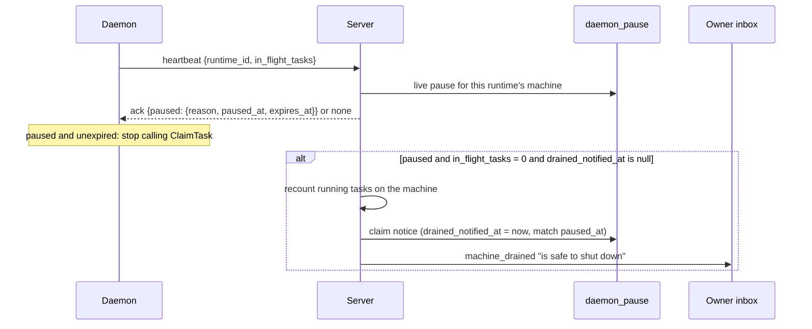

# CHE-2673: machine pause L2, daemon reconciliation and safe-to-shut-down

Part of CHE-2429. Builds on [L1](CHE-2430-machine-pause-l1.md).

## Outcome

A paused machine tells its owner once when its last task ends. The daemon stays up and idle. Nothing is stopped for you.

## Design

## Rules

| Topic | Rule |
| --- | --- |
| Transport | Same ack on HTTP `POST /api/daemon/heartbeat` and WS `daemon:heartbeat`. The WS path adds one PK-indexed join per heartbeat and no `getAgentRuntime` call |
| Daemon count | `in_flight_tasks` is `activeTasks`: claimed tasks, including preparation. Absent from old daemons, which therefore never notify |
| Server check | The daemon says 0, the server recounts running tasks for the machine. Both must say 0 |
| Once per pause | `drained_notified_at` is set by a compare-and-set on `paused_at`. A re-pause resets it and can notify again. A failed inbox write releases the claim |
| Recipient | Machine owner (`machine_owner_id`), in the pause row's workspace |
| Daemon gate | `tryEnterClaim` refuses while a pause is held and unexpired. The first ack without a pause clears it. `expires_at` also clears it, so a cut-off daemon cannot stay paused for ever |
| Bad ack | An unparseable `expires_at` counts as no pause (fail open) |
| `/health` | `paused`, `pause_reason`, `pause_expires_at` next to `maintenance_held` |
| CLI maintenance | Unchanged. It is a lease with a barrier; the pause is not. Both can hold at once |
| UI | Copy only: `machine_drained` type label in web, desktop and mobile. No layout change. The L1 banner already shows "Safe to shut down" at 0 `daemon_running_tasks`, so it is untouched |

## Out of scope

L3, L4, L5, re-routing, auto-stop.
