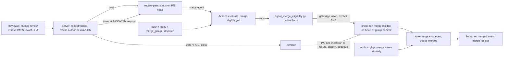

# CHE-5314 Auto-merge on a required review status

Status: plan, revision 2. No code yet. Changed since revision 1: the review of head `1e62865961f1b5c7ff53b652effc8d9ec55d6754` (3 P1) is answered in full. New: a revocation mechanism for green checks (section "Revocation"), an ordered rollback, and an authenticated publisher that binds each result to an explicit commit (section "Publisher and timer"). The plan is one page; revision 1 need not be read. Read live on 12 Nov 2026 (ICT): `cheese-work/multica` rulesets, `skills/multica-cheese-work-github` and `scripts/agent_merge_eligibility.py` at `multica-dotfiles` `ada5f8a`, server webhook code at `e2141667bc`. Review: x99-codex-terra (gate path, cross-lab).

## Problem

After the work is done, an agent merge takes 3 to 4 model runs: reviewer PASS, a merge run that waits for checks, a re-armed wakeup, the merge. Each hop is a wakeup. On 12 Nov, #1391 sat green 44 min after a PASS (CHE-5313: `checks_finished` wakeups did not fire), #1243 waited on a stale rule, #1250 and #1326 hit the run budget.

Goal: after the last required fact turns true, GitHub merges with no agent run. Every fact that turns false before the merge must stop it.

## What is already live (read back, not assumed)

| Fact | Evidence |
|---|---|
| Merge queue is on: `merge_method: MERGE`, group `ALLGREEN`, check timeout 30 min | ruleset `backend-tests` (id 22854843) |
| Required checks: `backend-tests`, `frontend`, `backend` (GitHub Actions app, integration 15368) | same ruleset |
| `protect main` has an empty required-checks list and no bypass actors | ruleset 25152849 |
| Repo allows auto-merge | `allow_auto_merge: true` |
| The merge decision is already a pure function of facts | `agent_merge_eligibility.py` (exit 0 = eligible) |
| The 24 h gate-path wait is skipped while the security gate is `disabled` (CHE-5126, CHE-5138); the veto check stays | script lines 83 to 86 |
| A pause variable never cancels a PR that is already queued or has auto-merge armed | `skills/multica-cheese-work-github` (`MAIN_RED_PAUSED` section) |
| The GitHub App token path, webhook intake and PR snapshots exist; the App's permission list is **not** readable from this run | `server/internal/handler/github.go` |

So the queue and auto-merge exist. What is missing is a **required check that is green only when the agent-merge rules hold**, and a way to turn it red again when a rule stops holding.

## Difference from the issue's proposal

The issue asks for a server-written `review-pass` commit status as the required check. With a merge queue that fails: the queue tests a temporary `gh-readonly-queue/...` commit with a different SHA, and a status posted on the PR head does not exist there. The queue would wait until the 30 min timeout and drop the PR. (GitHub's queue docs confirm only that CI must report on the merge-group commit; they name no status-versus-check rule, so the spike proves the behaviour.)

Chosen design, three parts:

1. **`review-pass` status (server, narrow, not required).** Written on the PR head. It says one thing: a cross-lab, non-author PASS exists for this exact head, with no later FAIL or veto. It carries the PASS time.
2. **`merge-eligible` check run (required, pinned to a gate App).** An Actions workflow reads `review-pass`, runs the existing `agent_merge_eligibility.py` unchanged, and publishes the result **as a check run on an explicit SHA** through the Checks API, with the gate App's token. The ruleset pins this App's `integration_id`. The same context is required on the PR head and on the merge-group commit.
3. **Revoker (server).** Turns a green result red, disarms auto-merge and dequeues when a fact flips after green. See "Revocation".

Why not the all-server variant: it needs a Go port of the eligibility rules that can drift from the script, and it depends on the webhook intake path that CHE-5313 shows losing events. The Actions variant reuses the script. The server still owns what only the server knows (verdicts, timers) and the revoker.

## Publisher and timer (answers finding 3)

**Rule: no result is published by its own workflow commit.** A scheduled run reports on its workflow commit and a `status` run reports on the default-branch commit, so neither can serve as the required result. Every result goes through one publisher step that calls `POST /repos/{repo}/check-runs` with `head_sha` set to the **explicit target**: the PR head for PR events, the merge-group commit (`github.sha` of the `merge_group` event) for queue events. The step stores the check run id and later updates that same run with `PATCH` (never a second run with the same name, whose precedence is unproven: probe U8).

**Why a gate App.** A required check pinned to the Actions app (integration 15368) can be forged by any workflow on a PR branch that declares `checks: write` and posts a check named `merge-eligible`. Pinning to a separate gate App closes that. Its private key is stored only as an Actions **environment** secret (`merge-gate`) that deployment-branch rules limit to `main`, so a PR-branch workflow cannot read it. Which App to use is decision D3.

**Triggers.** Two workflow files, neither with a job named `merge-eligible` (a skipped job named like a required check counts as passing, so no job may carry that name):

| Trigger | Target SHA | Workflow definition used |
|---|---|---|
| `pull_request_target` (opened, synchronize, reopened, ready_for_review, labeled, unlabeled), `status` (context `review-pass`), `workflow_dispatch` (PR number), `schedule` every 10 min | PR head, read from the PR, never from the event commit | `main` (a PR cannot edit it) |
| `merge_group` (`checks_requested`) | merge-group commit | the group commit (it includes the PR's edits; defended below) |

**Defence for the group workflow.** A PR cannot enter the queue until the **head** check is green. The head check is produced by the trusted `main` definition and the script refuses any PR that edits the workflow files, the ruleset files or the script (step b2). So a PR that rewrites the group workflow never reaches the queue. The group check then re-evaluates live facts as a second line, for drift on the base branch and for facts that changed since the head check.

**Timer for the gate-path wait.** The 24 h wait is set by the server, not by a cron. At PASS time the server stores a row in a `review_gate_timer` table (no foreign keys) with `fire_at = PASS time + 24 h`. The server's periodic loop (every 30 s) fires due rows by re-posting `review-pass` on the same SHA with description `gate-wait-elapsed`. That produces a `status` event, the evaluate workflow runs and publishes `merge-eligible` on the PR head. The evaluator computes `gate_veto_elapsed` from the status timestamp, never from the event time. While the security gate is `disabled` the wait is 0 and no timer row is written (same as the script today). The `schedule` run every 10 min is a safety net only: it re-evaluates every open PR that has `review-pass` and no green result, and raises an alert for every PR it turns green that the timer missed.

Stale cases:

- New push to a waiting PR: new head, no `review-pass` on it, red. The old timer row is keyed to the old SHA and fires into nothing (the re-post is skipped when the PR head differs).
- Merge-group commit that has been created: the timer never targets a group commit. A group commit gets only the live evaluation at `checks_requested` and, if a fact flips, the revoker.

## Mapping of each gate to a check state

| Today (agent judgement) | After |
|---|---|
| Signed cross-lab PASS on the exact head | `review-pass` status. A new push has no status on the new SHA, so it is red by construction |
| Tier receipt valid, classifier trusted, coverage complete | The evaluator runs `mechanical_tier.py verify` from a pinned `multica-dotfiles` SHA |
| Other required checks green | The evaluator reads them on the target SHA (it excludes itself) |
| `AGENT_MERGE_PAUSED`, `MAIN_RED_PAUSED` | The evaluator reads the two repo variables. Absent = green. A read error = red. A pause set later stops new evaluations and new arming. It does not cancel a PR already queued or armed: this is the **existing** rule and it is not changed here |
| Escalation paths and labels (migration, c00-config, design, two-signer) | The script refuses them, so the check stays red and Cheese merges |
| Gate-path 24 h wait | Server timer (above) |
| Gate-path veto (Cheese closes the PR or posts FAIL) | `multica review veto` by a member, or PR closed, or FAIL. The revoker acts at once, also on a queued PR |
| Author is not the merger | The server refuses a PASS from the PR's author agent or the same lab. The shared bot arms auto-merge, so the merger identity no longer carries the control |
| `scope_classified` (a human read the diff) | True only when the receipt has `coverage_complete`. Anything unassessed keeps the check red |

## Revocation (answers finding 1)

**Principle.** A green result on a queued commit stays valid until it is overwritten or the PR leaves the queue. So every fact that can flip must reach the revoker, and the revoker must act on the green run itself.

Facts that flip after green, and who sees them:

| Fact | Seen by | How it reaches the revoker |
|---|---|---|
| Veto, FAIL verdict | Server (the CLI call is recorded there) | Immediate, in the same transaction as the verdict row |
| PR closed, converted to draft, new head pushed, labelled with an escalation label | GitHub webhook; reconcile loop | Webhook intake plus the reconcile loop below (the loop covers lost events, as in CHE-5313) |
| Required check on the target turned red | GitHub | Native: the queue fails the group |
| Pause variable set | Not revoked (existing rule), see mapping | - |
| Writer outage | Server | Outbox below |

**Revoker actions, in this order, for each affected PR:**

1. `PATCH` the stored `merge-eligible` check run (head and, if queued, group commit) to `failure`.
2. `disablePullRequestAutoMerge` (GraphQL).
3. `dequeuePullRequest` if the PR is in the queue.
4. Read back: `autoMergeRequest` is null and no `mergeQueueEntry`. Record the result. Repeat 1 to 3 up to 3 times with backoff.
5. If the read back still shows an entry after the retries: alert Cheese (not an agent run) and stop. A failed revocation is never silent.

**Reconcile loop.** The server lists every open PR that has an `autoMergeRequest` or a `mergeQueueEntry`, every 60 s. For each PR it compares the recorded verdict state with GitHub. Any PR whose state is not "cleared" gets the revoker actions. This covers lost events and a crash between the verdict row and the GitHub call.

**Outbox.** A verdict row and its pending GitHub effect (status write, revoke) are written together in one transaction. A worker applies the effect, marks it done after the read back, and retries on failure. A server outage therefore delays the effect and never drops it. While the worker is down, `review-pass` cannot become newly green (it is written by the same worker), so only revocation is delayed; the reconcile loop completes it on restart.

**Ordering that shrinks the race.** The group-commit evaluator waits (bounded to 20 min, below the 30 min queue timeout, as one Actions job and not an agent run) until the other required checks on that commit have completed, then reads live facts last and publishes. With this order the open window is the time between the final publish and the queue's merge call, which is seconds, not the length of the test run.

**Residual race, stated.** A revoke that arrives after the final publish and before the queue's merge call can lose. Today's manual lane has the same window (the agent reads facts, then runs `gh pr merge`). The plan does not claim to close it. It makes the window seconds and records it: a revoke that finds the PR already merged is logged as `revoked-after-merge` with both timestamps and raises an alert.

## Steps

| # | Step | Depends on | Estimate | Stage |
|---|---|---|---|---|
| s0 | **Spike on a scratch repo** (below). Output: a table of U1 to U9 answers | - | 2 h | 1 |
| a1 | Server: `review_verdict` table, `multica review verdict` and `multica review veto`; agent identity from the authenticated task, never parsed comment text; cross-lab and non-author check; outbox table; no FK | s0 | 2 h | 2 |
| a2 | Server: post `review-pass` on the PR head on verdict, veto and new head (`pending`: "no PASS on <sha7>"); PR author agent and lab resolved server-side | a1 | 2 h | 2 |
| a3 | Server: `review_gate_timer` rows and the 30 s firing loop | a2 | 1.5 h | 2 |
| a4 | Server: revoker (check-run PATCH, disarm, dequeue, read back) and the 60 s reconcile loop | a1, s0 | 2 h | 2 |
| b1 | `merge-eligible.yml` (head triggers) and `merge-eligible-group.yml` (merge_group) with the publisher step, in shadow (publishing a differently named check, `merge-eligible-shadow`) in `cheese-work/multica`; script and classifier pinned to a `multica-dotfiles` SHA | s0 | 2 h | 2 |
| b2 | Add the workflow files, ruleset files and the script path to `CHEESE_PATH_RES` in the script (a PR that edits the gate stays Cheese's) | b1 | 1 h | 2 |
| c1 | Shadow period, 7 days: compare `merge-eligible-shadow` against each real agent merge decision. Pass: zero green-where-agents-refused, at most 5 % red-where-agents-merged, each explained | a2, a3, b1 | 7 days wait | 3 |
| c2 | Ruleset change (Cheese, one decision card): new ruleset `merge-eligible` that only adds the required check, pinned to the gate App | c1, a4 | 15 min | 3 |
| d1 | Skill and workflow text: author runs `gh pr merge <n> --auto --match-head-commit <sha>` when marking ready; delete the merge-run and re-armed-wakeup text (CHE-3683) | c2 | 1 h | 4 |
| d2 | Server: merge receipt on the `merged` event, replacing the agent-posted receipt; digest source unchanged | c2 | 2 h | 4 |
| e1 | Measure panel and alert (below) | a2 | 1.5 h | 3 |
| r1 | `scripts/automerge-revoke-all` (GraphQL: disarm and dequeue every armed or queued PR, then read back) used by the rollback; tested in the scratch repo | a4 | 1 h | 3 |

Each code step is a test-first PR built on X99. Step c1 waits on a time condition, so it ends the run with a wakeup, never a poll.

## Spike (s0): nine unknowns, each with a probe

| # | Unknown | Probe | If the answer is no |
|---|---|---|---|
| U1 | Does the Multica App have `statuses: write`, `checks: write`, and pull-request write for the disarm and dequeue mutations? | Call each endpoint with an installation token | Cheese approves a permission upgrade on the App (D3) |
| U2 | Is a required check missing on the PR head enough to stop auto-merge from enqueuing, and does a check run published for the head by `pull_request_target` satisfy it? | Throwaway ruleset on the scratch repo | Use `pull_request` plus a required-workflows rule pinned to the base branch |
| U3 | Does an armed PR keep auto-merge after a new head push, and after queue removal? | Scratch PR, push, force a dequeue | Author re-arms in the ready flow; CHE-4230's dequeue wake covers removal |
| U4 | Does `merge_group` give the group commit as `github.sha` and the PR number from `head_ref` (`gh-readonly-queue/main/pr-N-<sha>`)? | Read `github.event.merge_group` on a scratch run | Look the PR up by the queue's `head_sha` parents |
| U5 | Can `GITHUB_TOKEN` read repo Actions variables? | `gh variable list` in a workflow | Use the gate App token for the read |
| U6 | Does a required context pinned to `integration_id` reject a check run or status from another actor? | Post the same context as a different actor | Reject results whose creator is not the gate App inside the evaluator |
| U7 | Can a check run be created for an arbitrary `head_sha` (a PR head and a group commit) by the gate App from a scheduled or dispatched workflow, and does the queue accept it? | Create it from a `schedule` and a `workflow_dispatch` run | Server publishes instead (needs the `merge_group` webhook subscription) |
| U8 | If a check run is `PATCH`ed from `success` to `failure` while the group is waiting in the queue, does the queue drop the group? Which run counts when two runs share a name? | Scratch queue with a slow second check | Revoker falls back to disarm and dequeue only; document the wider race |
| U9 | Does the environment `merge-gate` secret stay unreadable from a workflow on a PR branch, including a branch named `gh-readonly-queue/main/...`? | Workflow on such branches tries to read it | Add a ruleset that restricts creation of `gh-readonly-queue/**` refs; if that fails, the group workflow does not mint tokens and only the head check is required |

## Rollback (answers finding 2)

**The ordering matters.** Disabling the new ruleset or the writer does not turn an existing green result red. A PR that is already armed or queued would then merge without the new gate. So rollback is a script with a verified gate between steps. Do not skip a step or reorder.

| Step | Action | Verify before the next step |
|---|---|---|
| R1 | Authors stop arming: revert the d1 text, or set the repo flag `AUTO_MERGE_ARMING_OFF`. The evaluator publishes red for every PR while the flag exists | New PRs show a red `merge-eligible` |
| R2 | Run `automerge-revoke-all`: PATCH the stored check runs to `failure`, disarm auto-merge, dequeue every queued PR | - |
| R3 | Read back with GraphQL: zero open PRs with `autoMergeRequest` and zero with a `mergeQueueEntry`. If not zero, repeat R2 up to 3 times; if still not zero, **stop and alert** (do not continue) | The count is 0 |
| R4 | Set `enforcement: disabled` on the `merge-eligible` ruleset (one call). The queue and the existing required checks are untouched | Ruleset readback shows `disabled` |
| R5 | Turn the server writer and timer off by feature flag. The revoker and the reconcile loop stay on in disarm-only mode until the d1 revert has merged, so a stray armed PR is still caught | Writer idle; reconcile loop reports 0 |
| R6 | Agents return to the CHE-2008 manual merge | - |

Time: R1 to R4 take under 10 min when the script works. Failure mode that matters: the server is down. Nothing new turns green (the writer is the server), the alert fires, and R2 to R4 can run from X99 without the server because `automerge-revoke-all` uses only the GitHub API.

## Test-first list (red before green, per Test-First Practice)

| Step | Tests |
|---|---|
| a1 | PASS from the author agent → refused; PASS from the same lab → refused; PASS for an old SHA → no effect on the new head; verdict row keyed to the authenticated agent id, comment text ignored; veto by a non-member → refused; verdict row and outbox row commit together or neither does |
| a2 | PASS → `success` on that SHA only; new push → `pending` on the new SHA; FAIL after PASS → `failure`; veto → `failure`; status write error → retried by the outbox, then alert (never a silent skip) |
| a3 | Fire at 23 h 59 min 30 s → not fired; at 24 h 00 min 30 s → fired once; two server instances → one post (row claim); head changed before fire → no post; wait is 0 when the security gate is disabled; server down at 24 h → fires on restart |
| a4 | Veto on a queued PR with a green group run → run patched to `failure`, auto-merge disarmed, dequeued, read back clean; revoke call fails twice then succeeds → retried; fails 3 times → alert, no silent success; PR already merged when the revoke lands → `revoked-after-merge` logged and alerted; webhook lost → the 60 s reconcile loop revokes within 90 s; crash between verdict row and GitHub call → effect applied after restart |
| b1 | Evaluator on fixture PRs: Tier 0 docs PR with PASS → exit 0 and publisher called with the PR head SHA (not the event SHA); no `review-pass` → red; `review-pass` created by a different actor → red; either pause variable present → red; variable read error → red; migration path → red; mixed PR with one escalation path → red; gate-path PR at 23 h → red, at 25 h → green (only when the security gate is not disabled); `schedule` run publishes to each waiting PR head, never to its own commit; publisher error → job fails closed |
| b1 (group) | Group commit with PASS and green checks → green on the group SHA; a fact flipped between head and group evaluation → red; other required check still running → evaluator waits, then reads facts last; wait exceeds 20 min → red |
| b2 | A PR that edits a workflow file, a ruleset file or the script → red |
| c2 | A job named `merge-eligible` that is skipped does not satisfy the ruleset (fixture workflow with a skipped job); a check run from the Actions app with the same name is rejected by the `integration_id` pin |
| r1 | Fixture: 2 armed PRs, 1 queued PR, 1 plain open PR → after the script, 0 armed or queued and the plain PR untouched; writer shutdown before the script → armed PRs stay revocable; read-back count of 1 → exit non-zero and no ruleset change |
| d2 | `merged` event → one receipt with PR URL, head SHA, tier, checks, PASS link, merge method, merge SHA; replayed event → no second receipt |

## Risks (1 low to 5 high)

| Axis | Score | Why and mitigation |
|---|---|---|
| Technical | 4 | Nine unknowns, all probed in s0 before any change to `multica`. U7 and U8 decide whether the Actions publisher works; the fallback is the server publisher with a new webhook subscription |
| Security | 4 | A forged green `merge-eligible` merges anything. Mitigations: required check pinned to a gate App whose key sits in a `main`-only environment, head check produced by a `main` workflow, script and classifier from a pinned SHA, the gate files in the escalation list, `review-pass` creator checked. This plan is a gate path: cross-lab review, and the ruleset change and the App choice are Cheese's |
| Rollback | 2 | Ordered script with verified gates; the dangerous step order is the one the script forbids. Needs `automerge-revoke-all` tested (r1) |
| Conflict | 3 | CHE-5313 (wakeups) is fixed separately and this removes the dependency; CHE-4230 dequeue wake stays; CHE-3123 author-is-not-merger changes as stated above |
| Cost | 1 | One lightweight Actions job per PR event, one bounded wait job per queued PR; fewer model runs |
| Single agent | 2 | Server steps (a1 to a4, r1) and workflow steps (b1, b2) are independent |

## Decisions for Cheese (one card, after Terra's review)

1. **D1, policy.** The author's run may arm auto-merge. Reviewer independence moves from "the merger is not the author" to "the server refused a same-lab or author PASS". Recommend yes: the control is checked by code, not by a name.
2. **D2, ruleset.** Add the `merge-eligible` required check after the shadow period passes. Recommend yes. Rollback is the ordered script.
3. **D3, gate App and its secret.** Which GitHub App publishes `merge-eligible`, and who stores its key in the `merge-gate` environment. Recommend a new App with `checks: write` only. This is an owner-only action. Also covers any permission upgrade if U1 says no.

## Measure

- **Latency:** minutes from `max(PASS time, last required check finish, PASS time + 24 h on a gate path)` to `merged_at`. Target under 10 min. Baseline: the last 20 agent-merged PRs, measured in s0. The timer adds at most about 1 min (30 s loop plus one evaluation).
- **Model runs per merged PR:** task runs on the linked issue after the PASS. Target 0. Baseline from the same 20 PRs.
- **Stall alert:** an open PR with a PASS and all other checks green but no green `merge-eligible` after 10 min.
- **Revocation counters:** revokes per week, revoke-read-back failures (target 0), `revoked-after-merge` (target 0, each one reviewed).
- **Assumption on "3X":** the issue text does not define it. I read it as three times fewer model runs and a latency at least three times lower than baseline. Reviewer: correct this if it means something else.
- **Before/after panel:** the existing daily digest gets one line per merge with both numbers.
