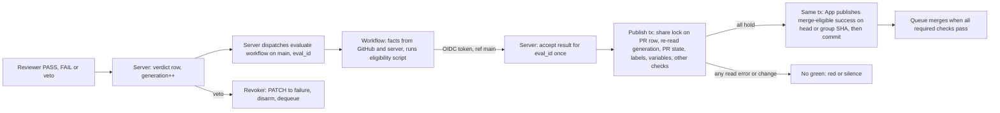

# CHE-5314 Auto-merge on a required review status

Status: plan, revision 5. No code yet. Changed since revision 4 (head `595d12c4d8a3b7baf250764441298caa90b55d52`, 1 P1: a veto could commit between the attestation read and the green POST): Cheese chose "Require a fix that prevents it" on 12 Nov 2026, so the ordering is now **prevented**, not accepted. The attestation read and the green POST run inside one database transaction that holds a share lock on the per-PR state row; a veto must take the exclusive lock on the same row, so it waits until the POST has finished or the transaction has ended (section "Merge-time authority", step 3 and "Publish lock"). The residual window of D1 is now only a veto that commits **after** the publish transaction ends, followed by an outage; its text is unchanged in scope. New tests cover veto between read and POST, and a crash inside the lock. Review scope for this round: only the diff since `595d12c`. Read live on 12 Nov 2026 (ICT): `cheese-work/multica` rulesets, `skills/multica-cheese-work-github` and `scripts/agent_merge_eligibility.py` at `multica-dotfiles` `ada5f8a`, server webhook code at `e2141667bc`. Review: x99-codex-terra (gate path, cross-lab).

## Problem

After the work is done, an agent merge takes 3 to 4 model runs: reviewer PASS, a merge run that waits for checks, a re-armed wakeup, the merge. Each hop is a wakeup. On 12 Nov, #1391 sat green 44 min after a PASS (CHE-5313: `checks_finished` wakeups did not fire), #1243 waited on a stale rule, #1250 and #1326 hit the run budget.

Goal: after the last required fact turns true, GitHub merges with no agent run. Every fact that turns false before the merge must stop it, except in the post-veto outage window stated in section "Merge-time authority" (decision D1, accepted by Cheese).

## What is already live (read back, not assumed)

| Fact | Evidence |
|---|---|
| Merge queue is on: `merge_method: MERGE`, group `ALLGREEN`, check timeout 30 min | ruleset `backend-tests` (id 22854843) |
| Required checks: `backend-tests`, `frontend`, `backend` (GitHub Actions app, integration 15368) | same ruleset |
| `protect main` has an empty required-checks list and no bypass actors | ruleset 25152849 |
| Repo allows auto-merge | `allow_auto_merge: true` |
| The merge decision is already a pure function of facts | `agent_merge_eligibility.py` (exit 0 = eligible) |
| The 24 h gate-path wait is skipped while the security gate is `disabled` (CHE-5126, CHE-5138); the veto check stays | script lines 83 to 86 |
| A pause variable never cancels a PR that is already queued or has auto-merge armed | `skills/multica-cheese-work-github` (`MAIN_RED_PAUSED` section) |
| The GitHub App token path, webhook intake and PR snapshots exist; the App's permission list is **not** readable from this run | `server/internal/handler/github.go` |

So the queue and auto-merge exist. What is missing is a **required check that is green only when the agent-merge rules hold**, and a way to turn it red again when a rule stops holding.

## Difference from the issue's proposal

The issue asks for a server-written `review-pass` commit status as the required check. With a merge queue that fails: the queue tests a temporary `gh-readonly-queue/...` commit with a different SHA, and a status posted on the PR head does not exist there. The queue would wait until the 30 min timeout and drop the PR. (GitHub's queue docs confirm only that CI must report on the merge-group commit; the spike proves the rest.)

Chosen design:

1. **Verdict record (server).** Table `review_verdict` (no foreign keys): PR, head SHA, verdict, original `signed_at`, reviewer agent id and lab, and a per-PR `generation` that every verdict, veto, close or new head increments. The generation lives on one row per PR, `review_pr_state` (no foreign keys); every bump is an `UPDATE` of that row, so it takes the row's exclusive lock (see "Publish lock"). The server refuses an author or same-lab PASS. A `review-pass` status is also written on the PR head for display. **No gate reads that status.**
2. **`merge-eligible` check run (required, published only by the server).** The server holds the GitHub App key, the same way it already does for webhooks and snapshots. The ruleset pins this App's `integration_id`, so no workflow, token or other actor can post that name.
3. **Evaluation workflow (no secret).** A `workflow_dispatch` workflow defined on `main` runs the existing `agent_merge_eligibility.py` unchanged against facts and reports the answer to the server. It publishes nothing to GitHub.
4. **Revoker (server).** Early cleanup after a veto. Not the control.

Why not the all-server variant: it needs a Go port of the eligibility rules that can drift from the script. The script keeps running in Actions. The server owns what only the server knows (verdicts, generation, timer) and the only write path to the required check.

## Merge-time authority (answers finding 1)

**The control is the attestation, not the revoker.** The `merge-eligible` result on a merge-group commit is published only by a live server, as the last act before the queue can merge:

1. The server sees a queue entry (GraphQL poll of the merge queue every 30 s, plus the `merge_group` webhook when subscribed; a lost event costs at most one poll interval). It waits (bounded to 20 min, below the 30 min queue timeout) until every other required check on the group SHA has completed.
2. It dispatches the evaluation (`eval_id`, PR, group SHA) and accepts the result once.
3. **Publish transaction (attest and POST under one lock).** The server opens a database transaction and, as its first statement, takes `SELECT ... FOR SHARE` on the `review_pr_state` row of the PR. Inside that transaction it re-reads, in this order: the verdict and `generation` (one query), the PR state and labels, the two pause variables, and that the group is still queued. Any read error, any change since the evaluation or a generation different from the one the evaluation saw: no green, transaction rolled back.
4. Still inside the same transaction it posts the check run `success` on the group SHA with `head_sha` set explicitly and the `generation` and `signed_at` in the output, then writes the check-run id, `tp` and the generation to `review_publish` and commits. The lock is released only at commit, rollback or crash. The transaction runs with `SET LOCAL lock_timeout`, `statement_timeout` and `idle_in_transaction_session_timeout` of 10 s and the GitHub call has a 5 s timeout, so a hung POST cannot hold the lock longer than 10 s. A POST that timed out has an unknown outcome: the transaction is rolled back and the reconcile loop (below) treats any green whose generation is not the current one as stale.

**Fail-closed by construction.** Green exists only after a live server wrote it. If the server is down, the worker is down or a webhook is lost, no green is published: the required check is missing, the queue times out and drops the group. A veto recorded in the database before the publish transaction takes its lock is read in step 3 whether or not any GitHub effect ever ran, so an outage cannot hide it. A veto never needs to reach GitHub before it takes effect on a queue entry that has no green yet. For an entry that already has a green, the veto reaches GitHub only through the revoker; see the residual window below.

**Publish lock (prevents the veto-between-read-and-POST ordering).** A verdict, veto, close or new-head transaction bumps `generation` with an `UPDATE` of the PR's `review_pr_state` row, which needs the exclusive row lock. The publish transaction holds a share lock on that row from before its first read until after its POST. Two cases only, both decided by PostgreSQL, not by timing in our code:

- **Veto takes its lock first.** The publish transaction then waits for the lock (bounded by `lock_timeout`), reads the new generation and publishes nothing.
- **Publish takes its lock first.** The veto waits until the publish transaction commits, rolls back, times out or the server crashes (the database releases the lock). So the veto commits strictly after the POST has returned or the transaction has died: `tv > tp`. There is no state in which a veto committed after the attestation read and before the POST.

A stale result (generation older than current) is dropped on arrival. The cost: a veto can wait up to 10 s while a publish is in flight, and the publish transaction holds a pool connection during the GitHub call, so publishers are capped (default 4 concurrent). A veto never fails because of the lock: on `lock_timeout` the veto retries, and the publish transaction is the one that gives up. A crash inside the lock leaves the POST either not sent, sent and lost, or sent and applied. In the last two cases the veto commits afterwards and is the post-green case below. This needs read-your-writes on the check-run listing (probe U8).

**Reconcile also covers an unknown POST outcome.** The 60 s loop lists every open PR that has a `merge-eligible` run on its head or group SHA by name and compares the run's `generation` with the current one. Any green with a different generation is PATCHed to `failure`, disarmed and dequeued. This covers a rolled-back publish whose POST actually reached GitHub.

**The head check is not binding.** It exists so auto-merge can enqueue. A stale green on the head cannot merge anything: with the queue enabled and no bypass actor, a merge happens only on a green group. The head check is published by the same attest sequence. Probe U2 proves that a green head with no group result cannot merge.

**Residual window (D1, accepted by Cheese as a scoped, reversible risk).** Stated plainly: the window is **not** bounded to seconds. Case: the green group result is published (`tp`), then a veto commits in the database (`tv > tp`), then the server crashes or is unreachable before the revoker's PATCH, disarm and dequeue reach GitHub. GitHub keeps the green, and the queue merges the PR as soon as it reaches the front of the queue, with no live server involved. The window runs from `tv` until the first of: the queue merges, or the server recovers and the revoker (which runs from the outbox on restart, and from the 60 s reconcile loop) clears it. It therefore lasts as long as the outage or the queue wait, whichever ends first; the queue wait grows when earlier groups are ahead of this one. What stays true: a veto cannot commit between the attestation read and the green `POST`, because of the publish lock above; the failure needs a green, a veto after the publish transaction ended, and an outage, in that order. Impact if it happens: one PR merges after a veto. It is a normal merge commit and one revert undoes it. Mitigations (they narrow the window, they do not close it): (a) publish the green only when the entry is at the front of the queue, if probe U4 shows the listing gives queue position, so the green sits for seconds instead of behind other groups; (b) alert Cheese when the server restarts with a veto newer than a published green on a PR that is still queued; (c) a revoke that finds the PR already merged is logged as `revoked-after-merge` with `tv`, `tp`, the merge time and the outage length, and raises an alert. Today's manual lane has a similar, smaller window (agent reads facts, then runs `gh pr merge`); this design adds the outage case, and Cheese accepts it.

**Revoker (cleanup).** On a verdict, veto, close or new head, in one transaction with the generation bump, the server writes an outbox row. A worker then: (1) lists and PATCHes every `merge-eligible` run on the PR head and the group SHA to `failure`; (2) `disablePullRequestAutoMerge`; (3) `dequeuePullRequest` if queued; (4) reads back (no auto-merge request, no queue entry), up to 3 tries with backoff; (5) alerts Cheese on failure (not an agent run). A 60 s reconcile loop lists every open PR with an auto-merge request or a queue entry and revokes any whose recorded state is not "cleared". This covers a crash between the verdict row and the GitHub call.

## Evaluation workflow (answers finding 3)

**No secret in Actions.** The key stays in the server. The workflow `merge-eligible-eval.yml` runs only on `workflow_dispatch`, from the definition on `main`, with `id-token: write` and `contents: read`. It never runs on `merge_group` and never on a queue ref, so it never needs an environment secret that a queue ref might not satisfy.

- **Trust of the result.** The workflow sends its answer to the server with its GitHub OIDC token. The server accepts it only if the token's `ref` is `refs/heads/main`, `job_workflow_ref` is this workflow file at `refs/heads/main`, `event_name` is `workflow_dispatch`, the audience matches, and the body names an `eval_id` the server issued, still pending and not yet used. A workflow on a PR branch or on a `gh-readonly-queue/...` ref gets a token with that ref and is rejected. Probe U5 checks both: a real run from `main` is accepted, and runs from a hostile branch and from a queue-named branch are rejected.
- **What the workflow reads.** PR files, labels, other checks and the tier receipt come from the GitHub API on the explicit SHA. Verdict facts (`cross_lab_pass`, `gate_veto_elapsed`, `gate_vetoed`, `merger_is_author`) come from one server query and carry `generation` and `signed_at`. It checks out only `main` and a pinned `multica-dotfiles` SHA. It never checks out or runs PR code. `merger_is_author` is the server's refusal of an author or same-lab PASS. `scope_classified` is true only when the receipt has `coverage_complete`.
- **Job names.** No job is named `merge-eligible` (a skipped job named like a required check counts as passing). The check run with that name comes only from the App.
- **Cost of the hop.** Dispatch plus runner start is tens of seconds. The group path dispatches after the other required checks finish, so this adds to merge latency; the Measure section counts it.

## Timer (answers finding 2)

**Rule: the wait is computed from the stored original PASS time, never from a status timestamp.** The server keeps `signed_at` on the verdict row. The script's `gate_veto_elapsed` fact is computed by the server as `now >= signed_at + 24 h` from the **current** verdict, read in the same query as `generation` and the verdict itself. A re-post or a refresh of any status cannot move it. A new PASS (new head or a PASS after a FAIL) has a new `signed_at` and restarts the wait; that is intended.

**Firing.** A table `review_gate_timer` (no foreign keys) holds `fire_at = signed_at + 24 h` per verdict row. The server loop (every 30 s) claims due rows (row claim, so two instances fire once) and starts an evaluation. It posts nothing itself. The evaluation re-reads the verdict atomically: a veto, FAIL, new head or close before firing makes the fact false and the check stays red. A timer that fires after a veto therefore cannot turn anything green. While the security gate is `disabled` the wait is 0 and no row is written (the script skips the wait; the veto fact stays). A `schedule` run every 10 min in Actions is a safety net: it asks the server for waiting PRs it has not evaluated and raises an alert for each one the timer missed.

## Mapping of each gate to a check state

| Today (agent judgement) | After |
|---|---|
| Signed cross-lab PASS on the exact head | Verdict row with the exact SHA. A new push has no verdict on the new SHA, so it is red |
| Tier receipt valid, classifier trusted, coverage complete | The evaluation runs `mechanical_tier.py verify` from a pinned `multica-dotfiles` SHA |
| Other required checks green | Group path: the server waits for them to complete first. Head path: the evaluation reads them on the SHA, excluding itself |
| `AGENT_MERGE_PAUSED`, `MAIN_RED_PAUSED` | Read by the evaluation and again by the attestation. Absent = green. A read error = no green. A pause set later stops new evaluations and new arming. It does not cancel a PR already queued or armed: this is the **existing** rule and it is not changed here |
| Escalation paths and labels | The script refuses them, so the check stays red and Cheese merges |
| Gate-path 24 h wait and veto | Timer section; veto bumps `generation`, so the attestation fails |
| Author is not the merger | The server refuses a PASS from the PR's author agent or the same lab. The shared bot arms auto-merge, so the control no longer sits on the merger's name |
| Same-lab break-glass (CHE-4960, ends 13 Nov 2026 17:00 ICT) | Not accepted by the server. Such a PR stays a manual merge |

## Steps (answers finding 4)

| # | Step | Depends on | Estimate | Stage |
|---|---|---|---|---|
| s0 | **Spike on a scratch repo** (below). Output: a table of U1 to U10 answers | - | 2 h | 1 |
| a1 | Server: `review_verdict` (with `signed_at`, `generation`), `multica review verdict` and `multica review veto`; agent identity from the authenticated task, never from comment text; cross-lab and non-author refusal; outbox table; no FK | s0 | 2 h | 2 |
| a2 | Server: OIDC verification and the `eval` table (`eval_id`, PR, SHA, kind, state; one-time use); facts endpoint (one query: verdict, `generation`, `signed_at`, computed booleans) | a1 | 2 h | 2 |
| a3 | Server: publisher (check run create and PATCH on an explicit `head_sha`, `review-pass` display status) and the publish transaction with the share lock, timeouts and publisher cap | a2 | 2.5 h | 2 |
| a4 | Server: queue poller (30 s), wait for the other required checks, dispatch, head-path triggers and the 60 s head reconcile | a3 | 2 h | 2 |
| a5 | Server: `review_gate_timer` rows and the 30 s firing loop | a3 | 1.5 h | 2 |
| a6 | Server: revoker (list by name, PATCH, disarm, dequeue, read back, alert) and the 60 s reconcile loop | a1, s0 | 2 h | 2 |
| b1 | `merge-eligible-eval.yml` (`workflow_dispatch` only, OIDC, no secret); script and classifier pinned to a `multica-dotfiles` SHA. In shadow the server publishes `merge-eligible-shadow` | s0, a2 | 2 h | 2 |
| b2 | Add the workflow files, ruleset files and the script path to `CHEESE_PATH_RES` (a PR that edits the gate stays Cheese's) | b1 | 1 h | 2 |
| r1 | `scripts/automerge-revoke-all` and `scripts/automerge-rollback` (the ordered rollback below, with verified gates) | a6 | 2 h | 2 |
| r2 | **Rollback drill** on the scratch repo, whole script, including a concurrent re-arm during the run (U10); evidence attached to the issue | r1 | 1 h | 3 |
| c1 | Shadow period, 7 days: compare `merge-eligible-shadow` with each real agent merge decision. Pass: zero green-where-agents-refused, at most 5 % red-where-agents-merged, each explained | a3, a4, a5, b1 | 7 days wait | 3 |
| c2 | Ruleset change (Cheese, one decision card): new ruleset `merge-eligible` that only adds the required check, pinned to the App | c1, a6, **r1, r2, U10 = yes** | 15 min | 3 |
| d1 | Skill and workflow text: the author runs `gh pr merge <n> --auto --match-head-commit <sha>` when marking ready; delete the merge-run and re-armed-wakeup text (CHE-3683) | c2 | 1 h | 4 |
| d2 | Server: merge receipt on the `merged` event, replacing the agent-posted receipt | c2 | 2 h | 4 |
| e1 | Measure panel and alert (below) | a3 | 1.5 h | 3 |

Each code step is a test-first PR built on X99. Step c1 waits on a time condition, so it ends the run with a wakeup, never a poll. Step c2 stays blocked until r1 and r2 are done and probe U10 shows the GitHub-enforced fence works: no enforcement without a tested way back.

## Spike (s0): ten unknowns, each with a probe

| # | Unknown | Probe | If the answer is no |
|---|---|---|---|
| U1 | Does the Multica App have `checks: write`, `actions: write` (dispatch), pull-request write (disarm, dequeue) and repository-variables read? | Call each endpoint with an installation token | Cheese approves a permission upgrade on the App (D3) |
| U2 | Is a required check, pinned to the App, enough to stop auto-merge enqueuing when it is missing on the head? Does a green head with a missing or red group result fail to merge? | Throwaway ruleset on the scratch repo | Publish only on the group; the head carries no required check and auto-merge arms after the head's other checks |
| U3 | Does an armed PR keep auto-merge after a new head push and after queue removal? | Scratch PR, push, force a dequeue | Author re-arms in the ready flow; CHE-4230's dequeue wake covers removal |
| U4 | Does the GraphQL queue listing give the group commit and every PR in the group? Does the `merge_group` webhook carry the same? | Scratch queue with two PRs | Poll only |
| U5 | Does a run from `main` mint an OIDC token the server accepts (`ref`, `job_workflow_ref`, `event_name`), and do tokens from a hostile branch and from a `gh-readonly-queue/main/...`-named branch carry their own ref and get rejected? | Real runs from all three refs against a scratch verifier | Reject all and publish nothing: the plan stops here and returns to review |
| U6 | Does a required context pinned to `integration_id` reject a check run or status from another actor, including the Actions app? | Post the same name as a different actor | Reject in the attestation by creator and add a periodic audit |
| U7 | Can the App create a check run on the PR head and on the group commit, and does the queue accept it as the required result? | Create both on the scratch queue | Subscribe the App to `merge_group` and report from its event |
| U8 | If a check run is `PATCH`ed from `success` to `failure` while the group is queued, does the queue drop it? Does a list by name see a run created a moment earlier (read-your-writes)? | Scratch queue with a slow second check; create then list in a loop | Revoker falls back to disarm and dequeue; the fence re-reads until the list shows the run |
| U9 | Does the server read the two repo variables with the App token? | Read both | Read them in the evaluation workflow instead and have the attestation use that value |
| U10 | Does `allow_auto_merge=false` block arming at once, clear or keep an armed PR, and still allow a manual `gh pr merge` into the queue? | Scratch repo | **Stop.** No evaluator-red fallback (it cannot fence a re-arm after the last readback). Step c2 does not start. Cheese gets a separate decision card on a concrete rollback that GitHub itself enforces; this plan is revised and reviewed again before c2 |

## Rollback

**The ordering matters.** Disabling the ruleset or the server does not turn an existing green result red. A PR armed or queued at that moment would then merge without the new gate. A re-arm between the zero readback and the ruleset change would do the same. So rollback is one script with a verified gate between steps, and arming is blocked by GitHub itself before anything is removed. Do not skip a step or reorder.

| Step | Action | Verify before the next step |
|---|---|---|
| R1 | Set repo `allow_auto_merge=false`. GitHub now refuses to arm any PR, so no actor can re-arm. Also set the flag `AUTO_MERGE_ARMING_OFF` (the evaluation then answers red for every PR; this is extra cleanup, not the fence) | Readback shows `allow_auto_merge=false`; a test arm fails |
| R2 | `automerge-revoke-all`: PATCH every `merge-eligible` run to `failure`, disarm auto-merge, dequeue every queued PR | - |
| R3 | GraphQL readback: zero open PRs with `autoMergeRequest`, zero with a `mergeQueueEntry`. Not zero: repeat R2 up to 3 times; still not zero: **stop and alert** (the fence in R1 stays on) | Count 0, twice, 60 s apart |
| R4 | Set `enforcement: disabled` on the `merge-eligible` ruleset (one call). The queue and the existing required checks are untouched | Ruleset readback shows `disabled` |
| R5 | Revert the d1 text. Then restore `allow_auto_merge=true` (its state before this plan). Turn the server publisher and timer off by feature flag; the revoker stays in disarm-only mode until the revert has merged | Readback shows `true`; writer idle; reconcile reports 0 |
| R6 | Agents return to the CHE-2008 manual merge | - |

The fence in R1 is why no re-arm can occur between R3 and R4. It is the **only** fence: the evaluator-red flag is asynchronous and cannot stop an arm that lands after the final readback. If probe U10 shows R1 does not block arming at once, there is no rollback fence, so the plan stops before enforcement: step c2 does not start, no ruleset changes, and Cheese decides separately on a concrete rollback that GitHub enforces. The shadow period (c1) still runs, because it changes nothing a merge depends on.

Time: R1 to R4 take under 10 min when the script works. If the server is down, R1 to R4 run from X99 with GitHub calls only. A down server publishes no green (section "Merge-time authority"), so a server outage never needs the script to be safe; the script is for leaving the design.

## Test-first list (red before green, per Test-First Practice)

| Step | Tests |
|---|---|
| a1 | PASS from the author agent → refused; PASS from the same lab → refused; PASS for an old SHA → no effect on the new head; identity from the authenticated agent id, comment text ignored; veto by a non-member → refused; verdict row, generation bump and outbox row commit together or none does |
| a2 | Token from a PR branch → rejected; token from a `gh-readonly-queue/...` ref → rejected; token from `main` with a wrong workflow file → rejected; result for an unknown, used or expired `eval_id` → rejected; facts endpoint returns verdict, `generation` and `signed_at` from one snapshot |
| a3 | Result with an older `generation` → no publish; **veto between the attestation read and the POST (hook after the read, before the POST; real database, two connections)** → the veto's `UPDATE` blocks until the publish transaction ends, its commit time is later than the POST return time, the veto never commits inside the interval, and the run is then PATCHed to `failure` by the revoker; veto takes its lock first → publish reads the new generation and posts nothing; **server killed inside the lock after the POST was sent** with a veto waiting → the database releases the lock, the veto commits, on restart the outbox revoker and the reconcile loop clear the green; **POST times out** (unknown outcome) → rollback, no `review_publish` row, reconcile PATCHes any green with a stale generation within 90 s; a hung POST → the veto waits at most 10 s, then commits after the transaction is aborted; publishers capped at 4, a fifth waits and does not starve vetoes; any attestation read error (verdict, PR, labels, variables, queue state) → no green; green carries `head_sha` set explicitly, never the event SHA; **crash after green**: green published, server killed, veto commits, server restarts → the outbox revoker PATCHes, disarms and dequeues on restart if the PR is still queued, and logs `revoked-after-merge` with `tv`, `tp` and outage length if the queue merged first; **crash after veto commit, before revocation**: veto commit, server killed before any GitHub call → the 60 s reconcile and the outbox both clear it on restart, and the restart alert fires (b); a veto committed before the green `POST` and the server killed right after the attest → no green was published |
| a4 | Server down while the group is queued, veto already in the database, server restarts → no green, queue times out; webhook lost → the 30 s poll finds the entry; other required check still running → wait, then evaluate; wait over 20 min → red; two PRs in one group, one ineligible → red |
| a5 | PASS at T, firing at T + 23 h 59 min 30 s → not fired; at T + 24 h 00 min 30 s → fired once; evaluation computes the wait from stored `signed_at` and ignores every status timestamp (a status re-posted at T + 24 h does not move it); veto at T + 23 h 59 min 59 s then the timer fires → red; new head before firing → no result for the old SHA; two server instances → one claim; server down at 24 h → fires on restart; wait is 0 while the security gate is disabled |
| a6 | Veto on a queued PR with a green group run → PATCHed, disarmed, dequeued, read back clean; revoke call fails twice then succeeds → retried; fails 3 times → alert, no silent success; PR already merged when the revoke lands → `revoked-after-merge` logged and alerted; webhook lost → the 60 s reconcile revokes within 90 s; crash between verdict row and GitHub call → effect applied after restart |
| b1 | Evaluation on fixture PRs: Tier 0 docs PR with PASS → eligible; no verdict → red; either pause variable present → red; variable read error → red; migration path → red; mixed PR with one escalation path → red; gate-path PR at 23 h → red, at 25 h → green (only while the security gate is not disabled); the workflow never checks out PR code |
| b2 | A PR that edits a workflow file, a ruleset file or the script → red |
| c2 | **c2 refuses to start while the U10 result is not "yes"**; A skipped job named `merge-eligible` does not satisfy the ruleset; a check run from the Actions app with the same name is rejected by the `integration_id` pin; **c2 refuses to start while r1 or r2 evidence is missing** (checklist in the decision card) |
| r1 | Fixture: 2 armed PRs, 1 queued PR, 1 plain open PR → after the script, 0 armed or queued and the plain PR untouched; arm attempt after R1 → fails; readback count of 1 → exit non-zero, no ruleset change, fence stays on; server stopped before the script → still completes |
| r2 | Drill in the scratch repo: a second process re-arms during R2 to R4, **including one attempt between the final readback of R3 and the R4 call** → every attempt is refused; end state equals the pre-plan state (`allow_auto_merge=true`, no new ruleset, no armed PR) |
| d2 | `merged` event → one receipt with PR URL, head SHA, tier, checks, PASS link, merge method, merge SHA; replayed event → no second receipt |

## Risks (1 low to 5 high)

| Axis | Score | Why and mitigation |
|---|---|---|
| Technical | 4 | Ten unknowns, all probed in s0 before any change to `multica`. U5, U7 and U8 decide whether the design works as written. U5 failing stops the plan |
| Security | 4 | A forged green `merge-eligible` merges anything. Mitigations: the check is posted only by the server's App and pinned by `integration_id`; no key or secret in Actions; evaluation results accepted only with an OIDC token from `main`'s workflow file and a one-time `eval_id`; PR code is never run; gate files in the escalation list. This plan is a gate path: cross-lab review, and the ruleset change and the App permissions are Cheese's |
| Availability | 3 | The server is now on the critical path of every agent merge. A server outage stops new greens (fail-closed for PRs with no green yet) and agents fall back to the manual lane. Exception, accepted in D1: a PR that already has a green and gets a veto during the outage can still merge Alert on a queued group with no result after 10 min |
| Rollback | 2 | Ordered script with a GitHub-enforced fence, tested in a drill before enforcement. If the fence does not exist (U10 = no), there is no enforcement |
| Conflict | 3 | CHE-5313 (wakeups) is fixed separately and this removes the dependency; CHE-4230 dequeue wake stays; CHE-3123 author-is-not-merger changes as stated above |
| Cost | 1 | One lightweight dispatch per evaluation; fewer model runs |
| Single agent | 2 | Server steps and workflow steps are independent |

## Decisions for Cheese (one card, after Terra's review)

1. **D1, policy and residual risk. Accepted by Cheese on 12 Nov 2026 (decision card, option "Accept D1 risk, one more review").** The author's run may arm auto-merge. Reviewer independence moves from "the merger is not the author" to "the server refused a same-lab or author PASS". Cheese accepts the residual window stated in "Merge-time authority": a veto that commits after the green is published, followed by a server outage, can let one already-approved merge go through until the server recovers; one revert undoes it. This acceptance does not cover D2, D3 or any change to the ruleset or App permissions.
2. **D2, ruleset.** Add the `merge-eligible` required check after the shadow period passes, r1 and r2 evidence exists, and U10 shows the fence works. Recommend yes. Rollback is the ordered script with a GitHub-enforced fence.
3. **D3, App permissions.** The Multica App gets the permissions U1 shows missing (expected: `checks: write`, `actions: write`, repository-variables read). An owner-only action. No new secret is stored in Actions.

## Measure

- **Latency:** minutes from `max(PASS time, last required check finish, PASS time + 24 h on a gate path)` to `merged_at`. Target under 10 min. Baseline: the last 20 agent-merged PRs, measured in s0. The queue-poll interval (30 s) and the dispatch hop (tens of seconds) count in the number.
- **Model runs per merged PR:** task runs on the linked issue after the PASS. Target 0. Baseline from the same 20 PRs.
- **Stall alert:** an open PR with a PASS and all other checks green but no green `merge-eligible` after 10 min; a queued group with no result after 10 min.
- **Safety counters:** revokes per week, revoke read-back failures (target 0), `revoked-after-merge` (target 0, each one reviewed), attestations that refused a green (each one logged with its reason).
- **Assumption on "3X":** the issue text does not define it. I read it as three times fewer model runs and a latency at least three times lower than baseline. Reviewer: correct this if it means something else.
- **Before/after panel:** the existing daily digest gets one line per merge with both numbers.
