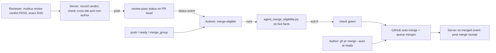

# CHE-5314 Auto-merge on a required review status

Status: plan, revision 1. No code yet. Read live on 12 Nov 2026 (ICT): `cheese-work/multica` rulesets, `skills/multica-cheese-work-github` and `scripts/agent_merge_eligibility.py` at `multica-dotfiles` `ada5f8a`, server webhook code at `e2141667bc`. Review: x99-codex-terra (gate path, cross-lab).

## Problem

After the work is done, an agent merge takes 3 to 4 model runs: reviewer PASS, a merge run that waits for checks, a re-armed wakeup, the merge. Each hop is a wakeup. On 12 Nov, #1391 sat green 44 min after a PASS (CHE-5313: `checks_finished` wakeups did not fire), #1243 waited on a stale rule, #1250 and #1326 hit the run budget.

Goal: after the last required fact turns true, GitHub merges with no agent run.

## What is already live (read back, not assumed)

| Fact | Evidence |
|---|---|
| Merge queue is on: `merge_method: MERGE`, group `ALLGREEN`, check timeout 30 min | ruleset `backend-tests` (id 22854843) |
| Required checks: `backend-tests`, `frontend`, `backend` (GitHub Actions app, integration 15368) | same ruleset |
| `protect main` has an empty required-checks list and no bypass actors | ruleset 25152849 |
| Repo allows auto-merge | `allow_auto_merge: true` |
| The merge decision is already a pure function of facts | `agent_merge_eligibility.py` (exit 0 = eligible) |
| The 24 h gate-path wait is skipped while the security gate is `disabled` (CHE-5126, CHE-5138); the veto check stays | script lines 83 to 86 |
| The GitHub App token path, webhook intake and PR snapshots exist; the App's permission list is **not** readable from this run | `server/internal/handler/github.go` |

So the queue and auto-merge exist. What is missing is a **required check that is green only when the agent-merge rules hold**.

## Difference from the issue's proposal

The issue asks for a server-written `review-pass` commit status as the required check. With a merge queue that fails: the queue tests a temporary `gh-readonly-queue/...` commit with a different SHA, and a status posted on the PR head does not exist there. The queue would wait for it until the 30 min timeout and drop the PR. (GitHub's queue docs confirm only that CI must report on the merge-group commit; they name no status-versus-check rule, so the spike below proves the behaviour.)

Chosen design, two parts:

1. **`review-pass` status (server, narrow).** Written on the PR head. It says one thing: a cross-lab, non-author PASS exists for this exact head, with no later FAIL or veto. Not a required check.
2. **`merge-eligible` check (GitHub Actions, required).** Runs on `pull_request_target`, `merge_group` and `status`. It reads `review-pass` from the PR head and runs the existing `agent_merge_eligibility.py` unchanged. It is the only new required context, and Actions already reports on merge-group commits.

Why not the all-server variant: it needs a new App webhook subscription (`merge_group`) and a Go port of the eligibility rules that can drift from the script. It also depends on the webhook intake path that CHE-5313 shows losing events. The Actions variant reuses the script and GitHub's own triggers.

## Mapping of each gate to a required-check state

| Today (agent judgement) | After |
|---|---|
| Signed cross-lab PASS on the exact head | `review-pass` status. A new push has no status on the new SHA, so it is red by construction |
| Tier receipt valid, classifier trusted, coverage complete | `merge-eligible` runs `mechanical_tier.py verify` from a pinned `multica-dotfiles` SHA |
| Other required checks green | `merge-eligible` reads them on the head (it excludes itself) |
| `AGENT_MERGE_PAUSED`, `MAIN_RED_PAUSED` | `merge-eligible` reads the two repo variables. Absent = green. A read error = red (fail closed) |
| Escalation paths and labels (migration, c00-config, design, two-signer) | Script refuses them, so the check stays red and Cheese merges |
| Gate-path 24 h wait | Script input `gate_veto_elapsed` = `review-pass` status `updated_at` plus 24 h. A `schedule` run every 10 min re-evaluates waiting PRs. Wait is 0 while the security gate is disabled, as today |
| Gate-path veto | Server writes `review-pass = failure` on a veto (`multica review veto` by a member, or PR closed). Replaces reading free-text Cheese comments |
| Author is not the merger | Moves into the server: it refuses a PASS from the PR's author agent or the same lab. The shared bot arms auto-merge, so the merger identity no longer carries the control |
| `scope_classified` (a human read the diff) | True only when the receipt has `coverage_complete`. Anything unassessed keeps the check red |

Pause semantics change in one place: pauses are checked when the PR is evaluated, not when the queue runs. A pause set after queue entry does not cancel a queued PR (same as today's "already queued is not cancelled").

## Steps

| # | Step | Depends on | Estimate | Stage |
|---|---|---|---|---|
| s0 | **Spike on a scratch repo** (below). Output: a table of U1 to U6 answers | - | 1.5 h | 1 |
| a1 | Server: `review_verdict` table, `multica review verdict` and `multica review veto`; agent identity from the authenticated task, never parsed comment text; cross-lab and non-author check; no FK | s0 | 2 h | 2 |
| a2 | Server: post `review-pass` on the PR head on verdict, veto and new head (`pending`: "no PASS on <sha7>"); PR author agent and lab resolved server-side | a1 | 2 h | 2 |
| b1 | `merge-eligible.yml` + facts collector, in shadow (not required) in `cheese-work/multica`; script and classifier pinned to a `multica-dotfiles` SHA | s0 | 2 h | 2 |
| b2 | Add the workflow file and ruleset files to `CHEESE_PATH_RES` in the script (a PR that edits the gate stays Cheese's) | b1 | 1 h | 2 |
| c1 | Shadow period, 7 days: compare `merge-eligible` against each real agent merge decision. Pass: zero green-where-agents-refused, at most 5 % red-where-agents-merged, each explained | a2, b1 | 7 days wait | 3 |
| c2 | Ruleset change (Cheese, one decision card): new ruleset `merge-eligible` that only adds the required check | c1 | 15 min | 3 |
| d1 | Skill and workflow text: author runs `gh pr merge <n> --auto --match-head-commit <sha>` when marking ready; delete the merge-run and re-armed-wakeup text (CHE-3683) | c2 | 1 h | 4 |
| d2 | Server: merge receipt on the `merged` event, replacing the agent-posted receipt; digest source unchanged | c2 | 2 h | 4 |
| e1 | Measure panel and alert (below) | a2 | 1.5 h | 3 |

Each code step is a test-first PR built on X99. Step c1 waits on a time condition, so it ends the run with a wakeup, never a poll.

## Spike (s0): six unknowns, each with a probe

| # | Unknown | Probe | If the answer is no |
|---|---|---|---|
| U1 | Does the Multica App have `statuses: write`? | `POST /repos/<scratch>/statuses/<sha>` with an installation token | Cheese approves a permission upgrade on the App (decision card) |
| U2 | Does a check run from a `pull_request_target` workflow satisfy a required check on the PR head? | Throwaway ruleset on the scratch repo | Use `pull_request` plus a required-workflows rule pinned to the base branch |
| U3 | Does a queued or armed PR keep auto-merge after a new head push, and after queue removal? | Scratch PR, push, force a dequeue | Author re-arms in the ready flow; CHE-4230's dequeue wake covers removal |
| U4 | Does `merge_group` give the PR head from `head_ref` (`gh-readonly-queue/main/pr-N-<sha>`) reliably? | Read `github.event.merge_group` on a scratch run | Look the PR up by the queue's `head_sha` parents |
| U5 | Can `GITHUB_TOKEN` read repo Actions variables? | `gh variable list` in a workflow | Use a fine-grained read token as an Actions secret, or let `main_health.py` write a status |
| U6 | Does a required context name with no producing app accept a status from any actor? | Post the same context as a different actor | Pin `integration_id` in the ruleset; reject a `review-pass` whose creator is not the Multica App |

## Rollback

| Layer | Action | Time |
|---|---|---|
| Ruleset | Set `enforcement: disabled` on the new `merge-eligible` ruleset (one API call). Other rules and the queue are untouched | 1 min |
| Auto-merge | Authors stop arming it; armed PRs stay blocked by the red check until the ruleset is disabled | - |
| Server | Writer off by feature flag: no `review-pass` appears, `merge-eligible` stays red, nothing merges (fail closed). Agents return to the CHE-2008 manual merge | minutes |
| Workflow | Remove `merge-eligible` from the ruleset; shadow mode resumes | 1 min |

Failure mode that matters: the server is down or the writer breaks. Nothing merges (red by construction) and the alert below fires. That is a stall, not an unsafe merge.

## Test-first list (red before green, per Test-First Practice)

| Step | Tests |
|---|---|
| a1 | PASS from the author agent → refused; PASS from the same lab → refused; PASS for an old SHA → no effect on the new head; verdict row keyed to the authenticated agent id, comment text ignored; veto by a non-member → refused |
| a2 | PASS → `success` on that SHA only; new push → `pending` on the new SHA; FAIL after PASS → `failure`; veto → `failure`; status write error → retried, then alert (never a silent skip) |
| b1 | Facts collector on fixture PRs: Tier 0 docs PR with PASS → exit 0; no `review-pass` → red; `review-pass` created by a different actor → red; either pause variable present → red; variable read error → red; migration path → red; mixed PR with one escalation path → red; gate-path PR at 23 h → red, at 25 h → green (only when the security gate is not disabled) |
| b2 | A PR that edits `merge-eligible.yml` or a ruleset file → red |
| d2 | `merged` event → one receipt with PR URL, head SHA, tier, checks, PASS link, merge method, merge SHA; replayed event → no second receipt |

## Risks (1 low to 5 high)

| Axis | Score | Why and mitigation |
|---|---|---|
| Technical | 3 | Six unknowns, all probed in s0 before any change to `multica` |
| Security | 4 | A forged green `merge-eligible` merges anything. Mitigations: `pull_request_target` or a base-pinned workflow, script and classifier from a pinned SHA, the gate files in the escalation list, `review-pass` creator pinned to the App. This plan is a gate path: cross-lab review, and the ruleset change is Cheese's |
| Rollback | 1 | One API call; the queue is untouched |
| Conflict | 3 | CHE-5313 (wakeups) is fixed separately and this removes the dependency; CHE-4230 dequeue wake stays; CHE-3123 author-is-not-merger changes as stated above |
| Cost | 1 | One lightweight Actions job per PR event; fewer model runs |
| Single agent | 2 | Steps a1/a2 (server) and b1/b2 (workflow) are independent |

## Decisions for Cheese (one card, after Terra's review)

1. **D1, policy.** The author's run may arm auto-merge. Reviewer independence moves from "the merger is not the author" to "the server refused a same-lab or author PASS". Recommend yes: the control is checked by code, not by a name.
2. **D2, ruleset.** Add the `merge-eligible` required check after the shadow period passes. Recommend yes. Rollback is one call.
3. **D3, App permission.** Only if U1 says no.

## Measure

- **Latency:** minutes from `max(PASS time, last required check finish)` to `merged_at`. Target under 10 min. Baseline: the last 20 agent-merged PRs, measured in s0.
- **Model runs per merged PR:** task runs on the linked issue after the PASS. Target 0. Baseline from the same 20 PRs.
- **Stall alert:** an open PR with a PASS and all other checks green but no green `merge-eligible` after 10 min.
- **Assumption on "3X":** the issue text does not define it. I read it as three times fewer model runs and a latency at least three times lower than baseline. Reviewer: correct this if it means something else.
- **Before/after panel:** the existing daily digest gets one line per merge with both numbers.
