## Scope

Shared web/desktop DM decision request cards, based on L1 PR #398 at
`50d052a97cc749f05e8fc7390846e7f660c7ab07`.

Migration 690 adds a request-ID array to cancellation messages. This preserves
the original asks on cancellation-only pages and on grouped issue-close notes.
The shared UI deduplicates an older ask when its updated cancellation card is
already loaded. A failed additive payload retains the readable legacy notice.

Reuses the receipt-card pattern from `design/dm-decision-quote-cards/rev-8/B.html`.
Design PR #316 is merged at `9ac3541dba50d3e1f06687779694b08095c21b79`.
The admission sheet is `docs/ux/CHE-2088.yml`.

The stack maintainer publishes the canonical L2 draft PR. Copy the screenshots
and test-first evidence below into that PR body. Its title must end in
`[squash]` or `[merge]`. Independent review remains required before ready.

## Observed test-first evidence

Parent: `50d052a97cc749f05e8fc7390846e7f660c7ab07`.
Each red run occurred before the corresponding production change in this run.
The accessibility, legacy-rendering and additional schema assertions were added
after the first implementation; they are supplemental coverage, not red proof.

| Suite | Observed red | Observed green |
| --- | --- | --- |
| `pnpm --filter @multica/core exec vitest run api/decision-cards-schema.test.ts` | Exit 1: 2 failed, 8 passed. Request kind downgraded to `message`; malformed request metadata survived validation. | Exit 0: 11 passed. |
| `pnpm --filter @multica/views exec vitest run chat/components/chat-message-list.decision.test.tsx` | Exit 1: 3 failed, 8 passed. Named request regions were absent for open, answered and withdrawn. | Exit 0: the original 11 tests passed. The final expanded component run passed 23 tests across 3 files. |
| `go test ./internal/handler -run '^TestDecisionRequestCards' -count=1 -v` | Exit 1: all 5 state/source cases failed because the original ask lacked request-card metadata. Workspace-isolation control passed. | All 5 cases and the workspace-isolation control passed in the subsequent decision regression run. |

A second observed red/green slice covers paging. Before the durable link was
implemented, the UI command failed 2 tests (12 passed): cancellation-only pages
lost the card, and malformed/missing metadata hid the fallback notice. The same
tests pass in the final 23-test component run. The backend red run failed its
withdrawn subcase with `cancellation page lacks its original ask card` before
the migration and linked-message query were implemented.

Verbatim failing assertions:

```text
expect(parsed.decision_request).toBeUndefined();
Unable to find an accessible element with the role "region" and name "Decision request: Open"
original ask lacks decision request card
```

Final targeted UI command:

```sh
pnpm --filter @multica/views exec vitest run chat/components/decision-request-card.test.tsx chat/components/chat-message-list.decision.test.tsx chat/components/decision-dm-card.test.tsx --maxWorkers 2
```

Additional observed checks: core and views TypeScript checks passed; focused
core/views ESLint passed; sqlc generation passed; Go formatting is clean.
Go vet passed for the handler, DM notification and protocol packages.
Migration 690 applied successfully on the disposable database. Final request
card, cancellation-message and chat-decision tests passed, including a
cancellation-only page and grouped closed asks.
The Go tests use a disposable PostgreSQL 17 container, not the live workspace.

```sh
go test ./internal/handler -run 'TestDecisionRequestCards|TestDecisionCancelMessage|TestDecisionCancelNote|TestChatDecision' -count=1 -v
go vet ./internal/handler ./internal/dmnotify ./pkg/protocol
```

## UI review pack

- Preview: not available after this run; the capture server was stopped.
- Visual diff: NOT-RUN (manual before/after review; no automated pixel diff).
- Capture: X99 Chromium, 1440 and 390 px, light and dark, synthetic asks only.
- Browser checks: 24 PNGs; no page errors or horizontal overflow.
- Both Mermaid diagrams passed syntax and browser render checks.
- Before captures reproduce the L1 response shape without request metadata,
  using the unchanged plain-assistant-message rendering path. They are not
  screenshots of production or of a separate L1 checkout.
- After captures render the real shared `ChatMessageList` and request card.

Keep / Change / Remove check:
- Keep: `chat-user-message` and `decision-dm-card` retain their existing rendering;
  the component regression suite passes, including quote-card placement.
- Change: request cards show state text, issue chip, optional source-comment
  link, original Markdown ask, withdrawal reason and explicit ICT time.
- Removed: none. New cancellation notices remain stored for old clients and
  agent context, but the shared UI renders their linked original asks as cards.

Legacy limits: a server without request metadata retains its plain ask. Old
stored `decision_reference` cancellation notes remain legacy text; this change
does not rewrite historical messages or mutate the live withdrawal fixture.
No mobile UI, production deployment, merge or live-fixture action is included.

### Desktop screenshots

| State / theme | Before | After |
| --- | --- | --- |
| Open / light |  | 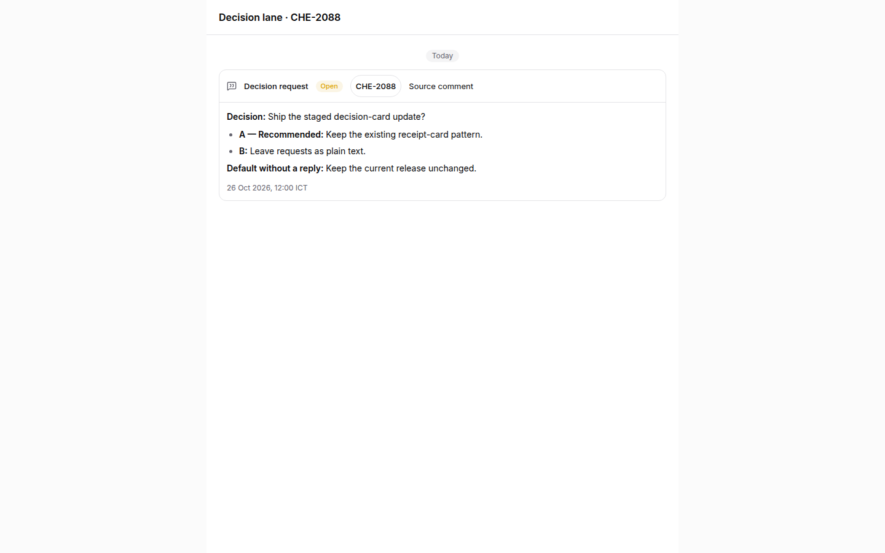 |
| Answered / light | 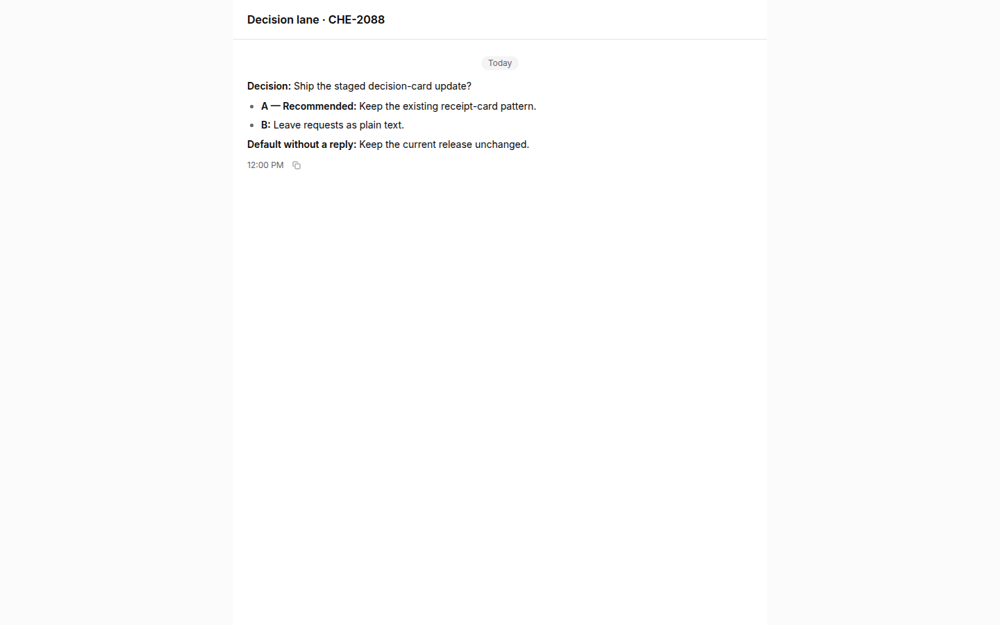 | 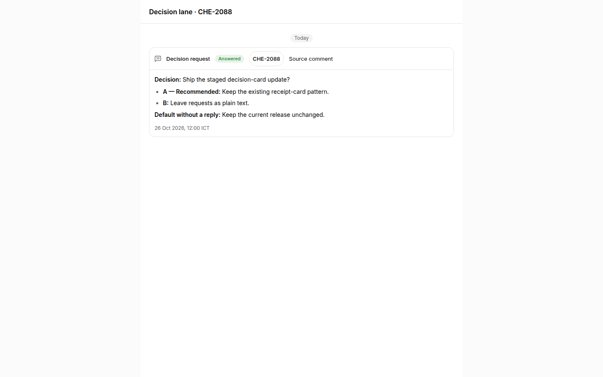 |
| Withdrawn / light | 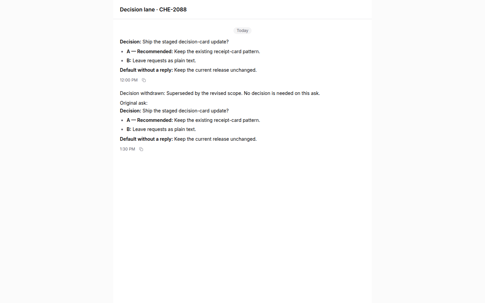 | 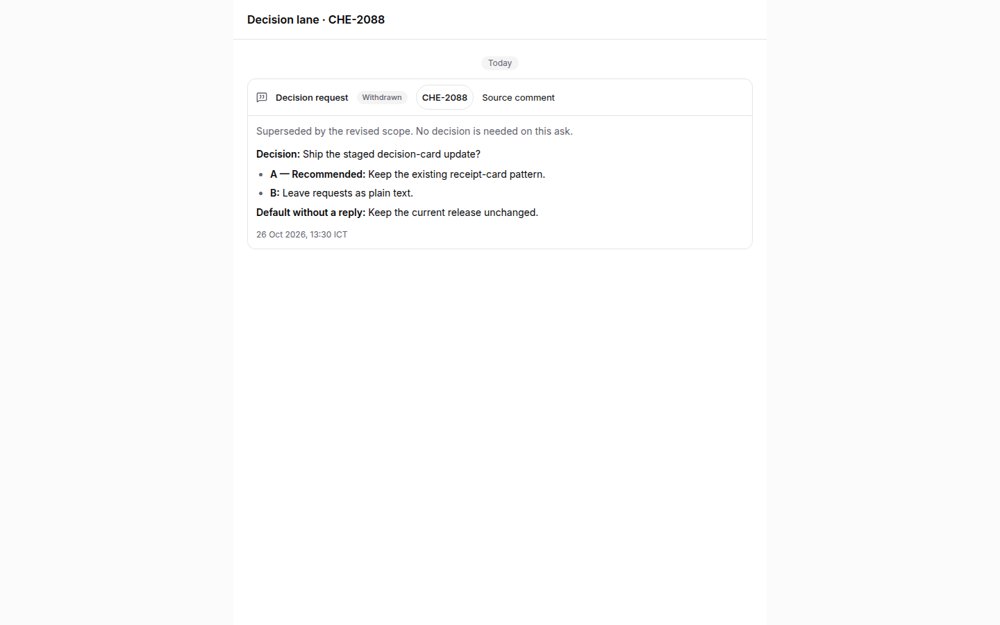 |
| Open / dark | 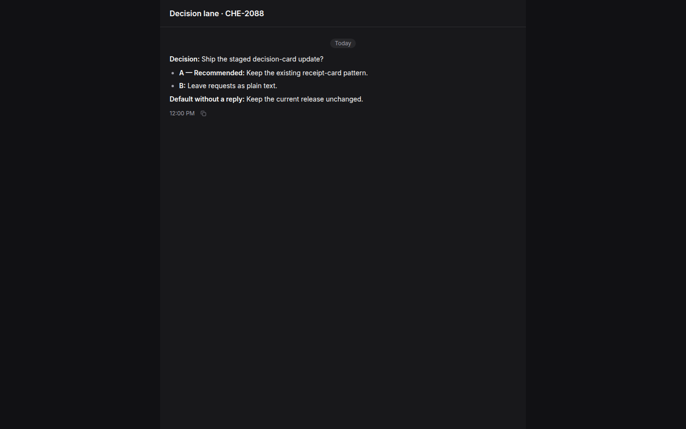 | 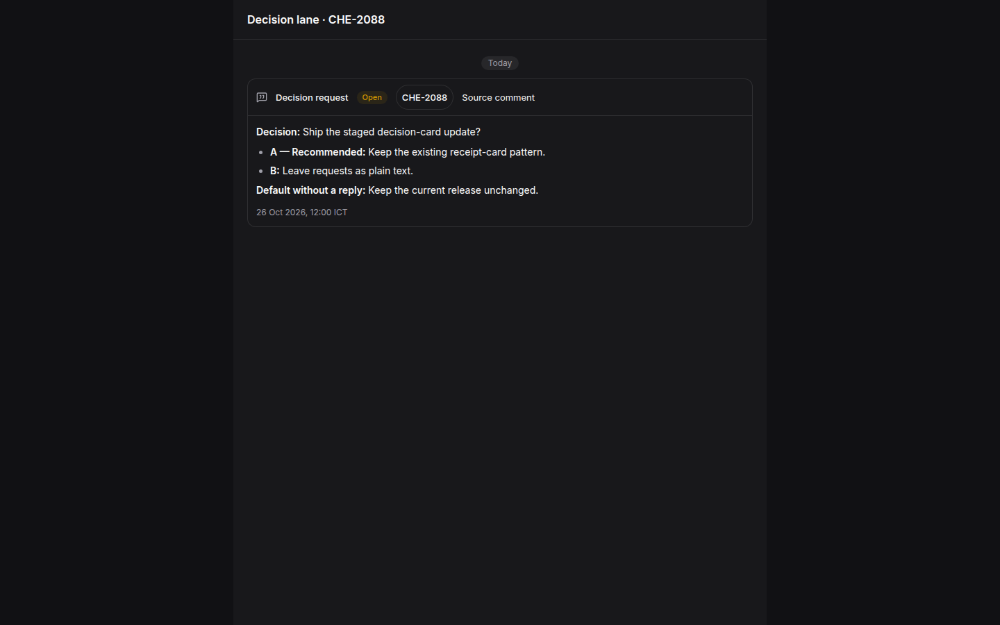 |
| Answered / dark |  | 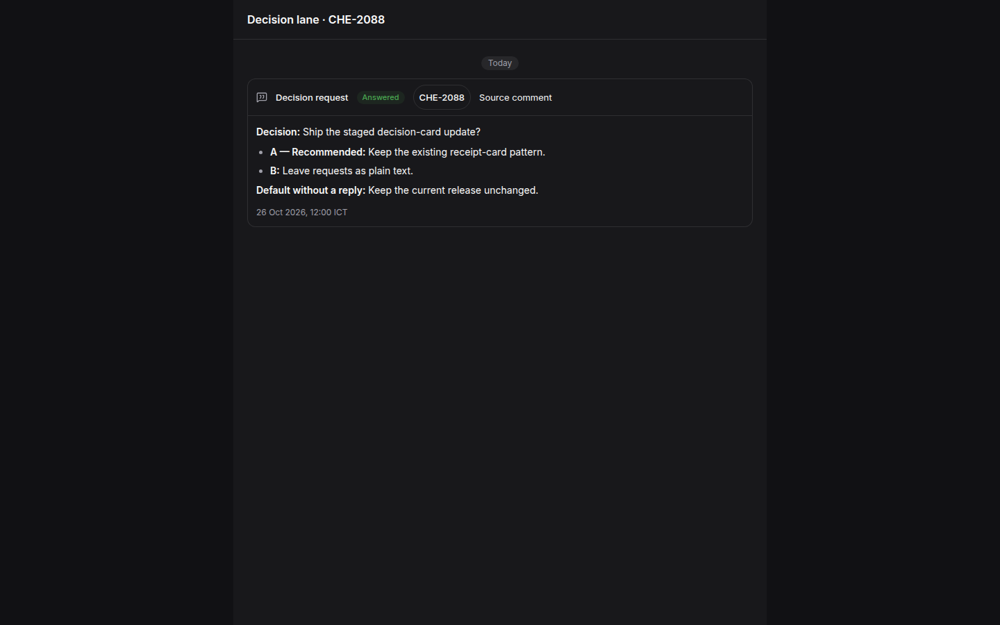 |
| Withdrawn / dark | 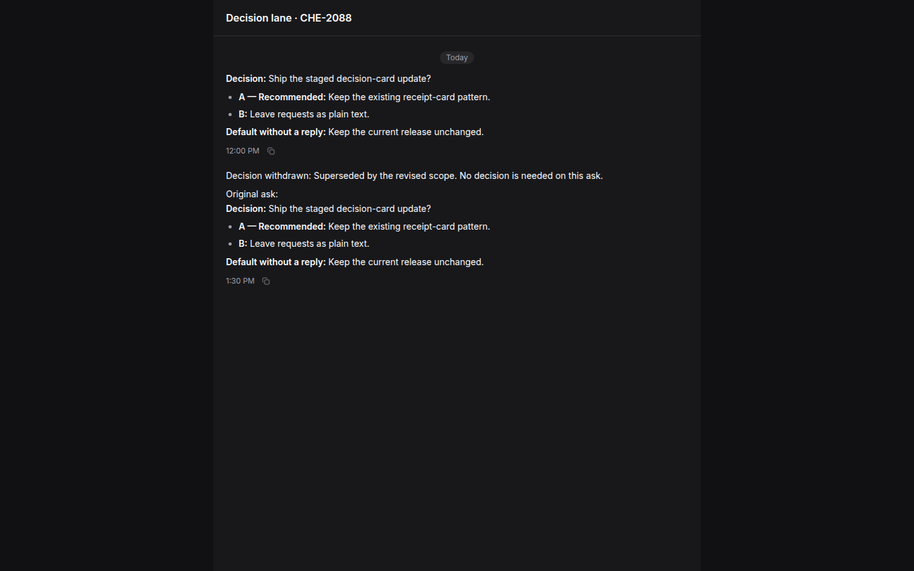 | 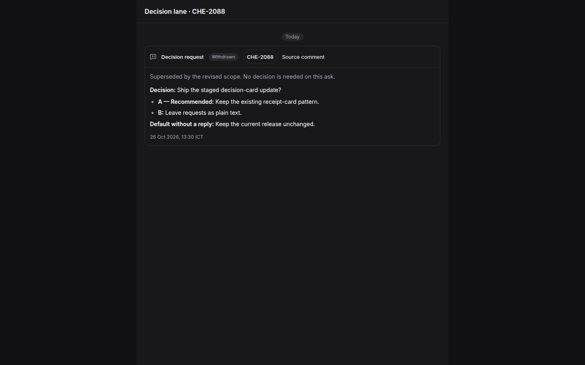 |

### Phone-width screenshots

| State / theme | Before | After |
| --- | --- | --- |
| Open / light |  | 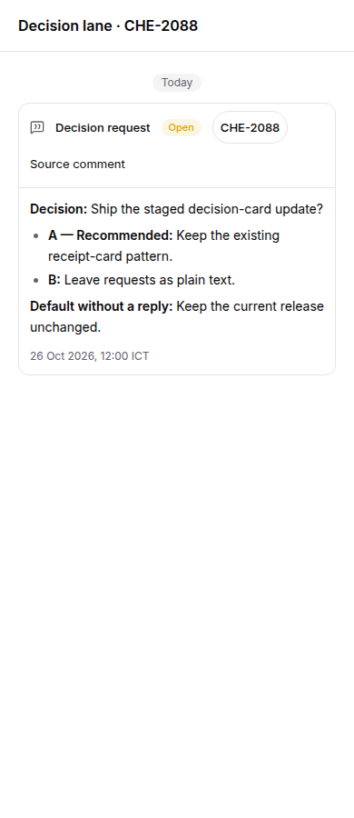 |
| Answered / light | 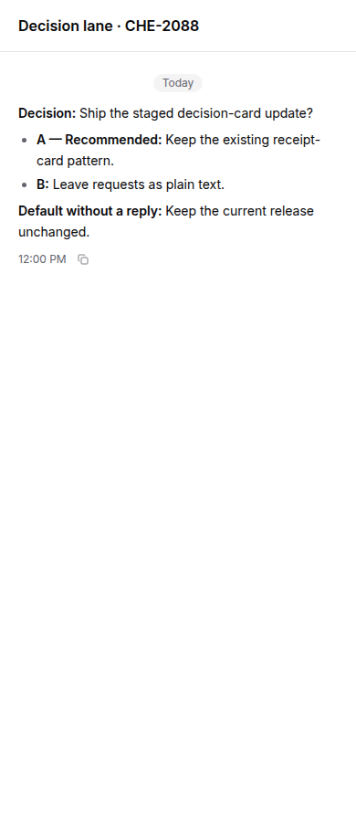 | 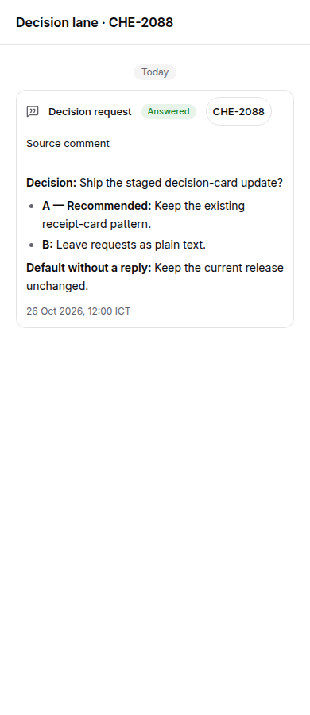 |
| Withdrawn / light | 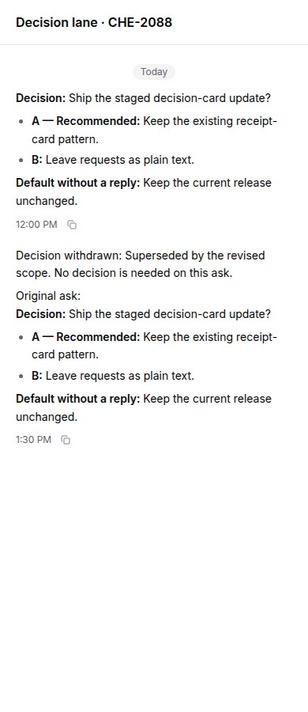 | 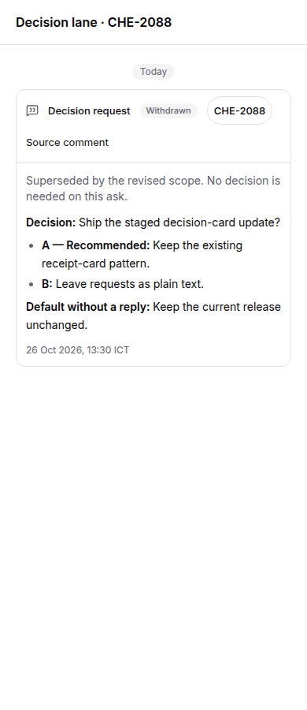 |
| Open / dark | 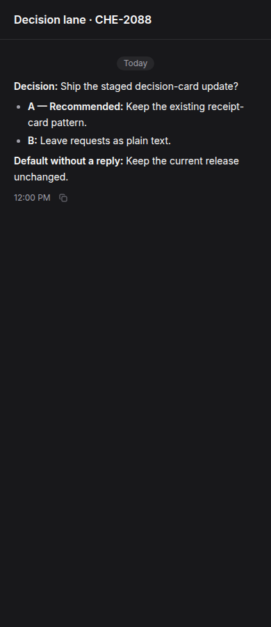 | 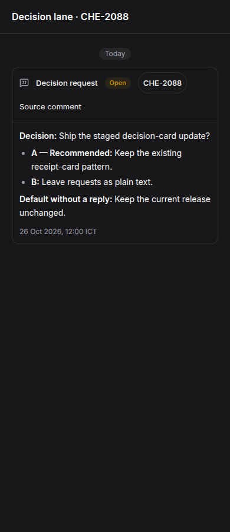 |
| Answered / dark |  | 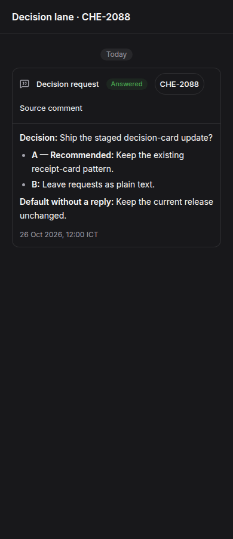 |
| Withdrawn / dark | 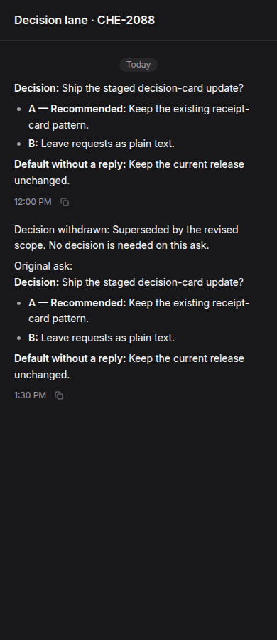 | 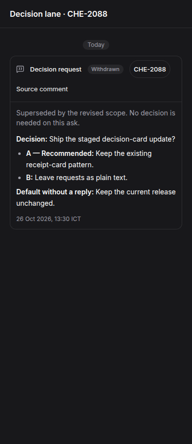 |
