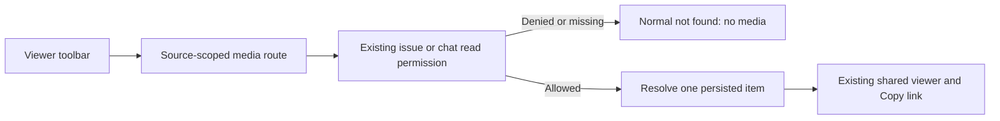

## Implementation Plan

Design admission: `design/viewer-media-pages/rev-1/A.html` @ `13613770066f99d1e8389e73fe877d11a20c4ee0` (merged PR #403). Direction A, media only, same toolbar. Phone More actions remain focusable buttons.

1. Observe the cached-route permission regression before changing implementation.
2. Resolve persisted media from permission-checked issue or chat APIs. Reuse existing viewers.
3. Wire browser tabs and allowlisted Electron windows.
4. Verify denial, reload, copy link, and web/desktop captures for all four kinds.
5. Publish a scoped draft PR for the leader's independent cross-lab review.

Memory check: reflect: no relevant memory.

The route uses a source identity and a SHA-256 identity of the media content or attachment ID. It does not put source content, raw attachment IDs or signed download URLs in a shareable URL. Editing or removing the original media invalidates its old content identity instead of silently displaying a different item. Identical items in one source share one URL.
