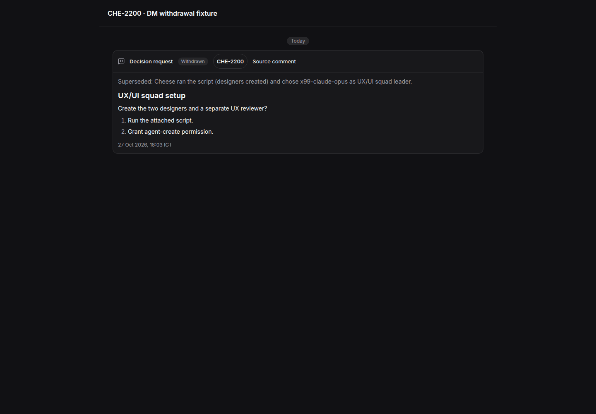
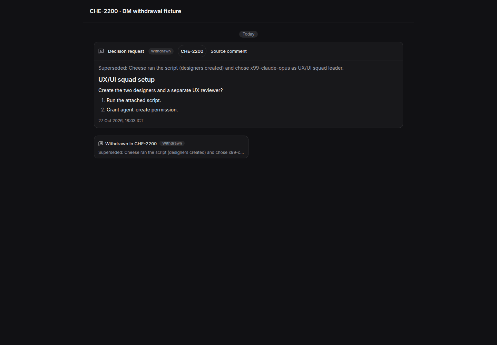
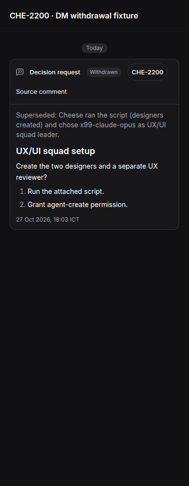
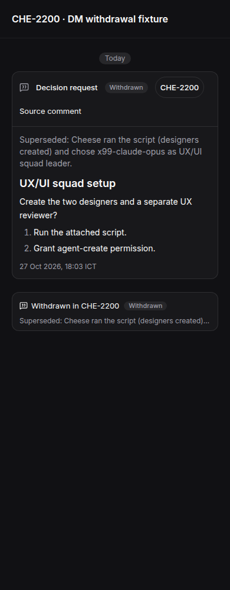

## Scope and cause

CHE-2234 restores the two-message shape of a withdrawn decision in the shared
web/desktop DM. It reuses the approved receipt layout from
`design/dm-decision-quote-cards/rev-8/B.html`, merged in design PR 316 at
`9ac3541dba50d3e1f06687779694b08095c21b79`.

The one-card cause is the client filter in `chat-message-list.tsx`, introduced
in CHE-2088 commit `29d27c42dd`. It collects request IDs from cancellation
notices into `updatedRequests`, then removes the original request row when
the same ID appears there. The server can supply both messages correctly and
the client still shows one. The regression test reproduces that condition.
The fix removes only that request-row suppression. Existing decision-reference
deduplication stays unchanged.

The original request keeps its ask, source links, withdrawal state and reason.
The notice now renders one compact receipt per request, with a source-comment
link (or issue fallback), a grey Withdrawn chip and a muted, single-line reason.
The complete reason remains in the DOM and the title attribute. The notice
does not repeat the ask. Legacy notices without card metadata retain their text.

Both `apps/web` and `apps/desktop` consume the shared `@multica/views/chat`
implementation. No mobile changes, live data writes, C00 deployment or merge
are part of this change.

## Observed test-first evidence

Parent: `6ae67d3257d5517862222df9c9c7b23a97cadab1`.

The first regression was written and run before changing production code.

```sh
pnpm --filter @multica/views exec vitest run chat/components/chat-message-list.decision.test.tsx -t 'keeps the original request row' --maxWorkers 1
```

Observed red, exit 1:

```text
AssertionError: expected <div data-row-key="notice">…(1)</div> to have a length of 2 but got 1
- Expected
+ Received
- 2
+ 1
Tests  1 failed | 14 skipped (15)
```

After removing the filter, the same command exited 0:

```text
Test Files  1 passed (1)
Tests  1 passed | 14 skipped (15)
```

Before implementing the compact receipt, the expanded component suite was
run against the root-only fix:

```sh
pnpm --filter @multica/views exec vitest run chat/components/chat-message-list.decision.test.tsx --maxWorkers 1
```

Observed red, exit 1: `Tests  4 failed | 13 passed (17)`.
The compact announcement region and `decision-withdrawal-card` were absent.
The root-row regression already passed in that run.

After implementing the compact receipt, the same command exited 0:

```text
Test Files  1 passed (1)
Tests  17 passed (17)
```

Supplemental keyboard, localization and full-reason accessibility checks were
added after the compact implementation. Those are not claimed as red evidence.

The final combined decision-card and locale-parity run passes 240 tests in
five files. The three other message-list suites pass 99 tests. Shared views TypeScript,
focused ESLint and `git diff --check` pass. The first two-worker combined run
hit worker-startup timeouts; the suites were rerun with one worker. One
supplemental test initially queried a title with unnormalized trailing
whitespace; its query was corrected and both accessibility tests passed.
No production code changed for either test-runner issue.

Packaged web/Electron builds, the full monorepo test suite and live C00
inspection are NOT-RUN. The shared component tests and X99 browser fixture
are the verification boundary for this PR.

## UI review pack

- Preview: not available. The X99 capture server was stopped after capture.
- Design: `design/dm-decision-quote-cards/rev-8/B.html` at
  `9ac3541dba50d3e1f06687779694b08095c21b79`.
- Sheet: `docs/ux/CHE-2234.yml`.
- Visual diff: NOT-RUN (CHE-1485 Layer B pending).
- Capture: X99 Google Chrome, dark theme, en-GB, Asia/Bangkok, reduced motion.
- These are real `ChatMessageList` fixture renders, not a live C00 or packaged
  Electron capture. The fixture uses CHE-2200's request ID, ping ID, source ID,
  withdrawal reason and timestamps, with a shortened ask for readability.

| Page | Width | Before | After |
| --- | --- | --- | --- |
| dm-withdrawn-decision | 1440 |  |  |
| dm-withdrawn-decision | 390 |  |  |

Browser observations at both widths: before has one full request card and no
compact receipt; after has one full request card plus one compact receipt.
`scrollWidth` equals viewport width (1440 and 390). No page errors occurred.
All four PNGs were inspected visually.

Keep / Change / Remove check:
- Keep: the request card, source issue, source comment and reason remain present.
- Change: the original message survives when its notice is loaded; the notice
  matches the approved compact receipt pattern and does not repeat the ask.
- Removed: none. Both stored messages remain available to older clients.

Loading, empty and disconnected chat states are unchanged. Legacy missing-card
fallbacks and existing answered-decision cards remain covered by component tests.
